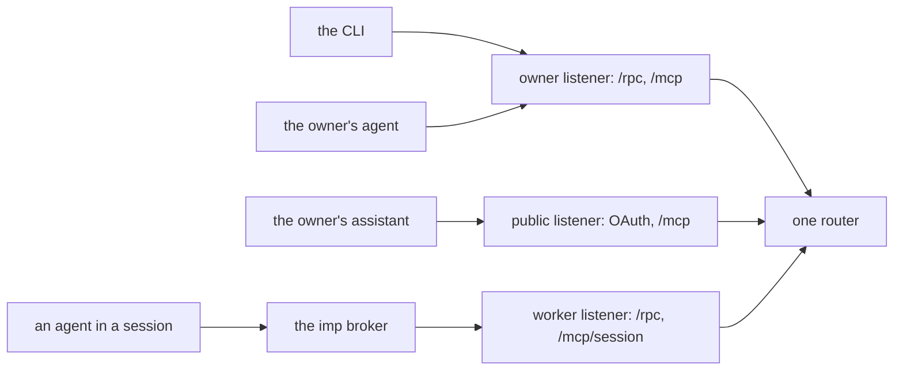

# API and auth

Everyone who talks to boxxy calls one set of procedures: the owner at a terminal, the owner's agent,
the owner's assistant from anywhere, and an agent working inside a session. A session is an agent
session that atc runs for one attempt ([Agent sessions](../work/sessions.md)). One contract holds
every procedure, and the server serves it on up to three listeners: the owner listener on the
owner's private network, the worker listener that sessions reach, and the public listener behind
OAuth.

The contract package holds an access table with the caller of each procedure, and one check on the
server enforces that table on every listener. A session reaches the server through the imp broker,
which adds the worker token to each request. That token may call only the procedures for sessions
and hooks. A call to one of those procedures also needs a proven caller, and the server refuses the
call when it cannot prove one.

[The overview](../overview.md#terms) defines the terms this doc uses.
[The CLI and the hooks](./cli-and-hooks.md) covers the command that calls these procedures.
[Attempt lifecycle](../work/attempts.md) covers the attempt row that records a session's caller.
[Owner notices](../work/notices.md) covers the notice session that two owner procedures set and
show.

## The doors

The contract lives in the package `@boxxy/contract`, and the server builds one oRPC router from it,
so every listener serves the same procedures. The configuration file sets the address of each
listener:

- The owner listener serves `/rpc` for the CLI, `/mcp` for the owner's agent, and `/healthz`. It
  takes no token, so the private network is its only gate.
- The worker listener serves `/rpc` and `/mcp/session`, and the broker sends every session's request
  to it. It answers 401 to a request without the worker token on every URL path, unknown ones
  included, so a caller with no token learns nothing of the routes.
- The public listener serves `/mcp`, the OAuth routes and the sign-in pages. The server opens it
  only when the configuration has a `publicDoor` section, and [the public door](#the-public-door)
  covers it.

Each listener refuses a request body over `maxRequestBytes`, on every URL path. The server counts
the bytes as it reads the body, because Bun's own limit lets through a streamed body that declares
no length.

The owner and worker listeners refuse a request that a browser page sent: one with an `Origin`
header, or with a `Sec-Fetch-Site` header other than `none`. Only programs call those listeners. The
owner listener takes no token, so without this check a page on any site could send it a write: a
browser sends a `text/plain` POST with no CORS preflight, and a site whose name resolves to the
listener's address passes for the same origin. A browser reaches only the public listener, for the
sign-in pages, and that listener makes its own checks.

The contract sets these rules for every procedure:

- A procedure is `<group>.<verb>`, and its MCP tool is `<group>_<verb>`. Each procedure sets its own
  tool name, so a renamed router key never renames a tool.
- A contract schema has no transform. An ID is a plain string on the wire, and the handler brands
  it.
- An answer that a caller acts on in its normal flow is a member of the output union. A call that
  names a thing that does not exist throws a typed error.
- The server accepts the previous version of the CLI, because the CLI is in the agent image and an
  image update can lag a server deploy. A release removes and renames nothing that the previous CLI
  sends or reads.

## The procedures

The access table in `@boxxy/contract` gives each procedure its caller (`owner`, `session` or
`hook`), the actor that the procedure's [fact](./facts-and-pepys.md) records, the MCP endpoint that
lists it as a tool, its CLI usage line, and the scope that the public listener requires. Each
procedure belongs to the narrowest caller whose job needs it.

- The owner's agent files and steers work for the owner, so `/mcp` lists every command on an item,
  every read, the runner's pause and resume, and the two procedures of the notice session. Only the
  owner's path files a held item, releases one or lists the held items, because a held item is the
  owner's draft ([derived item state](../work/pipeline.md#derived-item-state)).
- A session gets five procedures as tools, on their own endpoint `/mcp/session`, so a session's tool
  list holds no command on another item. With `attempt.current` it learns its attempt ID, the phase,
  the JSON Schema of the close-out that the phase takes, the outcome names, the skills to fetch and
  the item's notes. With `attempt.evidence` it records evidence, such as a test run or a commit.
  With `attempt.closeOut` it sends its close-out, and the work it found goes in the close-out, where
  settle drops a duplicate. With `attempt.listItems` and `attempt.getItem` it reads the other items
  of its repo, so its triage can find a duplicate or an overlap;
  [the session's reads](#the-sessions-reads-of-other-items) sets what it sees.
- A hook program sends two procedures with a hook payload: one binds the session to its attempt, and
  one links a pull request. Neither is an MCP tool.
- Some owner procedures have no tool, so only a person at the CLI calls them. `outbox.retry` acts on
  the whole [outbox](./facts-and-pepys.md#the-outbox) and writes no fact that shows who called it.
  `rules.dryRun` takes a whole rules file as its input. The six `auth` procedures manage who may
  reach the public listener, so they stay on the private owner listener.

One root middleware runs the access check for every call, on `/rpc` and both MCP endpoints, before
any handler runs, and no handler repeats it. The same middleware logs each call that fails with an
internal error (status 500): the procedure, the `item` and `attempt` IDs of the input, and the
error's chain of causes. It logs no other part of the input, so it never logs a close-out body or a
token. A typed error logs nothing.

## The paths

A path is the way a caller's request reaches the server, and it decides what the caller may call.
The owner's path runs through two listeners:

| Path             | Listener                                   | Caller                                          | What the server checks                        |
| ---------------- | ------------------------------------------ | ----------------------------------------------- | --------------------------------------------- |
| the owner's path | the owner listener                         | the owner, through the CLI or the owner's agent | nothing: the request arrives with no token    |
| the owner's path | the public listener                        | the owner's assistant                           | an OAuth access token that the owner approved |
| the worker path  | the worker listener, or the owner listener | a session, or one of its hooks                  | the worker token, then the proven caller      |

A request that carries the worker token is on the worker path on either the worker listener or the
owner listener. The token therefore never gains the owner's power by reaching the owner listener,
and a wrong token gets 401 on both.

A session runs in an imp, a cloud machine that reaches only the public internet. The session calls a
host name that the broker owns. The broker takes each request to that name, adds the worker token
and an identity token, and sends it to the worker listener. The session never holds the worker
token. It reads the host name as `BOXXY_URL`, which an auth profile in atc sets.

## The public door

[Decision 0018](../../decisions/0018-public-owner-mcp.md) records why the owner's MCP endpoint has a
public listener. That listener runs the OAuth server of
[`@zgeoff/mcp-auth`](https://www.npmjs.com/package/@zgeoff/mcp-auth), through
[`@boxxy/auth-oauth`](../../../adapters/auth-oauth/README.md), and serves the owner's tools at
`/mcp`. It never serves `/rpc` or `/healthz`, and the six `auth` procedures have no tool, so no
OAuth token reaches them.

The configuration's `publicDoor` section sets the listener, which listens on loopback by default.
The listener speaks plain HTTP, so when it listens beyond loopback, something in front of it
terminates TLS, and the server refuses to start unless its public URL is `https`. The `publicURL` is
the OAuth issuer, and `<publicURL>/mcp` is the one resource that every token is bound to.

- The owner adds each client with `boxxy auth clients add`. A client signs in with PKCE S256 and has
  no client secret, and the listener has no dynamic client registration.
- An agent with no person present signs in as a service client. It sends `service:<name>` and its
  secret to `/oauth2/token` with the `client_credentials` grant, and gets an access token with no
  refresh token.
- The `serviceTokensFile` lists each service client with its scopes and the sha256 digests of its
  secrets. The server refuses a file that holds a client's token itself (a static token), because
  anyone who read the file could send that token, so the file never holds a usable credential.
- The server reads the `serviceTokensFile` at start, and refuses to start when the file is missing
  or not valid. On SIGHUP it reads the file again: a valid file replaces the clients, a file that is
  not valid keeps the old ones. A file with no clients is valid, so the owner can revoke the last
  client without a restart.
- Each authorization needs a fresh passkey sign-in, then a consent page that lists the scopes the
  client asked for, with only `read` ticked at the start. The owner enrolls a passkey with
  `boxxy auth enroll`, which prints a one-time link that expires soon.
- `@zgeoff/mcp-auth` sets the token lifetimes. An access token is opaque and short-lived, and the
  auth database keeps only its hash. Refresh tokens rotate, and a reused one ends its grant. The
  server draws a new signing secret at each start, so a restart ends the sign-ins in progress. A
  revoke deletes a grant with every token in it.
- `read` is the scope of a tool that changes nothing, such as `item_get`. `write` is the scope of
  every tool that changes state, the runner's pause and resume among them. The access table holds
  each tool's scope, and the listener registers only a tool that has one. A token without the scope
  that a tool needs gets 403 with `insufficient_scope`, and a request with no valid token gets 401.
- The listener answers 403 to a request whose `Host` is neither the public host nor the local
  address, and to a form post or an MCP request from another `Origin`.
- The listener writes each sign-in outcome and each refused token to stderr as a JSON line. A line
  records the address in a `CF-Connecting-IP` header, which Cloudflare sets, and marks it `trusted`
  only when the socket peer is one that `trustForwardedFrom` lists, because any client can send that
  header.
- The OAuth state lives in an auth database file, by default beside the boxxy store, and only the
  user that the server runs as can read that file. `boxxy auth clients` and `boxxy auth grants`
  manage it through the owner listener. On a timer, the listener deletes expired tokens and sign-ins
  that never finished.

## The scope of the worker token

A request with the worker token may call only the procedures whose caller is `session` or `hook`.
Every owner procedure answers `FORBIDDEN`. The root middleware applies this rule on every listener,
so a session cannot close an item, retry one or pause the runner, although the broker forwards a
request to any URL path. A session reads other items through its own two procedures,
`attempt.listItems` and `attempt.getItem`, so the rule has no exception for reads.

atc can also run a session on the machine where atc itself runs, outside an imp. That session has no
broker in front of it, so it reaches the server on the owner's path and can call every owner
procedure. boxxy accepts this, because its workers run in imps, where the broker is the only way in.
Such a session can call no session or hook procedure, because it has no proven caller.

## The session's reads of other items

A session sees the items of one repo: the repo of the item that its current attempt works on. The
server finds that attempt from the proven caller, as `attempt.current` does, and never takes the
repo from the request. A duplicate or an overlap of an item is work in the same repo, so one repo is
enough for triage. An item of another repo stays out of sight, because the session's work, such as a
public pull request, could carry that item's text into its own repo.

- A session never sees a held item, because a held item is the owner's draft, so `attempt.listItems`
  refuses a `held` state filter. `attempt.getItem` answers `NOT_FOUND` for an item of another repo,
  a held item and a missing item alike, so the answer never shows that an item exists.
- A listed item has the fields of an `item.list` row. `attempt.getItem` returns the item with its
  body, its notes, its relations and its pull requests.
- Both procedures leave out the item's [kept session](../work/sessions.md#the-kept-session), and
  `attempt.getItem` leaves out the attempts, the evidence and the revisions, because a kept session
  and an attempt row hold another session's caller and atc session. `attempt.getItem` also leaves
  out each relation whose other item the session cannot see, so a relation never shows a held item
  or an item of another repo.
- Both procedures write nothing, and a session still has no edit, note, retry, hold or release.

## The proven caller

Every session and hook procedure needs a proven caller, the hook that binds a session included. The
worker token proves only that a call came through the broker. The identity token that the broker
adds proves which session sent the call.

1. The root middleware asks the `CallerProof` port ([Layout](../repo/layout.md)) to prove the
   request. The port answers with a caller identity, which is an issuer and a subject, or with
   nothing. With nothing, the server answers 401.
2. The server finds the session in the [boxxy store](../overview.md#the-data): the atc session whose
   latest attempt row holds that caller. The runner records the caller on the attempt row from atc's
   answer. When the store holds no such session, the answer is `no-attempt`. When two sessions
   match, the answer is `FORBIDDEN`, and the server logs the caller.
3. The handler gives the core the attempt ID from the request, and the session and the caller from
   steps 1 and 2. The core accepts the call only when the named attempt is the latest one that the
   session carries and that attempt's own row holds the proven caller.

Every call runs all three steps, and when the server cannot make a check, it refuses the call. The
server never takes the session from the request, because a session that could name its own session
could name another one.

Besides a fake for tests, the port has two adapters:

- In a deployment, `@boxxy/caller-proof-imp` verifies the identity token. The broker signs that
  token, a short-lived one in the `imp-identity` header, and removes any `imp-identity` header that
  a guest sends, so a session cannot forge one. The adapter verifies the token with the verifier of
  `@impz/client/identity`, and gives the token's issuer, and the machine ID as the subject. That is
  the same ID that atc reports for the session's host, which the runner stores as the caller.
- When the configuration has no `trustedIssuers` section, the server uses an adapter that proves no
  request, so every session and hook call is refused.

The `trustedIssuers` section lists the folders of the trust documents, and the audience, which is
the host name that sessions call. The server reads each document in those folders and passes them to
the adapter, which reads no file. A missing folder, a symlink that points nowhere, a file that is
not JSON, or folders that hold no document at all stop the server at start, so a configured but
empty mount never starts a server that refuses every session in silence. A bad document, or two
documents for one issuer, makes the adapter throw, so the server does not start either.

Only `@boxxy/caller-proof-imp` and the atc worker adapter name the imp or its token, apart from the
one place in the server that builds the adapter. Every other package sees an issuer and a subject.
The imp adapter does not call the library's session check, `checkSessionImp`, which compares the
caller with the host of a session. Steps 2 and 3 already make that comparison against the store, and
a second definition of "the same machine" could drift from the store's.

The proof needs a broker that signs each call to the boxxy host, and atc reporting each session's
host. Without either, the server refuses every session and hook call.
