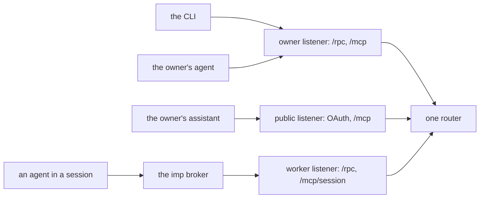

# API and auth

[The overview](../overview.md#terms) defines the terms this doc uses, such as attempt, close-out,
settle, atc, the imp broker and the proven caller.

Everyone who talks to boxxy calls one set of procedures: the owner at a terminal, the owner's agent,
the owner's assistant from anywhere, and an agent working inside a session. A session is one run of
an agent that atc starts for one attempt of an item ([Agent sessions](../work/sessions.md)). One
contract holds every procedure, and the server serves it on up to three listeners: the owner
listener on the owner's private network, the worker listener that sessions reach, and the public
listener behind OAuth.

The contract package holds an access table that gives the caller of each procedure, and one check on
the server enforces that table on every listener. A session reaches the server only through the imp
broker. The broker adds the worker token, a secret that only the broker and the server hold, to each
request. A request with the worker token may call only the procedures for sessions and their hooks,
and each of those calls also needs a proven caller. The server refuses the call when it cannot prove
one.

[The CLI and the hooks](./cli-and-hooks.md) covers the `boxxy` command that calls these procedures,
and the two hook programs that run in each session. [Attempt lifecycle](../work/attempts.md) covers
the attempt row that records a session's caller. [Owner notices](../work/notices.md) covers the
notice session, the atc session that receives the owner's notices, which the owner sets with
`notices.register` and reads with `notices.show`.

## The doors

The contract lives in the package `@boxxy/contract`, and the server builds one oRPC router from it,
so every listener serves the same procedures. The configuration file sets the address of each
listener:

- The owner listener serves `/rpc` for the CLI, `/mcp` for the owner's agent, and `/healthz`. It
  runs a request with no token as the owner, so the private network is its only gate.
- The worker listener serves `/rpc` and `/mcp/session`, and the broker sends every session's request
  to it. It answers 401 to a request without the worker token on every URL path, unknown ones
  included, so a caller with no token learns nothing of the routes.
- The public listener serves `/mcp`, the OAuth routes and the sign-in pages. The server opens it
  only when the configuration has a `publicDoor` section, and
  [the public listener's section](#the-public-door) covers it.

Only programs call the owner and worker listeners, so both refuse a request that a browser page
sent: one with an `Origin` header, or a `Sec-Fetch-Site` header other than `none`. Without this
check, any page the owner opens could write to the owner listener, which needs no token. A browser
sends a `text/plain` POST with no CORS preflight, and DNS rebinding lets a page pass for the
listener's own origin. A browser reaches only the public listener, which makes its own checks.

The contract sets these rules for every procedure:

- A procedure is `<group>.<verb>`, and its MCP tool is `<group>_<verb>`. Each procedure sets its own
  tool name, so a renamed router key never renames a tool.
- An answer that a caller acts on in its normal flow is a member of the procedure's output union,
  the set of result shapes that the procedure's output schema lists, each with its own `kind`. A
  call that names a thing that does not exist throws a typed error.
- The server accepts the previous version of the CLI, because the CLI is in the agent image and an
  image update can lag a server deploy. A release removes and renames nothing that the previous CLI
  sends or reads.

## The procedures

The access table in `@boxxy/contract` gives each procedure its caller (`owner`, `session` or
`hook`), the actor that the procedure's [fact](./facts-and-pepys.md) records, the MCP endpoint that
lists it as a tool, its CLI usage line, and the scope that the public listener requires. Each
procedure belongs to the narrowest caller whose job needs it. Each procedure has one MCP tool at
most, and one `boxxy` command.

- The owner's agent files and steers work for the owner, so `/mcp` lists every procedure that
  changes an item, every read, the runner's pause and resume, and `notices.register` and
  `notices.show`. Only the owner's path files a held item, releases one or lists the held items,
  because a held item is the owner's draft
  ([derived item state](../work/pipeline.md#derived-item-state)).
- A session gets five procedures as tools, on their own endpoint `/mcp/session`, so a session's tool
  list holds nothing that changes another item:
  - `attempt.current` gives the session its attempt ID, the phase, the JSON Schema of the close-out
    that the phase takes, the outcome names, the skills to fetch and the item's notes.
  - `attempt.evidence` records evidence, such as a test run or a commit.
  - `attempt.closeOut` sends the close-out. New work that the session found, such as a bug outside
    its item, goes in the close-out, and settle drops one that duplicates an existing item.
  - `attempt.listItems` and `attempt.getItem` read the other items of the session's repo, so its
    triage can find a duplicate or an overlap.
    [The session's reads](#the-sessions-reads-of-other-items) sets what it sees.
- Each session runs two hook programs, `boxxy hook` commands that the agent's harness runs at set
  points ([The CLI and the hooks](./cli-and-hooks.md)). The session-start hook calls
  `attempt.bindSession`, which binds the session to its attempt. The pull request hook calls
  `attempt.recordPullRequest`, which links a pull request to the item. Neither is an MCP tool.
- Some owner procedures have no tool, so only a person at the CLI calls them:
  - `outbox.retry` acts on the whole [outbox](./facts-and-pepys.md#the-outbox) and writes no fact
    that would show who called it, so it stays off the tools, where an agent could call it unseen.
  - `rules.dryRun` takes a whole rules file as its input.
  - The six `auth` procedures manage who may reach the public listener, so they stay on the private
    owner listener.

One root middleware runs the access check for every call, on `/rpc` and both MCP endpoints, before
any handler runs. Handlers never repeat it. The same middleware logs each internal error with the
procedure and the `item` and `attempt` IDs of its input, and leaves out the rest of the input, so a
close-out body or a token never reaches the log.

## The paths

The server picks a request's path from the listener that took it and the bearer token it carries.
The path then sets which procedures the caller may call.

| Path             | Listener                                   | Caller                                          | What the server checks                        |
| ---------------- | ------------------------------------------ | ----------------------------------------------- | --------------------------------------------- |
| the owner's path | the owner listener                         | the owner, through the CLI or the owner's agent | nothing: the request carries no token         |
| the owner's path | the public listener                        | the owner's assistant                           | an OAuth access token that the owner approved |
| the worker path  | the worker listener, or the owner listener | a session, or one of its hooks                  | the worker token, then the proven caller      |

On either listener, a request that carries a token is on the worker path, and a wrong token
gets 401. The broker sends a session's requests to the worker listener only, but a holder of the
worker token who sends it to the owner listener still gets only the worker path's power.

A session runs in an imp, a cloud machine that reaches only the public internet. The session calls a
made-up host name that the broker answers on, and reads that name from `BOXXY_URL`
([setup](./cli-and-hooks.md#setup)). The broker adds the worker token and an identity token to each
request to that name, and sends it to the worker listener. The worker token proves that the request
came through the broker, and the identity token proves which machine sent it
([the proven caller](#the-proven-caller)). The session never holds the worker token.

## The public door

[Decision 0018](../../decisions/0018-public-owner-mcp.md) records why the owner's MCP endpoint has a
public listener. That listener runs the OAuth server of
[`@zgeoff/mcp-auth`](https://www.npmjs.com/package/@zgeoff/mcp-auth), through
[`@boxxy/auth-oauth`](../../../adapters/auth-oauth/README.md), and serves the owner's tools at
`/mcp`. It never serves `/rpc` or `/healthz`. The six `auth` procedures have no tool, so an OAuth
token never reaches them.

The configuration's `publicDoor` section sets the listener, which listens on loopback by default.
The listener speaks plain HTTP. When it listens on an address beyond loopback, the owner puts a
proxy that terminates TLS in front of it, such as Cloudflare, and the server refuses to start unless
the `publicURL` is `https`. The `publicURL` is the OAuth issuer, and `<publicURL>/mcp` is the one
resource that every token is bound to.

- The owner adds each client with `boxxy auth clients add`. A client signs in with PKCE S256 and has
  no client secret, and the listener has no dynamic client registration.
- An agent with no person present signs in as a service client. It sends `service:<name>` and its
  secret to `/oauth2/token` with the `client_credentials` grant, and gets an access token with no
  refresh token.
- The `serviceTokensFile` lists each service client with its scopes and the sha256 digests of its
  secrets, so anyone who reads the file gets no usable credential. The server reads it again on
  SIGHUP, and keeps the old clients when the new file is not valid, so the owner can add or revoke a
  client without a restart.
- Each authorization needs a fresh passkey sign-in, then a consent page that lists the scopes the
  client asked for, with only `read` ticked at the start. The owner enrolls a passkey with
  `boxxy auth enroll`, which prints a one-time link with an expiry.
- `@zgeoff/mcp-auth` sets the token lifetimes. An access token is opaque, and the auth database
  keeps only its hash. Refresh tokens rotate, and a reused one ends its grant. The server draws a
  new signing secret at each start, so a restart ends the sign-ins in progress.
- `read` is the scope of a tool that changes nothing, such as `item_get`. `write` is the scope of
  every tool that changes state, the runner's pause and resume among them. The access table holds
  each tool's scope, and the listener registers only a tool that has one.
- The listener logs each sign-in outcome and each refused token. It marks the client address from
  Cloudflare's `CF-Connecting-IP` header as trusted only when the socket peer is in
  `trustForwardedFrom`, because any client can send that header.
- The OAuth state lives in an auth database file that only the server's user can read.
  `boxxy auth clients` and `boxxy auth grants` manage it through the owner listener.

## The scope of the worker token

The root middleware refuses every owner procedure with `FORBIDDEN` on the worker path, on every
listener. A session therefore cannot close an item, retry one or pause the runner, although the
broker forwards a request to any URL path. A session reads other items through its own two
procedures, `attempt.listItems` and `attempt.getItem`, so the rule needs no exception for reads.

atc can also run a session on the machine where atc itself runs, outside an imp. That session has no
broker in front of it, so it reaches the server on the owner's path. It can call every owner
procedure, and no session or hook procedure, because it has no proven caller. boxxy accepts that
this session has the owner's power: atc's machine already sits on the owner's private network, where
the owner listener needs no token, and a deployment runs its worker sessions in imps, where the
broker is the only way to the server.

## The session's reads of other items

A session sees the items of one repo: the repo of the item that its current attempt works on. The
server finds that attempt from the proven caller, as `attempt.current` does, and never takes the
repo from the request. A duplicate or an overlap of an item is work in the same repo, so one repo is
enough for triage. An item of another repo stays out of sight, because the session's work, such as a
public pull request, could carry that item's text into its own repo.

- A session never sees a held item, because a held item is the owner's draft, so `attempt.listItems`
  refuses a `held` state filter. `attempt.getItem` answers `NOT_FOUND` for an item of another repo,
  a held item and a missing item alike, so the answer never shows that an item exists.
- Both procedures leave out the item's [kept session](../work/sessions.md#the-kept-session).
  `attempt.getItem` also leaves out the attempts, the evidence and the revisions. A kept session and
  an attempt row record the machine and the atc session of the session that worked on that item, and
  the reading session must never learn another session's identity. `attempt.getItem` also leaves out
  each relation whose other item the session cannot see, so a relation never shows a held item or an
  item of another repo.
- Neither procedure writes. A session has no procedure that edits, notes, retries or releases an
  item.

## The proven caller

Every session and hook procedure needs a proven caller, the hook that binds a session included. The
worker token proves only that a call came through the broker. The identity token that the broker
adds proves which session sent the call.

1. The root middleware asks the `CallerProof` port ([Layout](../repo/layout.md)) to prove the
   request. The port answers with a caller identity, which is an issuer and a subject, or with
   nothing. With nothing, the server answers 401.
2. The root middleware finds the session in the [boxxy store](../overview.md#the-data): the atc
   session whose latest attempt row holds that caller. The runner records the caller on the attempt
   row from atc's answer. When two sessions match, the middleware refuses the call with `FORBIDDEN`
   and logs the caller. When no session matches, the procedure answers with its `refused` result and
   the reason `no-attempt`, a member of its output union.
3. The handler gives the core the attempt ID from the request, and the session and the caller from
   steps 1 and 2. The core accepts the call only when the named attempt is the session's latest
   attempt and that attempt's own row holds the proven caller.

Every call runs all three steps, and when the server cannot make a check, it refuses the call. The
server never takes the session from the request, because a session that could name its own session
could name another one.

Besides a fake for tests, the port has two adapters:

- In a deployment, `@boxxy/caller-proof-imp` verifies the identity token. The broker signs that
  token with an expiry, puts it in the `imp-identity` header, and removes any such header that a
  session sends, so a session cannot forge one. The adapter gives the token's issuer, and the
  machine ID as the subject. That is the same ID that atc reports for the session's host, which the
  runner stores as the caller.
- When the configuration has no `trustedIssuers` section, the server uses an adapter that proves no
  request, so every session and hook call is refused.

The adapter accepts a token only from an issuer that a trust document names: a JSON file with one
imp issuer and the public keys that verify its identity tokens. The `trustedIssuers` section lists
the folders that hold the trust documents, and the audience, which is the host name that sessions
call. The server reads each document in those folders and passes them to the adapter, which reads no
file. The server refuses to start when it cannot read a valid document, or when the folders hold
none, so a configured but empty mount never starts a server that refuses every session in silence.

Only `@boxxy/caller-proof-imp` and the atc worker adapter name the imp or its token, apart from the
one place in the server that builds the adapter. Every other package sees an issuer and a subject.
The imp adapter does not call the library's session check, `checkSessionImp`, which compares the
caller with the host of a session. Steps 2 and 3 already make that comparison against the store, and
a second definition of "the same machine" could drift from the store's.

The proof needs a broker that signs each call to the boxxy host, and atc reporting each session's
host. Without either, the server refuses every session and hook call.
