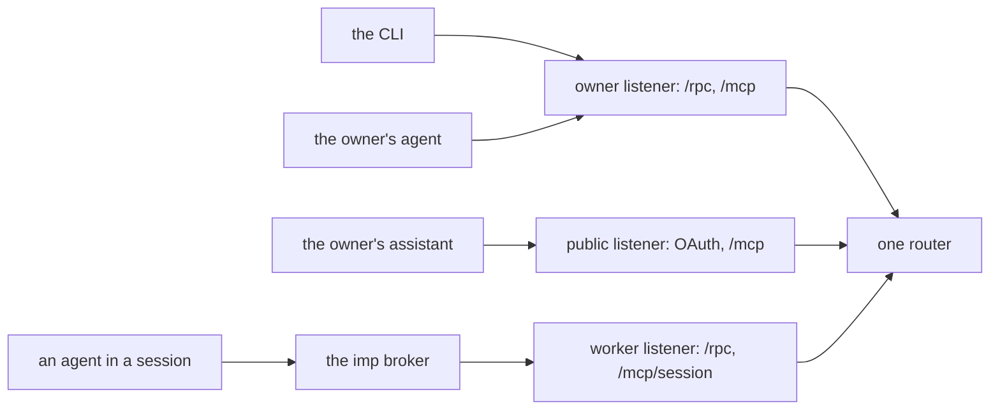

# API and auth

Everyone who talks to boxxy calls the same set of procedures: the owner at a terminal, the owner's
agent, the owner's assistant from anywhere, and an agent working inside a session. The server serves
one contract on up to three listeners, and decides what a caller may do from the listener that took
the request and the token it carries. A session can call only the few procedures its own work needs.
The imp broker proves which machine sent each of its calls, and the server checks that machine
against the attempt it started there, so a session can never act for another one. Read this doc
before you add a procedure, change who may call one, or change a listener.

[The CLI and the hooks](./cli-and-hooks.md) covers the `boxxy` command that calls these procedures.
[Attempts](../work/attempts.md) covers the attempt row that records a session's caller.
[Notices](../work/notices.md) covers the notice procedures. The [overview](../overview.md#terms)
defines the shared terms.

## The listeners

The contract lives in `@boxxy/contract`, and the server builds one oRPC router from it, so every
listener serves the same procedures. The server config sets each listener's address.

- **The owner listener** serves `/rpc` for the CLI, `/mcp` for the owner's agent, and `/healthz`. It
  runs a request with no token as the owner, so the owner's private network is its only gate.
- **The worker listener** serves `/rpc` and `/mcp/session`, and the broker sends every session's
  requests here. It answers 401 on every path, unknown ones included, to a request without the
  worker token, so a caller with no token learns nothing of the routes.
- **The public listener** serves `/mcp`, the OAuth routes and the sign-in pages, for the owner's
  assistant off the private network. The server opens it only when its config has a `publicDoor`
  section ([the public door](#the-public-door)).

Only programs call the owner and worker listeners, so both refuse a request a browser page sent: one
with an `Origin` header, or a `Sec-Fetch-Site` other than `none`. Without that check, any page the
owner opened could write to the owner listener, which needs no token: a browser sends a `text/plain`
POST with no CORS preflight, and DNS rebinding lets a page pass for the listener's own origin.

## The procedures

Each procedure is `<group>.<verb>`, and its MCP tool is `<group>_<verb>`. Each procedure sets its
own tool name, so renaming a router key never renames a tool. An answer the caller acts on in its
normal flow is one member of the procedure's output union, and each member has its own `kind`; a
call that names something that doesn't exist throws a typed error. The server accepts the previous
CLI version, because the CLI ships in the agent image, which can lag a server deploy, so a release
never removes or renames anything the previous CLI sends or reads.

The contract's access table gives each procedure its caller (`owner`, `session` or `hook`), the
actor its [fact](./facts-and-pepys.md) records, the MCP endpoint that lists it, its CLI usage line,
and the scope the public listener requires. Each procedure belongs to the narrowest caller whose job
needs it:

- **The owner's agent** files and steers work, so the owner's `/mcp` lists every procedure that
  changes an item, every read, the runner's pause and resume, and the notice procedures. Only the
  owner can file, release or list held items, because a held item is the owner's draft.
- **A session** gets five tools on its own endpoint, `/mcp/session`, so its tool list holds nothing
  that changes another item. `attempt.current` gives the session its attempt ID, phase, close-out
  schema, outcome names, skills and the item's notes. `attempt.evidence` records evidence such as a
  test run or a commit. `attempt.closeOut` sends the close-out, including any new work the session
  found, which settle drops when it duplicates an existing item. `attempt.listItems` and
  `attempt.getItem` read other items of the session's repo
  ([the session's reads](#a-sessions-view-of-other-items)).
- **The hooks** call `attempt.bindSession`, which binds a session to its attempt, and
  `attempt.recordPullRequest`, which links a pull request. Neither is an MCP tool.
- **Some owner procedures have no tool,** so only a person at the CLI calls them. `outbox.retry`
  acts on the whole outbox and writes no fact that would show who called it, so it stays where an
  agent can't call it unseen. `rules.dryRun` takes a whole rules file as input. The six `auth`
  procedures manage who may reach the public listener, so they stay on the private owner listener.

One root middleware runs the access check for every call, on `/rpc` and both MCP endpoints, before
any handler runs, and handlers never repeat it. It also logs each internal error with the procedure
and the `item` and `attempt` IDs of its input, and nothing else from the input, so a close-out body
or a token never reaches the log.

## The paths

The server picks a request's path from the listener that took it and the token it carries, and the
path sets which procedures the caller may call.

| Path             | Listener         | Caller                                          | The server checks                        |
| ---------------- | ---------------- | ----------------------------------------------- | ---------------------------------------- |
| the owner's path | owner            | the owner, through the CLI or the owner's agent | nothing: the request carries no token    |
| the owner's path | public           | the owner's assistant                           | an OAuth access token the owner approved |
| the worker path  | worker, or owner | a session, or one of its hooks                  | the worker token, then the proven caller |

On the owner and worker listeners, a request that carries a bearer token is on the worker path, and
a wrong token gets 401. The broker sends a session's requests only to the worker listener, but a
holder of the worker token who sends it to the owner listener still gets only the worker path's
power. On the worker path, the middleware refuses every owner procedure with `FORBIDDEN`, so a
session can't close an item, retry one or pause the runner, even though the broker forwards a
request to any URL path.

A session runs in an imp, a cloud machine that reaches only the public internet. It calls a made-up
host name that the broker answers on, which it reads from `BOXXY_URL`. The broker adds two tokens to
each request to that name and forwards it to the worker listener: the worker token, a secret only
the broker and the server hold, proves the request came through the broker, and an identity token
proves which machine sent it. The session never holds the worker token.

atc can also run a session on the machine where atc itself runs, outside an imp. That session has no
broker in front of it, so it reaches the server on the owner's path: it can call every owner
procedure, and no session or hook procedure, because it has no proven caller. boxxy accepts that
this session has the owner's power, because atc's machine already sits on the owner's private
network, and a deployment runs its worker sessions in imps, where the broker is the only way in.

## The public door

The public listener lets the owner's assistant reach the owner's tools from off the private network
([decision 0018](../../decisions/0018-public-owner-mcp.md)). It runs the OAuth server of
[`@zgeoff/mcp-auth`](https://www.npmjs.com/package/@zgeoff/mcp-auth) through
[`@boxxy/auth-oauth`](../../../adapters/auth-oauth/README.md), and serves the owner's tools at
`/mcp`, never `/rpc` or `/healthz`. The `auth` procedures have no tool, so an OAuth token never
reaches them.

The `publicDoor` config section sets the listener, which listens on loopback by default and speaks
plain HTTP. On any other address the owner puts a TLS-terminating proxy, such as Cloudflare, in
front, and the server refuses to start unless `publicURL` is `https`. `publicURL` is the OAuth
issuer, and `<publicURL>/mcp` is the one resource every token is bound to.

- **Clients are added by hand.** The owner adds each client with `boxxy auth clients add`. A client
  signs in with PKCE S256 and no client secret, and the listener has no dynamic client registration.
- **Every authorization needs the owner.** It takes a fresh passkey sign-in, then a consent page
  listing the scopes asked for, with only `read` ticked to start. The owner enrolls a passkey with
  `boxxy auth enroll`, which prints a one-time link with an expiry.
- **An agent with no person present signs in as a service client.** It sends `service:<name>` and
  its secret to `/oauth2/token` with the `client_credentials` grant, and gets an access token with
  no refresh token. The `serviceTokensFile` lists each service client with its scopes and the sha256
  digests of its secrets, so reading the file gives no usable credential. The server rereads it on
  SIGHUP and keeps the old clients when the new file is invalid, so the owner can add or revoke a
  client without a restart.
- **`read` and `write` are the two scopes.** `read` covers a tool that changes nothing, such as
  `item_get`, and `write` covers every tool that changes state, the runner's pause and resume
  included. The listener registers only a tool whose access-table row has a scope.
- **Tokens are opaque.** `@zgeoff/mcp-auth` sets their lifetimes, the auth database keeps only each
  token's hash, and a reused refresh token ends its grant. The server draws a new signing secret at
  each start, so a restart ends any sign-in in progress.
- **The auth database** is a file only the server's user can read. `boxxy auth clients` and
  `boxxy auth grants` manage it through the owner listener.
- **The listener logs each sign-in outcome and each refused token.** It trusts the client address in
  Cloudflare's `CF-Connecting-IP` header only when the socket peer is in `trustForwardedFrom`,
  because any client can send that header.

## A session's view of other items

A session sees the items of one repo: the repo of the item its current attempt works on. The server
finds that attempt from the proven caller, as `attempt.current` does, and never takes the repo from
the request. A duplicate or overlap is work in the same repo, so one repo is enough for triage.
Items of other repos stay hidden, because the session's work, such as a public pull request, could
carry their text into its own repo.

- **A held item stays hidden,** because it is the owner's draft, so `attempt.listItems` refuses a
  `held` filter. `attempt.getItem` answers `NOT_FOUND` alike for an item of another repo, a held
  item and a missing item, so the answer never shows that an item exists.
- **Another session's identity stays hidden.** Both procedures leave out the item's kept session,
  and `attempt.getItem` also leaves out its attempts, evidence and revisions, because those record
  the machine and atc session of whoever worked on the item. It also drops each relation whose other
  item the session can't see.
- **Both procedures only read.** A session has no procedure that edits, notes, retries or releases
  an item.

## The proven caller

Every session and hook procedure needs a proven caller, the hook that binds a session included. The
worker token proves only that a call came through the broker; the identity token proves which
machine sent it. The server makes three checks on every call, and refuses the call when it can't
make one:

1. The root middleware asks the caller proof to prove the request. The proof answers with an issuer
   and a subject, or with nothing, and nothing gets 401.
2. The middleware finds the atc session whose latest attempt row holds that caller; the runner
   recorded the caller there from atc's answer. Two matching sessions get `FORBIDDEN`, and the
   caller is logged. When no session matches, the procedure answers with its `refused` result and
   the reason `no-attempt`.
3. The handler passes the core the attempt ID from the request with the session and caller from
   steps 1 and 2. The core accepts the call only when that attempt is the session's latest and its
   own row holds the proven caller.

The server never takes the session from the request, because a session that could name its own
session could name another one.

In a deployment, `@boxxy/caller-proof-imp` verifies the identity token. The broker signs it with an
expiry, puts it in the `imp-identity` header, and strips any such header a session sends, so a
session can't forge one. The proof gives the token's issuer, and the machine ID as the subject, the
same ID atc reports for the session's host.

The proof accepts a token only from an issuer listed in a trust document: a JSON file with one imp
issuer and the public keys that verify its tokens. The `trustedIssuers` config section lists the
folders that hold the trust documents, and the audience, the host name sessions call. The server
refuses to start when it can't read a valid document or the folders hold none, so an empty mount
never starts a server that silently refuses every session. With no `trustedIssuers` section at all,
the server proves no request, and refuses every session and hook call.

Only the caller proof and the atc worker name the imp or its token, apart from the one place in the
server that builds the proof; every other package sees an issuer and a subject. The proof doesn't
call the imp library's own session check, because steps 2 and 3 already compare the caller against
the store, and a second definition of "the same machine" could drift from it. The whole scheme needs
a broker that signs each call to the boxxy host and atc that reports each session's host; without
either, every session and hook call is refused.
