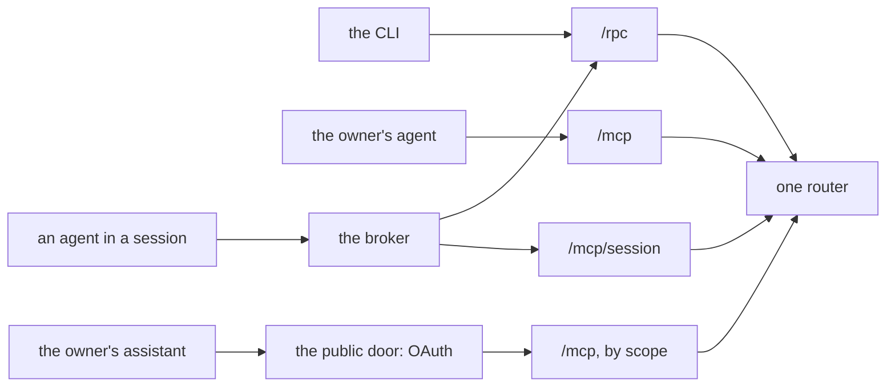

# API and auth

Everyone who talks to boxxy talks to one set of procedures: the owner at a terminal, the owner's
agent, the owner's assistant from anywhere, and an agent working inside a session. One contract
holds every procedure, and the server serves it through four doors: an RPC route for the CLI, an MCP
endpoint for the owner's agent on the owner's private network, a second MCP endpoint behind OAuth
for the owner's assistant on a public door, and a third MCP endpoint for an agent inside a session.

A table beside the contract says who may call each procedure, and one check on the server enforces
it for every door. A worker session reaches the server through a broker that adds a bearer token,
and that token may call only the session and hook procedures. Every session and hook call also needs
a proven caller, and the server refuses the call when it cannot prove one.

[The CLI and the hooks](./cli-and-hooks.md) covers the command that calls these procedures.
[Attempt lifecycle](../work/attempts.md) covers the attempt row that records a session's caller.
[Owner notices](../work/notices.md) covers the notice session that two owner procedures set and
show.

## The doors

The contract lives in the package `@boxxy/contract`, and the server builds one oRPC router from it.
The server opens up to three listeners, each on an address that the configuration file sets:

- The owner listener sits on the owner's private network. It serves `/rpc`, `/mcp` and `/healthz`.
  Its only gate is the network.
- The worker listener is the broker's target. It serves `/rpc` and `/mcp/session`, and answers 401
  on any path, unknown ones included, to a request without the worker token, so a caller with no
  token learns nothing of the routes.
- The public door serves `/mcp`, the OAuth routes and the sign-in pages, and nothing else. It is off
  when the configuration has no `publicDoor` section. [The public door](#the-public-door) covers it.

The owner and worker listeners refuse a body over `maxRequestBytes` (in `@boxxy/server`'s
`serve-api.ts`) with 413, on every path, `/healthz` included. The public door refuses a body over
the same limit. The server counts the bytes as it reads the body, because Bun's own limit lets a
streamed body with no length header through.

The owner and worker listeners refuse with 403 a request that a browser page sent: one with an
`Origin` header, or a `Sec-Fetch-Site` header other than `none`. No caller of those listeners is a
page. The owner listener takes no token, so without this check a page on any site could send it a
write: a browser sends a `text/plain` POST with no CORS preflight, and a site whose name resolves to
the listener's address passes for the same origin. The public door is the one door a browser
reaches, for the sign-in pages, and it holds its own checks.

Four rules of the contract shape every procedure:

- A procedure is `<group>.<verb>`, and its MCP tool is `<group>_<verb>`. The tool name is set on the
  procedure, so a renamed router key never renames a tool.
- A contract schema has no transform. An ID is a plain string on the wire, and the handler brands
  it.
- An answer that a caller acts on in its normal flow is a member of the output union. A call that
  names a thing that does not exist throws a typed error.
- The server accepts the previous version of the CLI, because the CLI is in the agent image and an
  image update can lag a server deploy. A release removes and renames nothing that the previous CLI
  sends or reads.

## The procedures

The access table in `@boxxy/contract` gives each procedure its caller, the actor its fact records,
the MCP endpoint that lists it, its CLI usage line and the scope the public door asks for. It
follows one rule: a procedure belongs to the narrowest caller whose job needs it.

- **The owner** is a call on the owner's path. The owner's agent files and steers work for the
  owner, so `/mcp` lists every command on an item, every read, the runner's pause and resume, and
  the two procedures of the notice session. Only the owner's path files a
  [held item](../../design/boxxy/planning.md#held-items), releases one or lists the held items,
  because a held item is the owner's draft.
- **A session** gets five tools, on their own endpoint `/mcp/session`, so a session's tool list
  holds no command on another item. A session reads what its attempt works on, records evidence,
  sends its close-out, and reads the other items of its repo, so triage can find a duplicate or an
  overlap. [The session's reads](#the-sessions-reads-of-other-items) sets what it sees. A session
  reports found work in its close-out, where settle dedupes it.
- **A hook** is the caller of the two procedures that a hook program sends with a hook payload:
  binding the agent session to its attempt, and linking a pull request. They are no tool.
- **Owner procedures with no tool** stay with a person at the CLI. The outbox retry acts on the
  whole outbox and writes no fact that shows who did it. The rules dry run takes a whole rules file.
  The six `auth` procedures manage who may reach the public door, so they stay on the private owner
  listener.

`attempt.current` tells the agent which of the four close-outs its attempt takes: the phase, the
JSON Schema of the body, and the outcome names. It also returns the skills to fetch and the item's
notes.

## The paths

| Path             | Who                                      | How the server knows                                                                               |
| ---------------- | ---------------------------------------- | -------------------------------------------------------------------------------------------------- |
| the owner's path | the owner, the CLI and the owner's agent | the request arrives on the owner listener, with no token                                           |
| the public door  | the owner's assistant, from anywhere     | the request carries an OAuth access token that the owner approved, and the door serves only `/mcp` |
| the worker path  | a session and its hooks                  | the request carries the worker bearer token, which the broker adds, on either listener             |

A worker session runs in an imp, which reaches the public internet only. The session calls a made-up
host, and the broker sends the request to the boxxy server and adds the bearer token. The session
never holds the token. It gets the address as `BOXXY_URL` from an atc auth profile.

## The public door

[Decision 0018](../../decisions/0018-public-owner-mcp.md) records why the owner's MCP endpoint has a
public door. The door runs the OAuth server of
[`@zgeoff/mcp-auth`](https://www.npmjs.com/package/@zgeoff/mcp-auth), through
[`@boxxy/auth-oauth`](../../../adapters/auth-oauth/README.md), and serves the owner's tools at
`/mcp`. It never serves `/rpc` or `/healthz`, and the six `auth` procedures are not tools, so no
token reaches them.

The configuration's `publicDoor` section sets the door, which listens on loopback by default. The
door speaks plain HTTP, so a door that listens beyond loopback sits behind something that terminates
TLS, and its public URL must be `https`. The `publicURL` is the OAuth issuer, and `<publicURL>/mcp`
is the one resource that every token is bound to.

- **Clients.** A client is a public client that the owner adds with `boxxy auth clients add`, with
  PKCE S256 and no client secret. The door has no dynamic client registration.
- **Service clients.** An agent with no person present signs in as a service client: it sends
  `service:<name>` and its secret to `/oauth2/token` with the `client_credentials` grant, and gets
  an access token with no refresh token. The `serviceTokensFile` names each client with its scopes
  and the sha256 digests of its secrets, and never holds a secret. The server reads the file at
  start, and refuses to start when the file is missing or not valid. On SIGHUP the server reads the
  file again: a valid file replaces the clients, a file that is not valid keeps the old ones, and
  the server logs which happened. boxxy refuses a client with a static token, so the file never
  holds a usable credential. It accepts a file with no clients, so the owner can revoke the last
  client without a restart.
- **Authorization.** Each authorization needs a fresh passkey sign-in, then a consent page that
  lists the scopes the client asked for. Only `read` starts ticked. The owner enrolls a passkey with
  `boxxy auth enroll`, which prints a one-time, short-lived link.
- **Tokens.** `@zgeoff/mcp-auth` sets the token lifetimes. An access token is opaque, short-lived
  and stored hashed. Refresh tokens rotate, and a reused one ends its grant. The signing secret is
  drawn at each start, so a restart ends the sign-ins in progress. Each grant is one row, and a
  revoke deletes it with every token of the grant.
- **Scopes.** `read` is for a tool that changes nothing, such as `item_get` or `runner_status`.
  `write` is for every tool that changes state, the runner pause and resume among them. The access
  table holds each tool's scope, and the door registers only a tool that has one. A token without
  the scope that a tool needs gets 403 with `insufficient_scope`. A request with no valid token
  gets 401.
- **Request checks.** The door answers 403 to a request whose `Host` is not the public host or the
  local address, and to a form post or an MCP request whose `Origin` is another one. It writes each
  sign-in outcome and each refused token to stderr as a JSON line. `trustForwardedFrom` lists the
  socket peers whose `CF-Connecting-IP` header those lines label `trusted`.
- **State.** The OAuth state lives in an auth database file beside the store, which only its owner
  can read. `boxxy auth clients` and `boxxy auth grants` manage it through the owner listener. On a
  timer the door sweeps out expired tokens and sign-ins that never finished.

## The scope of the worker token

A request with the worker bearer token may call only the procedures whose caller is `session` or
`hook`. Every owner procedure answers `FORBIDDEN`. A wrong token gets 401 on every procedure.

One root middleware does this from the access table, for the RPC route and both MCP endpoints, and
no handler repeats the check. A session therefore cannot close an item, retry one or pause the
runner, although the broker carries any path. A session reads other items through its own two
procedures, `attempt.listItems` and `attempt.getItem`, so the rule holds with no exception.

The same middleware logs each call that fails with an internal error (status 500): the procedure,
the `item` and `attempt` IDs of the input, and the error's chain of causes. It logs no other part of
the input, so it never logs a close-out body or a token. A typed error logs nothing.

A session on a local worker target, on the atc daemon's own host, reaches the server on the owner's
path and can call every owner procedure. boxxy accepts that, because its workers run on the cloud
target, where the only way in is the broker. Such a session can call no session or hook procedure,
because it has no proven caller.

## The session's reads of other items

A session sees the items of one repo: the repo of the item that its current attempt works on. The
server finds that attempt from the proven caller, as `attempt.current` does, and never takes the
repo from the request. A duplicate or an overlap of an item is work in the same repo, so one repo is
enough for triage. An item of another repo stays out of sight, because the session's work, such as a
public pull request, could carry that item's text into its own repo.

- **Held items.** A held item is the owner's draft, so a session never sees one: `attempt.listItems`
  leaves it out and takes no `held` state, and `attempt.getItem` answers `NOT_FOUND`.
- **Refusals.** `attempt.getItem` answers `NOT_FOUND` for an item of another repo, a held item and a
  missing item alike, so the answer never shows that an item exists. A caller whose session has no
  attempt gets `refused: no-attempt`, and a request with no proven caller gets 401.
- **What an answer holds.** A listed item has the fields of an `item.list` row. `attempt.getItem`
  returns the item with its body, its notes, its relations and its pull requests. Both leave out the
  item's kept session, and `attempt.getItem` leaves out the attempts, the evidence and the
  revisions, because a kept session and an attempt row hold another session's caller and atc
  session. `attempt.getItem` also leaves out each relation whose other item the session cannot see,
  so a relation never shows a held item or an item of another repo.
- **No writes.** Both procedures write nothing, and a session still has no edit, note, retry, hold
  or release.

## The proven caller

Every session and hook procedure needs a proven caller, the hook that binds a session included. The
bearer token proves only that a call came through the broker. The proof says who sent it.

1. The root middleware asks the `CallerProof` port to prove the request. The port answers with a
   caller identity, which is an issuer and a subject, or with nothing. With nothing, the server
   answers 401.
2. The server finds the session in its own store: the atc session whose latest attempt row holds
   that caller. The runner records the caller on the attempt row from the worker's answer. When the
   store holds no such session, the answer is `no-attempt`. When two sessions match, the answer is
   `FORBIDDEN`, and the server logs the caller.
3. The handler gives the core the attempt ID from the request, and the session and the caller from
   steps 1 and 2. The core accepts the call only when the named attempt is the latest one that the
   session carries and that attempt's own row holds the proven caller.

No branch skips a step, and a check that the server cannot make is a refusal. The server never takes
the session from the request: a session that could name a session could name another one. The core
compares two caller identities for equality and knows nothing more about them.

The port has three adapters:

| Adapter                   | Use                                                                                                                                  |
| ------------------------- | ------------------------------------------------------------------------------------------------------------------------------------ |
| the imp identity verifier | deployments. It reads the `imp-identity` header, a short-lived token that the broker signs, and gives the token's issuer and subject |
| a fake                    | tests set who the next request is from                                                                                               |
| the refuse-all proof      | the server uses it when its configuration has no `trustedIssuers` section, so every session and hook call is refused                 |

The package `@boxxy/caller-proof-imp` holds the verifier adapter. The broker removes any
`imp-identity` header that a guest sends and adds its own, so a session cannot forge one. The
adapter verifies the token with the verifier of `@impz/client/identity`, and gives the token's
issuer, and the machine ID as the subject: the same ID that atc reports for the session's host,
which the runner stores as the caller. The imp's name is never the subject.

The adapter reads no file. The `trustedIssuers` section names the folders of the trust documents and
the audience, which is the made-up host that sessions call. The server reads every regular file in
those folders, in name order, parses each as JSON, and passes the list with the audience. The server
follows a symlink and skips sub-folders and names that start with `..`, so a Kubernetes ConfigMap
volume loads each document once.

These refuse the start: a missing folder, a symlink that points nowhere, a file that is not JSON,
and folders that together hold no document, so a configured but empty mount never starts a server
that refuses every session in silence. A bad document, or two documents for one issuer, makes the
adapter throw, so the server does not start either. With an empty audience, the adapter proves no
request. Only this adapter and the atc worker adapter name the imp or its token, apart from the one
place in the server that builds the adapter; every other package sees an issuer and a subject.

The adapter does not call the library's session check, `checkSessionImp`, which compares the caller
with the host of a session. Steps 2 and 3 already make that comparison against the store, and a
second definition of "the same machine" could drift from the store's.

The proof needs a broker that signs each call to the boxxy host, and atc reporting each session's VM
host. Without either, the server refuses every session and hook call.

Tests call every owner procedure with the worker token, every session and hook procedure with a
missing or wrong proof, and with one session's proof and another session's attempt ID.
