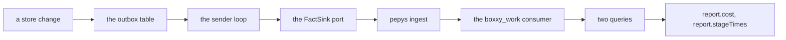

# Facts and pepys

Every change to boxxy's store also records what happened, as facts, and pepys, the event store,
keeps the long-term record of them. The store writes a change's facts to an outbox table in the same
transaction as the change. A sender loop sends the unsent rows to pepys in order, and a repeat
changes nothing there, because each row keeps one event ID. In pepys, boxxy's plug-in builds three
tables and three link types from the facts, and answers two queries: what an item cost to land, and
how long it spent in each step. boxxy reads those two queries for two reports and reads nothing else
from pepys, so every decision of boxxy is the same when pepys is down, behind or absent.

[The overview](../overview.md#terms) defines the terms this doc uses.
[Attempts](../work/attempts.md) covers the attempt lifecycle whose steps the facts record.
[Review and merge](../../design/boxxy/review-and-merge.md#facts-and-pepys) covers the review and
merge facts and how the stage-time query reads them.
[Decision 0013](../../decisions/0013-one-write-path-per-fact.md) records why each fact has one write
path.

## The path of a fact

## The outbox

- **One write path.** The store's apply function is the only code that inserts an outbox row. It
  writes every row and every fact of a change in one transaction, or none. A state in the store
  therefore has its fact in the outbox.
- **The row's sequence number is the store version**, and its fact ID is a UUID version 7 that the
  caller made. Every send of the row carries that ID as the event ID, so pepys drops a resend as a
  copy.
- **The store never refuses a change for its size.** Checks in front of the store keep each fact
  under `outboxLimits.factBytes`. The API bounds every string and list it reads, and the close-out
  parser rejects a close-out over `closeOutLimits.closeOutBytes`. The
  [owner listener](../overview.md#processes-and-how-they-reach-each-other) refuses to file or edit
  an item whose fact would pass the limit, with `FACT_TOO_LARGE`, because the sender would park that
  fact and it would never reach pepys. The sender parks any other row over the limit.

- **The outbox never drops or caps a row.** Sent rows stay, because the sequence number is the store
  version and close-outs cite fact IDs.

## The sender

The sender runs as its own loop in the server, apart from the runner's tick, because a send can wait
up to `outboxLimits.requestTimeoutMs` and a tick must not. The sender's rules live in the outbox
code of `@boxxy/dispatch`, and the loop around them in the server.

A batch is the longest run of unsent rows, in order, that holds `outboxLimits.batchFacts` facts or
fewer and fits `outboxLimits.batchBytes`. That budget keeps one batch inside one append to the pepys
log. The sender keeps one batch in flight at a time, so pepys receives the facts in store order.

| Answer from pepys                                                                                     | What the sender does                                                                                                                                                              |
| ----------------------------------------------------------------------------------------------------- | --------------------------------------------------------------------------------------------------------------------------------------------------------------------------------- |
| stored                                                                                                | marks the batch sent and sends the next one at once                                                                                                                               |
| 502, 503 or 504, a timeout, no connection                                                             | keeps the batch, waits with a backoff that starts at `outboxLimits.backoff.firstMs` and doubles up to `outboxLimits.backoff.maxMs`, and sends the same rows again; never gives up |
| the batch is refused with 400, 413 or 422, and it holds more than one row                             | splits the batch in halves and sends each, to find the bad row                                                                                                                    |
| the batch is refused with 400, 413 or 422, and it holds one row                                       | parks the row with the reason, and goes on                                                                                                                                        |
| any other refusal, such as a wrong secret, a missing route, or a 500 from a fault inside pepys ingest | parks nothing, reports `blocked`, and tries again every `outboxLimits.blockedRetryMs`                                                                                             |

A 400, 413 or 422 means a bad row, which a split can find. A 500 means that ingest itself failed,
which no split fixes.

When pepys refuses `outboxLimits.parkRun` single rows one after another, with none stored between,
the sender stops parking and reports `blocked`. That pattern means the boxxy server and the deployed
`@boxxy/pepys` differ in version, and parking more rows would only hide it. A row over
`outboxLimits.factBytes` never counts toward that run, because the sender parks it unsent.
`boxxy outbox retry` clears every park mark and wakes the sender.

The `FactSink` port has a pepys adapter, a fake for tests, and no sink at all. With no sink, no loop
runs and the rows stay unsent, so the whole history goes out when the owner adds pepys. One contract
suite runs against the fake and the pepys adapter.

`runner.status` shows the count of unsent and parked rows, the age of the oldest unsent row, the
last error and the next try. The sender never pushes an alert.

## The fact catalog

The fact schemas are declared once, in `libs/model/src/facts`, and the pepys stream
`facts.boxxy.work` carries them. These rules hold for every type:

- **Every fact names an item as its entity**, the thing in pepys that the fact is about, with the ID
  `boxxy:item:<id>`. A fact about an attempt carries the attempt in its payload, and a relation fact
  names its source item. pepys groups a consumer's input by entity into scopes, so one scope holds
  every fact of one item, and the consumer rebuilds an item from one read, in any arrival order.
- **The fact ID on the wire** is `event:boxxy:<fact ID>`, from the outbox row.
- **The item body is in the `filed` fact, and in an `edited` fact when it changes.** The
  `@boxxy/pepys` schemas accept the body and the design text of a design close-out. The `boxxy_work`
  tables keep no column for either, because no query reads them, and the pepys fact log keeps them.
  [The ledger](../work/pipeline.md#the-ledger-labels-notes-and-relations) covers the body.
- **A runner pause or resume writes no fact**, because it names no item.
- **Three [settle](../work/attempts.md#settle) causes have no fact of their own.** `stalled`,
  `skill-missing` and a refusal for capacity show on the `settled` fact.
- **The store checks each fact against the model's schema.** The sink adds `storeVersion` to every
  payload, so the wire schema in `@boxxy/pepys` is the model's schema plus that field. The decision
  fact of a claim or a wake therefore carries the store version that the claim read as
  `snapshotStoreVersion`, so the two fields never collide.
- **The `started`, `reconciled` and `resumed` facts carry the attempt's
  [proven caller](./api-and-auth.md#the-proven-caller)**, an issuer and a subject. pepys counts a
  telemetry row for an attempt only when the row's proven origin, the issuer and subject that the
  telemetry row records, equals that caller.
- **boxxy sends GitHub's own ID of each pull request as a decimal string**, because pepys builds its
  entity ID from it. Before boxxy writes the `pull_request.linked` fact, it reads the pull request
  through the forge to get that ID. When the forge does not answer, boxxy writes nothing, and
  [the pull request watch](./github.md#the-pull-request-watch) links the pull request later.
- **boxxy records its own sighting of a merge**, because the item's derived state reads it and boxxy
  must dispatch while pepys is down. pepys takes the merge time from the GitHub tables.
- **boxxy never writes `boxxy.attempt.turn_ended`.** Its schema lets stored facts parse.

## The `boxxy_work` package

The `boxxy_work` consumer, its tables and links, and the two queries ship in one package,
`@boxxy/pepys` at `packages/pepys`, which is one pepys plug-in. Beside them it holds the source,
which declares the stream and the schema of each fact type. The pepys deployment in another repo
imports the plug-in. The boxxy server imports only the fact sink and the
[pepys reader](#what-boxxy-reads-from-pepys), so it loads no GitHub or telemetry plug-in code.

The consumer runs in scope mode, with one scope per item. When a fact of an item arrives, pepys
marks the item's scope dirty, and on its next run the consumer gets every fact of that item and
writes the item's rows and links again:

| Table                   | One row per                           | From                                                  |
| ----------------------- | ------------------------------------- | ----------------------------------------------------- |
| `boxxy_item`            | item                                  | the filed, edited and closed facts                    |
| `boxxy_attempt`         | claimed attempt                       | the claim, session, sleep, close-out and settle facts |
| `boxxy_attempt_session` | pair of attempt and telemetry session | the session facts                                     |

| Link         | From       | To                                          |
| ------------ | ---------- | ------------------------------------------- |
| `ran_in`     | an attempt | each telemetry session the attempt used     |
| `produced`   | an attempt | the GitHub pull request, by GitHub's own ID |
| `attempt_of` | an attempt | its item                                    |

- The consumer writes no row and no link for an attempt until the scope holds the attempt's
  `claimed` fact. That fact may be parked in boxxy's outbox or not sent yet. When it arrives, it
  marks the scope dirty, and the consumer's next run writes the attempt's row and links.
- The consumer does no date arithmetic. It copies each fact's time, and stores sleep as a list of
  stretches that the queries add up.
- The consumer reaches the tables and links only through the generated glue in `src/generated/`,
  which `bun run glue` in the package rewrites from the plug-in.

### The join keys

Two links join boxxy's rows to rows that other pepys plug-ins write. Each works only because both
sides build the same entity ID from the same value.

- **`produced` joins on GitHub's pull request ID.** The GitHub adapter reads the pull request over
  REST, and boxxy stores its `id`. The GitHub plug-in of pepys builds `github:pull_request:<id>`
  from the webhook's `pull_request.id`, which GitHub documents as the same value. The IDs pass 2^32,
  so boxxy keeps the ID as a decimal string.
- **`ran_in` joins on the session ID that telemetry carries.** atc sets the resource attribute
  `atc.session.id` on every agent it starts. The telemetry plug-in keys each row by
  `telemetry:session:<atc session ID>`, or by the agent's own session ID when a record has no atc
  session ID. The consumer therefore links an attempt to both: to its atc session, from the
  `started`, `reconciled`, `resumed` and `session_bound` facts, and to the agent's own session ID,
  from `session_bound`. boxxy holds the atc session ID in the long form that atc gives a client on
  another machine, `<target>.<daemon>.<id>`. atc stamps telemetry with the short form, the `<id>`
  that the machine running the session gave it. The consumer therefore keeps only the last
  dot-separated part. The join assumes that each agent copies `OTEL_RESOURCE_ATTRIBUTES` onto every
  record it exports.

## The two queries

Both queries take one item, and their output schemas are declared once, in `@boxxy/model`. The
deployment builds the plug-in with `buildBoxxyPlugin`. It passes in the GitHub and telemetry
consumers whose tables the queries read, and the GitHub plug-in's delivery module, `githubDelivery`
of `@pepys/source-github`, which reads when a pull request merged, was released and was deployed.
`@boxxy/pepys` types the module by its shape, so the package has no run-time dependency on the
GitHub plug-in. The stage-time query finds the item's pull requests itself, through the `produced`
links of its attempts, and calls the module only when it finds at least one. The package's types
name the columns that each query reads, so a consumer with fewer columns fails the type check.

Each query reads plain rows with one statement per table, and a builder in TypeScript does the sleep
stretches, the caller match, the date arithmetic and the sums. The statements therefore stay plain
selects, with no window function, `julianday` or common table expression.

### `boxxy_cost_to_land`

The query returns totals and one line per phase, rework flag, product, model and cost basis, with
requests, four token counts and the cost. A product is the agent tool that telemetry names. The cost
basis is `reported` or `none` for a line of requests, and `turn` for the cost rows of a product that
reports cost per turn instead of per request.

- **Landed** means that a pull request which an attempt of the item produced has merged in the
  GitHub table. The time is the earliest such merge. An item that has not landed returns its cost so
  far.
- **Every attempt counts**, whatever its state or outcome, also one after the merge. One exception:
  an attempt that failed with `no-capacity` ran no session and gets no line.
- **Rework** is an attempt whose round is above 1.
- **Each telemetry row counts for one attempt.** The row's session and its proven origin must match
  the attempt's session and caller. When one session carried several attempts, each attempt owns the
  stretch from the time it was bound to the session until the next attempt was bound. A
  [kept session](../work/sessions.md#the-kept-session) is such a case.
- **An unknown cost is null, never 0.** A request with no cost counts in `requestsWithoutCost`,
  unless its session has a turn cost for the same phase, rework flag and product: that turn cost
  already holds the request's cost. When `requestsWithoutCost` is above 0, the total is a lower
  bound.

### `boxxy_stage_time`

The query returns seven steps: triage, design, build, review, merge, release and deploy. It also
returns the rework count, the rework minutes and the unrelated lines, the wait for review, and the
time the item's attempts slept. A step that has not happened has null minutes.

- The first four steps are phases. A phase's minutes are the sum over its settled attempts of the
  time from claim to end, less the attempt's sleep.
- The merge, release and deploy steps measure delivery, so the GitHub plug-in's delivery module,
  reached through the `produced` link, gives their ends. The time of verify and merge attempts
  counts in no step: verify has no step, and the merge step runs on the delivery times.
- Merge starts at the claim of the first merge attempt claimed at or after the latest end of a
  review that passed, a live attempt too. With no such attempt, as for an item with no merge phase,
  merge starts at that review's end. A review that settled `unsettleable` starts no merge step,
  because boxxy could not read whether it passed, so such an item has null merge minutes after its
  pull request merged. Release starts at the merge, and deploy at the release. An item with two pull
  requests takes the earliest time of each step.
- An attempt that failed with `no-capacity` is in no measure. A `usage-limit` one counts.
- The rework count is the number of reviews that asked for changes. Don't compute it from the item's
  highest round: the [round](../work/pipeline.md#rules-of-the-engine) also rises on other backward
  edges and on retries.
- The unrelated lines are the sum of `unrelatedLines` over the item's review close-outs. The first
  review records null ([the review gate](../../design/boxxy/review-and-merge.md#the-review-gate)).
- The wait for review runs, for each build that ended with the outcome `built`, from the build's end
  to the claim of the first review claimed after that end. The query orders the two by claim time,
  because an attempt's number counts only within its own phase.
- An open sleep adds no time, because the query reads no clock.
- The query matches three outcome names: `built`, `passed` and `changes-requested`. Whoever renames
  one of them in a phase kind must change the query's list too.

## What boxxy reads from pepys

The `PepysReader` port has two methods, one for each query, with a pepys adapter and a fake.

- `report.cost` and `report.stageTimes` return the query's output, whole, plus `behind`: the count
  of that item's facts still in the outbox.
- An item that pepys holds no fact of yet gives an empty value. With pepys down, both reports answer
  `PEPYS_UNAVAILABLE`, and `item.get` still shows each attempt's times.
- The adapter never throws and never retries. An answer that its schema refuses reads as
  unavailable, because it means the pepys deployment runs another version of `@boxxy/pepys` than the
  server.
- A lint rule keeps `@boxxy/pepys` out of every module and lib, so an app passes the sink and the
  reader in through the ports.

boxxy never reads a decision, a claim, a position, a merge state, or a check that a fact arrived
from pepys. Each of those lives in the store, so dispatch runs the same with pepys down.
