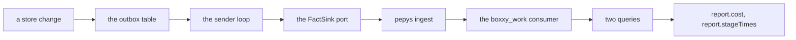

# Facts and pepys

Every change to boxxy's store also records what happened, as facts, and pepys, the event store,
keeps the long-term record of them. The store writes a change's facts to an outbox table in the same
transaction as the change. A sender loop sends the unsent rows to pepys in order, and a repeat
changes nothing there, because each row keeps one event ID. In pepys, boxxy's plug-in builds three
tables and three link types from the facts, and answers two queries: what an item cost to land, and
how long it spent in each step. boxxy reads those two queries for two reports and reads nothing else
from pepys. A decision, a claim, a merge state and a check that a fact arrived all live in the
store, so every decision of boxxy is the same when pepys is down, behind or absent.

[The overview](../overview.md#terms) defines the terms this doc uses.
[Attempts](../work/attempts.md) covers the attempt lifecycle whose steps the facts record.
[Review and merge](../../design/boxxy/review-and-merge.md#facts-and-pepys) covers the review and
merge facts and how the stage-time query reads them.
[Decision 0013](../../decisions/0013-one-write-path-per-fact.md) records why each fact has one write
path.

## The path of a fact

## The outbox

Each outbox row holds one fact. A row is unsent until pepys stores it, and the sender can park an
unsent row: it marks the row with a reason and skips it until the owner runs `boxxy outbox retry`.

- **One write path.** The store's apply function is the only code that inserts an outbox row. It
  writes every row of a change and the change itself in one transaction, or none. A state in the
  store therefore has its fact in the outbox.
- **The row's sequence number is the store version.** The code that builds a change gives each fact
  an ID, a UUID version 7, before the store applies the change. Every send of the row carries
  `event:boxxy:<fact ID>` as the event ID, so pepys drops a resend as a copy.
- **The store never refuses a change for its size.** Checks in front of the store keep each fact
  under `outboxLimits.factBytes`. The API bounds every string and list it reads, and the close-out
  parser rejects a close-out over `closeOutLimits.closeOutBytes`. The
  [owner listener](../overview.md#processes-and-how-they-reach-each-other) refuses, with
  `FACT_TOO_LARGE`, to file or edit an item whose fact would exceed `factBytes`. The sender parks a
  row that still exceeds `factBytes`, so that fact never reaches pepys.
- **The outbox never drops or caps a row.** The store reads its version as the highest sequence
  number in the outbox, and `item.get` reads an item's revisions from its `edited` facts there, so
  removing sent rows would break both.

## The sender

The sender runs as its own loop in the server, apart from the runner's tick, because a send can wait
up to `outboxLimits.requestTimeoutMs` and a tick must not. Its rules live in `@boxxy/dispatch`.

The sender sends a batch: the longest run of unsent rows, in store order, that holds
`outboxLimits.batchFacts` facts or fewer and fits `outboxLimits.batchBytes`. That budget keeps one
batch inside one append to the pepys log. The sender keeps one batch in flight at a time, so pepys
receives the facts in store order.

| Answer from pepys                                                                                     | What the sender does                                                                                                                                                              |
| ----------------------------------------------------------------------------------------------------- | --------------------------------------------------------------------------------------------------------------------------------------------------------------------------------- |
| stored                                                                                                | marks the batch sent and sends the next one at once                                                                                                                               |
| 502, 503 or 504, a timeout, no connection                                                             | keeps the batch, waits with a backoff that starts at `outboxLimits.backoff.firstMs` and doubles up to `outboxLimits.backoff.maxMs`, and sends the same rows again; never gives up |
| the batch is refused with 400, 413 or 422, and it holds more than one row                             | splits the batch in halves and sends each, to find the bad row                                                                                                                    |
| the batch is refused with 400, 413 or 422, and it holds one row                                       | parks the row with the reason, and goes on                                                                                                                                        |
| any other refusal, such as a wrong secret, a missing route, or a 500 from a fault inside pepys ingest | parks nothing, goes into the `blocked` state, and sends the same batch again every `outboxLimits.blockedRetryMs`                                                                  |

A 400, 413 or 422 means a bad row, which a split can find. A 500 means ingest failed, which no split
fixes.

When pepys refuses `outboxLimits.parkRun` single rows one after another, with none stored between,
the sender stops parking and goes into the `blocked` state. That pattern means the boxxy server and
the deployed `@boxxy/pepys` differ in version, and parking more rows would only hide it. The sender
parks a row over `factBytes` before it sends it, so that row never counts toward the run. The run
resets only when pepys stores a batch.

`boxxy outbox retry` clears every park mark and wakes the sender, which sends at once: a blocked
sender tries its batch again, and the sender parks a row over `factBytes` again when it reaches it.

A server whose config has no pepys section runs no sender, and its rows stay unsent, so the whole
history goes out when the owner adds the pepys section.

`runner.status` shows the sender's state, such as `blocked`, the count of unsent and parked rows,
the age of the oldest unsent row, the last error and the next try. The sender pushes no alert.

## The fact catalog

The fact schemas are declared once, in `libs/model/src/facts`, and the pepys stream
`facts.boxxy.work` carries them. These rules hold for every type:

- **Every fact names an item as its entity**, the thing in pepys that the fact is about, with the ID
  `boxxy:item:<id>`. A fact about an attempt carries the attempt in its payload, and a relation fact
  names its source item. pepys groups a consumer's input by entity into scopes, so one scope holds
  every fact of one item, and the consumer rebuilds an item from one read, in any arrival order.
- **The item body is in the `filed` fact, and in an `edited` fact when it changes.** The
  `@boxxy/pepys` schemas accept the body and the design text of a design close-out. The `boxxy_work`
  tables keep no column for either, because no query reads them, and the pepys fact log keeps them.
  [The ledger](../work/pipeline.md#the-ledger-labels-notes-and-relations) covers the body.
- **A runner pause or resume writes no fact**, because it names no item.
- **Three [settle](../work/attempts.md#settle) causes have no fact of their own.** `stalled`,
  `skill-missing` and a refusal for capacity show on the `settled` fact.
- **The store checks each fact against the model's schema.** The sink adds `storeVersion`, the row's
  sequence number, to every payload, so the wire schema in `@boxxy/pepys` is the model's schema plus
  that field. The `boxxy.decision.recorded` fact, the runner's decision to start or wake an attempt,
  also holds the store version that the decision read, as `snapshotStoreVersion`, a name that never
  clashes with the sink's field.
- **The `started`, `reconciled` and `resumed` facts carry the attempt's
  [proven caller](./api-and-auth.md#the-proven-caller)**, an issuer and a subject. The cost query
  matches each telemetry row's proven origin against that caller.
- **The `pull_request.linked` fact carries GitHub's own ID of the pull request**, for
  [the join keys](#the-join-keys). boxxy reads that ID through the forge port first. When the forge
  does not answer, boxxy writes nothing, and
  [the pull request watch](./github.md#the-pull-request-watch) links the pull request later.
- **boxxy records its own sighting of a merge**, because the item's derived state reads it and boxxy
  must dispatch while pepys is down. pepys takes the merge time from the GitHub tables.
- **boxxy never writes `boxxy.attempt.turn_ended`, and its schema stays**, because pepys still holds
  facts of that type and the consumer must parse every fact of an item.

## The `boxxy_work` package

The `boxxy_work` consumer, its tables and links, and the two queries ship in one package,
`@boxxy/pepys` at `packages/pepys`, which is one pepys plug-in. The package also holds boxxy's pepys
source: the definition that tells pepys ingest the stream, the receive route and its signature
check, and the wire schema of each fact type. The pepys deployment in another repo imports the
plug-in, and the boxxy server imports only the fact sink and the
[pepys reader](#what-boxxy-reads-from-pepys), so it loads no GitHub or telemetry plug-in code.

The consumer runs in pepys's scope mode: pepys hands it every fact of one scope at a time, and here
each scope is one item. When a fact of an item arrives, pepys marks the item's scope dirty, and on
its next run the consumer gets every fact of that item and writes the item's rows and links again:

| Table                   | One row per                           | From                                                  |
| ----------------------- | ------------------------------------- | ----------------------------------------------------- |
| `boxxy_item`            | item                                  | the filed, edited and closed facts                    |
| `boxxy_attempt`         | claimed attempt                       | the claim, session, sleep, close-out and settle facts |
| `boxxy_attempt_session` | pair of attempt and telemetry session | the session facts                                     |

| Link         | From       | To                                          |
| ------------ | ---------- | ------------------------------------------- |
| `ran_in`     | an attempt | each telemetry session the attempt used     |
| `produced`   | an attempt | the GitHub pull request, by GitHub's own ID |
| `attempt_of` | an attempt | its item                                    |

- The consumer writes no row and no link for an attempt until the scope holds the attempt's
  `claimed` fact. That fact may be parked in boxxy's outbox or not sent yet. When it arrives, it
  marks the scope dirty, and the consumer's next run writes the attempt's row and links.
- The consumer copies each fact's time and stores sleep as a list of stretches. It does no date
  arithmetic.

### The join keys

Two links join boxxy's rows to rows that other pepys plug-ins write. Each works only because both
sides build the same entity ID from the same value.

- **`produced` joins on GitHub's pull request ID.** boxxy stores the `id` that the forge port's
  GitHub adapter reads over REST, as a decimal string. The GitHub plug-in of pepys builds
  `github:pull_request:<id>` from the webhook's `pull_request.id`, which GitHub documents as the
  same value, so both sides build the same text.
- **`ran_in` joins on the session ID that telemetry carries.**
  [atc](../work/sessions.md#the-atc-worker) sets the resource attribute `atc.session.id` on every
  agent it starts. The telemetry plug-in keys each row by `telemetry:session:<atc session ID>`, or
  by the agent's own session ID when a record has no atc session ID. The consumer therefore links an
  attempt to both: to its atc session, from the `started`, `reconciled`, `resumed` and
  `session_bound` facts, and to the agent's own session ID, from `session_bound`. boxxy holds the
  long atc session ID that a client on another machine gets, `<target>.<daemon>.<id>`, and atc
  stamps telemetry with the short `<id>`, so the consumer keeps only the last dot-separated part.
  The join assumes that each agent copies `OTEL_RESOURCE_ATTRIBUTES` onto every record it exports.

## The two queries

Both queries take one item, and their output schemas are declared once, in `@boxxy/model`. The pepys
deployment builds the plug-in with `buildBoxxyPlugin`, and passes in the GitHub and telemetry
consumers whose tables the queries read, and the GitHub plug-in's delivery module, which reads when
a pull request merged, was released and was deployed. `@boxxy/pepys` types that module and those
columns by their shape, so it has no run-time dependency on the GitHub plug-in, and the type check
fails when the deployment passes a consumer with fewer columns. Each query reads plain rows with one
select per table, and TypeScript does the sleep stretches, the caller match, the dates and the sums.

### `boxxy_cost_to_land`

The query returns totals and a list of cost lines. Each cost line sums the requests of one phase,
rework flag, product, model and cost basis, with four token counts and the cost. An attempt counts
as rework when its [round](../work/pipeline.md#rules-of-the-engine) is above 1. The product is the
agent tool that telemetry names. The cost basis comes from telemetry for a line of requests:
`reported` when telemetry recorded each request's cost, `none` when it recorded no cost. A product
that reports its cost per turn instead of per request gets lines of its own, with the basis `turn`.

- **The query treats an item as landed** once a pull request that one of its attempts produced has
  merged, by the GitHub table. The landing time is the earliest such merge. An item that has not
  landed returns its cost so far.
- **Every attempt counts**, whatever its state or outcome, and one claimed after the merge counts
  too. One exception: an attempt that failed with `no-capacity` ran no session and gets no line.
- **Each telemetry row counts for one attempt.** The row's session and its proven origin must match
  the attempt's session and caller. When one session carried several attempts, each attempt owns the
  stretch from the time it was bound to the session until the next attempt was bound. A
  [kept session](../work/sessions.md#the-kept-session) is such a case.
- **An unknown cost is null, never 0.** A request with no cost counts in `requestsWithoutCost`,
  unless its session has a turn cost for the same phase, rework flag and product: that turn cost
  already holds the request's cost. When `requestsWithoutCost` is above 0, the total is a lower
  bound.

### `boxxy_stage_time`

The query returns seven steps: triage, design, build, review, merge, release and deploy. It also
returns the rework count, the rework minutes, the unrelated line count, the wait for review, and the
time the item's attempts slept. A step that has not happened has null minutes.

- The first four steps are phases. A phase's minutes are the sum over its settled attempts of the
  time from claim to end, less the attempt's sleep. An open sleep counts as none, because the query
  reads no clock. The rework minutes are that sum over attempts whose round is above 1.
- The merge, release and deploy steps measure delivery, so the GitHub plug-in's delivery module,
  reached through the `produced` link, gives their ends. The time of verify and merge attempts
  counts in no step: verify has no step, and the merge step runs on the delivery times.
- The merge step starts at the claim of the first merge attempt, live or settled, that was claimed
  at or after the end of the latest review that passed. With no such attempt, as for an item with no
  merge phase, the merge step starts at that review's end. A review that settled `unsettleable`
  starts no merge step, because boxxy could not read whether it passed, so such an item has null
  merge minutes after its pull request merged. Release starts at the merge, and deploy at the
  release. An item with two pull requests takes the earliest time of each step.
- An attempt that failed with `no-capacity` is in no measure. A `usage-limit` one counts.
- The rework count is the number of reviews that asked for changes. Don't compute it from the item's
  highest round: the round also rises on other backward edges and on retries.
- The unrelated line count sums `unrelatedLines` over the item's review close-outs: the changed
  lines of code outside the files of the earlier review's findings
  ([the review gate](../../design/boxxy/review-and-merge.md#the-review-gate)). A first review
  records null.
- The wait for review runs, for each build that ended with the outcome `built`, from the build's end
  to the claim of the first review claimed after that end. The query orders the build and the review
  by claim time, because boxxy numbers attempts within each phase.
- The query matches three outcome names: `built`, `passed` and `changes-requested`. Whoever renames
  one of them in a [phase kind](../work/pipeline.md#the-pipeline) must change the query's list too.

## What boxxy reads from pepys

- `report.cost` and `report.stageTimes` return the query's output, whole, plus `behind`: the count
  of that item's rows that the outbox has not sent, parked ones included, and the time of the
  oldest.
- An item that pepys holds no fact of yet gives an empty value. With pepys down, both reports answer
  `PEPYS_UNAVAILABLE`, and with no pepys section, `PEPYS_NOT_CONFIGURED`. `item.get` still shows
  each attempt's times.
- The pepys adapter of the `PepysReader` port never throws and never retries. An answer that its
  schema refuses reads as unavailable, because it means the pepys deployment runs another version of
  `@boxxy/pepys` than the server.
- A [dependency rule](../repo/layout.md#dependency-rules) keeps `@boxxy/pepys` out of every module
  and lib, so the server app passes the sink and the reader in through the ports.
