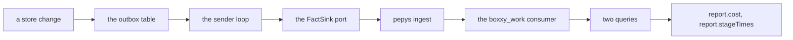

# Facts and pepys

Every change to boxxy's store also records what happened, as facts, and pepys keeps the long-term
record of them. The store writes a change's facts to an outbox table in the same transaction as the
change. A sender loop sends the unsent rows to pepys in order, and a repeat changes nothing there,
because each row keeps one event ID. In pepys, the boxxy plug-in builds three tables and three link
types from the facts, and answers two queries: what an item cost to land, and how long it spent in
each step. boxxy reads those two queries for two reports and reads nothing else from pepys, so every
decision of boxxy is the same when pepys is down, behind or absent.

[Attempts](../work/attempts.md) covers the attempt lifecycle whose steps the facts record, and the
pull request watch. [Review and merge](../../design/boxxy/review-and-merge.md#facts-and-pepys)
covers the review and merge facts and how the stage-time query reads them.
[Decision 0013](../../decisions/0013-one-write-path-per-fact.md) records why each fact has one write
path.

## The path of a fact

## The outbox

- **One write path.** The store's apply function is the only code that inserts an outbox row. It
  writes every row and every fact of a change in one transaction, or none. A state in the store
  therefore has its fact in the outbox.
- **The row's sequence number is the store version**, and its fact ID is a UUID version 7 that the
  caller made. Every send of the row carries that ID as the event ID, so pepys drops a resend as a
  copy.
- **No store change is refused for its size, with two exceptions.** The API bounds every string and
  list it reads, except the close-out body. The close-out parser bounds the body instead: it keeps
  every list whole and rejects a close-out over 120,000 bytes as stored. The owner door refuses a
  file or an edit of an item whose fact would pass the outbox's limit of one fact, with
  `FACT_TOO_LARGE`. The sender parks any other row that is still over that limit.
- **Nothing is dropped or capped.** Sent rows stay, because the sequence number is the store version
  and close-outs cite fact IDs.

## The sender

The sender runs as its own loop in the server, apart from the runner tick, because a send can wait
up to `outboxLimits.requestTimeoutMs` and a tick must not. The sender's rules live in the outbox
code of `@boxxy/dispatch`, and the loop around them in the server.

A batch is the longest run of unsent rows, in order, that holds 100 facts or fewer and fits the byte
budget of one batch. The budget keeps one batch inside one append to the pepys log. One batch is in
flight at a time, so pepys receives the facts in store order.

| Answer from pepys                                                         | What the sender does                                                                                                                                                              |
| ------------------------------------------------------------------------- | --------------------------------------------------------------------------------------------------------------------------------------------------------------------------------- |
| stored                                                                    | marks the batch sent and sends the next one at once                                                                                                                               |
| 502, 503 or 504, a timeout, no connection                                 | keeps the batch, waits with a backoff that starts at `outboxLimits.backoff.firstMs` and doubles up to `outboxLimits.backoff.maxMs`, and sends the same rows again; never gives up |
| the batch is refused with 400, 413 or 422, and it holds more than one row | splits the batch in halves and sends each, to find the bad row                                                                                                                    |
| the batch is refused with 400, 413 or 422, and it holds one row           | parks the row with the reason, and goes on                                                                                                                                        |
| any other refusal, such as a wrong secret, a missing route, or a 500      | parks nothing, reports `blocked`, and tries again every `outboxLimits.blockedRetryMs`                                                                                             |

Ingest answers 500 when a source throws, when it has no blob store, or when its log refuses an
append. No split of the batch fixes those, so the sink reports a 500 as a refusal of the sink.

After pepys refuses 25 single rows in a row with none stored between, the sender stops parking and
reports `blocked`: that pattern means the boxxy server and the deployed `@boxxy/pepys` differ in
version. A row over the limit of one fact never counts toward the 25, because the sender parks it
without sending it, so it cannot show a version difference. Such a row shows in the parked count of
`runner.status`. `boxxy outbox retry` clears every park mark and wakes the sender.

The `FactSink` port has three forms: the pepys adapter, which uses the pepys kit's batch sender and
holds no HTTP code of its own; a fake for tests; and no sink at all. With no sink, no loop runs and
the rows stay unsent, so the whole history goes out when the owner adds pepys. One contract suite
runs against the fake and the pepys adapter.

`runner.status` shows the outbox state: the count of unsent and parked rows, the age of the oldest
unsent row, the last error and the next try. Nothing pushes an alert.

## The fact catalog

The fact schemas are declared once, in `libs/model/src/facts`, and the stream `facts.boxxy.work`
carries them. These rules hold for every type:

- **Every fact names an item as its entity**, and a fact about an attempt carries the attempt in its
  payload. One scope in pepys then holds every fact of one item, so the consumer rebuilds an item
  from one read, in any arrival order. A relation fact names its source item.
- **The fact ID on the wire** is `event:boxxy:<event>`, where the event is the outbox row's fact ID.
- **The item body is in the `filed` fact, and in an `edited` fact when it changes.** A `filed` fact
  stored before the body existed reads as an empty body. The `@boxxy/pepys` schemas accept the body
  and the design text of a design close-out, and the package keeps no column for either: no query
  reads them, and the fact log keeps them.
  [The ledger](../work/pipeline.md#the-ledger-labels-notes-and-relations) covers the body.
- **A runner pause or resume writes no fact**, because it names no item.
- **Three settle causes have no fact of their own.** `stalled`, `skill-missing` and a capacity
  refusal show on the `settled` fact.
- **The store checks each fact against the model's schema.** The wire schema in `@boxxy/pepys` is
  the model's schema plus the store version, which the sink adds. No model schema has a
  `storeVersion` field, so the decision fact carries the version of the snapshot it read as
  `snapshotStoreVersion`.
- **The caller.** The `started`, `reconciled` and `resumed` facts carry the proven caller of the
  attempt's session. pepys counts a telemetry row for an attempt only when the row's proven origin
  is that caller.
- **Pull requests.** boxxy stores GitHub's own ID of each pull request and sends it as a decimal
  string, because pepys builds its entity ID from it. The link reads the forge before it writes.
  When the forge does not answer, nothing is written, and
  [the pull request watch](./github.md#the-pull-request-watch) links the pull request later.
- **A merge.** boxxy records its own sighting of a merge, because the item's derived state reads it
  and boxxy must dispatch while pepys is down. pepys takes the merge time from the GitHub tables.
- **`boxxy.attempt.turn_ended`** has a schema so that stored facts parse, and boxxy never writes it.

## The `boxxy_work` package

The package `@boxxy/pepys`, at `packages/pepys`, is one pepys plug-in: the source with its fact
family, the consumer `boxxy_work`, three link types and two queries. The pepys deployment in another
repo imports the plug-in, and the boxxy server imports the sink and the reader by subpath, which
load no GitHub or telemetry plug-in code.

The consumer runs in scope mode, with one scope per item. From an item's facts it writes:

| Table                   | One row per                           | From                                                  |
| ----------------------- | ------------------------------------- | ----------------------------------------------------- |
| `boxxy_item`            | item                                  | the filed, edited and closed facts                    |
| `boxxy_attempt`         | claimed attempt                       | the claim, session, sleep, close-out and settle facts |
| `boxxy_attempt_session` | pair of attempt and telemetry session | the session facts                                     |

| Link         | From       | To                                          |
| ------------ | ---------- | ------------------------------------------- |
| `ran_in`     | an attempt | each telemetry session the attempt used     |
| `produced`   | an attempt | the GitHub pull request, by GitHub's own ID |
| `attempt_of` | an attempt | its item                                    |

- The consumer reads only the fact types that build these rows and links, and passes over the
  others.
- An attempt with no claimed fact in the scope yields no row and no link. The fact marks the scope
  dirty when it arrives, and the next run writes them.
- The consumer's module does no date arithmetic. It copies each fact's time, and stores sleep as a
  list of stretches that the query adds up.
- The consumer's entry compiles with scriptc, and reaches the tables and links only through the
  generated glue in `src/generated/`. The package commits the glue, and `bun run glue` in the
  package rewrites it from the plug-in.
- `@pepys/kit` and zod are peer dependencies, so that the deployment holds one copy of each. The
  package imports no kysely: each query runs on the kit's query database.

### The join keys

Two links join boxxy's rows to rows that other pepys plug-ins write. Each works only because both
sides build the same entity ID from the same value.

- **`produced` joins on GitHub's pull request ID.** The GitHub adapter reads the pull request over
  REST, and boxxy stores its `id`. The GitHub plug-in of pepys builds `github:pull_request:<id>`
  from the `pull_request.id` of the webhook. For one pull request, the REST `id` equals the
  `pull_request.id` of a GitHub event payload. The IDs pass 2^32, so boxxy keeps the ID as a decimal
  string. The join assumes that a webhook delivery carries the same `pull_request.id` as the REST
  read, as GitHub documents.
- **`ran_in` joins on the session ID that telemetry carries.** atc sets the resource attribute
  `atc.session.id` on every agent it starts. The telemetry plug-in keys each row by
  `telemetry:session:<atc session ID>`, or by the agent's own session ID when a record has no atc
  session ID. The consumer therefore links an attempt to both: to its atc session, from the
  `started`, `reconciled`, `resumed` and `session_bound` facts, and to the agent's own session ID,
  from `session_bound`. atc stamps the ID that the session's own host gives it, so the consumer
  takes the last dot-separated part of the `<target>.<daemon>.<id>` form that a remote client is
  answered with. The join assumes that each agent copies `OTEL_RESOURCE_ATTRIBUTES` onto every
  record it exports.

## The two queries

Both queries take one item, and their output schemas are declared once, in `@boxxy/model`.

The deployment builds the plug-in with `buildBoxxyPlugin`, and passes it the GitHub and telemetry
consumers that the queries read, with the GitHub plug-in's delivery module, `githubDelivery` of
`@pepys/source-github`, as `delivery`. `@boxxy/pepys` types the module by its shape, so it has no
run-time dependency on the GitHub plug-in and imports no kysely, and no deployment writes a delivery
read of its own. The stage-time query finds the item's pull requests itself, through the `produced`
links of its attempts, and calls the module only when it finds at least one. The package's types
name the columns that each query reads, so a consumer with fewer columns fails the type check.

Each query reads plain rows of its tables with one statement per table, and a builder in TypeScript
does the stretches, the caller match and the sums. The statements need no window function, no
`julianday` and no common table expression from the store. An input that names no boxxy item answers
as an item with no rows.

### `boxxy_cost_to_land`

The query returns one line per phase, rework flag, product, model and cost basis, with requests,
four token counts and the cost, and totals.

- **Landed** means that a pull request which an attempt of the item produced has merged in the
  GitHub table. The time is the earliest such merge. An item that has not landed returns its cost so
  far.
- **Every attempt counts**, whatever its state or outcome, also one after the merge. One exception:
  an attempt that failed with `no-capacity` ran no session and gets no line.
- **Rework** is an attempt whose round is above 1.
- **Each telemetry row counts for one attempt.** The row's session and its proven origin must match
  the attempt's session and caller. When one session carried several attempts, each attempt owns the
  stretch from the time it was bound to the session until the next attempt was bound. A kept session
  is such a case.
- **An unknown cost is null, never 0.** A product that reports cost per turn gets its own lines. A
  request with no cost counts in `requestsWithoutCost` unless its own session has a turn cost for
  the same phase, rework flag and product.

### `boxxy_stage_time`

The query returns seven steps: triage, design, build, review, merge, release and deploy. It also
returns the rework count, minutes and unrelated lines, the wait for review, and the time the item's
attempts slept. A step that has not happened has null minutes.

- The four phases come from the item's attempts. A phase's minutes are the sum over its settled
  attempts of the time from claim to end, less the attempt's sleep.
- The ends of merge, release and deploy come from the GitHub plug-in's delivery module, reached
  through the `produced` link. The minutes of verify and merge attempts count in no phase step.
- Merge starts at the claim of the first merge attempt claimed at or after the latest end of a
  review that passed, a live attempt too. With no such attempt, as for an item with no merge phase,
  merge starts at that review's end. A review that settled `unsettleable` starts no merge step,
  because boxxy could not read whether it passed, so such an item has null merge minutes after its
  pull request merged. Release starts at the merge, and deploy at the release. An item with two pull
  requests takes the earliest time of each step.
- An attempt that failed with `no-capacity` is in no measure. Every other attempt counts, a
  `usage-limit` one too.
- The rework count is the number of reviews that asked for changes. The highest round less one is a
  different number.
- The unrelated lines are the sum of `unrelatedLines` over the item's review close-outs, which the
  consumer copies into `boxxy_attempt`. The first review records null, so an item with no later
  review has null unrelated lines
  ([the review gate](../../design/boxxy/review-and-merge.md#the-review-gate)).
- The wait for review of a build that was built runs from its end to the claim of the first review
  claimed after that end. The claim times give the order, because an attempt's number counts within
  its own phase.
- An open sleep adds no time, because the query reads no clock.
- The query names three outcome names of the phase kinds. A phase kind that renames one must change
  the query.

## What boxxy reads from pepys

The `PepysReader` port has two methods, one for each query, with a pepys adapter and a fake.

- `report.cost` and `report.stageTimes` return the query's output, whole, plus `behind`: the count
  of that item's facts still in the outbox.
- An item that pepys holds no fact of yet gives an empty value. With pepys down, both reports answer
  `PEPYS_UNAVAILABLE`, and `item.get` still shows each attempt's times.
- The adapter never throws and never retries. An answer that its schema refuses reads as
  unavailable, because it means the pepys deployment runs another version of `@boxxy/pepys` than the
  server.
- A lint rule keeps `@boxxy/pepys` out of every module and lib, so an app passes the sink and the
  reader in through the ports.

boxxy never reads a decision, a claim, a position, a merge state, or a check that a fact arrived
from pepys. Each of those lives in the store, so dispatch runs the same with pepys down.
