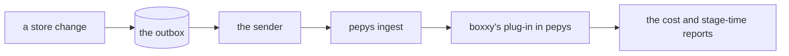

# Facts and pepys

Every change boxxy makes to its store is also written down as a fact, and pepys, the event store,
keeps those facts for good. The owner reads two reports built from them: what an item cost to land,
and how long it spent in each stage. boxxy never asks pepys to decide anything. Claims, merges and
item state all live in the boxxy store, so the runner works the same when pepys is down, behind or
not configured. Read this doc before you add a fact type, change how facts are sent, or change what
a report measures.

[Attempts](../work/attempts.md) covers the attempt lifecycle whose steps the facts record. The
[review and merge design](../../design/boxxy/review-and-merge.md#facts-and-pepys) covers the review
and merge facts. [Decision 0013](../../decisions/0013-one-write-path-per-fact.md) records why each
fact has one write path. The [overview](../overview.md#terms) defines the shared terms.

## How a fact reaches pepys

The store writes a change and its facts to the outbox in one transaction. The sender, a loop in the
server, sends the unsent facts to pepys in store order. boxxy's plug-in inside pepys rebuilds each
item's rows from its facts, and the two reports read those rows. The facts carry everything pepys
needs, so pepys can rebuild every item from the facts alone.

## The outbox

The store's apply function is the only code that writes an outbox row, and it writes the change and
every fact of the change together or not at all. A state in the store therefore always has its fact
in the outbox.

- **A resend is harmless.** Each fact gets its ID before the store applies the change, and every
  send carries `event:boxxy:<fact ID>` as the event ID, so pepys drops a copy.
- **The store never refuses a change for its size.** The checks in front of it keep each fact under
  the outbox's per-fact limit: the API bounds every string and list it reads, the close-out parser
  rejects an oversized close-out, and the owner listener refuses to file or edit an item whose fact
  would be too large, with `FACT_TOO_LARGE`. The sender parks any fact that still slips over the
  limit, so it never reaches pepys.
- **The outbox never drops a row.** The store reads its own version as the highest sequence number
  in the outbox, and `item.get` reads an item's revisions from its `edited` facts there, so deleting
  sent rows would break both.

## Sending to pepys

The sender runs apart from the runner's tick, because a send can wait on pepys for a long time and a
tick must not. It sends the longest run of unsent facts that fits one append to the pepys log, and
keeps one batch in flight, so pepys receives facts in store order.

| pepys answers                                                | The sender                                                                    |
| ------------------------------------------------------------ | ----------------------------------------------------------------------------- |
| stored                                                       | marks the batch sent and sends the next one                                   |
| 502, 503, 504, a timeout or no connection                    | waits with a doubling backoff and sends the same batch again                  |
| 400, 413 or 422 on a batch of several facts                  | splits the batch in half and sends each half, to find the bad fact            |
| 400, 413 or 422 on one fact                                  | parks that fact with the reason and moves on                                  |
| anything else, such as a wrong secret or a 500 inside ingest | parks nothing, goes `blocked`, and retries the same batch on a fixed interval |

A 4xx on a batch means one bad fact, which a split can find. Any other refusal means pepys itself is
wrong, which no split fixes. When pepys refuses several single facts in a row with nothing stored
between them, the sender stops parking and goes `blocked` too, because that pattern means the server
and the deployed `@boxxy/pepys` run different versions, and more parking would hide it.

`boxxy outbox retry` clears every park and wakes the sender. `runner.status` shows the sender's
state, the unsent and parked counts, the age of the oldest unsent fact and the last error; the
sender sends no alert. A server with no pepys section in its config runs no sender, so the whole
history goes out once the owner adds one.

## What every fact carries

The stream `facts.boxxy.work` carries every fact type. These rules hold for all of them:

- **Every fact is about an item.** Its pepys entity is `boxxy:item:<id>`; an attempt fact carries
  the attempt in its payload, and a relation fact names its source item. pepys groups facts by
  entity, so one read gives the plug-in every fact of one item, in any arrival order.
- **Facts carry the full text they change.** The `filed` fact holds the body, and an `edited` fact
  holds it again when it changes. The plug-in's tables keep no body or design text, because no
  report reads them, but the pepys fact log keeps both.
- **Each fact carries its store version.** The sink adds `storeVersion` to every payload. A
  `boxxy.decision.recorded` fact, the runner's decision to start or wake an attempt, also carries
  the version that decision read, as `snapshotStoreVersion`.
- **Session facts carry the proven caller.** The `started`, `reconciled` and `resumed` facts hold
  the attempt's [proven caller](./api-and-auth.md#the-proven-caller), which the cost report matches
  against telemetry.
- **A pull request link carries GitHub's own ID** for the pull request, which joins it to pepys's
  GitHub data ([the join keys](#the-join-keys)).
- **boxxy records the merges it sees**, because item state reads them and boxxy must dispatch while
  pepys is down. pepys takes the merge time from its GitHub tables instead.
- **Some changes write no fact.** A runner pause or resume names no item. A settle for `stalled`,
  `skill-missing` or a capacity refusal shows only on the `settled` fact.
- **A retired type keeps its schema.** boxxy no longer writes `boxxy.attempt.turn_ended`, but pepys
  still holds such facts and the plug-in must parse every fact of an item.

## boxxy's plug-in in pepys

`@boxxy/pepys`, in `packages/pepys`, is the code a pepys deployment loads to understand boxxy. It
holds boxxy's pepys source (the stream, the receive route and its signature check, and the wire
schema of each fact), the `boxxy_work` consumer that builds boxxy's tables, and the two report
queries. The pepys deployment lives in another repo and imports the plug-in. The boxxy server
imports only the fact sink and the report reader from it, so it loads no GitHub or telemetry plug-in
code.

When a fact arrives, pepys marks its item dirty, and the consumer then rebuilds all of that item's
rows and links from its facts:

| Table or link           | One per                             | Built from                                         |
| ----------------------- | ----------------------------------- | -------------------------------------------------- |
| `boxxy_item`            | item                                | the filed, edited and closed facts                 |
| `boxxy_attempt`         | claimed attempt                     | the claim, session, sleep, close-out, settle facts |
| `boxxy_attempt_session` | attempt and telemetry session pair  | the session facts                                  |
| `attempt_of` link       | attempt, to its item                | the claim                                          |
| `ran_in` link           | attempt, to each telemetry session  | the session facts                                  |
| `produced` link         | attempt, to its GitHub pull request | the pull request link                              |

The consumer writes nothing for an attempt until the item's facts include its `claimed` fact, which
may still sit unsent in boxxy's outbox; its arrival marks the item dirty again. The consumer copies
each fact's time as it is and does no date arithmetic.

### The join keys

Two links join boxxy's rows to rows that other pepys plug-ins write. Each works only because both
sides build the same entity ID from the same value.

- **`produced` joins on GitHub's pull request ID.** boxxy stores the `id` that GitHub's REST API
  returns, as a decimal string. pepys's GitHub plug-in builds `github:pull_request:<id>` from the
  webhook's `pull_request.id`, which GitHub documents as the same value.
- **`ran_in` joins on the session ID in telemetry.** atc stamps every agent it starts with the
  resource attribute `atc.session.id`, and the telemetry plug-in keys each row by that ID, or by the
  agent's own session ID when a record has none. The consumer therefore links an attempt to both
  IDs. boxxy holds the long atc ID, `<target>.<daemon>.<id>`, while telemetry carries only `<id>`,
  so the consumer keeps the last dot-separated part. The join assumes each agent copies
  `OTEL_RESOURCE_ATTRIBUTES` onto every record it exports.

The pepys deployment hands the plug-in the GitHub and telemetry tables the reports read, and the
GitHub plug-in's delivery data: when a pull request merged, was released and was deployed. The
plug-in depends only on their shape, so a deployment whose tables lack a column the reports read
fails its type check, not at run time.

## What an item cost to land

`boxxy_cost_to_land` returns an item's totals and a list of cost lines. Each line sums the requests
of one phase, rework flag, agent product, model and cost basis. An attempt is rework when its
[round](../work/pipeline.md#how-boxxy-decides-where-an-item-stands) is above 1. The cost basis is
`reported` when telemetry recorded each request's cost, `none` when it recorded none, and `turn` for
a product that reports cost per turn.

- **An item lands when a pull request it produced merges.** The landing time is the earliest such
  merge. An item that hasn't landed returns its cost so far.
- **Every attempt counts**, whatever its outcome, including one claimed after the merge. An attempt
  that failed with `no-capacity` ran no session, so it gets no line.
- **Each telemetry row counts once.** Its session and proven origin must match the attempt's session
  and caller. When one session carried several attempts in turn, as a
  [kept session](../work/sessions.md#the-kept-session) does, each attempt owns the stretch from its
  bind to the next attempt's bind.
- **An unknown cost is null, never 0.** A request with no cost counts in `requestsWithoutCost`,
  unless its session has a turn cost for the same line, which already includes it. While
  `requestsWithoutCost` is above 0, the total is a lower bound.

## How long an item spent in each stage

`boxxy_stage_time` returns the minutes of seven stages (triage, design, build, review, merge,
release and deploy), plus the rework count and minutes, the unrelated line count, the wait for
review, and the time the item's attempts slept. A stage that hasn't happened is null.

- **A phase stage is attempt time less sleep.** Triage, design, build and review sum each settled
  attempt's time from claim to end, less its sleep. An open sleep counts as none, because the query
  reads no clock. Rework minutes are the same sum over attempts whose round is above 1.
- **The delivery stages run on GitHub's times.** Merge, release and deploy end at the times pepys's
  GitHub data records. Verify and merge attempts count in no stage.
- **The merge stage starts at the first merge attempt claimed after the latest passed review**, or
  at that review's end when there is none, as for a pipeline with no merge phase. A review that
  settled `unsettleable` starts no merge stage, because boxxy can't tell whether it passed. Release
  starts at the merge, and deploy at the release. With two pull requests, each stage takes the
  earliest time.
- **The rework count is the number of reviews that asked for changes.** Don't derive it from the
  item's highest round, which also rises on other backward edges and on retries.
- **The unrelated line count** sums each review's count of changed lines outside the files of the
  earlier review's findings
  ([the review gate](../../design/boxxy/review-and-merge.md#the-review-gate)). A first review
  records null.
- **The wait for review** runs from each `built` build's end to the claim of the first review after
  it, ordered by claim time, because boxxy numbers attempts within each phase.
- **A `no-capacity` failure counts nowhere; a `usage-limit` one counts.**

The query matches three outcome names: `built`, `passed` and `changes-requested`. Rename one in a
phase kind and you must change the query too.

## What boxxy reads back

`report.cost` and `report.stageTimes` return a query's output whole, plus `behind`: how many of the
item's facts the outbox hasn't sent yet, parked ones included, and the time of the oldest. An item
pepys has no fact for yet gives an empty value. With pepys down, both reports answer
`PEPYS_UNAVAILABLE`, and with no pepys section in the config, `PEPYS_NOT_CONFIGURED`; `item.get`
still shows each attempt's times.

The reader never throws and never retries. It treats an answer that fails its schema as unavailable,
because that means pepys runs a different `@boxxy/pepys` version from the server. A
[dependency rule](../repo/layout.md#dependency-rules) keeps `@boxxy/pepys` out of every module and
lib, so the server passes the sink and the reader in through ports.
