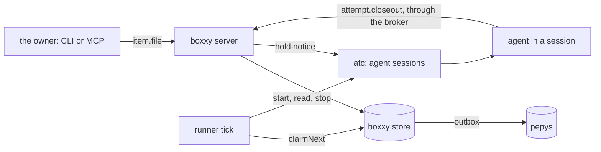
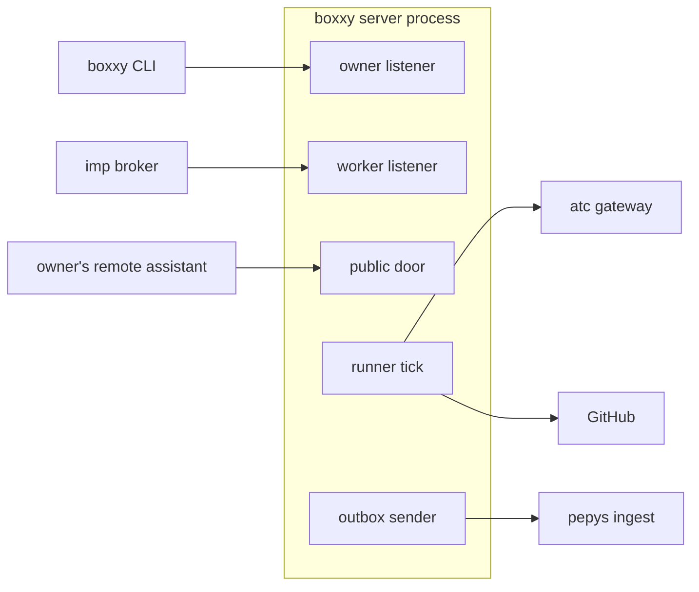

# Architecture overview

boxxy decides which item of work a fleet of coding agents takes next, runs each phase of the item as
one attempt in an agent session, and records every change as a fact. One server holds the work in a
SQLite store, and a runner loop inside it claims work, starts sessions through atc, reads them back
and settles their outcomes. pepys, a separate fact store, receives every fact and answers the cost
and stage-time reports. This page shows the whole system, and links the doc that owns each part.

## The path of an item

The owner files an item with the CLI or through the owner's MCP tools. The item's kind names a
pipeline in the rules, such as triage, design, build and review. On each tick the runner calls
`claimNext`, which decides in one store transaction which item phase starts next and takes a seat in
each limit that counts it. The runner starts an agent session for the attempt, then reads the
session on every tick. The agent sends a typed close-out when its work is done, and the runner
settles the attempt: the outcome picks the pipeline's next step, sends the item back, ends it, or
holds it for the owner. A hold sends the owner a notice.

[The pipeline](./work/pipeline.md) covers the steps, the limits, the recipes and the launch prompt.
[Attempts](./work/attempts.md) covers the attempt states, the readings, sleep and wake, and the kept
session. [Notices](./work/notices.md) covers how a hold reaches the owner.

Some phases run with no session. A merge attempt is a job: the runner reads the pull request's
checks through GitHub and merges at the head when every required check is green. The review and
merge step is still partly a design, in
[review, verify and merge](../design/boxxy/review-and-merge.md).

## Processes and how they reach each other

The server is one process. It opens up to three listeners: the owner listener on the owner's private
network, the worker listener that agent sessions reach through the imp broker, and an optional
public door behind OAuth. The broker adds the worker token and an identity token to each call from a
session, so the server can prove which session called. [API and auth](./interfaces/api-and-auth.md)
covers the listeners, the tokens and who may call each procedure.
[The CLI and the hooks](./interfaces/cli-and-hooks.md) covers the `boxxy` command and the hook
plug-in that runs in each session.

The runner reaches atc through the atc gateway's MCP tools, and GitHub through a GitHub App. Both
are adapters that the server builds and passes to the domain modules, so the modules stay free of
I/O. [Layout](./repo/layout.md) sets the package kinds and the rules that keep I/O at the edges.

## The data

The boxxy store is one SQLite file that only the server opens. It holds the state that dispatch
needs: items, attempts, leases, limit seats, levers, notices and the fact outbox. The store is the
only place that claims, because a claim needs a compare-and-set write that pepys does not offer
([decision 0001](../decisions/0001-claims-live-in-the-boxxy-store.md)).

Every store change writes its facts to the outbox in the same transaction, and the sender sends them
to pepys in order. pepys keeps the whole history, and the `@boxxy/pepys` plug-in builds the tables
that the reports read. [Facts and pepys](./interfaces/facts-and-pepys.md) covers the outbox, the
plug-in and the two queries.

## Rules

The pipelines, limits, pools, recipes and prompts live in a rules file in git, and the server loads
them from a reviewed commit. The rules version hashes what the loader read, and every decision
records it. Levers that change often, such as defer and expedite, are facts in the store.
[Rules](../design/boxxy/rules.md) and [planning](../design/boxxy/planning.md) are still partly
designs; [the pipeline](./work/pipeline.md) covers the built rules that drive an item.

## The repo

- [Layout](./repo/layout.md): the package kinds, the dependency rules, the import pins and where a
  new file goes.
- [Tech stack](./repo/tech-stack.md): the runtime, the libraries and the repo tooling, with the
  reason for each choice.
- [Release](./repo/release.md): the npm packages, the one version they share, and what a deployment
  pins.
- [Verify journeys](./repo/verify-journeys.md): the test journeys, the map from changed paths to
  features, and the check that fails a pull request with no fresh verdict.

The designs for work that is not built yet are in [docs/design](../design/boxxy/README.md), and the
decisions behind the system are in [docs/decisions](../decisions/).
