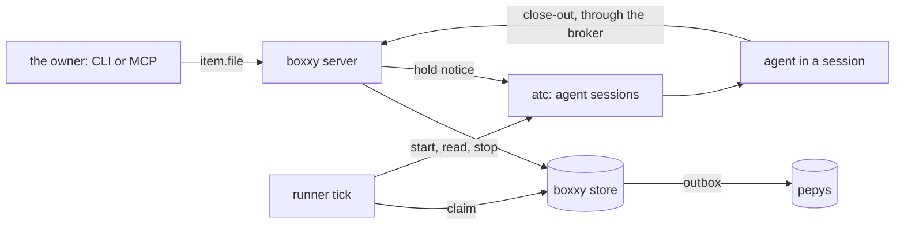
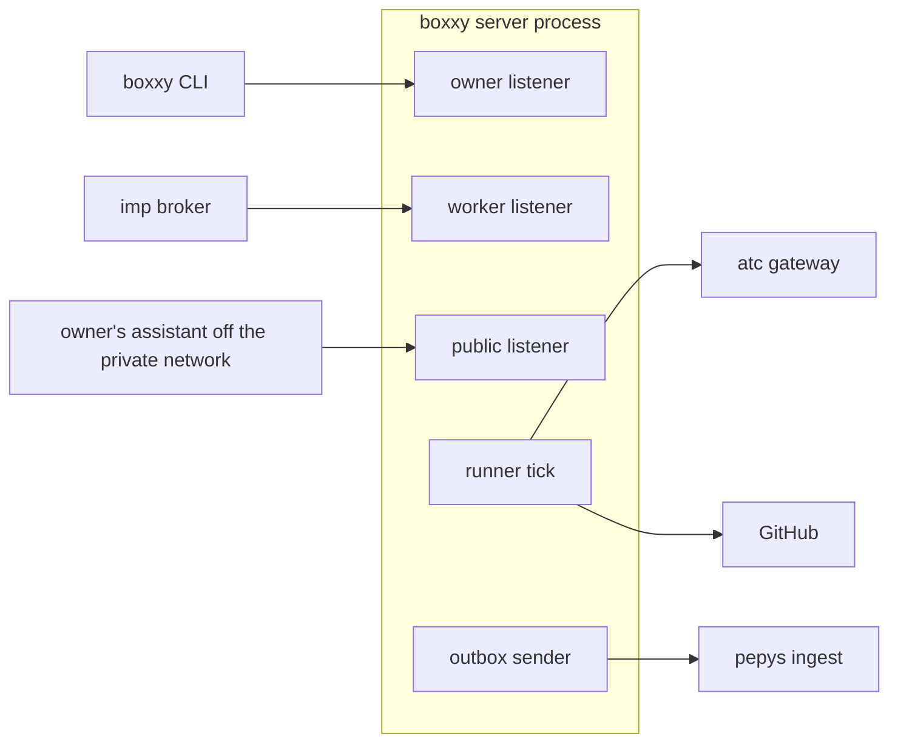

# How boxxy works

boxxy decides which piece of work a fleet of coding agents takes next, runs each step of that work
in an agent session, and records every change it makes. One server process holds the work in a
SQLite store. A loop inside the server claims work, starts agent sessions, reads them back and
records how each one ended. A separate event store, pepys, receives every record and answers the
cost and stage-time reports. This page shows the whole system, defines the terms the other
architecture docs use, and links the doc that owns each part.

## Terms

| Term          | Meaning                                                                                                                  |
| ------------- | ------------------------------------------------------------------------------------------------------------------------ |
| owner         | the one person who runs boxxy: files work, answers holds and changes the rules                                           |
| item          | one piece of work, such as a feature or a fix, with a title, the outcome the owner wants, a body and acceptance criteria |
| phase         | one step of an item's work: triage, design, build, review, verify or merge                                               |
| pipeline      | the order of an item's phases, and where each result of a phase sends the item; it is data in the rules file             |
| attempt       | one try at one phase of one item; a phase can take several attempts                                                      |
| close-out     | the typed result an agent sends when its attempt's work is done                                                          |
| settle        | the server's step that ends an attempt and moves the item by the close-out's result                                      |
| hold          | an item stopped for the owner, who lifts it with `boxxy item retry`                                                      |
| runner, tick  | the loop inside the server, and one pass of it: claim, start, read every live attempt, clean up, send notices            |
| claim         | the store's choice of the next item phase to start, with the seats it takes                                              |
| limit, seat   | a named cap on running attempts, and one place under it that a running attempt holds                                     |
| pool          | a filter and an order over the items that are ready to start, defined in the rules file                                  |
| lever         | a change the owner makes to the order without a rules change, such as defer or expedite                                  |
| recipe        | how a phase's session runs: the agent, the model, the prompt template and the skills                                     |
| rules file    | the YAML file in git that holds the pipelines, limits, pools and recipes; the rules version is its hash                  |
| fact          | a record of one change, such as `boxxy.attempt.claimed`, that the server sends to pepys                                  |
| pepys         | the event store that keeps every fact and builds the tables the reports read                                             |
| atc           | the session manager that starts, reads, sleeps and stops agent sessions, on a local machine or in an imp, a cloud VM     |
| imp broker    | the proxy between a session in an imp and the server; it adds the worker token and an identity token to each call        |
| proven caller | the session that the broker's identity token proves made a call                                                          |
| forge         | the code host behind the forge port; GitHub is the one adapter                                                           |
| job           | an attempt that runs with no agent session, such as a merge that the runner drives                                       |

## The path of an item

1. The owner files an item with the CLI or through the owner's MCP tools.
2. On each tick, the runner asks the store for a claim. The store picks the next item phase in one
   transaction, and takes a seat in each limit that counts the attempt.
3. The runner starts an agent session for the attempt through atc, then reads the session on every
   tick.
4. The agent sends a close-out when its work is done, and the runner settles the attempt. The
   pipeline then moves the item to its next phase, sends it back to an earlier phase, ends it, or
   holds it.
5. A hold sends the owner a notice.

These docs own the steps:

- [The pipeline](./work/pipeline.md): phases, edges, holds, limits, pools, recipes and the launch
  prompt.
- [Attempts](./work/attempts.md): the attempt states, the readings, sleep and wake, close-outs and
  settle.
- [Agent sessions](./work/sessions.md): the kept session, cleanup, capacity and the atc adapter.
- [Notices](./work/notices.md): how a hold reaches the owner.

A merge attempt is a job. The runner reads the pull request's checks through the forge, and merges
at the pull request's head commit when every required check is green. The
[review, verify and merge design](../design/boxxy/review-and-merge.md) holds the design of the
review, verify and merge steps.

## Processes and how they reach each other

The server runs as one process and opens up to three listeners:

- the owner listener, on the owner's private network, for the CLI and the owner's MCP tools;
- the worker listener, which agent sessions reach through the imp broker;
- the public listener, behind OAuth, for the owner's assistant when it runs off the private network.
  The server opens it only when its configuration has a `publicDoor` section.

These docs own the edges:

- [API and auth](./interfaces/api-and-auth.md): the listeners, the tokens, the proven caller and who
  may call each procedure.
- [The CLI and the hooks](./interfaces/cli-and-hooks.md): the `boxxy` command and the hook plug-in
  that runs in each session.
- [GitHub](./interfaces/github.md): how boxxy links pull requests and records merges.

The runner reaches atc through the atc gateway's MCP tools, and GitHub through a GitHub App. Each
outside system has one adapter package. The server builds the adapters and passes them to the domain
packages under `modules/`, which do no I/O of their own. [Layout](./repo/layout.md) sets the package
kinds and the import rules that hold this split.

## The data

The boxxy store is one SQLite file, and only the server opens it. It holds what claiming needs:
items, attempts, leases, seats, levers, notices and the fact outbox. A lease marks the one live
attempt of an item phase. The server claims in its own store, because a claim needs a
compare-and-set write, and pepys has none
([decision 0001](../decisions/0001-claims-live-in-the-boxxy-store.md)).

Every store change writes its facts to the outbox in the same transaction, and the outbox sender
sends them to pepys in order. pepys keeps the whole history. The `@boxxy/pepys` package runs inside
the pepys deployment and builds the tables that the cost and stage-time queries read.
[Facts and pepys](./interfaces/facts-and-pepys.md) covers the outbox, the package and the two
queries.

## Rules

The server loads the rules file from a reviewed commit in git. The loader hashes the files it read
into the rules version, and each claim records that version. Levers change too often for a rules
change, so the store keeps them as rows. [The pipeline](./work/pipeline.md) covers the built rules
that move an item. The [rules design](../design/boxxy/rules.md) and the
[planning design](../design/boxxy/planning.md) cover the rest.

## The repo

- [Layout](./repo/layout.md): the package kinds, the dependency rules, the import pins and where a
  new file goes.
- [Tech stack](./repo/tech-stack.md): the runtime, the libraries and the repo tooling, with the
  reason for each choice.
- [Release](./repo/release.md): the npm packages, the one version they share, and what a deployment
  pins.
- [Verify journeys](./repo/verify-journeys.md): the test journeys, the map from changed paths to
  features, and the check that fails a pull request with no fresh verdict.

The designs for work not yet built are in [docs/design](../design/boxxy/README.md), and the
decisions behind the system are in [docs/decisions](../decisions/).
