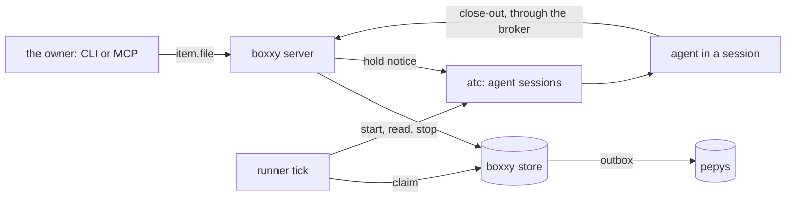
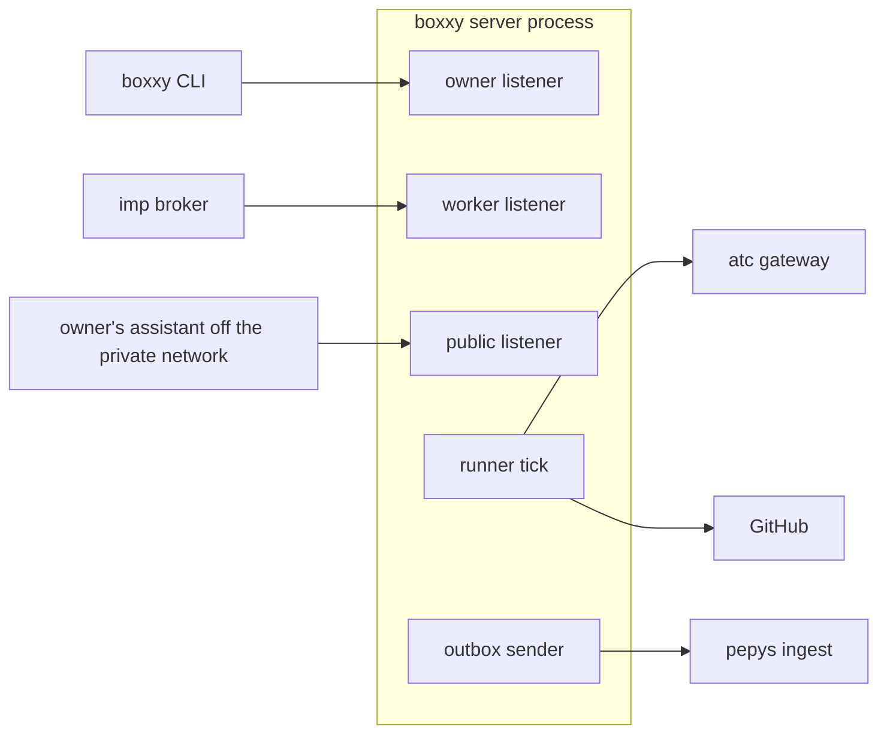

# How boxxy works

boxxy decides which piece of work a fleet of coding agents takes next, runs each step of that work
in an agent session, and records every change it makes. One server process holds the work in a
SQLite store. A loop inside it, called the runner, claims work and starts agent sessions through
atc, the session manager. The runner then watches each live session and records how each attempt
ended. pepys, a separate event store, keeps a record of every change and builds two reports: what an
item cost, and how long it spent in each stage. Below is the whole system, with a link to the doc on
each part. The words every architecture doc uses are defined in [Terms](#terms) at the end.

## The path of an item

1. The owner files an item with the CLI or the owner's MCP tools.
2. On each tick, the runner asks the store for a claim. The store picks the next phase of an item to
   start, from the pools, and takes a seat in each limit that counts the new attempt.
3. The runner starts an agent session for the attempt through atc, and reads that session's state on
   every later tick.
4. The agent sends a close-out when its work is done, and the runner settles the attempt. The store
   keeps no position for the item: each time the server reads an item, it works out where the item
   stands from the item's settled attempts and the pipeline, and the next step is where the edge of
   the settled outcome leads. A rules change therefore moves every waiting item with no migration.
5. When a settle puts the item on hold, it also writes a notice, which the runner sends through atc
   to the session the owner picked for notices.

Phases, edges, holds, limits, pools, recipes and the launch prompt are in
[the pipeline](./work/pipeline.md). How the claim picks an item is in
[planning](./work/planning.md). One attempt from claim to settle is in
[attempts](./work/attempts.md). Keeping, cleaning up and starting sessions are in
[agent sessions](./work/sessions.md). How a hold reaches the owner is in
[notices](./work/notices.md). The steps that wait for a merge to ship are in the
[ship watch](./work/ship-watch.md).

When a pipeline has a merge step, the runner merges the pull request itself, as a job with no agent
session: it reads the pull request's checks and merges at the head commit once every required check
is green. Merging needs a `github` section in the server config: without one, the rules loader
refuses a pipeline with a merge step ([GitHub](./interfaces/github.md)).

## Processes and how they reach each other

The server runs as one process with up to three listeners: the owner listener on the owner's private
network, for the CLI and the owner's MCP tools; the worker listener, which agent sessions reach only
through the imp broker; and the public listener, behind OAuth, for the owner's assistant off the
private network, opened only when the config has a `publicDoor` section. Who may call what on each
listener is in [API and auth](./interfaces/api-and-auth.md). The `boxxy` command and the hooks in
each session are in [the CLI and the hooks](./interfaces/cli-and-hooks.md), and how boxxy links and
merges pull requests is in [GitHub](./interfaces/github.md).

The runner reaches atc through the atc gateway's MCP tools, and GitHub as a GitHub App. Each outside
system has one adapter package. The server builds the adapters and hands them to the domain packages
under `modules/`, and those do no I/O of their own ([layout](./repo/layout.md)).

## The data

The boxxy store is one SQLite file, and only the server opens it. It holds the work and its live
state: items and their levers, attempts and their leases, the seats of each limit, pull request
links, the notices still to send, and the fact outbox. Claims live here because a claim needs a
compare-and-set write, which pepys lacks
([decision 0001](../decisions/0001-claims-live-in-the-boxxy-store.md)).

Every change writes its facts to the outbox in the same transaction, so every state in the store has
its facts waiting to go. The outbox sender, a second loop in the server, sends them to pepys in
order. pepys keeps the whole history, and boxxy's plug-in inside pepys builds the tables the two
reports read. boxxy never needs pepys to decide anything
([facts and pepys](./interfaces/facts-and-pepys.md)). How a write lands, and what refuses one, is in
[the store](./work/store.md).

## Rules

The server loads the rules from a folder. When the folder is a git checkout, the server loads only a
commit in the history of the configured ref, such as `origin/main`, so every rule it runs has merged
through review. A plain folder with no git loads with no check, so build that folder only from the
reviewed rules branch. The rules version is a hash of that commit, the rules file, the recipes'
prompt templates and the code of the planning concepts the rules file pins, such as its pool and
lever kinds. Each claim records the rules version. The owner's levers must act at once while a rules
change waits for review, so the store keeps levers as rows
([decision 0003](../decisions/0003-rules-in-git-levers-as-facts.md)). The loader refuses a YAML
value that holds itself through an alias, and any `__proto__` key, before the schema check.
`scripts/write-concept-pins.ts` writes the concept pins into the committed
`src/generated/concept-pins.ts`, and a test fails when that file is stale. Each hash uses canonical
JSON by RFC 8785, which throws on `NaN` or `undefined`, and a tree hash sorts its files by the UTF-8
bytes of their relative paths.

The parts of the rules file the server runs are in [the pipeline](./work/pipeline.md). The parts not
yet built are in the [rules](../design/boxxy/rules.md) and [planning](../design/boxxy/planning.md)
designs.

## The repo

- [Layout](./repo/layout.md): the package kinds, the dependency rules, the import pins and where a
  new file goes.
- [Tech stack](./repo/tech-stack.md): the runtime, the libraries and the repo tooling, with the
  reason for each.
- [Release](./repo/release.md): how the packages publish at one version, and what a deployment pins.
- [Verify journeys](./repo/verify-journeys.md): the journeys an agent runs before a change merges,
  and the check that enforces them.

Designs for work not yet built are in [docs/design](../design/boxxy/README.md), and the decisions
behind the system are in [docs/decisions](../decisions/).

## Terms

| Term              | Meaning                                                                                                                  |
| ----------------- | ------------------------------------------------------------------------------------------------------------------------ |
| owner             | the one person who runs boxxy: files work, answers holds and changes the rules                                           |
| owner's agent     | an agent the owner works with on the private network, which steers boxxy through the owner listener's MCP tools          |
| owner's assistant | the owner's AI assistant off the private network, which reaches the same tools through the public listener               |
| item              | one piece of work, such as a feature or a fix, with a title, the outcome the owner wants, a body and acceptance criteria |
| phase             | one step of an item's work: triage, design, build, review, verify, merge or live                                         |
| pipeline          | the order of an item's phases, and the edge each result of a phase takes; it is data in the rules file                   |
| edge              | where one result of a phase sends the item: the next phase, an earlier one, the same one again, an end, or a hold        |
| attempt           | one try at one phase of one item                                                                                         |
| job               | an attempt that runs with no agent session, such as a merge that the runner drives                                       |
| close-out         | the JSON result an agent sends when its attempt's work is done, parsed by its phase's format                             |
| settle            | the server's step that ends an attempt and records its result, in one store transaction                                  |
| hold              | an item stopped for the owner, who lifts it with `boxxy item retry`                                                      |
| runner, tick      | the loop inside the server, and one pass of it: claim, start, read every live session, clean up, send notices            |
| claim             | one store transaction that picks the next item phase to start, creates its attempt, and takes its seats                  |
| limit, seat       | a named cap on running attempts with a filter for the attempts it counts, and one place under it that an attempt holds   |
| pool              | a filter and an order over the items ready to start, defined in the rules file                                           |
| lever             | a change the owner makes to a pool's order without a rules change, such as defer or expedite                             |
| recipe            | how a phase's session runs: the agent, the model, the prompt template and the skills                                     |
| rules file        | the YAML file in git that holds the pipelines, limits, pools and recipes                                                 |
| fact              | a record of one change, such as `boxxy.attempt.claimed`, that the server sends to pepys                                  |
| pepys             | the event store that keeps every fact and builds the tables the reports read                                             |
| atc               | the session manager that starts, reads, sleeps and stops agent sessions, reached through its gateway's MCP tools         |
| imp broker        | the proxy between a session in an imp, a cloud machine, and the server; it adds the worker token and an identity token   |
| proven caller     | the session that the broker's identity token proves made a call                                                          |
| port, adapter     | an interface the domain code calls for one outside system, and the package that implements it for one system             |
| forge             | the code host, behind the forge port; GitHub is the one adapter                                                          |
