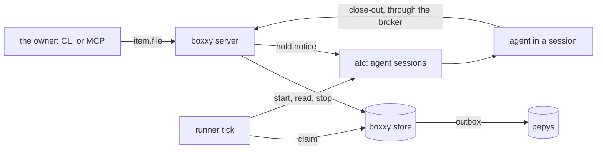
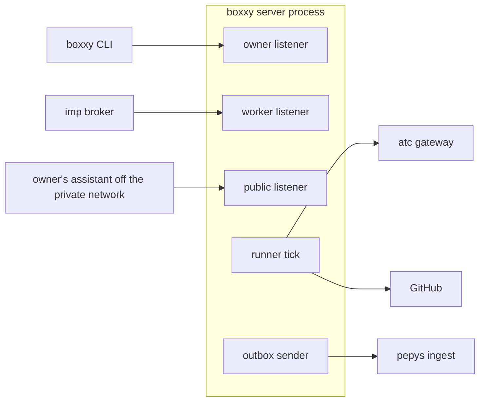

# How boxxy works

boxxy decides which piece of work a fleet of coding agents takes next, runs each step of that work
in an agent session, and records every change it makes. One server process holds the work in a
SQLite store. A loop inside the server claims work, starts agent sessions, asks atc, the session
manager, for the state of each live session, and records how each attempt ended. A separate event
store, pepys, receives a record of every change and holds the data for two reports: what an item
cost, and how long it spent in each stage, meaning each phase and the delivery steps after it. This
page shows the whole system, defines in [Terms](#terms) the words the other architecture docs use,
and links the doc that owns each part.

## Terms

| Term          | Meaning                                                                                                                                     |
| ------------- | ------------------------------------------------------------------------------------------------------------------------------------------- |
| owner         | the one person who runs boxxy: files work, answers holds and changes the rules                                                              |
| item          | one piece of work, such as a feature or a fix, with a title, the outcome the owner wants, a body and acceptance criteria                    |
| phase         | one step of an item's work: triage, design, build, review, verify or merge                                                                  |
| pipeline      | the order of an item's phases, and the edge each result of a phase takes; it is data in the rules file                                      |
| edge          | where one result of a phase sends the item: to the next phase, back to an earlier one, to the same phase again, to an end, or to a hold     |
| attempt       | one try at one phase of one item; a phase can take several attempts                                                                         |
| close-out     | the JSON result an agent sends when its attempt's work is done; the server parses it by its phase's format                                  |
| settle        | the server's step that ends an attempt and records the close-out's result, in one store transaction                                         |
| hold          | an item stopped for the owner, who lifts it with `boxxy item retry`                                                                         |
| runner, tick  | the loop inside the server, and one pass of it: claim, start, ask atc for the state of every live attempt's session, clean up, send notices |
| claim         | one store transaction that picks the next item phase to start, creates its attempt, and takes the seats that attempt needs                  |
| limit, seat   | a named cap on running attempts, with a filter that picks the attempts it applies to, and one place under it that a running attempt holds   |
| pool          | a filter and an order over the items that are ready to start, defined in the rules file                                                     |
| lever         | a change the owner makes to a pool's order without a rules change, such as defer or expedite; the store keeps it as a row                   |
| recipe        | how a phase's session runs: the agent, the model, the prompt template and the skills                                                        |
| rules file    | the YAML file in git that holds the pipelines, limits, pools and recipes, and the path of each recipe's prompt template                     |
| fact          | a record of one change, such as `boxxy.attempt.claimed`, that the server sends to pepys                                                     |
| pepys         | the event store that keeps every fact and builds the tables the reports read                                                                |
| atc           | the session manager that starts, reads, sleeps and stops agent sessions; boxxy calls its gateway, which serves atc's tools over MCP         |
| imp broker    | the proxy between a session in an imp, a cloud VM, and the server; it adds the worker token and an identity token to each call              |
| proven caller | the session that the broker's identity token proves made a call                                                                             |
| port, adapter | an interface that the domain code calls for one outside system, and the package that implements it for one system                           |
| forge         | the code host, behind the forge port; GitHub is the one adapter                                                                             |
| job           | an attempt that runs with no agent session, such as a merge that the runner drives                                                          |

The worker token lets a request call only the procedures that sessions and their hooks use.

## The path of an item

1. The owner files an item with the CLI or through the owner's MCP tools.
2. On each tick, the runner asks the store for a claim. The store picks the next item phase from the
   pools, and takes a seat in each limit whose filter matches the new attempt.
3. The runner starts an agent session for the attempt through atc, and on every later tick asks atc
   for that session's state.
4. The agent sends a close-out when its work is done, and the runner settles the attempt. The store
   keeps no position for the item: the server works out where the item stands from its settled
   attempts and the pipeline's edges each time it reads the item. The item's next place follows from
   the edge for the settled result: its next phase, an earlier phase, an end, or a hold.
5. When a settle puts an item on hold, it also writes a notice. The runner sends the notice through
   atc to the notice session, the agent session that the owner picked to receive notices.

These docs own the steps:

- [The pipeline](./work/pipeline.md): phases, edges, holds, limits, pools, recipes and the prompt a
  session starts with.
- [Attempts](./work/attempts.md): the attempt states, the session states the runner reads, sleep and
  wake, close-outs and settle.
- [Agent sessions](./work/sessions.md): the kept session that a later attempt wakes to carry on,
  cleanup, capacity and the atc adapter.
- [Notices](./work/notices.md): how a hold reaches the owner.

When a pipeline has a merge step, the runner merges the pull request itself, as a job. It reads the
pull request's checks through the forge, and merges at the pull request's head commit when every
required check is green. The server builds the merge job only when its configuration has a `github`
section. Without one, the rules loader refuses a pipeline with a merge step.
[The pipeline](./work/pipeline.md) covers jobs, and [GitHub](./interfaces/github.md) the merge's
reads and refusals.

## Processes and how they reach each other

The server runs as one process and opens up to three listeners:

- the owner listener, on the owner's private network, for the CLI and the owner's MCP tools;
- the worker listener, which agent sessions reach through the imp broker;
- the public listener, behind OAuth, for the owner's assistant when it runs off the private network.
  The server opens it only when its configuration has a `publicDoor` section.

These docs own the edges:

- [API and auth](./interfaces/api-and-auth.md): the listeners, the tokens, the proven caller and who
  may call each procedure.
- [The CLI and the hooks](./interfaces/cli-and-hooks.md): the `boxxy` command and the hook plug-in
  that runs in each session.
- [GitHub](./interfaces/github.md): how boxxy links pull requests and records merges.

The runner reaches atc through the atc gateway's MCP tools, and GitHub through a GitHub App. Each
outside system has one adapter package. The server builds the adapters and passes them to the domain
packages under `modules/`, which do no I/O of their own. [Layout](./repo/layout.md) sets the package
kinds and the import rules that hold this split.

## The data

The boxxy store is one SQLite file, and only the server opens it. It holds the work and its live
state: items and their levers, attempts and their leases, the seats of each limit, pull request
links, the notices still to send and the fact outbox. A lease marks the one live attempt of an item
phase. The server claims in its own store, because a claim needs a compare-and-set write, and pepys
has none ([decision 0001](../decisions/0001-claims-live-in-the-boxxy-store.md)).

The store's apply function writes each change's facts to the outbox in the same transaction as the
change, so every state in the store has its facts in the outbox. The outbox sender, a loop in the
server, sends them to pepys in order. pepys keeps the whole history. The `@boxxy/pepys` package runs
inside the pepys deployment and builds the tables that the cost and stage-time queries read.
[Facts and pepys](./interfaces/facts-and-pepys.md) covers the outbox, the package and the two
queries.

## Rules

The server loads the rules from a git checkout, and only from a commit in the history of the
configured ref, such as `origin/main`, so every rule it runs has merged through review. A plain
folder with no git loads with no check, so build that folder only from the reviewed rules branch.
The rules version is a hash of that commit, the rules file, the recipes' prompt templates and the
plug-in code the rules file pins, and each claim records that version. The owner's levers must act
at once, and a rules change waits for a review, so the store keeps levers as rows
([decision 0003](../decisions/0003-rules-in-git-levers-as-facts.md)).
[The pipeline](./work/pipeline.md) covers the parts of the rules file that the server runs. The
[rules design](../design/boxxy/rules.md) and the [planning design](../design/boxxy/planning.md)
cover the parts not yet built.

## The repo

- [Layout](./repo/layout.md): the package kinds, the dependency rules, the import pins and where a
  new file goes.
- [Tech stack](./repo/tech-stack.md): the runtime, the libraries and the repo tooling, with the
  reason for each choice.
- [Release](./repo/release.md): the npm packages, the one version they share, and what a deployment
  pins.
- [Verify journeys](./repo/verify-journeys.md): the test journeys, the map from changed paths to
  features, and the check that fails a pull request with no fresh verdict.

The designs for work not yet built are in [docs/design](../design/boxxy/README.md), and the
decisions behind the system are in [docs/decisions](../decisions/).
