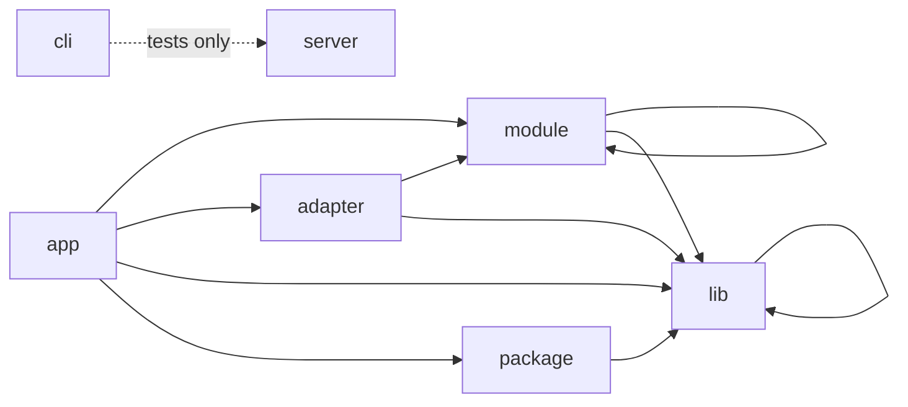

# Layout

boxxy is one Bun workspace split into five kinds of package: apps, modules, adapters, libs and
packages. Modules hold the domain and do no I/O. Each adapter talks to one outside system. Apps
build the adapters and pass them to the modules, and packages are what another repo's deployment
installs. Lint enforces the split: turbo boundaries tags fail a dependency between the wrong kinds,
and the `zgeoff/import-zones` rule in `.oxlintrc.json` pins each outside library to the one package
that may import it.

[Decision 0016: layout](../../decisions/0016-layout.md) records why the repo is split this way.
[Tech stack](./tech-stack.md) covers the libraries, the repo setup files and how each package is
built and published. [Attempts](../work/attempts.md) covers the attempt machine, which one file of
`modules/dispatch` drives, as [Inside a package](#inside-a-package) says.

## Workspace

```text
boxxy/
├── apps/                  composition roots: build adapters, pass them to modules
│   ├── cli/               @boxxy/cli: the boxxy command and the hooks
│   └── server/            @boxxy/server: the Elysia + oRPC API and the runner loop
├── modules/               the domain; no I/O, no adapter imports
│   ├── rules/             the rules loader, the plug-in registry, the rules version hash
│   ├── planning/          buildFrame, decide and the built-in concepts
│   ├── dispatch/          claims over the ClaimStore port, leases, the attempt machine
│   ├── closeout/          the phase kinds: close-out parse, settle and input
│   └── train/             decideMerge, the merge rule
├── adapters/              one package per outside system, named <port>-<system>
│   ├── store-sqlite/      the store and its migrations, on bun:sqlite and Kysely
│   ├── auth-oauth/        the public door's OAuth server and its auth database
│   ├── worker-atc/        spawns attempts through atc, reads back their sessions
│   ├── notifier-atc/      sends a hold notice as an atc message
│   ├── forge-github/      PR and commit links, the PR body, checks and the merge
│   ├── review-noslop/     checks and posts the review tool's result for the ReviewGate port
│   ├── verifier-wringer/  reads the verify gate check and report for the Verifier port
│   └── caller-proof-imp/  proves a session's caller from the broker's identity token
├── libs/                  shared types, schemas and pure helpers; no I/O
│   ├── model/             every type 2+ packages share, the fact catalog, the ports
│   ├── contract/          the oRPC contract the server serves and the CLI calls
│   ├── content-hash/      the ContentHash type and its hashes
│   └── prompt-template/   the launch prompt's placeholders, load check and render
├── packages/              packages that another repo's deployment installs
│   └── pepys/             @boxxy/pepys: the pepys plug-in, the FactSink and the pepys reader
├── docs/                  architecture/, decisions/, design/ and runbooks/
└── scripts/               repo tooling; may do I/O
```

The repo creates a package when built code needs it. A design for unbuilt work names the package it
adds.

Each package's folder name is its package name under `@boxxy/`: `modules/planning` is
`@boxxy/planning`, and `adapters/store-sqlite` is `@boxxy/store-sqlite`.

A lib holds types, schemas and pure helpers that two or more packages use. Every type that two or
more packages share lives in `@boxxy/model`, in `libs/model`, so the modules, the adapters and
`@boxxy/contract` all import it, and no two modules import each other in a cycle.

`scripts/` is not a workspace package, so the import zones leave it alone, and a script may do I/O.
turbo boundaries refuses a root dependency on a module, so the root `package.json` depends on libs
only, and a script that needs a module, such as the concept pin writer, imports the module's source
by relative path.

## Dependency rules



Each package's `turbo.json` carries its kind's tag, and `turbo boundaries` fails a dependency that
the diagram doesn't show. So an app may depend on a module, an adapter, a lib or a package; a module
on a module or a lib; an adapter on a module or a lib; and a lib or a package on a lib only.

So an adapter never imports another adapter, and only an app imports an adapter or a package.

An app never imports another app, with one test-only exception: the CLI's tests drive the real
server. Every test outside `e2e/`, `evals/` and `bench/` is a unit test that sits beside the module
it tests, so a test of the CLI against the real server is a CLI test, beside the CLI module it
drives. Three checks hold the exception:

- `@boxxy/cli` lists `@boxxy/server` in `devDependencies` only. The two apps carry a second tag,
  `cli` and `server`: the `app` tag may depend on the `server` tag, and only the `cli` tag may be
  its dependent, so `turbo boundaries` fails any other package that depends on the server.
- The `server-test-utils` edge of the `zgeoff/import-zones` rule lets the CLI import the server only
  through its `@boxxy/server/test-utils/*` entry.
- The `server-in-tests` edge lets only a CLI test file or a file in `apps/cli/src/test-utils/` make
  that import, so the CLI that ships never imports the server.

The CLI's test utils that drive the real server, `create-test-cli` and the verify CLI in
`src/test-utils/verify/`, import the CLI's dev dependencies, so `files` in its `package.json` and
its `tsconfig.build.json` leave them out of the published package. A test of one app alone stays
beside that app's code and uses a fake `fetch`.

A module never imports an adapter. A module that needs an outside system declares a port, such as
`ClaimStore`, in `libs/model`; an adapter implements it; the app builds the adapter and passes it
in. This keeps `decide()` pure, so a replay can rerun it on recorded facts (see
[dispatch](../../design/boxxy/dispatch.md)).

Every package under `packages/` carries the tag `package`. Another repo's deployment installs such a
package, such as `@boxxy/pepys` in the pepys deployment, so it pulls in as little of boxxy as it
can. It depends on libs only: a lib holds the types and ports it needs, and a module would drag the
domain into the deployment. Only an app imports a package, because the app is the one place that
builds what the packages provide. The `pepys` edge of the import zones also fails an import of
`@boxxy/pepys` from a module or a lib. A package that needs an adapter's work takes it through a
port in `libs/model`, as a module does.

A lib that a package depends on is installed with it, so such a lib keeps its test-only libraries
out of `dependencies`. `@boxxy/model` lists `@faker-js/faker` in `devDependencies` and as an
optional peer: its fakes in `src/test-utils/` use it, and `src/index.ts` imports none of them.

A package's `turbo.json` holds only its tags, such as `{ "extends": ["//"], "tags": ["module"] }`.

## Import pins

Each outside system has one package that may talk to it. The `zgeoff/import-zones` rule in
`.oxlintrc.json` holds each pin, under the name in the last column:

| Outside system | Package                           | What lint checks                                                                                                                                            | Rule           |
| -------------- | --------------------------------- | ----------------------------------------------------------------------------------------------------------------------------------------------------------- | -------------- |
| the store      | `adapters/store-sqlite`           | only it and `adapters/auth-oauth` import `bun:sqlite`, `kysely` or `@zgeoff/kysely-bun-sqlite`; the second one opens the auth database, never the store     | `sqlite`       |
| OAuth          | `adapters/auth-oauth`             | only it imports `@zgeoff/mcp-auth`, `@zgeoff/mcp-auth/elysia` or `@zgeoff/mcp-auth/testing`                                                                 | `oauth`        |
| atc            | `adapters/worker-atc`             | only it imports `@modelcontextprotocol/client`, to call the atc gateway's MCP tools                                                                         | `atc`          |
| imp identity   | `adapters/caller-proof-imp`       | only it imports `@impz/client` or `@impz/client/identity`                                                                                                   | `imp-identity` |
| noslop         | `adapters/review-noslop`          | only it imports `@noslop/cli`, `@noslop/cli/check` or `@noslop/cli/post`, to check and post a review result with the noslop App's keys                      | `noslop`       |
| GitHub         | `adapters/forge-github`           | only it imports `@octokit/auth-app` or `@octokit/request`, to mint the boxxy App's installation token                                                       | `github-app`   |
| pepys          | `packages/pepys`                  | only it imports `@pepys/api`, `@pepys/ingest`, `@pepys/kit`, `@pepys/kit/send`, `@pepys/source-github`, `@pepys/source-telemetry` or `@pepys/testing`       | `pepys-kit`    |
| wringer        | `apps/cli/src/test-utils/verify/` | only the verify CLI imports `@wringer/browser`, `@wringer/db`, `@wringer/gunshi`, `@wringer/http`, `@wringer/mcp` or `@wringer/stream`                      | `wringer`      |
| wringer report | `adapters/verifier-wringer`       | only it, the verify CLI and the CLI's two merge journey test files import `@wringer/core`; the adapter reads the data comment of a report in a pull request | `wringer-core` |

`adapters/notifier-atc` reaches atc without importing the MCP client: the server builds a client
with the `worker-atc` factory and passes the notifier its one send call.

The `network` entry of the import zones lets only an adapter or a package under `packages/` call
`fetch`. An app that wires an adapter passes `fetch` in as an argument. Lint can't tell which
outside system a `fetch` reaches, so review checks that each call goes through the package that owns
its outside system: GitHub through `forge-github`, and the pepys ingest through `packages/pepys`.

oRPC has an owner and no lint pin. Only `libs/contract` calls `oc` and `mcp.tool` to define a
procedure. `apps/server` imports `@orpc/server`, `@orpc/mcp` and `@modelcontextprotocol/server` to
serve the contract, and `@orpc/client` to call the pepys query API. The atc stand-in in
`adapters/worker-atc/src/test-utils/` imports `@modelcontextprotocol/server` too, to serve atc's
tools on the library the atc gateway uses; the package lists it as an optional peer. `apps/cli`
imports `@orpc/client` to call the server, and the real-pepys test deployment in
`packages/pepys/src/test-utils/` imports it to call the pepys query API in process.

Only `apps/server` imports `elysia`. `adapters/auth-oauth` uses the Elysia adapter of
`@zgeoff/mcp-auth`, which needs Elysia as a peer, so it lists `elysia` as a dependency too. Each of
the two lists Elysia's peers `exact-mirror`, `openapi-types` and `typebox` as its own dependencies.

Three libraries have a pin of their own:

| Library    | Package                | Rule     | Why                                                                                                                                                           |
| ---------- | ---------------------- | -------- | ------------------------------------------------------------------------------------------------------------------------------------------------------------- |
| `yaml`     | `modules/rules`        | `yaml`   | every rules file reaches the other packages through `loadRules`                                                                                               |
| `xstate`   | `modules/dispatch`     | `xstate` | the attempt machine, which only `buildAttemptChange` drives                                                                                                   |
| `liquidjs` | `libs/prompt-template` | `liquid` | `modules/rules` checks each prompt template at load and `modules/dispatch` renders it at claim, so the engine and its settings live in a lib that both import |

`modules/**` and `libs/**` do no I/O. The `domain-io` entry of the import zones fails an import of
`node:fs`, `node:child_process`, `node:net`, `node:http` or `node:https` there, and oxlint's
`no-restricted-globals` rule fails any use of the `Date`, `process` or `Bun` globals. Time and
environment come into a module or a lib as arguments, so a test or a replay sets them.

A package imports another only through an entry that the other's `exports` lists. Every package
exports `.`, its `src/index.ts`, and many export `./test-utils/*`, which only tests and other test
helpers import. A few export a named entry as well, such as `@boxxy/pepys/sink`,
`@boxxy/pepys/reader` and `@boxxy/rules/example/*`. The `unresolved` entry of the import zones fails
a deep import, such as `@boxxy/planning/src/decide.ts`, whose path no `exports` key lists.

## Inside a package

Three rules of `@zgeoff/oxlint-config` shape a package's `src/`:

- `zgeoff/file-named-for-export`: one export of each file has the file's name, so a file is named in
  kebab case for its main export. `index.ts`, `types.ts` and `constants.ts` are exempt, in any
  folder.
- `zgeoff/feature-folders`: the root of `src/` holds 8 loose modules at most. The count leaves out
  `index.ts`, `types.ts`, `constants.ts`, tests, and each file that `package.json` names as an
  entry. A subfolder has no limit. When a package outgrows the root, its modules go into one folder
  per thing the package does, such as `attempts/` and `claims/` in `modules/dispatch`.
- `zgeoff/feature-folders` again: code that two feature folders share lives in `src/utils/`, and a
  file in `utils/` imports no feature folder, type imports included. The rule rejects `lib/`,
  `shared/`, `helpers/` and `common/` as other names for `utils/`. `test-utils/` and `generated/`
  are not feature folders.

To place a new file:

- Put code in a file at the root of `src/`, or in the feature folder of the subject it belongs to.
  `src/index.ts` only re-exports.
- Put a folder's types in its own `types.ts`, and its fixed values in its own `constants.ts`.
- Put a test beside the file it tests, as `<file>.test.ts`.
- Put a concept in `modules/planning/src/concepts/`, one file per concept, named after it and
  exporting the concept under that bare name, such as `pool`. Then add it to the list in
  `concepts.ts`. `buildFrame`, `decide` and `propagate` never import a concept: an override in
  `.oxlintrc.json` fails such an import, so the planning core reads concepts only through the loaded
  rules.
- Put a phase kind in `modules/closeout/src/phases/`, one file per kind, named and exported the same
  way, such as `build`.
- Put a store migration in `adapters/store-sqlite/src/migrations/`, one file per migration, and an
  auth database migration in `adapters/auth-oauth/src/migrations/`.
- Leave `generated/` to the script that writes it. `modules/planning/src/generated/` holds the
  concept pins, which the planning package's `build` script writes, and
  `packages/pepys/src/generated/` holds the glue that `pepys build` writes. Lint and the formatter
  skip the pepys glue.
- Write the attempts table, the attempt sessions table or a limit seat only from
  `attempts/build-attempt-change.ts` in `modules/dispatch`, the one caller of the attempt machine.
  The test of `scripts/collect-attempt-writes` fails on such a write in any other source file of the
  package; tests and the store fixtures in `test-utils/` seed those tables and are left out. The
  store's `syncLimits` also writes seats, outside any store change, when the loaded limits change
  which attempts they count.

Tests and their helpers follow the test layout that `bun run check:test-layout` (`chex test-layout`)
enforces:

- A package's test helpers, such as its fakes and factories, live in its `src/test-utils/`, which
  the package exports as `./test-utils/*` for other packages' tests. Production code never imports a
  test helper. A helper that two or more packages' tests use lives in the package that owns what it
  starts, builds or fakes, and another package imports it by name, with that package as a
  `workspace:*` dev dependency.
- An end-to-end test lives, flat, in the `e2e/` folder of the package that builds the program it
  runs, and a benchmark lives in that package's `bench/`, as `adapters/store-sqlite/bench/` does,
  and an eval suite in its `evals/`. Every other test is a unit test, and `bun run test` runs it.
- A test that runs the CLI against the real server in the test process is a CLI test, as
  [Dependency rules](#dependency-rules) says. When a CLI module's test file holds more than one
  wiring of the server, its one `setupTest()` returns each extra wiring as a member, such as
  `mergeAtHead`, and a test of that wiring reads its context from the member.
- The repo root holds no `test-utils/` or `e2e/` folder.

## Where a helper goes

Put a helper in the first place on this list that fits:

1. Used by one file: below its caller, in that file.
2. Used by 2 or more files in one package: its own file, named for its export, in that package: in
   the feature folder that uses it, or in `src/utils/` when two feature folders do.
3. Used by 2 or more packages and specific to boxxy: a lib named for what it does.
4. Generic, with nothing specific to boxxy: `@zgeoff/std`, added there upstream.
