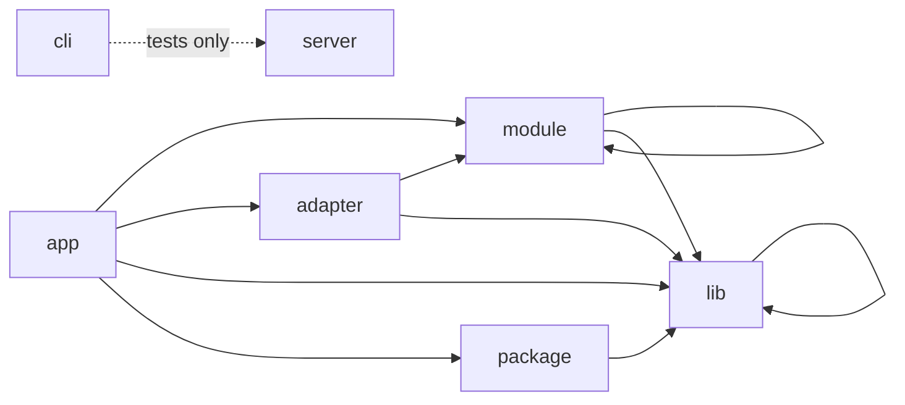

# Layout

boxxy is one Bun workspace of packages, in five kinds: apps, modules, adapters, libs and deployed
packages. Modules hold the domain and do no I/O. A module that needs an outside system declares a
port, an interface for that system, and an adapter implements the port for one system. Apps build
the adapters and pass them to the modules. A deployed package, in `packages/`, is one that another
repo's deployment installs. In this doc, "package" means any package of the workspace.

Lint enforces the split. `turbo boundaries` reads each package's kind from the tags in its
`turbo.json`, and fails a dependency between the wrong kinds. The `zgeoff/import-zones` rule in
`.oxlintrc.json` lists, for each outside library, the packages that may import it.

[The overview](../overview.md#terms) defines the terms this doc uses.
[Decision 0016: layout](../../decisions/0016-layout.md) records why the repo is split this way.
[Tech stack](./tech-stack.md) covers the libraries, the repo setup files and how each package is
built and published. [The pipeline](../work/pipeline.md) covers phases and pools, and
[Attempts](../work/attempts.md) covers close-outs, settle and the attempt machine.

## Workspace

```text
boxxy/
├── apps/                  build the adapters and pass them to the modules
│   ├── cli/               @boxxy/cli: the boxxy command and the hooks
│   └── server/            @boxxy/server: the Elysia + oRPC API and the runner loop
├── modules/               the domain; no I/O, no adapter imports
│   ├── rules/             loads the rules file, registers its plug-ins, hashes the rules version
│   ├── planning/          builds the frame of ready items, decides the order, the built-in concepts
│   ├── dispatch/          claims through the ClaimStore port, leases, the attempt machine
│   ├── closeout/          the phase kinds: each phase's input, close-out parser and settle rule
│   └── train/             decideMerge: on each read of a merge job, wait, merge, finish or hold
├── adapters/              one package per outside system, named <port>-<system>
│   ├── store-sqlite/      the store and its migrations, on bun:sqlite and Kysely
│   ├── auth-oauth/        the public listener's OAuth server and its auth database
│   ├── worker-atc/        spawns attempts through atc, reads back their sessions
│   ├── notifier-atc/      sends a hold notice as an atc message
│   ├── forge-github/      PR and commit links, the PR body, checks and the merge
│   ├── review-noslop/     checks and posts the review tool's result, behind the ReviewGate port
│   ├── verifier-wringer/  reads the verify gate check and its report, behind the Verifier port
│   └── caller-proof-imp/  proves a session's caller from the broker's identity token
├── libs/                  shared types, schemas and pure helpers; no I/O
│   ├── model/             every type 2+ packages share, the fact catalog, the ports
│   ├── contract/          the oRPC contract the server serves and the CLI calls
│   ├── content-hash/      the ContentHash type and its hashes
│   └── prompt-template/   the launch prompt's placeholders, load check and render
├── packages/              deployed packages, which another repo's deployment installs
│   └── pepys/             @boxxy/pepys: the pepys plug-in, the FactSink and the pepys reader
├── docs/                  architecture/, decisions/, design/ and runbooks/
└── scripts/               repo tooling; may do I/O
```

Add a package only when code that is built needs it. Each package's folder name is its package name
under `@boxxy/`: `modules/planning` is `@boxxy/planning`, and `adapters/store-sqlite` is
`@boxxy/store-sqlite`.

A lib holds types, schemas and pure helpers that two or more packages use. Every type that two or
more packages share lives in `@boxxy/model`, in `libs/model`, so the modules, the adapters and
`@boxxy/contract` all import it, and no two modules import each other in a cycle.

`scripts/` is not a workspace package, so the import zones leave it alone, and a script may do I/O.
`turbo boundaries` refuses a root dependency on a module, so the root `package.json` depends on libs
only. A script that needs a module, such as `scripts/write-concept-pins.ts`, imports the module's
source by relative path.

## Dependency rules



`turbo boundaries` fails a dependency that the diagram doesn't show, so an adapter never depends on
another adapter, and only an app depends on an adapter or a deployed package.

A module never imports an adapter. A module that needs an outside system declares a port, such as
`ClaimStore`, in `libs/model`; an adapter implements it; the app builds the adapter and passes it
in. A module therefore runs on plain values, so a test runs it without a store or a network, and a
replay can rerun it on recorded inputs.

A deployed package depends on libs only, so it pulls as little of boxxy as it can into the other
repo's deployment: a lib holds the types and ports it needs, and a module would drag the domain in.
A deployed package that needs an adapter's work takes it through a port in `libs/model`, as a module
does. The `pepys` entry of the import zones also fails an import of a deployed package from a module
or a lib. A lib that a deployed package depends on is installed with it, so such a lib lists its
test-only libraries in `devDependencies`.

An app never depends on another app. The one exception is test-only: the CLI's tests drive the real
server. Every test outside `e2e/`, `evals/` and `bench/` is a unit test that sits beside the source
file it tests, so a test of the CLI against the real server is a CLI test, beside the CLI source
file it drives. Three checks keep the server out of the CLI that ships:

- `@boxxy/cli` lists `@boxxy/server` in `devDependencies` only. The two apps carry a second tag,
  `cli` and `server`. The `app` tag lists `server` among the tags it may depend on, and the `server`
  tag allows only the `cli` tag as a dependent, so `turbo boundaries` fails any other package that
  depends on the server.
- The `server-test-utils` entry of the import zones lets the CLI import the server only through its
  `@boxxy/server/test-utils/*` exports.
- The `server-in-tests` entry lets only a CLI test file or a file in `apps/cli/src/test-utils/` make
  that import.

The CLI's test utils that drive the real server, `create-test-cli` and the verify CLI, import the
CLI's dev dependencies. The verify CLI, in `apps/cli/src/test-utils/verify/`, is the `bun verify`
command that [Verify journeys](./verify-journeys.md) describes. `files` in the CLI's `package.json`
and its `tsconfig.build.json` leave both out of the published package. A test of one app alone stays
beside that app's code and uses a fake `fetch`.

## Import pins

The `zgeoff/import-zones` rule in `.oxlintrc.json` holds a list of named entries. Each entry in this
table pins a set of libraries to the packages that may import them:

| Entry          | Libraries                                                                                                                           | Packages that may import them                                   |
| -------------- | ----------------------------------------------------------------------------------------------------------------------------------- | --------------------------------------------------------------- |
| `sqlite`       | `bun:sqlite`, `kysely`, `@zgeoff/kysely-bun-sqlite`                                                                                 | `adapters/store-sqlite`, `adapters/auth-oauth`                  |
| `oauth`        | `@zgeoff/mcp-auth`, `@zgeoff/mcp-auth/elysia`, `@zgeoff/mcp-auth/testing`                                                           | `adapters/auth-oauth`                                           |
| `atc`          | `@modelcontextprotocol/client`                                                                                                      | `adapters/worker-atc`                                           |
| `imp-identity` | `@impz/client`, `@impz/client/identity`                                                                                             | `adapters/caller-proof-imp`                                     |
| `noslop`       | `@noslop/cli`, `@noslop/cli/check`, `@noslop/cli/post`                                                                              | `adapters/review-noslop`                                        |
| `github-app`   | `@octokit/auth-app`, `@octokit/request`                                                                                             | `adapters/forge-github`                                         |
| `pepys-kit`    | `@pepys/api`, `@pepys/ingest`, `@pepys/kit`, `@pepys/kit/send`, `@pepys/source-github`, `@pepys/source-telemetry`, `@pepys/testing` | `packages/pepys`                                                |
| `wringer`      | `@wringer/browser`, `@wringer/db`, `@wringer/gunshi`, `@wringer/http`, `@wringer/mcp`, `@wringer/stream`                            | the verify CLI                                                  |
| `wringer-core` | `@wringer/core`                                                                                                                     | `adapters/verifier-wringer`, the verify CLI, two CLI test files |
| `yaml`         | `yaml`                                                                                                                              | `modules/rules`                                                 |
| `xstate`       | `xstate`                                                                                                                            | `modules/dispatch`                                              |
| `liquid`       | `liquidjs`                                                                                                                          | `libs/prompt-template`                                          |

Each outside system has one adapter or deployed package that talks to it, and an entry pins its
client library there. The exceptions:

- `adapters/auth-oauth` opens the auth database with the store's SQLite libraries. It never opens
  the store.
- `adapters/notifier-atc` reaches atc without the MCP client: the server builds a client with the
  `worker-atc` factory and passes the notifier its one send call.
- wringer is pinned to the verify CLI, a test helper of the CLI. `@wringer/core` renders and reads
  the verify report, so `adapters/verifier-wringer` imports it too, to read a report from a pull
  request for the server. The CLI's two merge tests, `attempt-commands.test.ts` and
  `item-commands.test.ts` in `apps/cli/src/commands/`, import it to render a report.

The last three rows pin a library to the domain package that owns its job. Every rules file reaches
the other packages through `loadRules` in `modules/rules`, and xstate runs only the attempt machine.
`modules/rules` checks each prompt template at load and `modules/dispatch` renders it at claim, so
the template engine and its settings live in a lib that both import.

The `network` entry lets only an adapter or a deployed package call `fetch`. An app that wires an
adapter passes `fetch` in as an argument. Lint can't tell which outside system a `fetch` reaches, so
review checks that each call goes through the package that owns its outside system: GitHub through
`forge-github`, and the pepys ingest through `packages/pepys`.

oRPC has no entry, so review checks these rules:

- Only `libs/contract` defines a procedure, with `oc` and `mcp.tool`.
- `apps/server` serves the contract, with `@orpc/server`, `@orpc/mcp` and
  `@modelcontextprotocol/server`, and calls the pepys query API with `@orpc/client`.
- `apps/cli` calls the server with `@orpc/client`.
- Two test helpers outside the apps import these libraries too. The atc stand-in in
  `adapters/worker-atc/src/test-utils/` serves atc's tools on `@modelcontextprotocol/server`, the
  library the atc gateway uses. The test pepys deployment in `packages/pepys/src/test-utils/` calls
  the pepys query API with `@orpc/client`.

Only `apps/server` imports `elysia`. `adapters/auth-oauth` lists `elysia` as a dependency because
the Elysia adapter of `@zgeoff/mcp-auth` needs it as a peer.

`modules/**` and `libs/**` do no I/O. The `domain-io` entry fails an import of `node:fs`,
`node:child_process`, `node:net`, `node:http` or `node:https` there, and oxlint's
`no-restricted-globals` rule fails any use of the `Date`, `process` or `Bun` globals. Time and
settings come into a module or a lib as arguments, so a test or a replay sets them.

A package imports another only through an entry point that the other's `exports` lists. Every
package exports `.`, its `src/index.ts`, and many export `./test-utils/*`, which only tests and
other test helpers import. A few export a named entry point as well, such as `@boxxy/pepys/sink`,
`@boxxy/pepys/reader` and `@boxxy/rules/example/*`. The `unresolved` entry fails a deep import, such
as `@boxxy/planning/src/decide.ts`, whose path no `exports` key lists.

## Inside a package

These rules of `@zgeoff/oxlint-config` apply to a package's `src/`:

- `zgeoff/file-named-for-export`: one export of each file has the file's name, so a file is named in
  kebab case for its main export. `index.ts`, `types.ts` and `constants.ts` are exempt, in any
  folder.
- `zgeoff/feature-folders`: the root of `src/` holds 8 loose source files at most. The count leaves
  out `index.ts`, `types.ts`, `constants.ts`, tests, and each entry point listed in `package.json`.
  A subfolder has no limit. When a package outgrows the root, its source files go into one folder
  per thing the package does, such as `attempts/` and `claims/` in `modules/dispatch`.
- `zgeoff/feature-folders` again: code that two feature folders share lives in `src/utils/`, and a
  file in `utils/` imports no feature folder, type imports included. The rule rejects `lib/`,
  `shared/`, `helpers/` and `common/` as other names for `utils/`. `test-utils/` and `generated/`
  are not feature folders.

To place a new file:

- Put code in a file at the root of `src/`, or in the feature folder of the subject it belongs to.
  `src/index.ts` only re-exports.
- Put a folder's types in its own `types.ts`, and its fixed values in its own `constants.ts`.
- Put a test beside the file it tests, as `<file>.test.ts`.
- Put a concept, the plug-in code behind a pool or a lever, such as `pool`, `defer` or `expedite`,
  in `modules/planning/src/concepts/`. Give it a file of its own, named after it, that exports it
  under that bare name, and add it to the list in `concepts.ts`. The planning core,
  `build-frame.ts`, `decide.ts` and `propagate.ts`, never imports a concept: an override in
  `.oxlintrc.json` fails such an import, so the core reads concepts only through the loaded rules.
- Put a phase kind in `modules/closeout/src/phases/`, one file per kind, named and exported the same
  way, such as `build`.
- Put a store migration in `adapters/store-sqlite/src/migrations/`, one file per migration, and an
  auth database migration in `adapters/auth-oauth/src/migrations/`.
- Leave `generated/` to the script that writes it. The `build` script of `modules/planning` writes
  `src/generated/concept-pins.ts`, which records each concept's version and a hash of its source.
  The rules version includes them, so a replay reruns the same concept code. `pepys build` writes
  the glue in `packages/pepys/src/generated/`, which lint and the formatter skip.
- Write the attempts table, the attempt sessions table or a seat in a limit only from
  `attempts/build-attempt-change.ts` in `modules/dispatch`, the one caller of the attempt machine.
  The test of `scripts/collect-attempt-writes` fails on such a write in any other source file of the
  package; tests and the store fixtures in `test-utils/` seed those tables and are left out. The
  store's `syncLimits` also writes seats, outside any store change, when the loaded limits change
  which attempts they count.

Tests and their helpers follow the test layout that `bun run check:test-layout` (`chex test-layout`)
enforces:

- A package's test helpers, such as its fakes and factories, live in its `src/test-utils/`, which
  the package exports as `./test-utils/*` for other packages' tests. Production code never imports a
  test helper. A helper that two or more packages' tests use lives in the package that owns what it
  starts, builds or fakes, and another package imports it by name, with that package as a
  `workspace:*` dev dependency.
- An end-to-end test lives, flat, in the `e2e/` folder of the package that builds the program it
  runs, and a benchmark lives in that package's `bench/`, as `adapters/store-sqlite/bench/` does,
  and an eval suite in its `evals/`. Every other test is a unit test, and `bun run test` runs it.
- When one CLI test file runs the real server in more than one setup, such as on the job rules for a
  merge, its one `setupTest()` returns one property per setup, such as `mergeAtHead`, and a test of
  that setup reads its server and CLI from that property.
- The repo root holds no `test-utils/` or `e2e/` folder.

## Where a helper goes

Put a helper in the first place on this list that fits:

1. Used by one file: below its caller, in that file.
2. Used by 2 or more files in one package: its own file, named for its export, in that package: in
   the feature folder that uses it, or in `src/utils/` when two feature folders do.
3. Used by 2 or more packages and specific to boxxy: a lib named for what it does.
4. Generic, with nothing specific to boxxy: `@zgeoff/std`, added there upstream.
