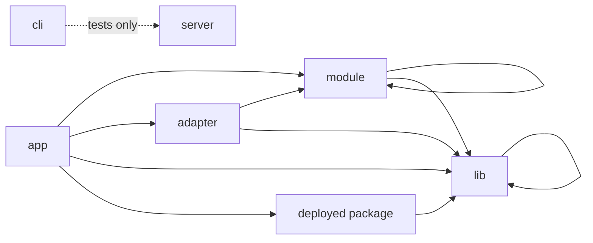

# Layout

boxxy is one Bun workspace, split so the domain never does I/O. Modules hold the domain. A module
that needs an outside system declares a port, an interface for that system, and an adapter
implements the port for one system. Apps build the adapters and hand them to the modules. Libs hold
the types, schemas and pure helpers several packages share, and also do no I/O. A deployed package,
under `packages/`, is one that another repo's deployment installs. Lint enforces every rule here, so
a file in the wrong place fails the check. Read this doc before you add a package, a dependency or a
file whose home isn't obvious.

[Decision 0016](../../decisions/0016-layout.md) records why the repo is split this way.
[Tech stack](./tech-stack.md) covers the libraries and the repo's setup files. The
[overview](../overview.md#terms) defines the shared terms.

## Workspace

```text
boxxy/
├── apps/                  build the adapters and pass them to the modules
│   ├── cli/               the boxxy command and the hooks
│   └── server/            the Elysia + oRPC API and the runner loop
├── modules/               the domain; no I/O, no adapter imports
│   ├── rules/             loads the rules file, registers its plug-ins, hashes the rules version
│   ├── planning/          orders the ready items by the pools and levers
│   ├── dispatch/          the claim, the lease and the attempt machine
│   ├── closeout/          the phase kinds: each phase's input, close-out parser and settle rule
│   └── train/             the merge rule: what a merge job does on each read of its pull request
├── adapters/              one package per outside system, named <port>-<system>
│   ├── store-sqlite/      the store and its migrations
│   ├── auth-oauth/        the public listener's OAuth server and its auth database
│   ├── worker-atc/        starts and reads attempt sessions through atc
│   ├── notifier-atc/      sends a hold notice as an atc message
│   ├── forge-github/      pull request and commit links, checks and the merge
│   ├── review-noslop/     checks and posts a review session's noslop result
│   ├── verifier-wringer/  reads a pull request's verify check and report
│   └── caller-proof-imp/  proves a session's caller from the imp broker's identity token
├── libs/                  shared types, schemas and pure helpers; no I/O
│   ├── model/             every type two or more packages share, the fact catalog, the ports
│   ├── contract/          the oRPC contract the server serves and the CLI calls
│   ├── content-hash/      the content hash type and its hashes
│   └── prompt-template/   the launch prompt's placeholders, load check and render
├── packages/              deployed packages, which another repo's deployment installs
│   └── pepys/             the pepys plug-in, the fact sink and the pepys reader
├── docs/
└── scripts/               repo tooling; may do I/O
```

Each folder's package is named for it under `@boxxy/`, so `modules/planning` is `@boxxy/planning`.
Add a package in the same pull request as the first code that needs it. A type two or more packages
share goes in `@boxxy/model`, so two modules that share a type both import the model and neither
imports the other.

The docs for each outside system: [agent sessions](../work/sessions.md#the-atc-worker) for atc,
[GitHub](../interfaces/github.md#the-github-adapter) for the forge, the
[review gate design](../../design/boxxy/review-and-merge.md#the-review-gate) for noslop,
[verify journeys](./verify-journeys.md) for wringer, and
[facts and pepys](../interfaces/facts-and-pepys.md) for pepys.

## Dependency rules



`turbo boundaries` fails any dependency the diagram doesn't show, so an adapter never depends on
another adapter, and only an app depends on an adapter or a deployed package.

- **A module never imports an adapter.** It takes each outside system through a port in `libs/model`
  that the app fills, so a module runs on plain values: a test runs it without a store or a network,
  and a replay can rerun it on recorded inputs.
- **A deployed package depends on libs only,** so it pulls as little of boxxy as possible into the
  other repo's deployment; a module would drag the domain in. When it needs an adapter's work, it
  takes a port, as a module does, and an import-zones entry fails any import of a deployed package
  from a module or lib. A lib it depends on gets installed with it, so such a lib lists its
  test-only libraries in `devDependencies`.
- **An app never depends on another app,** with one exception: the CLI's tests drive the real
  server, and the test layout puts them beside the CLI code they drive. The CLI lists the server
  only as a dev dependency, may import only the server's test-helper exports, and may import them
  only from a test or a test helper. The CLI's published package leaves out those helpers, the
  verify CLI among them.
- **`scripts/` is not a package,** so the import rules leave it alone and a script may do I/O.
  `turbo boundaries` refuses a root dependency on a module, so a script that needs one imports its
  source by relative path.

## Import pins

Each outside system has one adapter or deployed package that talks to it, and the
`zgeoff/import-zones` rule in `.oxlintrc.json` pins that system's client library there. A library
the domain needs for one job is pinned to the one package whose job needs it: the YAML parser to the
rules module, which every rules file passes through; xstate to dispatch, which runs only the attempt
machine; and Liquid to the prompt-template lib, because the rules module checks templates at load
and dispatch renders them at claim, so both import the lib. The exceptions:

- **The auth adapter opens its own database with the store's SQLite libraries,** and never opens the
  store.
- **The notifier reaches atc without the MCP client.** The server builds an atc client with the atc
  worker's factory and passes the notifier its one send call.
- **wringer is pinned to the verify CLI,** a test helper of the CLI. The verifier adapter also
  imports wringer's core to read a pull request's verify report, and two CLI merge tests import it
  to render one.
- **Only the server imports `elysia`.** The auth adapter lists it as a dependency because
  `@zgeoff/mcp-auth`'s Elysia adapter needs it as a peer.

Three more entries in the rule keep the domain clean:

- **`network`** lets only an adapter or a deployed package call `fetch`; an app passes `fetch` in as
  an argument. Lint can't tell which system a `fetch` reaches, so a reviewer checks that GitHub
  calls go through the GitHub adapter and pepys calls through `packages/pepys`.
- **`domain-io`** fails an import of `node:fs`, `node:child_process`, `node:net`, `node:http` or
  `node:https` in a module or lib, and oxlint's `no-restricted-globals` fails any use of `Date`,
  `process` or `Bun` there. Time and settings come in as arguments, so a test or a replay sets them.
- **`unresolved`** fails a deep import, such as `@boxxy/planning/src/decide.ts`. A package imports
  another only through an entry its `exports` lists, such as `.` or `./test-utils/*`.

oRPC has no entry, so a reviewer checks its rule: only the contract lib defines procedures, the
server serves them and calls the pepys query API, and the CLI calls the server. Two test helpers
outside the apps also import these libraries: the atc stand-in in the atc worker serves atc's tools
over MCP, and the test pepys deployment calls the pepys query API.

## Inside a package

These rules of `@zgeoff/oxlint-config` shape a package's `src/`:

- **A file is named for its main export,** in kebab case. `index.ts`, `types.ts` and `constants.ts`
  are exempt.
- **The root of `src/` holds at most 8 loose source files,** not counting `index.ts`, `types.ts`,
  `constants.ts`, tests and the package's entry points. A package that outgrows that moves its files
  into one folder per thing it does, such as `attempts/` and `claims/` in dispatch.
- **Code two feature folders share lives in `src/utils/`,** which imports no feature folder, not
  even for types.

To place a new file:

- **Code** goes at the root of `src/` or in the feature folder of its subject. `src/index.ts` only
  re-exports. A folder's types go in its own `types.ts`, and its fixed values in its own
  `constants.ts`.
- **A planning concept,** the code behind a kind of pool or a lever the rules file names, gets its
  own file in `modules/planning/src/concepts/`, named for the concept and listed in `concepts.ts`.
  The planning core never imports a concept, and an override in `.oxlintrc.json` fails such an
  import, so the core reads concepts only through the loaded rules.
- **A phase kind** gets its own file in `modules/closeout/src/phases/`, named the same way.
- **A migration** gets its own file in `adapters/store-sqlite/src/migrations/`, or in
  `adapters/auth-oauth/src/migrations/` for the auth database.
- **Generated code** stays with the script that writes it. The planning module's build writes each
  concept's version and source hash, which the rules version includes, so a replay reruns the same
  concept code. `pepys build` writes the glue in `packages/pepys/src/generated/`, which lint and the
  formatter skip.
- **Writes to attempts, attempt sessions or seats** come only from the attempt builder in dispatch,
  the one caller of the attempt machine, and a repo test fails on any other such write in that
  package; tests may still seed those tables. The one exception is the runner's limit sync, which
  rewrites the seats when the loaded limits change which attempts they count.

Tests follow the layout `bun run check:test-layout` enforces. A package's test helpers live in its
`src/test-utils/`, exported as `./test-utils/*`, and production code never imports one. A helper
several packages use lives in the package that owns what it fakes or builds, and the others take
that package as a `workspace:*` dev dependency. An end-to-end test lives flat in the `e2e/` folder
of the package whose program it runs, and a benchmark or eval suite in the `bench/` or `evals/`
folder of the package it measures. Every other test is a unit test beside its file, as
`<file>.test.ts`. The repo root holds no `test-utils/` or `e2e/` folder.

## Where a helper goes

Put a helper in the first place that fits:

1. Used by one file: below its caller, in that file.
2. Used by two or more files in one package: its own file in that package, in the feature folder
   that uses it, or in `src/utils/` when two feature folders do.
3. Used by two or more packages and specific to boxxy: a lib named for what it does.
4. Generic: `@zgeoff/std`, added upstream.
