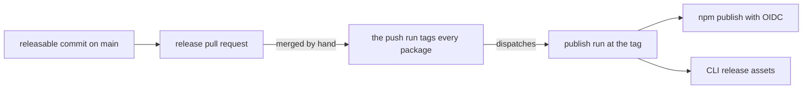

# How boxxy ships

boxxy ships as `@boxxy/*` packages on npm, every one at the same version, plus a compiled CLI on
GitHub. A deployment in another repo never builds from this repo: it installs the packages at one
version, downloads the CLI from the CLI's GitHub release, and builds its images from those. CI
publishes each version from a release tag with npm provenance, so a maintainer's only step in a
normal release is merging the release pull request. Read this doc before you change the release
workflows or a package's manifest, or when you upgrade a deployment.

The [releasing runbook](../../runbooks/releasing.md) gives the maintainer's steps.
[Tech stack](./tech-stack.md) covers the repo's tooling. The [overview](../overview.md#terms)
defines the shared terms.

## How a release publishes



1. A releasable commit lands on `main`, and the release job of `main.yml` calls zgeoff/tools'
   release-please workflow, which opens or updates one release pull request with the version bumps
   and changelogs.
2. A maintainer merges the release pull request. The `main.yml` run of that push tags every package
   as `@boxxy/<package>@<version>` on the merge commit, and release-please creates a GitHub release
   for each tag.
3. The push run dispatches a second `main.yml` run at the tag, the publish run. It starts at the tag
   because npm provenance records the run's own commit as the source, and only a run at the tag has
   the tagged commit as its own.
4. The publish run waits for the tagged commit's checks, then runs `npm publish` from Node 24's
   bundled npm with the job's OIDC token. The repo holds no npm token, and `bun publish` has no OIDC
   support.
5. When the release holds `@boxxy/cli`, a separate job uploads the
   [CLI release assets](#the-cli-release-assets). That job alone has `contents: write`, so that
   permission never shares a job with the OIDC token.

Publish runs share one queue and never cancel, so releases publish in the order their push runs
dispatched them, and no release stops halfway. A version below a package's `latest` dist-tag
publishes under `backport`, so `latest` stays on the newest version.

`npm-packages.yml` rehearses all of this without publishing or uploading: it packs each package,
dry-runs its publish, and builds and checks the CLI assets. It runs on every push to `main`, and on
each pull request that changes a file a package or the publish reads, so a pull request that would
break the publish fails before it merges.

When a publish run fails after the tags exist, such as during an npm outage, a maintainer dispatches
`main.yml` again at a tag of that release. The republish runs the `main.yml` the tagged commit
holds, publishes each package the maintainer lists, skips each version npm already holds, and
uploads the CLI assets when the list includes `apps/cli`
([the runbook](../../runbooks/releasing.md#republish-a-release-that-failed-to-publish)).

## The packages

Every package folder under `apps/`, `modules/`, `adapters/`, `libs/` and `packages/` publishes as
`@boxxy/<folder>`, unless its `package.json` sets `"private": true`. A published package ships its
source with no bundler, so every `@boxxy/*` package it imports must be on npm too. boxxy therefore
keeps no private package, and the contract the server and CLI share is a published lib. Each package
ships its TypeScript source, its declarations in `dist/`, its README and the license, with
`publishConfig.access` set to `public`.

| A deployment builds  | It installs                                                                  |
| -------------------- | ---------------------------------------------------------------------------- |
| the server image     | `@boxxy/server`, and each `@boxxy/*` package the server depends on           |
| the pepys deployment | `@boxxy/pepys` and its dependency `@boxxy/model`                             |
| the agent image      | no package: the files on the [CLI's GitHub release](#the-cli-release-assets) |

`@boxxy/pepys` is the code a pepys deployment loads to build boxxy's tables
([facts and pepys](../interfaces/facts-and-pepys.md#boxxys-plug-in-in-pepys)). It takes `@pepys/kit`
and `zod` as required peer dependencies, so it uses the deployment's own copy of each, and its other
`@pepys/*` peers are optional, because only its test helpers import them. Each `@pepys/*` peer range
is a caret range on the pepys minor version boxxy builds against, so a deployment can take any patch
of it. Inside this repo, the root catalog pins every `@pepys/*` package to one exact version.

The publish refuses a package whose tarball would break on install. It packs each package, reads the
file list, and stops before `npm publish` when an `exports` target has no packed file, or when a
packed `src` file imports a bare name that no `dependencies`, `peerDependencies` or
`optionalDependencies` field lists (`bun`, `node:` and `bun:` modules count as listed). The
rehearsal runs the same checks, so a pull request finds the fault first.

A package's `src/test-utils/` ships with it, so its users can call its test helpers in their own
tests. When a helper imports a package only those users need, the package lists it twice: as an
optional peer, so a user installs it only to use the helper, and as a dev dependency, so the
workspace has it for the package's own tests. `@boxxy/pepys`, for example, lists the pepys test and
ingest packages that way. When the optional peer is another `@boxxy/*` package, its range is
`workspace:*`, and `bun pm pack` writes the release's exact version in its place.

## The CLI release assets

An agent image runs no package manager: its build downloads pinned files and checks their SHA-256.
So the publish run attaches three files to the GitHub release of each `@boxxy/cli@<version>` tag:

| Asset                      | What it holds                                                                                         |
| -------------------------- | ----------------------------------------------------------------------------------------------------- |
| `boxxy-linux-x64`          | the CLI, compiled by Bun into one Linux binary that carries its own runtime                           |
| `boxxy-hook-plugin.tar.gz` | the [hook plug-in](../interfaces/cli-and-hooks.md#the-hook-plug-in), under one folder, `hook-plugin/` |
| `SHA256SUMS`               | one `sha256sum` line for each of the other two                                                        |

The deployment's image build installs the binary as `boxxy` on the `PATH`, because the hooks call
`boxxy`. A deployment's maintainer checks a version's files like this, then pins each checksum in
the agent image's Dockerfile:

```bash
gh release download '@boxxy/cli@<version>' --repo zgeoff/boxxy -p boxxy-linux-x64 -p boxxy-hook-plugin.tar.gz -p SHA256SUMS
sha256sum -c SHA256SUMS
```

The job builds the files from the tagged commit, with the pinned Bun and the frozen lockfile. Before
the upload it runs the binary to check that it starts, prints its version and usage, and refuses a
hook call with no server URL, then checks the files against `SHA256SUMS`.

Once a GitHub release holds a complete set, the job never replaces it, because an image may already
pin its checksums, and Bun doesn't promise the same bytes from two compiles of one commit. The job
uploads `SHA256SUMS` last, so a `SHA256SUMS` that GitHub marks uploaded, with a size above zero,
means the set is complete and the job skips that release. In any other state, including a
half-failed upload that GitHub leaves in the state `starter`, the job uploads all three files again
with `--clobber`.

The job uploads nothing, and fails, when the tag has no GitHub release, since release-please creates
it and the job doesn't, or when the run's checkout isn't the tag's commit, such as a dispatch by
hand at `main`. The job reads the upload tag from the version in `package.json`, and a later commit
can hold the same version, so without that check it could upload other code's binaries under an
existing tag.

## One version for every package

`release-please-config.json` puts every package in one `linked-versions` group, `boxxy`. When a
release holds a change to any package, every package in the group gets the highest version among
them, including packages with no change. Each package still gets its own tag,
`@boxxy/<folder>@<version>`, and every tag of a release sits on the same merge commit.

The config's plugins run `node-workspace` first, then `linked-versions`, the order release-please
needs to link versions in a workspace. `linked-versions` must merge the packages' changes into the
one release pull request, because it needs every package at once to give them one version, so
`node-workspace` runs with `"merge": false` and only updates the `@boxxy/*` dependency ranges.

To add a package, add its entry under `packages` and its component name to the `linked-versions`
plugin's `components`; a private package needs both too. `release-please-config.test.ts` fails while
a package folder lacks either. Before 1.0, a breaking change raises the minor version and any other
releasable change raises the patch.

## The first publish of a new name

CI publishes through npm trusted publishing, with no npm token. npm accepts a trusted publisher only
on a package that already exists, and expires one that no publish uses soon after it is added. So a
new name needs a placeholder published by hand, and the trusted publisher goes on only when a
release is ready ([the runbook](../../runbooks/releasing.md#publish-a-new-package) gives the
deadline and commands):

1. A maintainer with two-factor authentication on the `@boxxy` npm org publishes version `0.0.1`
   from their own machine. The placeholder holds only a `package.json` with the name, license and
   `repository`, a README marking it as a placeholder, and the license file, built outside the
   repo's package folders so it can reserve a name before the code is on `main`.
2. When the release pull request that releases the package is ready to merge, the maintainer adds a
   trusted publisher that lists this repo and `main.yml`.
3. The release publishes the first real version from CI, with provenance. It is above `0.0.1`,
   because `initial-version` is `0.1.0` and the group version is at least that.

## What a deployment pins

A deployment pins every `@boxxy/*` line of its `package.json` to one exact version, and its lockfile
to match, and its agent image pins that version's CLI assets by checksum. To upgrade, it reads the
`latest` version of `@boxxy/server` on npm and moves every `@boxxy/*` line there in one change; one
read is enough, because every package of a release shares the version.

The deployment also pins `@pepys/kit` inside the peer range of `@boxxy/pepys`. boxxy moves to a new
pepys minor version in one release, which moves the catalog's `@pepys/*` lines, the peer ranges of
`@boxxy/pepys` and its generated glue together; `bun run glue` in `packages/pepys` rewrites the
glue. The deployment then moves its `@boxxy/*` and `@pepys/kit` pins together, to that release.
