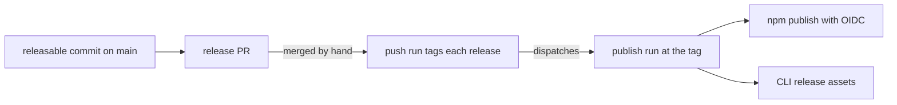

# Tech stack

boxxy runs on Bun and TypeScript, serves its API with oRPC on Elysia, and keeps its store in SQLite
through Kysely. It shares one toolchain with the other repos its agents build, so the same agents,
shared skills and checks work on all of them, and repo-sync keeps the shared files in step. Every
package publishes to npm through release-please and npm trusted publishing. This doc gives each
choice with its reason, the repo setup files, and how a package is built and released.

[Decision 0015: stack](../../decisions/0015-stack.md) records the choices and the alternatives they
beat. [Layout](./layout.md) covers the package kinds and the import pins that keep each library in
one package. [How boxxy ships](./release.md) covers the packages a deployment installs and the
version they share.

## Main choices

- **Elysia 2.0 release candidate.** boxxy serves its oRPC API on the Elysia 2.0 rc, which pepys also
  runs with oRPC, and oRPC's MCP integration runs beside it.
- **oRPC v2 beta, pinned exactly.** The API and its two MCP endpoints run on an oRPC v2 beta,
  because v2 has the MCP integration and the server serves its contract as MCP too
  ([API and auth](../interfaces/api-and-auth.md#the-doors)).
- **Shared files through repo-sync.** boxxy takes its shared files from zgeoff/tools through the
  repo-sync workflow, as every other repo does, so a fix to a shared file reaches every repo.
  repo-sync delivers the chex checks with them.
- **The package split.** boxxy splits its code into `apps/`, `modules/`, `adapters/` and `libs/`,
  plus `packages/` for what another repo installs, and enforces the split with turbo boundaries and
  `zgeoff/import-zones` ([layout](./layout.md)).

## Packages

Every external version is pinned exactly, once, in the root `workspaces.catalog`, which is the one
list of versions. A package writes `"catalog:"` for an external dependency and `"workspace:*"` for
another `@boxxy/*` package.

| Area                    | Packages                                                                                      | Why                                                                      |
| ----------------------- | --------------------------------------------------------------------------------------------- | ------------------------------------------------------------------------ |
| Runtime                 | Bun, at the version `.bun-version` gives; `engines.node >=24`                                 | Bun runs the source with no build step; Node 24's npm does the publish   |
| Compiler                | `typescript` 7, `tsrs`                                                                        | `tsrs` typechecks and emits declarations                                 |
| Strict config           | `@tsconfig/strictest`                                                                         | the strictest shared base                                                |
| Lint                    | `oxlint`, `@zgeoff/oxlint-config`                                                             | the shared rules, including the import zones and the folder rules        |
| Type-aware lint         | `@maschwenk/tsrslint`                                                                         | runs oxlint's type-aware rules on `tsrs`                                 |
| Format                  | `oxfmt`, `@zgeoff/oxfmt-config`, `@zgeoff/format-codemod`                                     | the shared formatter config and the codemods it runs                     |
| Package boundaries      | `turbo`                                                                                       | `turbo boundaries` fails a dependency between the wrong package kinds    |
| Typed API               | `@orpc/contract`, `@orpc/server`, `@orpc/client`, `@orpc/mcp`, `@modelcontextprotocol/server` | one contract serves the API and the MCP tools, and types the CLI's calls |
| atc client              | `@modelcontextprotocol/client`, the MCP client of the server library's release                | the atc gateway serves MCP                                               |
| HTTP server             | `elysia`, with `typebox`, `exact-mirror` and `openapi-types`                                  | Elysia's peers, pinned in the catalog                                    |
| Database                | `kysely` on `bun:sqlite` through `@zgeoff/kysely-bun-sqlite`                                  | one local SQLite file with a write transaction                           |
| Migrations              | Kysely's `Migrator` with an in-code migration provider                                        | migrations ship inside the package                                       |
| Validation              | `zod` 4                                                                                       | every schema at a boundary                                               |
| Rules files             | `yaml`                                                                                        | the rules repository is YAML                                             |
| Launch prompt templates | `liquidjs`, in `@boxxy/prompt-template` only                                                  | a template engine with settings that one lib owns                        |
| CLI                     | `node:util` `parseArgs`, with the command table of `apps/cli`                                 | a table of commands needs only flags and words                           |
| Control flow            | `ts-pattern`, `tiny-invariant`                                                                | exhaustive branches on unions, and guards for states only a bug reaches  |
| State machines          | `xstate` 6 beta, for the attempt machine in `@boxxy/dispatch` only                            | the attempt state table as data                                          |
| Tests                   | `bun test` through `@zgeoff/rig`, `@zgeoff/bun-test-extended`, `@faker-js/faker`              | the shared test lanes and matchers                                       |
| GitHub App auth         | `@octokit/auth-app` and `@octokit/request`, in `adapters/forge-github` only                   | sign the App's JWT and mint its installation token                       |
| HTTP mocks              | `msw` with `@mswjs/interceptors`, and `@msw/data` collections                                 | the GitHub REST API in `adapters/forge-github` tests                     |
| Git hooks               | `lefthook`, gitleaks                                                                          | fix staged files and scan for secrets before a commit                    |
| Commits                 | `@commitlint/cli`, `@zgeoff/commitlint-config`                                                | Conventional Commits, which release-please reads                         |
| Repo checks             | `@zgeoff/chex`                                                                                | the test layout and docs checks                                          |
| Dead code               | `knip`                                                                                        | unused files, exports and dependencies                                   |
| Skill gate              | `@zgeoff/skill-gate`                                                                          | an agent loads the right skills before an edit                           |

- Expected outcomes are values of a union type, branched with `ts-pattern`'s `match().exhaustive()`.
  `tiny-invariant` guards states that only a bug can reach. boxxy uses no result library.
- The server writes its logs as JSON lines to stderr, with no log library.
- boxxy has no OpenTelemetry SDK. Agents send their own telemetry, which atc's agent config switches
  on, and boxxy joins it to attempts by the agent session id (see
  [measurement](../../design/boxxy/measurement.md#spend-capture)).

## Repo setup files

| File                                                          | What it does                                                                                                                                                        |
| ------------------------------------------------------------- | ------------------------------------------------------------------------------------------------------------------------------------------------------------------- |
| `package.json` (root)                                         | the workspace list (`apps/*`, `modules/*`, `adapters/*`, `libs/*`, `packages/*`), the catalog, the root scripts                                                     |
| `.bun-version`                                                | the Bun version CI and `packageManager` use                                                                                                                         |
| `bunfig.toml`                                                 | isolated linker, exact saves, a minimum release age (`minimumReleaseAge`) with first-party excludes, the test preload                                               |
| `tsconfig.base.json`, `tsconfig.json`                         | the shared compiler options, and the root files' typecheck                                                                                                          |
| `turbo.json`                                                  | the boundaries tags and what each may depend on                                                                                                                     |
| `.oxlintrc.json`                                              | extends `@zgeoff/oxlint-config`; holds the `zgeoff/import-zones` pins                                                                                               |
| `oxfmt.config.ts`, `.formatignore`                            | the formatter config, which spreads `@zgeoff/oxfmt-config`, and the files `format-codemod` skips                                                                    |
| `lefthook.yml`                                                | pre-commit fixes staged files and runs gitleaks; commit-msg runs commitlint; pre-push runs `prose` and `boundaries`, then extends the synced pre-push baseline      |
| `commitlint.config.js`                                        | extends `@zgeoff/commitlint-config`                                                                                                                                 |
| `rig.config.ts`                                               | what differs from `rig`'s built-in test lanes, which is nothing                                                                                                     |
| `knip.json`                                                   | the dead-code check's entries per workspace                                                                                                                         |
| `audit-ignores.json`                                          | each ignored advisory with its package, reason and expiry                                                                                                           |
| `renovate.json`                                               | extends the `github>zgeoff/tools` preset                                                                                                                            |
| `review.json`                                                 | noslop's config; lists the synced paths so noslop skips them                                                                                                        |
| `release-please-config.json`, `.release-please-manifest.json` | one release component per published package                                                                                                                         |
| `.gitleaks.toml`                                              | the secret scan's allow list                                                                                                                                        |
| `AGENTS.md`, `CLAUDE.md`                                      | agent rules; `CLAUDE.md` is one line that points at `AGENTS.md`                                                                                                     |
| `.claude/settings.json`, `.claude/skill-gate.json`            | wire the skill-gate hook, and map file globs to the skills an agent loads before an edit                                                                            |
| `LICENSE`                                                     | MIT, "the boxxy authors"                                                                                                                                            |
| `.github/workflows/main.yml`                                  | checks on each push to `main`, then release-please, then a dispatched publish at the release tag                                                                    |
| `.github/workflows/npm-packages.yml`                          | packs each package, dry-runs its publish and builds the CLI's release assets, on each push to `main` and on a PR that changes a file a package or the publish reads |
| `.github/workflows/repo-sync.yml`                             | calls zgeoff/tools's repo-sync, pinned to a green tools commit                                                                                                      |
| `.github/workflows/verify.yml`                                | the `verify / gate` check, which [verify journeys](./verify-journeys.md#the-ci-check) owns                                                                          |
| `scripts/publish/`, `scripts/release/`, `scripts/ci/`         | the publish dispatch, the package publish, the CLI's release assets and the verify gate's step; `scripts/test-utils/` holds their stubs                             |

The `BUN_CHECK_SCRIPTS` repo variable gives CI its list of root scripts:
`audit deadcode format:check lint:full typecheck boundaries check:test-layout prose test`.
`boundaries` runs `turbo boundaries`, and `check:test-layout` runs `chex test-layout`, which fails a
test or a test helper outside the [test layout](./layout.md#inside-a-package). `test` stays
`rig unit`, because `rig init` resets it to that on each rig update. No root script runs the whole
list: the type-aware lint (`lint:full`) and the dead-code check run in CI only, so an agent on a
host with little memory never runs them. An agent runs `typecheck`, `lint` and `test` locally. CI
also runs each docs check that the `check:docs` script names, and `prose` adds the prose check of
`AGENTS.md`.

### What repo-sync delivers

boxxy's `repo-sync.yml` opts in to these entries: `workflow-bun-pr`, `workflow-audit-fix`,
`pre-push-baseline`, `skill-testing`, `skill-code-style`, `skill-docs-writing`,
`skill-skill-writing`, `skill-ci-design` and `knip-runner`. Its `skip` holds `hook-skill-gate`, an
entry zgeoff/tools has retired: repo-sync keeps a retired entry's files in a repo that skips it, so
the skill-gate hook that `.claude/settings.json` runs stays. With the entries every repo takes,
repo-sync delivers:

- `.github/workflows/pr.yml`, which runs the shared Bun checks; the ruleset requires `pr / checks`;
- `.github/workflows/audit-fix.yml` and `.github/workflows/repo-sync-guard.yml`;
- `.lefthook/pre-push-baseline.yml` and the scripts it calls, each run under a memory cap;
- the shared skills, the skill-gate hook, and `scripts/run-knip.sh` for the dead-code check. boxxy
  keeps its own `.claude/skill-gate.json`, so the `skill-gate-rules` entry of zgeoff/tools lists
  boxxy in its `except`;
- the PR template, the issue templates, `.editorconfig` and `socket.yml`.

A synced file is overwritten on the next sync, so change it in zgeoff/tools. zgeoff/tools's
downstream repo setup runbook gives the one-time steps for a new repo.

## Release



boxxy releases through release-please and publishes through npm trusted publishing. One workflow,
`main.yml`, publishes. `npm-packages.yml` only rehearses the publish and the CLI build.

1. A releasable commit lands on `main`. The shared release-please job opens or updates one release
   PR with the version bumps and changelogs.
2. A maintainer merges the release PR by hand. The push run of that merge tags each release as
   `@boxxy/<package>@<version>`.
3. The push run dispatches a publish run at the tag, so npm provenance records the tagged commit.
4. The publish run waits for the tagged commit's checks, then runs `npm publish` from Node 24's
   bundled npm with the job's OIDC token. No npm token exists in the repo. `bun publish` has no OIDC
   support, so npm publishes.
5. When the release holds `@boxxy/cli`, a second job of the publish run compiles the CLI and
   attaches the binary, the hook plug-in archive and their checksums to the CLI's GitHub release.
   That job holds `contents: write`, apart from the publish job's OIDC token.

Publish runs queue and never cancel, so a release never stops halfway. Each publish run waits in one
queue with its own checks, so releases publish in the order they were tagged. A version below the
package's `latest` dist-tag publishes under the `backport` dist-tag, so `latest` stays on the newest
version. A package that is new to npm gets one local publish of a placeholder, then a trusted
publisher on npmjs.com that names `main.yml`. [How boxxy ships](./release.md) gives the packages,
the one version they share and the first publish, and the
[releasing runbook](../../runbooks/releasing.md) gives the steps.

## tsconfig

boxxy uses no project references. One root `tsconfig.base.json` extends `@tsconfig/strictest`, and
each package's `tsconfig.json` extends it. The base:

```json
{
  "extends": "@tsconfig/strictest/tsconfig.json",
  "compilerOptions": {
    "target": "ESNext",
    "lib": ["ESNext"],
    "module": "Preserve",
    "moduleResolution": "bundler",
    "types": ["bun", "@zgeoff/bun-test-extended"],
    "noEmit": true,
    "allowImportingTsExtensions": true,
    "verbatimModuleSyntax": true,
    "moduleDetection": "force"
  }
}
```

A package's `tsconfig.json` extends `../../tsconfig.base.json` and includes `src`, plus the
package's `e2e` or `bench` folder where it has one. Its `typecheck` script runs `tsrs --noEmit`.
Each package also has a `tsconfig.build.json` that emits declarations only, from `src` to `dist`,
and excludes `src/**/*.test.ts`.

## Package manifests

Every package uses the published shape. Inside the workspace Bun runs the source; the published
files add emitted declarations. An invented example:

```json
{
  "name": "@boxxy/example",
  "version": "0.1.0",
  "license": "MIT",
  "repository": {
    "type": "git",
    "url": "git+https://github.com/zgeoff/boxxy.git",
    "directory": "libs/example"
  },
  "files": ["src", "!src/**/*.test.ts", "dist"],
  "type": "module",
  "exports": { ".": { "types": "./dist/index.d.ts", "default": "./src/index.ts" } },
  "publishConfig": { "access": "public" },
  "scripts": {
    "build": "rm -rf dist && tsrs -p tsconfig.build.json",
    "typecheck": "tsrs --noEmit"
  },
  "engines": { "bun": ">=1.3", "node": ">=24" }
}
```

Each published package also carries its own `README.md`, `LICENSE` and the `CHANGELOG.md` that
release-please writes. It also sets `description`, `homepage` and `bugs`.

## Every package publishes

Every package under `apps/`, `modules/`, `adapters/`, `libs/` and `packages/` publishes as
`@boxxy/<folder>`. A published package ships source, so it can't depend on a private one; publishing
all of them keeps the CLI's dependencies installable without a bundler. The repo has no private
package. The oRPC contract lives in `libs/contract` (`@boxxy/contract`), so the server and the CLI
share it as a published lib.
