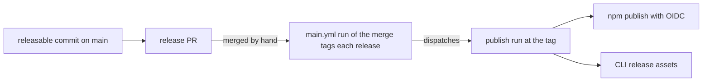

# Tech stack

boxxy runs on Bun and TypeScript, serves its API with oRPC on Elysia, and keeps its store in SQLite
through Kysely. The same agents, shared skills and checks build every zgeoff repo, such as atc and
pepys, so boxxy uses the toolchain those repos share. Every package publishes to npm through
release-please and npm trusted publishing. This doc gives each choice with its reason, the repo
setup files, and how a package is built and released.

[The overview](../overview.md#terms) defines the terms this doc uses, such as claim, pepys and the
rules file. [Decision 0015: stack](../../decisions/0015-stack.md) records the choices and the
alternatives they beat. [Layout](./layout.md) covers the package kinds and the import pins that keep
each library in one package. [How boxxy ships](./release.md) covers the packages a deployment
installs and the version they share.

## Main choices

These choices shape the rest of the repo. [Packages](#packages) gives every other library.

- Bun runs the TypeScript source as it is, with no build step. A published package therefore ships
  its source, and only its type declarations need a build ([package manifests](#package-manifests)).
- The server keeps its store in one SQLite file that only the server opens, through Kysely on
  `bun:sqlite`. A claim needs a write transaction that checks and takes its seats in one step, and
  `bun:sqlite` gives it ([the data](../overview.md#the-data)).
- The server serves one contract both as its RPC API and as MCP tools, and only oRPC v2 has the MCP
  integration ([API and auth](../interfaces/api-and-auth.md#the-doors)). boxxy serves oRPC v2 on
  Elysia 2, the HTTP server, and the catalog pins the exact version of each. pepys runs oRPC on
  Elysia 2 too.
- [zgeoff/tools](https://github.com/zgeoff/tools) holds the files every zgeoff repo shares: CI
  workflows, git hooks, skills and check scripts. Its repo-sync workflow copies them into each repo,
  so a fix to a shared file reaches every repo
  ([what repo-sync delivers](#what-repo-sync-delivers)).
- boxxy splits its code into `apps/`, `modules/`, `adapters/` and `libs/`, plus `packages/` for a
  package that another repo's deployment installs, such as the pepys plug-in. turbo boundaries and
  the `zgeoff/import-zones` lint rule enforce the split ([layout](./layout.md)).

## Packages

The root `workspaces.catalog` pins each external version exactly, and it is the one list of
versions. A package writes `"catalog:"` for an external dependency and `"workspace:*"` for another
`@boxxy/*` package.

| Area                    | Packages                                                                                      | Why                                                                                                                                                        |
| ----------------------- | --------------------------------------------------------------------------------------------- | ---------------------------------------------------------------------------------------------------------------------------------------------------------- |
| Runtime                 | Bun, at the version `.bun-version` gives; `engines.node >=24`                                 | Bun runs the source with no build step; Node 24's npm does the publish                                                                                     |
| Compiler                | `tsrs`                                                                                        | a Rust port of the TypeScript 7 compiler; it typechecks and emits types                                                                                    |
| TypeScript              | `typescript` 7                                                                                | the optional peer that Elysia and msw resolve                                                                                                              |
| Strict config           | `@tsconfig/strictest`                                                                         | the strictest shared base                                                                                                                                  |
| Lint                    | `oxlint`, `@zgeoff/oxlint-config`                                                             | the shared rules, including `zgeoff/import-zones`, which holds the import pins                                                                             |
| Type-aware lint         | `@maschwenk/tsrslint`                                                                         | runs oxlint's type-aware rules on `tsrs`                                                                                                                   |
| Format                  | `oxfmt`, `@zgeoff/oxfmt-config`, `@zgeoff/format-codemod`                                     | oxfmt formats with the shared config; `format-codemod` sets the blank lines between statements                                                             |
| Package boundaries      | `turbo`                                                                                       | `turbo boundaries` fails a dependency between the wrong package kinds                                                                                      |
| Typed API               | `@orpc/contract`, `@orpc/server`, `@orpc/client`, `@orpc/mcp`, `@modelcontextprotocol/server` | one contract serves the API and the MCP tools, and types the CLI's calls                                                                                   |
| atc client              | `@modelcontextprotocol/client`, at the version of `@modelcontextprotocol/server`              | the [atc gateway](../work/sessions.md#the-atc-worker) serves its tools as MCP                                                                              |
| HTTP server             | `elysia`, with `typebox`, `exact-mirror` and `openapi-types`                                  | Elysia's peers, pinned in the catalog                                                                                                                      |
| Database                | `kysely` on `bun:sqlite` through `@zgeoff/kysely-bun-sqlite`                                  | one local file, and the write transaction a claim needs                                                                                                    |
| Migrations              | Kysely's `Migrator` with an in-code migration provider                                        | migrations ship inside the package                                                                                                                         |
| Validation              | `zod` 4                                                                                       | every schema at a boundary                                                                                                                                 |
| Rules file              | `yaml`                                                                                        | parses the rules file, which the owner writes in YAML                                                                                                      |
| Launch prompt templates | `liquidjs`, in `@boxxy/prompt-template` only                                                  | a recipe's [launch prompt](../work/pipeline.md#the-launch-prompt) is a Liquid template, and one lib sets the strict modes and the allowed tags and filters |
| CLI                     | `node:util` `parseArgs`, with the command table of `apps/cli`                                 | a table of commands needs only flags and positional arguments                                                                                              |
| Control flow            | `ts-pattern`, `tiny-invariant`                                                                | exhaustive branches on unions, and guards for states only a bug reaches                                                                                    |
| State machines          | `xstate` 6, for the attempt machine in `@boxxy/dispatch` only                                 | the attempt state table as data                                                                                                                            |
| Tests                   | `bun test` through `@zgeoff/rig`, `@zgeoff/bun-test-extended`, `@faker-js/faker`              | rig runs each kind of test with its own limits; the shared matchers                                                                                        |
| GitHub App auth         | `@octokit/auth-app` and `@octokit/request`, in `adapters/forge-github` only                   | sign the App's JWT and mint its installation token                                                                                                         |
| HTTP mocks              | `msw` with `@mswjs/interceptors`, and `@msw/data` collections                                 | the GitHub REST API in `adapters/forge-github` tests                                                                                                       |
| Git hooks               | `lefthook`, gitleaks                                                                          | fix staged files and scan for secrets before a commit                                                                                                      |
| Commits                 | `@commitlint/cli`, `@zgeoff/commitlint-config`                                                | Conventional Commits, which release-please reads                                                                                                           |
| Repo checks             | `@zgeoff/chex`                                                                                | the test layout and docs checks                                                                                                                            |
| Dead code               | `knip`                                                                                        | unused files, exports and dependencies                                                                                                                     |
| Skill gate              | `@zgeoff/skill-gate`                                                                          | an agent loads the right skills before an edit                                                                                                             |

- A function returns an expected failure as one variant of a union type. boxxy uses no result
  library.
- The server writes its logs as JSON lines to stderr, with no log library.
- boxxy has no OpenTelemetry SDK. Each agent exports its own telemetry, and atc stamps every agent
  it starts with its session ID. pepys joins that telemetry to [attempts](../work/attempts.md) by
  the session ID ([the join keys](../interfaces/facts-and-pepys.md#the-join-keys)).

## Repo setup files

| File                                                          | What it does                                                                                 |
| ------------------------------------------------------------- | -------------------------------------------------------------------------------------------- |
| `.bun-version`                                                | the Bun version CI and `packageManager` use                                                  |
| `bunfig.toml`                                                 | Bun's install and test settings; the list below gives the ones that matter                   |
| `tsconfig.base.json`, `tsconfig.json`                         | the shared compiler options, and the root files' typecheck                                   |
| `turbo.json`                                                  | the boundaries tags and what each may depend on                                              |
| `.oxlintrc.json`                                              | holds the `zgeoff/import-zones` pins                                                         |
| `oxfmt.config.ts`, `.formatignore`                            | the formatter config, and the files `format-codemod` skips                                   |
| `lefthook.yml`                                                | the git hooks; the list below gives what each runs                                           |
| `rig.config.ts`                                               | empty, so rig runs the tests in its built-in lanes; a lane that differs from those goes here |
| `knip.json`                                                   | the dead-code check's entries per workspace                                                  |
| `audit-ignores.json`                                          | each ignored advisory with its package, reason and expiry                                    |
| `review.json`                                                 | the config of noslop, the review tool; it lists the synced files so noslop skips them        |
| `release-please-config.json`, `.release-please-manifest.json` | one release component per published package                                                  |
| `.claude/settings.json`, `.claude/skill-gate.json`            | wire the skill-gate hook, and map file globs to the skills an agent loads before an edit     |
| `.github/workflows/main.yml`                                  | the checks on each push to `main`, the release, and the publish                              |
| `.github/workflows/npm-packages.yml`                          | a rehearsal of the publish and the CLI build                                                 |
| `.github/workflows/repo-sync.yml`                             | calls the repo-sync workflow of zgeoff/tools, pinned to a green tools commit                 |
| `.github/workflows/verify.yml`                                | the `verify / gate` check, which [verify journeys](./verify-journeys.md#the-ci-check) owns   |
| `scripts/publish/`, `scripts/release/`, `scripts/ci/`         | the scripts the release workflows and the verify gate run                                    |

rig splits the tests into lanes, such as the unit run and the `e2e/` folders, and runs each lane
with its own timeout, worker count and memory cap.

- `bunfig.toml` installs with an isolated linker and saves exact versions. Its `minimumReleaseAge`
  refuses a version until it has been on npm for a set time, as a guard against a hijacked release.
  Renovate bumps a first-party package, such as `@zgeoff/rig` or `@pepys/kit`, as soon as it
  publishes, so `minimumReleaseAgeExcludes` lists every first-party package boxxy installs.
- `lefthook.yml` fixes the staged files and runs gitleaks before a commit, and runs commitlint on
  the commit message. Before a push it runs `prose` and `boundaries`, then the pre-push baseline:
  the shared pre-push hook file, `.lefthook/pre-push-baseline.yml`, that repo-sync delivers. The
  baseline runs chex, the shared repo checks.

CI runs the shared checks in the `pr / checks` job of `pr.yml`, which repo-sync delivers. The
`BUN_CHECK_SCRIPTS` repo variable, set in GitHub, gives that job its list of root scripts:
`audit deadcode format:check lint:full typecheck boundaries check:test-layout prose test`.
`boundaries` runs `turbo boundaries`, and `check:test-layout` runs `chex test-layout`, which fails a
test or a test helper outside the [test layout](./layout.md#inside-a-package). `prose` runs the
prose check on `AGENTS.md`. The job also runs each docs check that the `check:docs` script lists,
each as a separate step. The type-aware lint (`lint:full`) and the dead-code check run in CI only,
so an agent on a host with little memory never runs them. An agent runs `typecheck`, `lint` and
`test` locally.

### What repo-sync delivers

repo-sync delivers the entries every repo takes, and the opt-in entries that boxxy's `repo-sync.yml`
lists in `include`. Together they deliver:

- `.github/workflows/pr.yml`, which runs the shared Bun checks; the repo's GitHub ruleset requires
  its `pr / checks` job;
- `.github/workflows/audit-fix.yml` and `.github/workflows/repo-sync-guard.yml`;
- `.lefthook/pre-push-baseline.yml` and the scripts it calls, each run under a memory cap;
- the shared skills, and `scripts/run-knip.sh` for the dead-code check;
- the PR template, the issue templates, `.editorconfig` and `socket.yml`.

repo-sync overwrites a synced file on the next sync, so change it in zgeoff/tools. The
[downstream repo setup runbook](https://github.com/zgeoff/tools/blob/main/docs/runbooks/downstream-repo-setup.md)
of zgeoff/tools gives the one-time steps for a new repo.

boxxy keeps two skill-gate files that repo-sync must leave alone:

- `.claude/hooks/skill-gate/skill-gate.ts`, the hook that `.claude/settings.json` runs before each
  edit and around each shell command. The hook loads `@zgeoff/skill-gate`. The zgeoff/tools manifest
  has no entry for this file, and repo-sync deletes a file whose entry is not in the manifest,
  unless the repo lists that entry in `skip`
  ([retired files](https://github.com/zgeoff/tools/blob/main/docs/architecture/repo-sync.md#retired-files)).
  boxxy's `skip` lists `hook-skill-gate`, so the hook stays. The `@zgeoff/skill-gate` README gives
  the steps to replace the hook with `@zgeoff/agent-hooks`.
- `.claude/skill-gate.json`, which boxxy writes to map its own file globs to skills. The
  `skill-gate-rules` entry of zgeoff/tools lists boxxy in its `except`, so repo-sync never
  overwrites this file.

## Release



boxxy releases through release-please and publishes through npm trusted publishing. One workflow,
`main.yml`, publishes. `npm-packages.yml` packs each package, dry-runs its publish and builds the
CLI's release assets. It runs on each push to `main`, and on each pull request that changes a file
that a package or the publish step reads. A pull request that breaks the publish therefore fails
before it merges.

1. A releasable commit lands on `main`. The release job of `main.yml` calls the release-please
   workflow of zgeoff/tools, which opens or updates one release PR with the version bumps and
   changelogs.
2. A maintainer merges the release PR by hand. The `main.yml` run of that merge, the push run, tags
   each release as `@boxxy/<package>@<version>`.
3. The push run dispatches a publish run at the tag, so npm provenance records the tagged commit.
4. The publish run waits for the tagged commit's checks, then runs `npm publish` from Node 24's
   bundled npm with the job's OIDC token. The repo holds no npm token. `bun publish` has no OIDC
   support, so npm publishes.
5. When the release holds `@boxxy/cli`, a second job of the publish run compiles the CLI and
   attaches the binary, the hook plug-in archive and their checksums to the CLI's GitHub release.
   That job runs alone with `contents: write`, so that permission never shares a job with the OIDC
   token.

All publish runs share one queue, and each run holds its place there through its checks and its
publish. Releases therefore publish in the order the push runs dispatched them. A publish run never
cancels, so a release never stops halfway. A version below the package's `latest` dist-tag publishes
under the `backport` dist-tag, so `latest` stays on the newest version.

npm adds a trusted publisher only to a name that is on the registry, so a new package name needs one
publish by hand first:
[the first publish of a new name](./release.md#the-first-publish-of-a-new-name) gives it.
[How boxxy ships](./release.md) gives the packages and the one version they share, and the
[releasing runbook](../../runbooks/releasing.md) gives the steps.

## tsconfig

boxxy uses no project references. One root `tsconfig.base.json` extends `@tsconfig/strictest`, and
each package's `tsconfig.json` extends the base. Bun runs the `.ts` source as it is, so the base
emits nothing and resolves imports the way a bundler does. A package's `typecheck` script runs
`tsrs --noEmit`, and its `build` script runs `tsrs -p tsconfig.build.json`, which writes only the
declarations of `src` into `dist`, without the tests.

## Package manifests

Every package's `package.json` is written for publishing. An invented example:

```json
{
  "name": "@boxxy/example",
  "version": "0.1.0",
  "license": "MIT",
  "repository": {
    "type": "git",
    "url": "git+https://github.com/zgeoff/boxxy.git",
    "directory": "libs/example"
  },
  "files": ["src", "!src/**/*.test.ts", "dist"],
  "type": "module",
  "exports": { ".": { "types": "./dist/index.d.ts", "default": "./src/index.ts" } },
  "publishConfig": { "access": "public" },
  "scripts": {
    "build": "rm -rf dist && tsrs -p tsconfig.build.json",
    "typecheck": "tsrs --noEmit"
  },
  "engines": { "bun": ">=1.3", "node": ">=24" }
}
```

A workspace checkout has no `dist` until a build runs. When the `types` target is missing, the
typechecker moves on to the `default` condition and reads `src/index.ts`, so a sibling package
typechecks against the source. The published files add the built `dist`, so a consumer's typechecker
reads the declarations.

Only Bun runs a published package, because its `default` export is TypeScript source, and Node
refuses to strip types from a file under `node_modules`. `engines.node` is the Node version whose
bundled npm publishes the package.

Each published package also carries its own `README.md`, `LICENSE` and the `CHANGELOG.md` that
release-please writes. It also sets `description`, `homepage` and `bugs`.

## Every package publishes

Every package under `apps/`, `modules/`, `adapters/`, `libs/` and `packages/` publishes as
`@boxxy/<folder>`. A published package ships its source with no bundler, so each `@boxxy/*` package
it imports stays a dependency that npm must install. npm can't install a package that was never
published, so boxxy keeps no private package. The oRPC contract lives in `libs/contract`
(`@boxxy/contract`), so the server and the CLI share it as a published lib.
