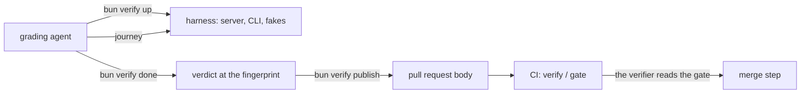

# Verify journeys

A change to boxxy merges only after an agent has used each feature it touches against a running
boxxy, the way the owner or an agent session would. Each of boxxy's eight features has a journey: a
short script of `bun verify` lines that ends in a read with the value it expects. A grading agent
runs the journey of each changed feature against a local boxxy, records a verdict, and publishes a
report into the pull request's body. A CI check, `verify / gate`, fails a pull request that changes
a feature's files with no fresh verdict for it, and boxxy's merge step never merges a head the gate
hasn't passed. Read this doc before you change the harness, the map from paths to features, or the
gate.

The `verify` skill in `.agents/skills/verify/` holds each journey and its end state; this doc owns
what each journey proves. `bun verify` is built on [wringer](https://github.com/zgeoff/wringer)
([its terms](https://github.com/zgeoff/wringer/blob/main/docs/reference/terms.md)). The
[overview](../overview.md#terms) defines the boxxy terms.

## From journey to merge

When a journey passes, the grader runs `bun verify done`, and wringer records a verdict in
`.wringer/` on the grader's machine: the feature, and the fingerprint of the code the journey ran
on. The fingerprint is a git patch id of the branch's change against its merge base, limited to that
feature's paths, so editing a feature's paths makes its verdict stale. Most of boxxy's code is in
all eight features' paths ([the map](#the-path-to-feature-map)), so most changes need all eight
journeys again.

`bun verify publish` writes the report into the pull request body: a table of each feature, whether
the change touches it, and its verdict, plus a hidden data comment with one entry per verdict.
wringer calls that entry a claim, which has nothing to do with boxxy's claim of work. Git ignores
`.wringer/`, and the verify registry, `verify-registry.ts`, which defines the targets and features
`bun verify` knows, sets no upload hook, so evidence stays on the grader's machine.

## The harness

`bun verify up` starts the registry's `local` target: one Bun process, the harness, in a new run
folder that wringer creates, so each `up` starts empty. The harness builds the same parts as the
CLI's end-to-end merge tests:

- the real server from the server's test composition, on a SQLite store, with the
  [example rules](../work/pipeline.md) and a local skills repo they pin;
- a fake clock, and fakes in place of the adapters for [atc](../work/sessions.md#the-atc-worker),
  [GitHub](../interfaces/github.md) and the
  [caller proof](../interfaces/api-and-auth.md#the-proven-caller);
- a fake notifier that keeps each notice it sends, and refuses one while no
  [notice session](../work/notices.md#the-registered-notice-session) is registered;
- the real ingest and query API of [pepys](../interfaces/facts-and-pepys.md), in the harness's
  process;
- the [public listener](../interfaces/api-and-auth.md#the-public-door), with its OAuth server in
  front.

When the listeners answer, the harness prints one ready line with four endpoints: `boxxy`, a
stand-in for the imp broker that routes each call to the right listener and adds the worker token;
`control`, for steps only the harness can take, such as moving the clock or running one tick;
`skills`, the skills repo; and `mcp`, the public listener. The verify CLI, its registry, the path
map and the harness live with the CLI's test helpers in `apps/cli/src/test-utils/verify/`, because
they reuse those helpers and the test layout lets only a test or a test helper import them; the
CLI's published package leaves them out.

The harness keeps these rules:

- **Every owner and session step runs the real CLI as a process,** with `BOXXY_URL` set to the
  `boxxy` endpoint, because only a separate process exercises the CLI's entry point, HTTP client and
  stdin. Before a session's calls, the harness sets the caller the fake proof reports.
- **Time moves only when a step moves it.** The harness runs no tick, watch pass or outbox send on a
  timer; a control route moves the fake clock, then runs one of them. On a deployed server a journey
  would wait for each tick, and its timestamps would differ each run.
- **Each journey files its own item.** A journey line runs either a CLI command or an action, a
  control step the harness provides. The `file-item` and `land-item` actions make the new item the
  current one, which journey lines name as `@current`, and close the items before it, so no tick
  claims work for an old item; `file-item-beside` keeps the earlier item open, for a journey like
  `plan-ordering` that needs two. Journeys therefore run in any order after one `up`, and can run
  again on the same run.
- **Control steps run one at a time, in arrival order.** A route refuses a step whose state is
  wrong, and the journey line fails with `check-failed`. The harness never retries a step.
- **The harness reaches nothing beyond localhost.** It needs no atc, GitHub or deployed pepys, and
  no stored token. Every CLI call sets `BOXXY_SKILLS_URL`, because the session-start hook would
  otherwise fetch from GitHub.
- **The harness never sees the public listener's secret.** `bun verify up` mints a read-and-write
  service client and passes the harness only the secret's digest; the secret stays with wringer's
  supervisor, the process that owns the run, which signs in with it.

## What each journey proves

Each journey ends in a read command that fails with `check-failed` when a value differs from the one
the journey line expects, so a pass needs no judgment from the grader. A pass proves boxxy's own
code, never the adapters the fakes replace.

- `file-item`: the owner files an item through the CLI and the server, and boxxy shows it.
- `claim-settle`: the claim, the start on the fake worker, the
  [session-start hook](../interfaces/cli-and-hooks.md#the-session-start-hook) binding the session,
  the close-out parse and the settle work together, and a session reads another item of its repo
  through the worker listener.
- `report-cost`: a merged item's [facts](../interfaces/facts-and-pepys.md) reach pepys through the
  outbox, and the cost and stage-time reports come back through the server and the CLI.
- `plan-ordering`: a deferred item gets no attempt while the other item takes the claim, and gets
  one after the undefer. The journey runs an expedite but can't prove it reorders anything, because
  while one item is deferred the runner can claim only the other.
- `runner-pause`: the pause stops the claim, `status` reports it, and the resume restarts it.
- `hold-notice`: a settle that holds the item stores a [notice](../work/notices.md), and the tick
  sends it to the session `notices register` stored.
- `hold-recovery`: `item retry --phase` lifts a hold, and the next attempt runs in that phase.
- `owner-mcp`: a service client signs in with `client_credentials`, the public listener lists the
  owner's tools with the read tools marked, and an MCP call files and reads an item. The item is
  held, so no other journey's tick claims it.

The registry's other target, `prod`, attaches to the deployed public listener for a smoke check
after a deploy: a grader runs the `owner-mcp` reads there. wringer refuses every write on it, and
its client holds only the read scope, so the listener refuses a write that slips past wringer. A
`prod` verdict never goes into a pull request, because the deployed items name private repos, and
the public repo holds no host name, so the grader reads the listener's origin and the client's
secret from 1Password.

## The path-to-feature map

`feature-paths.ts`, beside the registry, maps whole package folders to features. Every journey files
an item through the CLI and the server, so every journey runs code in most packages, and a map of
single files would repeat that long list per feature and miss each new file.

- **All eight features:** `apps/cli`, `apps/server`, `libs`, `adapters/store-sqlite`, and the
  `rules`, `dispatch`, `closeout` and `train` modules.
- **Every feature but `file-item` and `owner-mcp`:** `modules/planning`.
- **One feature each:** `adapters/auth-oauth` for `owner-mcp`, and `packages/pepys` for
  `report-cost`.

The gate fails a pull request that changes a feature's paths with no verdict at the current
fingerprint, or that changes a path no feature maps and no ignore glob matches, so every tracked
path, a new package's included, is in a feature or ignored. wringer treats a path an ignore glob
matches as unchanged, in the changed paths and in the fingerprint, even when a feature's glob also
matches it. The ignore list has four groups, each with its reason in a comment in
`feature-paths.ts`:

1. Prose, tests and benches, which have no runtime effect.
2. Build, lint and repo wiring that Bun never reads when it runs the source, such as `.claude/**`,
   `.github/**` and `scripts/**`.
3. The files Renovate and release-please change: each `package.json`, `bun.lock`, the Bun pin and
   the release-please files. Mapping them would make every update bot's pull request wait for a
   verdict no grader writes; the CLI's tests in CI, which run the journeys' flow against the real
   server, cover a dependency change.
4. Code no journey runs: the adapters the fakes replace, the review and verifier adapters, and the
   server's own start, config, timers and rules loader, which the harness swaps for the test
   composition. Their own tests cover them.

A change to the CLI's or the server's `src/test-utils/`, the harness included, needs fresh verdicts
for all eight features, because it changes what a journey proves. No ignore glob matches a source
file a journey runs; the list matches prose by folder and name, never `**/*.md`, because the rules'
prompts are markdown the server sends to each session.

## The CI check

`verify / gate`, in `.github/workflows/verify.yml`, runs when a pull request opens, reopens, gets a
push or has its body edited, since the grader publishes after the push. It has its own workflow
because the shared checks have no `edited` trigger, and a body edit there would rerun every static
check. The job never starts boxxy or runs a journey. It runs two steps: `bun run verify:lint` fails
when the registry, the map and the skill disagree, such as a glob that matches no file or a journey
line that won't parse; then `bun run ci:verify-gate` runs the gate on the body against the base
branch and prints one `::error::` per failing feature and per unmapped path.

- **It reports on every pull request,** with no `if:` or path filter, because the merge step waits
  for each required check, and one that never reports ends the merge attempt with the outcome
  `stalled` at its deadline.
- **It passes a Renovate pull request without running the gate** when the head branch starts with
  `renovate/` and the author is the Renovate app's bot. Renovate can bump a version inside a mapped
  path, and no grader writes its reports. A person's `renovate/` branch still meets the gate.
- **It checks out GitHub's merge ref,** so the fingerprint is the change as it would land on the
  base. The patch id uses 3 lines of context, so a base change within 3 lines of the pull request's
  hunks makes a verdict stale and the grader must rerun that journey.
- **It can't tell that a journey ran,** so a report written by hand passes.

## Who grades

Inside boxxy's pipeline, the `verify` phase grades a change between review and merge when a repo's
rules put it there; the
[review and merge design](../../design/boxxy/review-and-merge.md#the-verifier) owns it. An agent
that opens a pull request outside boxxy follows `AGENTS.md`.

The grader closes out `verified` or `failed` when it graded the change, so the attempt succeeds
either way and the item goes on to merge or back to build; `blocked` and `abandoned` mean it graded
nothing, so the attempt fails. A grader that ran in the builder's
[kept session](../work/sessions.md#the-kept-session) leaves that session on the item after either
graded outcome, so the next build wakes it. The grader never changes the code, so the merge reads
the head the review passed. When a rework pushes a new head, the next grader reruns only the
journeys of features the rework touched; the others keep their verdicts.

A rules file that skips the verify step when `verify / gate` already passes
([step gates and skips](../work/pipeline.md#step-gates-and-skips)) leaves every verdict to the
verify phase, so its prompts split the work:

- The build phase writes or changes the journey, the feature file and the path map of each feature
  it adds or changes, and runs `bun verify lint`. It records no verdict and publishes no report.
- The build and rework prompts say that `verify / gate` stays red until the verify phase runs, so
  the builder leaves it red.
- Only the verify phase records verdicts and runs `bun verify publish`.

## A prod target for live checks

A [live step](../work/pipeline.md#the-live-phase-kind) checks an item's tagged acceptance lines
against the deployed system, through the repo's own verify CLI. A repo gives its live agent:

- a prod target in its verify registry, with `access: 'read-only'` and `evidence: 'local'`, which
  the agent checks with `bun verify doctor --target prod` before any line;
- a guard in each of its own QA scripts that writes to prod, which confines the write to a QA area
  and refuses outside it. A line that needs a write outside the guards closes out `blocked`, with
  the write it needs;
- its prod credentials in its own vault, which only the broker profile of its scoped agent reads
  ([who holds a credential](../work/sessions.md#who-holds-a-credential)).

## What the merge step reads

The merge step never reads the grader's outcome. It reads the gate through the verifier adapter,
which reads the gate's check run at the pull request's head and the body's data comment:

- `verified` when the gate's check run succeeded and the comment parses, with one verified feature
  per entry;
- `verified` with no features when the gate's check run succeeded and the body holds no report, as
  after a skipped verify step, which publishes none;
- `incomplete` when the check run failed, or the body has a data comment that doesn't parse.
- `not-covered` when the head has no gate check run that finished as passed or failed: none yet, one
  still running, or one cancelled or skipped.

An entry carries no status of its own: staleness needs a checkout, which only the gate has, so the
adapter takes the gate's result as the staleness check. Only a check run counts, never a commit
status of the gate's name, because any token that may write statuses could post one. The merge step
waits for the checks that the base branch requires, and for the gate like any other check when the
base branch's ruleset or the rules' `merge.checks` list it.

The repo owns the `verify` skill, written from wringer's template with one feature file per feature,
and the job that syncs shared skills from `zgeoff/skills` never writes it. Only the verify CLI
imports wringer; the verifier adapter and two CLI merge tests import its core alone
([import pins](./layout.md#import-pins)).
