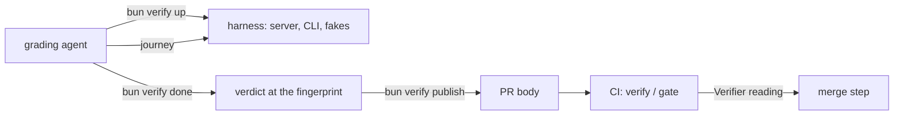

# Verify journeys

A change to boxxy merges only after an agent has used each feature it touches against a running
boxxy, the way the owner or an agent session would. Each of boxxy's eight features has a journey: a
short script of `bun verify` lines that ends in a read command with the value it expects. The
grading agent runs the journey of each changed feature against a local boxxy, records a verdict, and
writes the report into the pull request's body. A CI check, `verify / gate`, fails a pull request
that changes a feature's files with no fresh verdict for that feature. boxxy's merge step never
merges a head that the gate has not passed.

[The overview](../overview.md#terms) defines the boxxy terms this doc uses, such as owner, item,
attempt, claim, close-out, settle, hold, tick, pepys and the imp broker. This doc owns what each
journey proves; the `verify` skill in `.claude/skills/verify/` holds each journey and its end state.

`bun verify` is built on [wringer](https://github.com/zgeoff/wringer)
([its terms](https://github.com/zgeoff/wringer/blob/main/docs/reference/terms.md)). When a journey
passes, the grader runs `bun verify done`, and wringer records a verdict in `.wringer/` on the
grader's machine: the feature, and the fingerprint of the code the journey ran on. The fingerprint
is a git patch id of the branch's change against its merge base, limited to that feature's paths, so
an edit to a feature's paths makes that feature's verdict stale. [The map](#the-path-to-feature-map)
puts most of boxxy's code in all eight features' paths, so most changes need all eight journeys run
again.

`bun verify publish` writes the report into the pull request's body: a table of each feature,
whether the change touches its paths, and its verdict, and a hidden data comment with one entry for
each verdict. wringer calls that entry a claim, which is unrelated to boxxy's claim of work.

## From journey to merge

## The harness

The verify CLI, its registry (`verify-registry.ts`), the path-to-feature map and the harness live in
`apps/cli/src/test-utils/verify/`, which the CLI's published package leaves out. The harness reuses
the CLI tests' helpers, and the repo's [test layout](./layout.md) check lets only a test or a test
helper import a `test-utils` entry, so the verify CLI lives among the test helpers.

`bun verify up` starts the registry's `local` target: one Bun process, the harness. wringer gives
each `up` a new run folder for the store, the skills repo, the public listener's auth database and
the session workspaces, so each `up` starts empty. The harness builds the same parts as the CLI's
end-to-end merge tests in `apps/cli/src/commands/`:

- the real server from the server's test composition, on a SQLite store, with the
  [example rules](../work/pipeline.md) and a local skills repo that the rules pin;
- a fake clock, and fakes in place of three adapters a deployment uses: the worker, which starts
  sessions through [atc](../work/sessions.md#the-atc-worker); the forge, which talks to
  [GitHub](../interfaces/github.md); and the caller proof, which reads the
  [proven caller](../interfaces/api-and-auth.md#the-proven-caller) from the imp broker's token;
- a fake notifier in place of the atc notifier, which keeps each notice it sends, and refuses one
  while no [notice session](../work/notices.md#the-registered-notice-session) is registered;
- pepys under test: the real ingest and query API of [pepys](../interfaces/facts-and-pepys.md), in
  the harness's process;
- the [public listener](../interfaces/api-and-auth.md#the-public-door): the server's MCP endpoint
  with its OAuth server in front.

The real server has an owner listener, and a worker listener for session and hook calls that a
worker token guards. In a deployment, the imp broker sits in front of both, routes each call and
adds the token. When the server's listeners answer, the harness prints one ready line with four
endpoints: `boxxy`, a stand-in for the imp broker that the CLI's own tests also use; `control`, the
routes for steps that only the harness can take, such as moving the clock or running one tick;
`skills`, the skills repo; and `mcp`, the public listener.

The harness keeps these rules:

- **Every owner and session step runs the real CLI as a process,** with `BOXXY_URL` set to the
  `boxxy` endpoint. Only a separate process exercises the CLI's entry point, its HTTP client and its
  stdin. Before each session's calls, the harness sets the session that the fake caller proof
  reports as the caller.
- **Time moves only when a step moves it.** The harness runs no tick, pull request watch or outbox
  send on a timer: a control route advances the fake clock, then runs one tick, one watch pass or
  one outbox drain. On the deployed server, which ticks on timers, a journey would wait for each
  tick, and the timestamps it reads would differ on each run.
- **Each journey files its own item.** The `file-item` and `land-item` actions make the item they
  file the current item, which a journey line refers to as `@current`. They close the item before it
  and every item kept open beside it, so no tick claims work for an old item. `file-item-beside`
  keeps the earlier item open instead, for a journey that needs two items, such as `plan-ordering`.
  The journeys therefore run in any order after one `up`, and a journey can run again on the same
  run.
- **Control steps run one at a time, in arrival order,** so a slow step never overlaps the next. A
  route refuses a step whose state is wrong, and the journey line fails with `check-failed`. Nothing
  retries.
- **The harness reaches no network outside localhost.** It needs no atc, GitHub or deployed pepys,
  and no stored token. Every CLI call sets `BOXXY_SKILLS_URL`, because the session-start hook
  fetches from GitHub when the variable is unset.
- **The harness never sees the secret that signs in to the public listener.** `bun verify up` mints
  a service client with the read and write scopes, and passes the harness only the secret's digest
  for the listener's service-token file. The secret stays with wringer's supervisor, the process
  that owns the run, whose `mcp` driver signs in with it.

## The journeys

Each journey ends in a read command. The command runs the CLI and fails with `check-failed` when a
value differs from the one in the journey line, so a pass needs no judgment from the grader. A pass
proves boxxy's own code, and never the adapters that the fakes replace. Each pass proves this much:

- `file-item`: the owner files an item through the CLI and the server, and boxxy shows it.
- `claim-settle`: the claim, the start on the fake worker, the
  [session-start hook](../interfaces/cli-and-hooks.md#the-session-start-hook) binding the session to
  its attempt, the server's parse of the close-out and the settle work together. A session also
  reads another item of its repo through the worker listener.
- `report-cost`: the [facts](../interfaces/facts-and-pepys.md) of a merged item reach pepys through
  the outbox, and the cost report and the stage-time report come back from pepys through the server
  and the CLI.
- `plan-ordering`: a deferred item gets no attempt while the other item takes the claim, and gets
  one after the undefer. The journey runs an expedite, but never proves that an expedite moves an
  item ahead of an older one: while one item is deferred, the runner can claim only the other.
- `runner-pause`: the pause stops the claim, `status` reports it, and the resume restarts it.
- `hold-notice`: a settle that holds the item stores a [notice](../work/notices.md), and the tick
  sends it through the notifier to the session that `notices register` stored.
- `hold-recovery`: `item retry --phase` lifts a hold, and the next attempt runs in that phase.
- `owner-mcp`: a service client signs in with `client_credentials` from the public listener's
  service-token file, the listener lists the owner's tools with the read tools marked, and an MCP
  call files and reads an item. The item is held, so no other journey's tick claims it.

## The prod target

The registry's other target, `prod`, attaches to the deployed public listener. wringer refuses every
write on it, and its service client holds only the read scope, so the listener also refuses a write
that slips past wringer. A grader runs the `owner-mcp` reads there after a deploy, as a smoke check.
A `prod` verdict and its evidence never go into a pull request, because the deployed items name
private repos. The public repo holds no host name, so the grader reads the listener's origin and the
read client's secret from 1Password before it attaches.

## The path-to-feature map

`feature-paths.ts`, beside the registry, maps whole package folders to features. Every journey files
an item through the CLI and the server, so every journey runs code in most packages; a map of single
files would repeat that long list for each feature and miss each new file. The map gives:

- **All eight features:** `apps/cli`, `apps/server`, `libs`, `adapters/store-sqlite`, and the
  `rules`, `dispatch`, `closeout` and `train` modules.
- **Every feature but `file-item` and `owner-mcp`:** `modules/planning`.
- **One feature each:** `adapters/auth-oauth` for `owner-mcp`, and `packages/pepys` for
  `report-cost`.

The gate fails a pull request that changes a feature's paths with no verdict at the current
fingerprint, or that changes a path no feature maps and no ignore glob matches, so every tracked
path, a new package's among them, is in a feature or ignored. wringer counts a path that an ignore
glob matches as no change, in the changed paths and in the fingerprint, even when a feature's glob
matches it too.

The ignore list has four groups, each with its reason in a comment in `feature-paths.ts`:

1. Prose, tests and benches, which have no runtime effect.
2. Build, lint and repo wiring that Bun never reads when it runs the source, `.claude/**`,
   `.github/**` and `scripts/**` among them.
3. The files that Renovate and release-please change: each `package.json`, `bun.lock`, the Bun pin
   and the release-please files. A mapped lock file would make every update bot's pull request wait
   for a verdict that no grader writes. The CLI's tests in CI, which run the journeys' flow against
   the real server, cover a dependency change.
4. Code that no journey runs: the adapters that the fakes replace, the review and verifier adapters,
   and the server's own start, config, timers and rules loader, which the harness replaces with the
   test composition. A mapped path would demand a verdict from a journey that never runs it. Their
   own tests cover them, with the server's start tests run against a fake atc server.

The map keeps these rules:

- A change to the CLI's or the server's `src/test-utils/`, the verify CLI and the harness among it,
  needs fresh verdicts of all eight features, because it changes what a journey proves.
- An ignore glob never matches a source file that a journey runs. The list matches prose files by
  folder and name, and never matches `**/*.md`, because the rules' prompts are markdown that the
  server sends to each session.

## The CI check

The check `verify / gate`, in `.github/workflows/verify.yml`, runs when a pull request opens,
reopens, gets a push or has its body edited, since the grader writes the report after the push. The
shared checks in `pr.yml` have no `edited` trigger, and a body edit there would rerun every static
check, so the gate has a workflow of its own.

The job runs two steps, and neither starts boxxy or runs a journey:

1. `bun run verify:lint` fails when the registry, the map and the skill disagree, such as a glob
   that matches no file or a journey line that would not parse.
2. `bun run ci:verify-gate` runs `bun verify gate` on the body from the event, against the pull
   request's base branch. On a failure it prints one `::error::` annotation for each failing feature
   and each unmapped path.

These facts hold for the check:

- **The step passes a Renovate pull request without running the gate,** when the head branch starts
  with `renovate/` and the author is the Renovate app's bot. Ignore group 3 covers the files
  Renovate usually changes, but Renovate can bump a version inside a mapped path, and no grader
  writes a report for its pull requests. A person's `renovate/` branch still meets the gate.
- **The job has no `if:` and no path filter, so it reports on every pull request.** boxxy's merge
  step waits for each required check, and one that never reports ends the merge attempt as `stalled`
  at the merge's deadline.
- **The job checks out GitHub's merge ref,** so the gate fingerprints the change as it would land on
  the tip of the base branch. The patch id uses 3 lines of context, so a change to the base within 3
  lines of the pull request's hunks makes the verdict stale, and the grader has to run that
  feature's journey again.
- **The gate can't tell that a journey ran,** so a report written by hand passes.

## Who grades

Inside boxxy's pipeline, the `verify` phase grades a change between the review and the merge, when a
repo's rules put it there; the
[review and merge design](../../design/boxxy/review-and-merge.md#the-verifier) owns it. An agent
that opens a pull request outside boxxy takes the steps in `AGENTS.md`.

The grader closes out with one of four outcomes. `verified` and `failed` both mean the grader graded
the change, so the attempt succeeds whatever the grade, and the item goes on to merge or back to
build. `blocked` and `abandoned` mean it graded nothing, so the attempt fails. A grader that ran in
the builder's [kept session](../work/sessions.md#the-kept-session) leaves that session on the item
after either graded outcome, so the next build attempt wakes it. The merge step never reads these
outcomes; it reads the gate, through the [`Verifier` reading](#the-verifier-reading).

The grader never changes the code, so the merge reads the head the review passed. When a `failed`
verify or a review's `changes-requested` sends the item back to build, the rework pushes a new head,
and the next verify attempt's grader runs the journey of each feature whose paths the rework
touched. The other features keep their verdicts.

## The `Verifier` reading

boxxy's merge step reads the gate through the `Verifier` port, whose wringer adapter reads the
gate's check run at the pull request's head and the body's data comment:

- `verified` when the gate's check run succeeded and the comment parses, with one `verified` feature
  for each entry in the comment;
- `incomplete` with no features when the gate's check run failed, or when the body holds no data
  comment that parses: a Renovate pull request has none, and a comment in an older wringer format
  fails to parse;
- `not-covered` when the head has no gate check run that finished as passed or failed: none yet, one
  still running, or one cancelled or skipped.

An entry carries no status of its own: staleness needs a checkout, which only the gate has, so the
adapter takes the gate's conclusion as the staleness check. Only a check run counts, never a commit
status of the gate's name, because any token that may write statuses could post one. An unmapped
path alone also fails the gate, so the reading is `incomplete`.

The merge step merges only a head whose reading is `verified`, even when the rules' `merge.checks`
leave the gate out, and waits for the gate as for any other check when they list it.

## Constraints

- Only the verify CLI imports `@wringer/*`. Two others import `@wringer/core` alone: the CLI's
  end-to-end merge tests, to render a data comment, and the verifier adapter, to parse one for the
  server. The import-zone rules in `.oxlintrc.json` hold these edges.
- Git ignores `.wringer/`, and the registry sets no upload hook, so evidence stays local.
- The repo owns the `verify` skill, written from wringer's template, with one feature file for each
  feature. The job that syncs the shared skills from `zgeoff/skills` never writes it.
