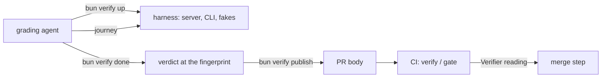

# Verify journeys

A change to boxxy merges only after an agent has used each feature it touches against a running
boxxy, the way an owner or a session would. Each of boxxy's eight features has a journey: a short
script of `bun verify` lines that ends in a read with the value it expects. The grading agent runs
the journey of each changed feature against a local boxxy, records a verdict, and writes the report
into the pull request's body. A CI check, `verify / gate`, fails a pull request that changes a
feature's files with no fresh verdict for that feature. boxxy's merge step never merges a head that
the gate has not passed.

This doc owns what each journey proves; the `verify` skill in `.claude/skills/verify/` holds each
journey and its end state. `bun verify` is built on [wringer](https://github.com/zgeoff/wringer),
whose terms this doc uses:

- A **verdict** is what `bun verify done` records when a journey passes: the feature and the
  fingerprint of the code it ran on. wringer keeps verdicts and evidence files in `.wringer/` on the
  grader's machine.
- The **fingerprint** is a git patch id of the branch's change against the merge base with the base
  branch. Any edit to a feature's paths changes it, and the feature's verdict goes stale.
- The **report** lists each feature, whether the change touches its paths, and its verdict.
  `bun verify publish` writes it into the pull request's body as a table and a hidden data comment
  with one claim for each verdict.

boxxy's own terms come from these docs:

- The [core model](../../design/boxxy/core-model.md) covers an item, its attempts and their phases.
- The [attempt lifecycle](../work/attempts.md) covers the runner's tick, one pass that claims, reads
  and settles attempts.
- [Close-outs](../../design/boxxy/close-outs.md) covers the structured result a session sends at the
  end of its attempt.
- [Facts and pepys](../interfaces/facts-and-pepys.md) covers the outbox, the store's queue of facts,
  and pepys, the service that stores the facts and serves the cost and time reports.

## Shape

## The harness

The verify CLI, its registry, the path-to-feature map and the harness live in
`apps/cli/src/test-utils/verify/`, a test helper folder that the CLI's published package leaves out.
The harness imports the CLI tests' own helpers, and `chex test-layout` lets only a test or a test
helper import a package's `test-utils` entry, so the whole verify CLI is a test helper.

`bun verify up` launches one Bun process, the harness. It builds the same parts as the CLI's
item-to-merge journey test: the real server from the server's test composition, on a SQLite store,
with the example rules and a local skills repo that the rules pin; fakes for the clock, worker,
forge and caller proof, where a deployment has the atc, GitHub and imp adapters; a notifier that
keeps each notice it sends, and refuses one while no notice session is registered; pepys under test,
its real ingest and query API in the same process; and the public door, the server's MCP endpoint
with its OAuth server in front. Each `up` gets a new run folder from wringer, which holds the store,
the skills repo, the door's auth database and each session's workspace, so the next `up` starts from
an empty store.

The real server has an owner listener, and a worker listener for session and hook calls that a
worker token guards. A deployment puts a broker in front of them that routes each call and adds the
token. The harness prints one ready line once its listeners answer, with four endpoints: `boxxy`,
the same broker routing that the CLI's own tests use; `control`, the routes for steps that only the
harness can take, such as moving the clock or running one tick; `skills`, the skills repo; and
`mcp`, the public door.

The harness keeps these rules:

- **Every owner and session step runs the real CLI as a process,** with `BOXXY_URL` set to the
  `boxxy` endpoint, because a process proves the CLI's entry, its HTTP client and its stdin. The
  harness's own unit test runs the same argv in the test process, because a process per step would
  outrun the test's time limit. Before each session's calls, the harness sets the caller that the
  fake caller proof returns.
- **Time moves only when a step moves it.** No tick, pull request watch or outbox send runs on a
  timer: a control route advances the fake clock, then runs one tick, one watch pass or one outbox
  drain. The deployed server ticks and watches on timers, so a journey on it would wait, and read
  different minutes on each run.
- **Each journey files its own item.** The harness keeps the item that the last `file-item` or
  `land-item` action filed, and a journey line refers to it as `@current`. When a journey sets the
  current item, the harness closes the item before it and its peers, so no tick claims work for an
  old item. The journeys therefore run in any order after one `up`, and a journey can run again on
  the same run.
- **Control steps run one at a time, in arrival order,** so a slow step never overlaps the next. A
  route answers 409 for a step whose state is wrong, and the journey line fails with `check-failed`.
  Nothing retries.
- **The harness reaches no network outside localhost.** It needs no atc, GitHub or deployed pepys,
  and no stored token. Every CLI call sets `BOXXY_SKILLS_URL`, because the session-start hook
  fetches from GitHub when the variable is unset.
- **The harness never sees the door's secret.** `bun verify up` mints a service client with the read
  and write scopes, and passes only the secret's digest to the harness, which writes it into the
  door's service-token file. The secret stays with wringer's supervisor, whose `mcp` driver signs in
  with it.

## The journeys

Each journey ends in a read command, which runs the CLI and fails with `check-failed` when a value
differs from the one in the journey line, so the grader judges nothing. A pass proves this much:

- `file-item`: the owner's path through the CLI and the server to the store files an item and shows
  it.
- `claim-settle`: dispatch's decision, the claim, the start on the fake worker, the hook's bind, the
  close-out parse and the settle work together, and a session reads another item of its repo through
  the worker listener.
- `report-cost`: the facts of a merged item reach pepys through the outbox, and both reports come
  back from pepys through the server and the CLI.
- `plan-ordering`: a deferred item gets no attempt while the other item takes the claim, and gets
  one after the undefer. The journey runs an expedite, but never proves that an expedite moves an
  item ahead of an older one, because while one item is deferred the runner can claim only the
  other.
- `runner-pause`: the pause flag stops the claim, `status` reports it, and the resume lets the next
  tick claim.
- `hold-notice`: a settle that holds writes a notice row, and the tick sends it through the notifier
  to the session that `notices register` stored.
- `hold-recovery`: `item retry --phase` lifts a hold and moves the item to the phase, so the next
  attempt runs there.
- `owner-mcp`: a service client signs in with `client_credentials` from the door's service-token
  file, the door lists the owner's tools with the read tools marked, and an MCP call files and reads
  an item. The item is held, so no other journey's tick claims it.

A journey proves boxxy's own code, and never runs the worker, forge, caller-proof or notifier
adapters that the fakes replace.

## The prod target

The registry's second target, `prod`, attaches to the deployed public door. wringer refuses every
write on it, and its service client holds only the read scope, so the door also refuses a write that
slips past wringer. A grader runs the `owner-mcp` reads there after a deploy, as a smoke check; the
skill's `owner-mcp` feature file holds the steps. A `prod` verdict and its evidence stay on the
grader's machine and never go into a pull request, because the deployed items name private repos.
The door's origin comes from the secret store with the client's secret, because the public repo
keeps no host name.

## The path-to-feature map

`feature-paths.ts`, beside the registry, holds the globs, one set per package, because every journey
runs most of the server: a map by file would repeat the same globs and break on each new file.
wringer's gate fails a pull request on a changed feature with no verdict at the current fingerprint,
or on a changed path that no feature maps and no ignore glob matches, so every tracked path is in a
feature or ignored. wringer counts a path that an ignore glob matches as no change, in the changed
paths and in the fingerprint, even when a feature's glob matches it too.

| Paths                                                                                                                | Features                                      |
| -------------------------------------------------------------------------------------------------------------------- | --------------------------------------------- |
| `apps/cli/**`, `apps/server/**`, `libs/**`, `adapters/store-sqlite/**`, `modules/{rules,dispatch,closeout,train}/**` | all eight                                     |
| `modules/planning/**`                                                                                                | every feature but `file-item` and `owner-mcp` |
| `adapters/auth-oauth/**`                                                                                             | `owner-mcp`                                   |
| `packages/pepys/**`                                                                                                  | `report-cost`                                 |

The ignore list has four groups, each with its reason in a comment in `feature-paths.ts`:

1. Prose, tests and benches, which have no runtime effect.
2. Build, lint and repo wiring that Bun never reads when it runs the source, `.claude/**`,
   `.github/**` and `scripts/**` among them.
3. The files that Renovate and release-please change: each `package.json`, `bun.lock`, the Bun pin
   and the release-please files. A mapped lock file would make every update bot's pull request wait
   for an agent's verdict. A patch or minor update merges on green CI, and a major bump or a new Bun
   version gets the owner's review, while the CLI's tests in CI run the same flow as the journeys
   against the real server.
4. Code that no journey runs: the adapters that the fakes replace, the review and verifier adapters,
   and the server's own start, config, timers and rules loader, which the harness replaces with the
   test composition. A mapped path would demand a verdict from a journey that never runs it. Their
   own tests and the server's start tests on the atc stand-in cover them.

The map keeps these rules:

- A change to the CLI's or the server's `src/test-utils/`, the verify CLI and the harness among it,
  needs fresh verdicts of all eight features, because it changes what a journey proves.
- An ignore glob never matches a source file that a journey runs. `**/*.md` stays off the list,
  because the rules' prompts are markdown that the server sends to each session.
- A new package fails the gate as unmapped until its pull request adds it to a feature or to the
  ignore list.

## The CI check

The gate runs as the check `verify / gate`, in `.github/workflows/verify.yml`, when a pull request
opens, reopens, gets a push or has its body edited, since the grader writes the report there after
the push. The shared checks in `pr.yml` have no `edited` trigger, and a body edit there would rerun
every static check, so the gate has a workflow of its own.

The job runs two steps, and neither starts boxxy or runs a journey:

1. `bun run verify:lint` fails when the registry, the map and the skill disagree, such as a glob
   that matches no file or a journey line that would not parse.
2. `bun run ci:verify-gate` writes the body from the event to a file, and runs `bun verify gate`
   against the pull request's base branch. When the gate fails, the step prints one `::error::`
   annotation for each failing feature and each unmapped path, so each cause shows next to the
   failed step.

These facts hold for the check:

- **The gate skips a Renovate pull request.** When the head branch starts with `renovate/` and the
  author is the Renovate app's bot, the step passes without running the gate, because the bot
  changes only dependency versions and nobody runs a journey on its pull requests. A person's
  `renovate/` branch still meets the gate.
- **The job has no `if:` and no path filter, so it reports on every pull request.** boxxy's merge
  step waits for a required check that never reports until its deadline, and then ends the merge
  attempt as `stalled`.
- **The job checks out GitHub's merge ref,** so the gate fingerprints the change as it would land on
  the tip of the base branch. The patch id uses 3 lines of context, so a change to the base within 3
  lines of the pull request's hunks makes the verdict stale, and the change is graded again.
- **The gate trusts the report.** It recomputes the fingerprint and the changed features, but it
  cannot tell that a journey ran, so a report written by hand passes.

## Who grades

The `verify` phase kind grades a change inside boxxy's pipeline, after the review and before the
merge, when a repo's rules put it there. A `verified` or `failed` verify graded the work, so the
attempt succeeds, and a grader that ran in the builder's
[kept session](../work/sessions.md#the-kept-session) keeps it for the rework. A `blocked` or
`abandoned` verify graded nothing, and fails. The
[review and merge design](../../design/boxxy/review-and-merge.md#the-verifier) owns the phase and
its recipes. An agent that opens a pull request outside boxxy takes the steps in `AGENTS.md`. The
grader never changes the code, so the head the review passed stays the head the merge reads. A
rework after a failed verify or a review sends the item back to build, the new head makes every
verdict stale, and the change is graded again.

## The `Verifier` reading

boxxy's merge step reads the gate through the `Verifier` port. Its wringer adapter reads the
`verify / gate` check run at the pull request's head and the data comment in the body:

- `verified` when the gate's check run succeeded and the comment parses, with one `verified` feature
  for each claim in the comment;
- `incomplete` with no features when the gate failed, or when the body holds no current comment that
  parses, as on a Renovate pull request, whose gate passes with no report. An older version of the
  comment adds a note to run `bun verify publish` again;
- `not-covered` when the gate's run at the head has not passed or failed.

A claim carries no status of its own, because staleness needs the diff, and only the gate has a
checkout to compute it, so the adapter trusts the gate's conclusion. Only a check run counts, never
a commit status of the gate's name, because any token that may write statuses could post one. An
unmapped path fails the gate while every claim in the body stands, so the reading is `incomplete`,
and the gate's annotation shows the path.

The merge step merges only a head whose reading is `verified`, even when the rules' `merge.checks`
leave the gate out. When the gate is among the required checks, the merge step waits for it as for
any other check.

## Constraints

- Only the verify CLI imports `@wringer/*`. `@wringer/core` has two more importers: the merge
  journey tests, which render a data comment with it, and the verifier adapter, which parses the
  comment for the server. The import-zone rules in `.oxlintrc.json` hold these edges.
- Git ignores `.wringer/`, and the registry sets no upload hook, so evidence stays local.
- The repo owns the `verify` skill, written from wringer's template, with one
  `references/feature-<name>.md` for each feature. The skills sync never delivers it.
