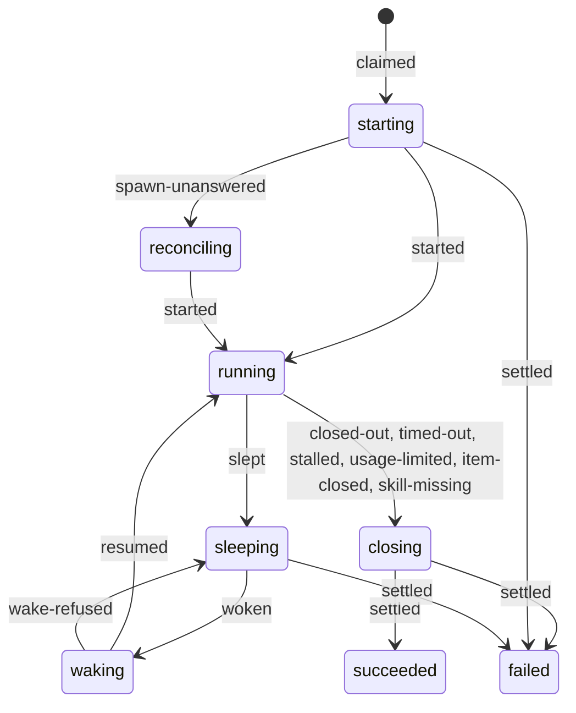

# Attempt lifecycle

boxxy runs each phase of an item as an attempt: one agent session that tries the phase once. The
runner starts an attempt when it claims the item, and settles it as succeeded or failed. On each
tick the runner reads the session of every live attempt through the atc worker. The reading is
`running`, `suspended`, `ended` or `absent`, and one pure table maps the reading and the attempt's
state to one action. A `running` reading never ends an attempt. boxxy stops a session before it
settles the attempt, so the attempt holds its seats until its session has stopped.

[The overview](../overview.md#terms) defines the terms this doc uses, such as runner, tick, claim,
seat, settle and atc. [The pipeline](./pipeline.md) covers phases, steps, edges, limits and holds.
[Notices](./notices.md) covers how a hold reaches the owner,
[API and auth](../interfaces/api-and-auth.md) the proven caller, and [agent sessions](./sessions.md)
the kept session, cleanup and the atc worker.
[The review-and-merge design](../../design/boxxy/review-and-merge.md) covers job attempts, and
[the close-outs design](../../design/boxxy/close-outs.md) the phase kinds.

## The states

The diagram shows the common moves, and the table of moves in the attempt machine of
`@boxxy/dispatch` holds the full set with the rows and facts each move writes. An attempt moves to
`reconciling` when the worker gives no answer to the spawn call. The spawn may still have landed, so
the runner reads the session by its spawn name, as it reads any other. The event `usage-limited`
settles the attempt with the failure `usage-limit`.

Every write to the attempts table, to the attempt sessions table and to a seat goes through one
builder, `buildAttemptChange` in `modules/dispatch/src/attempts/`, and a repo test fails when
another source file of `modules/dispatch` writes to them. The builder runs the XState machine
through the pure `transition` function and creates no actor. The attempt row stores the state value
and the context, never a snapshot.

Two callers can change one attempt at once, such as the runner and a close-out call. Each change
therefore expects the row as its builder read it: the state, every column that the machine's guards
read, and the generations of the attempt's lease and of its seats; the seat generation goes up at
each wake. Two moves that keep the state still race on the guard columns. The store applies one and
refuses the other, and the refused caller reads again on the next tick.

The runner picks each action from the row it read before the session reading, then writes the move
inside the store's write lock, which runs one change at a time. When the row in the lock differs on
a guard column, the runner writes nothing. An action that calls the worker first (a respawn, a
resume or a stop) reads the row again before the call. That narrows the race but cannot close it,
because the worker call runs outside the lock. A move that records the worker's answer, such as
`started` or `resumed`, has no such check: the machine refuses it when the answer no longer fits.

An attempt takes its seats at the claim, releases them at the sleep, takes them again at the wake
before the session resumes, and releases them at the settle; `closing` keeps them. It holds the
lease on its item and phase from the claim to the settle, so no second attempt starts on that phase.

## The reconcile table

On each tick the runner reads one session per live attempt and takes the action in this table:

| Reading   | starting, reconciling | running                  | sleeping                 | waking                   | closing |
| --------- | --------------------- | ------------------------ | ------------------------ | ------------------------ | ------- |
| running   | move to running       | check bounds             | request the wake         | move to running          | stop    |
| suspended | sleep                 | sleep                    | nothing                  | resume                   | settle  |
| ended     | settle                | settle                   | nothing                  | resume                   | settle  |
| absent    | send the spawn again  | settle as `session-lost` | settle as `session-lost` | settle as `session-lost` | settle  |

A time limit or a pending request changes some cells:

- an absent session on a starting or reconciling attempt settles as `spawn-lost` after
  `timeouts.spawnLostMinutes`, and a waking one as `resume-lost` after `timeouts.resumeLostMinutes`;
- a running session on a sleeping attempt wakes over the cap ([sleep and wake](#sleep-and-wake));
- a closing attempt follows [the give-up rule](#closing-the-stop-and-the-give-up-rule);
- an `ended` reading on a running attempt that boxxy asked to sleep records the sleep.

A running attempt whose session runs stays as it is until it passes a bound that the rules set. Each
bound applies in one design mode, `agent` or `attended`, or in both
([design mode](./pipeline.md#design-mode)). boxxy checks the bounds in this order and acts on the
first one that is past:

| Mode     | Bound                                                                                                                                     | Past the bound                                                   |
| -------- | ----------------------------------------------------------------------------------------------------------------------------------------- | ---------------------------------------------------------------- |
| both     | the reading carries a reset time for the account's usage limit                                                                            | boxxy stops the session and settles the attempt as `usage-limit` |
| agent    | the pipeline step's `timeoutMinutes`, counted from the start or the latest wake                                                           | boxxy stops the session and settles the attempt as `timed-out`   |
| attended | the session waits for the owner for `afterIdleMinutes`: it asks for input, its turn ended, or it shows no activity since a wake           | sleep                                                            |
| attended | the session shows no activity at all for `afterQuietMinutes`                                                                              | sleep                                                            |
| agent    | the session shows no activity for `afterSilentMinutes`, counted from its last activity, its start or its latest wake, whichever is latest | boxxy stops the session and settles the attempt as `stalled`     |
| attended | the owner has not attached for `afterUnattendedMinutes`, while the agent stays active                                                     | sleep, even when active                                          |

An agent ends its turn to wait for CI, a subagent or a scheduled wakeup. An agent-mode attempt that
the agent does not close out therefore ends at a bound of this table, and never at a turn end. boxxy
never asks to put an agent-mode session to sleep, because a sleep stops the agent's scheduled wakeup
and no owner is there to wake the attempt. A session that asks for input is no exception: Claude
Code sends its idle notice after each turn end, and atc reads that notice as a request for input,
the same as a real prompt. So silence ends an agent-mode session only at `afterSilentMinutes`. A
host can still sleep on its own, in either mode. The reading then shows `suspended`, and boxxy
records the sleep and requests the wake at once.

atc counts only the agent's hook events as activity, such as the end of a turn, and never a tool
call. A turn the agent starts for a scheduled wakeup or a finished background task therefore shows
its activity when it ends. A scheduled wakeup can wait longer than the default silence limit, so the
example build and design prompts tell the agent to wake more often than that default. The `sleep`
block of the rules file sets the four `after…Minutes` settings, and only `afterSilentMinutes` has a
default. One case has no bound, on purpose: an attended session that the owner attaches to again
inside every `afterUnattendedMinutes`.

These rules explain the other cells:

- atc's state `done` means that the turn ended and the session waits for a prompt. It reads as
  running, never as an end, in either mode.
- An `ended` reading on a sleeping attempt does nothing, because a session on a local machine,
  outside an imp, reads as ended once boxxy suspends it. A session that truly ended while asleep
  fails at the wake as `resume-lost`.
- A close-out beats a sleep in progress. A close-out that lands between the sleep request and the
  suspend moves the attempt to `closing`.
- boxxy puts no attempt to sleep before atc reports an agent session ID for it, because atc cannot
  revive a session that stopped before atc captured the ID.

`timeouts` in `@boxxy/dispatch` holds the time limits that the rules file does not. Two apply only
to a job attempt, which runs with no session: `timeouts.jobReadSeconds`, the least time between two
reads of one job, and `timeouts.actRetryMinutes`, how long the runner waits before it sends an
unanswered merge request again
([job attempts](../../design/boxxy/review-and-merge.md#job-attempts)).

## Sleep and wake

boxxy puts a session to sleep only in attended mode, and only on a bound in the table above. The
sleep has three steps, and the seats go last:

1. boxxy marks the attempt, in one change, before any worker call.
2. boxxy asks the worker to suspend the session. The worker refuses when the session shows activity
   since boxxy judged it idle, except at the unattended bound.
3. boxxy records the sleep and releases the seats. A refusal clears the mark.

A crash, or an unknown answer from the worker, can stop the sleep between two steps, and the next
reading finishes it. After step 1 the attempt keeps the mark and its seats: a running reading clears
the mark, and a suspended or ended reading records the sleep. After step 2 the session reads as
suspended or ended, so boxxy records the sleep.

Every wake starts as a wake request, from one of these sources:

- the owner runs `boxxy item wake <item>`;
- a reading shows the session running while the attempt sleeps, because the owner revived it in atc;
- a reading shows the session suspended when boxxy never asked for a sleep, because the host slept
  on its own.

Each claim takes requested wakes before any new work. The claim takes the attempt's seats, and only
then does boxxy resume the session. A session that the owner revived runs at that point, and if no
seat comes free within `timeouts.seatlessSeconds`, the attempt wakes over the cap: each limit that
counts the attempt goes over its maximum, and boxxy claims no new work under that limit until its
count is back at or under the maximum. boxxy stops no session that the owner revived.

## Close-outs and their limits

One procedure, `attempt.closeOut`, takes the close-out of every phase. The phase comes from the
attempt row, and that phase kind's parser reports every problem at once. The first check is this:

| Case                                                            | Answer                        | The attempt        |
| --------------------------------------------------------------- | ----------------------------- | ------------------ |
| the call is not for the current attempt of the calling session  | refused, `not-current`        | unchanged          |
| the first valid close-out of a live attempt                     | recorded                      | moves to `closing` |
| an invalid close-out                                            | rejected, with every problem  | stays open         |
| a valid close-out over `closeOutLimits.closeOutBytes` as stored | rejected, `too-large`         | stays open         |
| the same body again                                             | recorded, as a repeat         | unchanged          |
| another body after a valid close-out                            | refused, `already-closed-out` | unchanged          |
| a proven caller that no session of boxxy holds                  | refused, `no-attempt`         | none               |

The first valid close-out is final. The current attempt of a session is the latest one it carries,
whose row holds the proven caller, and the session reads its ID with `attempt.current`. A call with
no proven caller gets a 401 ([the proven caller](../interfaces/api-and-auth.md#the-proven-caller)).

`closeOutLimits.closeOutBytes`, in `@boxxy/closeout`, keeps the `closed_out` fact well under the
[outbox's limit of one fact](../interfaces/facts-and-pepys.md#the-outbox), so an accepted close-out
always reaches pepys. The limit bounds the design text of a design close-out too, which has no limit
of its own.

## Closing, the stop and the give-up rule

boxxy moves an attempt to `closing` when it has decided that the attempt is over and the session
still runs. The runner then stops the session, and the attempt settles when the session reads as
suspended, ended or absent. boxxy sends no stop while the agent is inside a turn, until
`timeouts.stopGraceSeconds` after the move to `closing`, so the agent can tell the owner that the
close-out went in. A close caused by `item.close` gets no such grace.

atc refuses a stop while another owner keeps the same host awake, which can last long. An attempt
whose session still runs `timeouts.closingGiveUpMinutes` after the move to `closing` settles anyway,
and releases its seats and its lease. It settles as it would have after a stop: by its close-out, or
with the failure that moved it to `closing`, such as `timed-out`. boxxy marks it as a stray, lists
it in `runner.status`, and sends the stop on each tick for `timeouts.strayHours`.
[Cleanup](./sessions.md#cleanup) then takes over the stop.

An item can close while its attempt's spawn is in flight. The attempt then stays in `closing` and
sends no second spawn. When the session appears, boxxy stops it and settles. When none appears
within `timeouts.spawnLostMinutes`, it settles as a stray, and the runner, then cleanup, looks for
the session by its spawn name on each tick and stops it when it appears. `item.close` ends the
item's live attempts in the same store change as the close. A sleeping attempt settles at once as
failed, with the reason `item-closed` and no wake. Any other live attempt moves to `closing`.

## Settle

Settle runs in one store change. It writes the state, the failure, the outcome, the end time, the
seat release, the lease release, the rows and facts of the effects, and the `settled` fact.

The phase kind returns every effect of the outcome, such as a new item, a relation or the close of
the item. Settle builds one plan of rows and facts for each effect, in order, and counts the
relations and the close that earlier plans write. Settle skips, with a reason, a relation named
twice, a second close, and a new item whose title an earlier one in the close-out has. Without the
skips, the second insert breaks a unique key, the store refuses the whole settle, and the attempt
stays `closing` on every tick.

An item can hold for the owner after the settle. Settle then withholds each effect that changes the
item: the close, a relation, and a new kind, field, acceptance or body. It still files new items and
records friction proposals, and adds a `blocks` relation from another item to this one: a blocked
design or build records its wait that way, so the item still waits after the owner retries it. The
`settled` fact lists each withheld effect with its reason, and settle writes the hold's notice row
in the same lock, after the settle change.

Settle never throws on stored data. The phase kind loaded now can differ from the one that accepted
the close-out, so the settle rule of the phase kind runs inside a catch. When it throws, or returns
an outcome that its kind does not list, the attempt settles as failed with `closeout-unsettleable`
and the fixed outcome `unsettleable`. The outcome name that the phase code returned goes to a field
of its own, so no edge of the pipeline can match it. The item then holds, and
`boxxy item retry <item> --phase <phase>` moves it on.

An attempt fails with a forced failure below, with `closeout-missing` or `closeout-unsettleable`, or
with the outcome of a
[design or build close-out](../../design/boxxy/close-outs.md#the-v1-phase-kinds) that is `blocked`
or `abandoned`.

| Failure         | Cause                                                                                                                                                                | Counts against `maxAttempts` |
| --------------- | -------------------------------------------------------------------------------------------------------------------------------------------------------------------- | ---------------------------- |
| `spawn-refused` | the worker refused the spawn for a cause other than capacity                                                                                                         | yes                          |
| `no-capacity`   | the worker target has no free machine                                                                                                                                | no                           |
| `spawn-lost`    | no session appeared `timeouts.spawnLostMinutes` after the claim                                                                                                      | yes                          |
| `session-lost`  | the session is absent                                                                                                                                                | yes                          |
| `resume-lost`   | the session did not run `timeouts.resumeLostMinutes` after the wake                                                                                                  | yes                          |
| `timed-out`     | an agent-mode attempt passed its step's `timeoutMinutes`, or a job's read kept failing past it ([job attempts](../../design/boxxy/review-and-merge.md#job-attempts)) | yes                          |
| `stalled`       | an agent-mode session showed no activity for `afterSilentMinutes`                                                                                                    | yes                          |
| `skill-missing` | a skill that the phase's recipe lists was missing after boxxy fetched the skills                                                                                     | yes                          |
| `item-closed`   | the owner closed the item                                                                                                                                            | the item is archived         |
| `usage-limit`   | the reading carried a reset time for the account's usage limit                                                                                                       | no                           |
