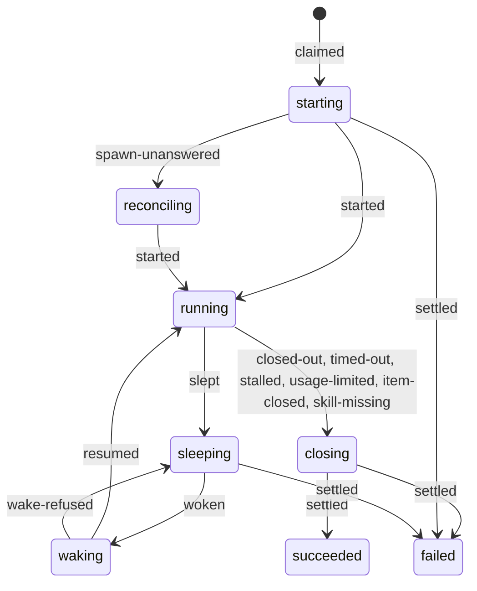

# Attempt lifecycle

An attempt is one try at one phase of an item, run by one agent session. It starts when the runner
claims the item, and ends when boxxy settles it as succeeded or failed. On each tick the runner
reads the session of every live attempt, and one pure table maps the reading and the attempt's state
to one action. A reading of a running session never ends an attempt: an attempt ends when its
session is suspended, ended or absent. boxxy stops a session before it settles the attempt, so a
seat stays held until the session has stopped.

[The pipeline](./pipeline.md) covers items, phases, rules, limits and holds, which this doc takes as
given. [Notices](./notices.md) covers how a settle that leaves the item on hold reaches the owner.
[API and auth](../interfaces/api-and-auth.md) covers the proven caller that every close-out call
carries. [Agent sessions](./sessions.md) covers the kept session, cleanup and the atc worker.
[The review-and-merge design](../../design/boxxy/review-and-merge.md) covers job attempts and the
verifier, and [the close-outs design](../../design/boxxy/close-outs.md) covers the phase kinds.

## The states

The diagram shows the common moves. The table of moves in the attempt machine of `@boxxy/dispatch`
holds the full set: each event, the states it is allowed from, the state it leads to, and the rows
and facts it writes.

- **One writer.** The attempt-change builder in `modules/dispatch/src/attempts/` builds every write
  to the attempts table, to the attempt sessions table, and every seat write. A caller passes an
  event and applies the change it gets back. A repo test fails when another source file of
  `modules/dispatch` writes to those tables or to a seat.
- **The table is an XState machine.** The builder calls the pure `transition` function and creates
  no actor. The row stores the state value and the context, never a snapshot.
- **Races.** Each change of a live attempt names the lease generation and the hold generation it was
  built under. It expects the state and every other column that the machine's guards read, as the
  builder read them, so two moves that keep the state also race. Of two callers that race, the store
  applies one change and refuses the other. The caller drops a refused change and reads again on the
  next tick.
- **A move decided on an older row.** The runner picks each action of the reconcile table from the
  row it read before the reading, and builds the move from the row it reads in the lock. Each action
  therefore carries the guard columns of the row it was picked from. When the row in the lock
  differs on any of them, boxxy refuses the move and writes nothing. An action that calls the worker
  first (a respawn, a resume or a stop) reads the row again before the call. That narrows the race
  but cannot close it, because the worker call runs outside the lock. A move that records the
  worker's answer, such as `started` or `resumed`, carries no such guard: the machine decides
  whether the answer still applies.
- **Seats.** An attempt takes its seats at the claim, releases them at the sleep, takes them again
  at the wake before the session resumes, and releases them at the settle. An attempt in `closing`
  keeps what it held.
- **The lease.** The attempt holds its item-phase lease from the claim to the settle, through every
  sleep, so no second attempt starts on the item.

## The reconcile table

The runner reads one session per live attempt on each tick, and the table gives one action.

| Reading   | starting, reconciling | running                                        | sleeping                                                              | waking                   | closing                             |
| --------- | --------------------- | ---------------------------------------------- | --------------------------------------------------------------------- | ------------------------ | ----------------------------------- |
| running   | move to running       | see the bounds after this table                | request the wake; after `timeouts.seatlessSeconds`, wake over the cap | move to running          | stop, or settle by the give-up rule |
| suspended | sleep                 | sleep                                          | nothing                                                               | resume                   | settle                              |
| ended     | settle                | settle, or sleep when boxxy asked for the stop | nothing                                                               | resume                   | settle                              |
| absent    | send the spawn again  | settle as `session-lost`                       | settle as `session-lost`                                              | settle as `session-lost` | settle                              |

A running attempt whose session runs stays as it is only inside a bound that the rules set. boxxy
checks the bounds in the order of this table and acts on the first one that is past:

| Mode     | Bound                                                                                                                                     | Past the bound                                                   |
| -------- | ----------------------------------------------------------------------------------------------------------------------------------------- | ---------------------------------------------------------------- |
| both     | the reading carries a reset time for the account's usage limit                                                                            | boxxy stops the session and settles the attempt as `usage-limit` |
| agent    | the step's time limit, counted from the start or the latest wake                                                                          | boxxy stops the session and settles the attempt as `timed-out`   |
| attended | the session waits for the owner for `afterIdleMinutes`: it asks for input, its turn ended, or it shows no activity since a wake           | sleep                                                            |
| attended | the session shows no activity at all for `afterQuietMinutes`                                                                              | sleep                                                            |
| agent    | the session shows no activity for `afterSilentMinutes`, counted from its last activity, its start or its latest wake, whichever is latest | boxxy stops the session and settles the attempt as `stalled`     |
| attended | the owner has not attached for `afterUnattendedMinutes`, while the agent stays active                                                     | sleep, with no idle check                                        |

An agent-mode attempt that the agent does not close out ends at a bound of this table, and never at
a turn end, because an agent ends its turn to wait for CI, a subagent or a scheduled wakeup. boxxy
puts no agent-mode session to sleep, because a sleep stops the agent's scheduled wakeup and nobody
wakes an agent-mode attempt. A session that asks for input is no exception: Claude Code sends its
idle notice shortly after each turn end, and atc reads that notice as a request for input, the same
as a real prompt. So silence ends an agent-mode session only at `afterSilentMinutes`.

atc counts only the agent's hook events as activity, such as the end of a turn, and never a tool
call. A turn the agent starts for a scheduled wakeup or a finished background task therefore shows
its activity when it ends. A scheduled wakeup can wait longer than the default silence limit, so the
example build and design prompts tell the agent to wake more often than that default. The rules file
sets the four sleep bounds; `afterSilentMinutes` alone has a default, in the rules file schema of
`@boxxy/rules`.

One case has no bound, on purpose: an attended session that the owner attaches to again inside every
`afterUnattendedMinutes`.

These rules decide the hard cells:

- atc's state `done` means that the turn ended and the session waits for a prompt. It reads as
  running, never as an end, in either mode.
- An `ended` reading on a sleeping attempt does nothing, because a local session that boxxy put to
  sleep reads as ended. A session that truly ended while asleep fails at the wake as `resume-lost`.
- A close-out beats a sleep in progress. A close-out that lands between the sleep request and the
  stop moves the attempt to `closing`.
- boxxy puts no attempt to sleep before atc reports an agent session ID for it, because atc cannot
  revive a session that stopped before atc captured the ID.

The time limits that the rules file does not hold are fixed in `timeouts`, the dispatch timeouts
module of `@boxxy/dispatch`. This doc gives each one where it applies, except two of a job attempt:
at least `timeouts.jobReadSeconds` between two reads of one job, and `timeouts.actRetryMinutes`
before the drive sends an unanswered action again.

## Sleep and wake

boxxy learns that a session waits for the owner from the reading alone, and only in attended mode:
the session asks for input, its turn ended, it shows no activity since a wake, or it went quiet. The
sleep has three steps, and the seats go last:

1. boxxy marks the attempt, in one change, before any worker call.
2. boxxy asks the worker to suspend the session. The adapter refuses when the session shows newer
   activity.
3. boxxy records the sleep and releases the seats. A refusal clears the mark.

A crash, or an unknown answer from the worker, can stop the sleep between two steps. The next
reading finishes it:

- **After step 1.** The attempt keeps the mark and its seats. A running reading clears the mark, and
  the next tick checks the bounds again. A suspended or ended reading records the sleep.
- **After step 2.** The session reads as suspended or ended, and boxxy records the sleep and
  releases the seats.

The wake is one mechanism. Every source ends in a wake request, and nothing else wakes an attempt:

- the owner runs `boxxy item wake <item>`;
- a reading shows the session running while the attempt sleeps, because the owner revived it in atc;
- a reading shows that the host slept with no request.

The planner puts a wake before any new work. The claim takes the seats, and only then does boxxy
resume the session. One case leaves that order: the owner revived the session and no seat came free
within `timeouts.seatlessSeconds`, two ticks of the runner. The attempt then wakes over the cap, the
limit counts the seat, and boxxy starts no new work under that limit until the count is at or under
the maximum. boxxy stops no session that the owner revived. A session that does not run
`timeouts.resumeLostMinutes` after the wake settles as `resume-lost`.

## Close-outs and their limits

One procedure, `attempt.closeOut`, takes the close-out of every phase. The phase comes from the
attempt row, and that phase kind's parser reports every problem at once.

| Case                                                            | Answer                                                                                              |
| --------------------------------------------------------------- | --------------------------------------------------------------------------------------------------- |
| the call is not for the current attempt of the calling session  | refused, `not-current`; checked first                                                               |
| the first valid close-out of a live attempt                     | recorded; the attempt moves to `closing`                                                            |
| an invalid close-out                                            | rejected, with every problem; the attempt stays open                                                |
| a valid close-out over `closeOutLimits.closeOutBytes` as stored | rejected, `too-large`; the attempt stays open                                                       |
| the same body again                                             | recorded, as a repeat; nothing is written                                                           |
| another body after a valid close-out                            | refused, `already-closed-out`                                                                       |
| a proven caller that no session of boxxy holds                  | refused, `no-attempt`                                                                               |
| a call with no proven caller                                    | 401, before the handler runs ([the proven caller](../interfaces/api-and-auth.md#the-proven-caller)) |

- **The first valid close-out is final.** A later call cannot replace it.
- **A call reaches the attempt it names, and only when that attempt is the current one of the
  calling session.** The current attempt is the latest attempt that the session carries, and its own
  row must hold the proven caller. The session reads its attempt ID with `attempt.current`.
  [API and auth](../interfaces/api-and-auth.md#the-proven-caller) has the rule in full.
- **The size limit is on the close-out as stored**, so an accepted close-out always fits one outbox
  item. `closeOutLimits.closeOutBytes`, in `@boxxy/closeout`, keeps the `closed_out` fact under half
  of what a fact may take on the wire, so a layer that escapes the JSON once more still fits. The
  limit bounds the design text of a design close-out too, which has no limit of its own.

## Closing, the stop and the give-up rule

boxxy moves an attempt to `closing` when it has decided that the attempt is over and the session
still runs. The runner then stops the session, and the attempt settles when the session reads as
suspended, ended or absent.

- **Grace.** boxxy sends no stop while the agent is inside a turn, until `timeouts.stopGraceSeconds`
  after the move to `closing`, so the agent can tell the owner that the close-out went in. A close
  caused by `item.close` gets no grace.
- **The give-up rule.** An attempt whose session still runs `timeouts.closingGiveUpMinutes` after
  the move to `closing` settles anyway, by its cause, and releases its seats and its lease. boxxy
  marks it as a stray, keeps sending the stop for `timeouts.strayHours`, and lists it in
  `runner.status`. After that, [cleanup](./sessions.md#cleanup) takes over the stop. A stop can fail
  for that long on a host that another owner keeps awake.
- **An item closed while its spawn is in flight.** The attempt stays in `closing` and sends no
  second spawn. When the session appears, boxxy stops it and settles. When none appears within
  `timeouts.spawnLostMinutes`, the attempt settles as a stray, and the runner looks for the session
  by its spawn name for `timeouts.strayHours`. When the session appears, the runner records it on
  the attempt row as it stops it, so cleanup forgets it. When no stop is confirmed in that time,
  cleanup looks for the session by its spawn name on each tick, then stops and forgets the session
  it finds. When it finds none, no session is left to stop, and cleanup records the attempt's
  session as forgotten. When atc does not answer the lookup, cleanup goes on with the other sessions
  and looks again on the next tick.

`item.close` ends the item's live attempts in the same store change as the close. A sleeping attempt
settles at once as failed, with the reason `item-closed` and no wake. Any other live attempt moves
to `closing`.

## Settle

Settle runs in one store change. It writes the state, the failure, the outcome, the end time, the
seat release, the lease release, the rows and facts of the effects, and the `settled` fact. It
stores no position.

The phase kind returns every effect of the outcome, and settle builds one plan of rows and facts for
each. Each plan sees the relations and the close that the plans before it write, so a relation named
twice, or a second close, skips with a reason. An open item whose title the close-out repeats skips
too. Without that, the second insert breaks a unique key, the store refuses the whole settle, and
the attempt stays `closing` on every tick.

When the item holds after the settle, settle withholds each effect that changes the item: the close,
a relation, and a new kind, field or acceptance. It still files new items and records friction
proposals. It also still adds a `blocks` relation from another item to the item, because a blocked
design or build records that wait so the item still waits after the owner's retry. The `settled`
fact lists each withheld effect with its reason, and settle writes the hold's notice row in the same
lock, after the settle change.

Settle never throws on stored data. The phase kind loaded now can differ from the one that accepted
the close-out, so the settle rule of the phase kind runs inside a catch. When it throws, or returns
an outcome that its kind does not list, the attempt settles as failed with `closeout-unsettleable`
and the fixed outcome `unsettleable`. A name that the phase code returned goes to its own field, so
that no rules file can give it an edge. The item then holds, and
`boxxy item retry <item> --phase <phase>` moves it on.

An attempt fails with one of the forced failures below, or with `closeout-missing` or
`closeout-unsettleable`. A design or build close-out that is `blocked` or `abandoned` also fails the
attempt, with that outcome as the failure
([close-outs](../../design/boxxy/close-outs.md#the-v1-phase-kinds)).

| Failure         | Cause                                                                                                                                                           | Counts against `maxAttempts` |
| --------------- | --------------------------------------------------------------------------------------------------------------------------------------------------------------- | ---------------------------- |
| `spawn-refused` | the worker refused the spawn for a cause other than capacity                                                                                                    | yes                          |
| `no-capacity`   | the worker target has no free machine                                                                                                                           | no                           |
| `spawn-lost`    | no session appeared `timeouts.spawnLostMinutes` after the claim                                                                                                 | yes                          |
| `session-lost`  | the session is absent                                                                                                                                           | yes                          |
| `resume-lost`   | the session did not run `timeouts.resumeLostMinutes` after the wake                                                                                             | yes                          |
| `timed-out`     | an agent-mode attempt passed its step's time limit, or a job attempt's read threw past it ([job attempts](../../design/boxxy/review-and-merge.md#job-attempts)) | yes                          |
| `stalled`       | an agent-mode session showed no activity for `afterSilentMinutes`                                                                                               | yes                          |
| `skill-missing` | a skill the recipe lists was not there after the fetch                                                                                                          | yes                          |
| `item-closed`   | the owner closed the item                                                                                                                                       | the item is archived         |
| `usage-limit`   | the reading carried a reset time for the account's usage limit                                                                                                  | no                           |
