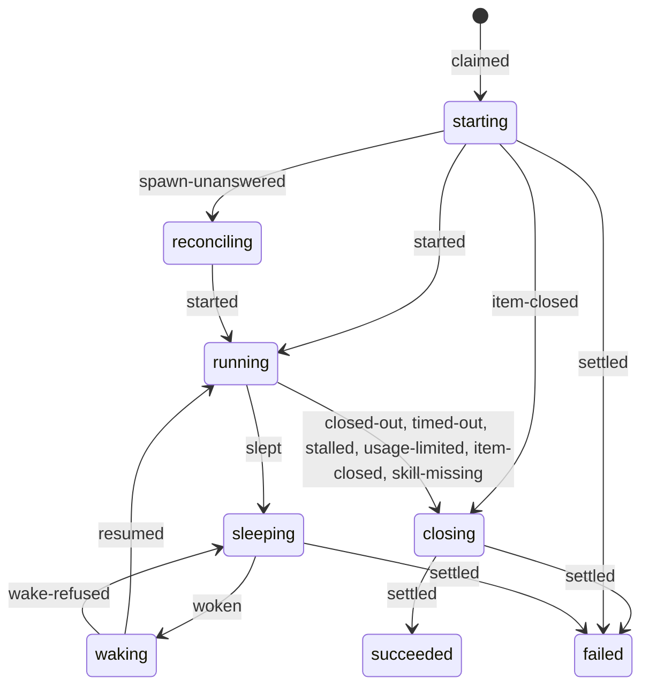

# Attempt lifecycle

An attempt is one try at one phase of one item. The runner claims it, starts its agent session
through atc, reads that session on every tick, and finally settles the attempt as succeeded or
failed. An attempt ends on a close-out, on a time bound, or when its session is lost, and never just
because the agent's turn ended: agents end turns to wait for CI or a scheduled wakeup. The attempt
keeps its seats and the lease on its phase until its session has stopped, so two sessions never work
the same phase of an item. The one exception is an attempt whose stop atc keeps refusing: after a
give-up time it settles anyway ([giving up](#stopping-a-session-and-giving-up)). Read this doc
before you change how the runner reads sessions, puts them to sleep, wakes them or settles them.

[The pipeline](./pipeline.md) covers what an outcome does to the item.
[Agent sessions](./sessions.md) covers the session itself: keeping it for rework, cleaning it up,
and the atc adapter. The [close-outs design](../../design/boxxy/close-outs.md) covers each phase
kind's close-out, and the [job attempts design](../../design/boxxy/review-and-merge.md#job-attempts)
covers attempts with no session, such as a merge. The [overview](../overview.md#terms) defines the
shared terms.

## The states

The diagram shows the common moves; the attempt machine in the dispatch module holds every move and
the rows and facts each one writes.

- **`reconciling`** means the spawn call got no answer. The spawn may still have landed, so the
  runner looks for the session by its spawn name before it tries again.
- **`wake-refused`** means atc had no room for the wake. The attempt sleeps again and keeps its wake
  request ([capacity](./sessions.md#capacity-and-the-usage-limit)).
- **`closing`** means boxxy has decided the attempt is over but its session may still run. The
  attempt settles once the session has stopped: by its close-out when it has one, otherwise with the
  failure named by the event that moved it to `closing` (`usage-limited` gives `usage-limit`).

An attempt takes its seats at the claim, gives them back when it sleeps, takes them again at the
wake before the session resumes, and gives them back at the settle; `closing` keeps them. From claim
to settle it also holds the lease on its item and phase, a store row that lets only one attempt at a
time run that phase.

## Two writers, one attempt

The runner and a close-out call can change the same attempt at the same moment. Every write to an
attempt, its session rows or its seats therefore goes through one builder in the dispatch module,
which runs the attempt machine as a pure function, and a repo test fails when any other code in that
module writes them. The store refuses a change when the stored row differs from the row the builder
read: its state, every column the machine's guards read, and the version counters on the lease and
the seats. The seat counter goes up at each wake. The refused caller reads again on the next tick.

The runner decides each action from a row it read before the session reading, so it adds a check of
its own. Inside the store's write lock it writes nothing when the row has changed on a guard column,
and an action that calls atc first (a respawn, a resume or a stop) reads the row again just before
the call. The atc call runs outside the lock, so this narrows the race without closing it. A move
that records atc's answer, such as `started`, skips the runner's check, and the machine refuses it
when the answer no longer fits the attempt's state.

## What the runner does with each reading

On each tick the runner reads every live attempt's session as `running`, `suspended`, `ended` or
`absent`, and one pure table maps the reading and the attempt's state to an action:

| Reading   | starting, reconciling | running                  | sleeping                 | waking                   | closing |
| --------- | --------------------- | ------------------------ | ------------------------ | ------------------------ | ------- |
| running   | move to running       | check the bounds         | request the wake         | move to running          | stop    |
| suspended | sleep                 | sleep                    | nothing                  | resume                   | settle  |
| ended     | settle                | settle                   | nothing                  | resume                   | settle  |
| absent    | send the spawn again  | settle as `session-lost` | settle as `session-lost` | settle as `session-lost` | settle  |

Fixed time limits in the dispatch module change some cells. An absent session settles as
`spawn-lost` once a starting attempt has waited long enough, and as `resume-lost` for a waking one.
An `ended` reading on a running attempt that boxxy asked to sleep records the sleep. A running
session on a sleeping attempt can wake it over its limits ([sleep and wake](#sleep-and-wake)).

These rules explain the less obvious cells:

- **atc's `done` reads as running.** It means the turn ended and the session waits for a prompt,
  which is not an end in either design mode.
- **`ended` on a sleeping attempt does nothing,** because a session on a local machine reads as
  ended once boxxy suspends it. A session that truly ended while asleep fails at the wake as
  `resume-lost`.
- **A host can sleep on its own,** whether a local machine or an imp. The reading then shows
  `suspended`, and boxxy records the sleep and requests the wake at once.
- **boxxy never puts a session to sleep before atc reports its agent session ID,** because atc can't
  revive a session that stopped before atc captured the ID.

### The bounds on a running attempt

A running attempt whose session runs stays as it is until it passes a bound. The pipeline step sets
`timeoutMinutes`, and the rules file's `sleep` block sets the four `after…Minutes` settings, of
which only `afterSilentMinutes` has a default. boxxy checks the bounds in this order and acts on the
first one passed:

| Design mode | Bound                                                                                | Past it                        |
| ----------- | ------------------------------------------------------------------------------------ | ------------------------------ |
| both        | the reading carries a reset time for the account's usage limit                       | stop, and settle `usage-limit` |
| agent       | `timeoutMinutes` since the start or the latest wake                                  | stop, and settle `timed-out`   |
| attended    | the session has waited for the owner for `afterIdleMinutes`                          | sleep                          |
| agent       | no activity for `afterSilentMinutes` since its last activity, start or wake          | stop, and settle `stalled`     |
| attended    | the owner hasn't attached for `afterUnattendedMinutes`, while the agent stays active | sleep, even when active        |

boxxy never puts an agent-mode session to sleep, because a sleep cancels the agent's scheduled
wakeup and no owner is there to wake it. That holds even when the session asks for input, since
Claude Code sends its idle notice after every turn end and atc reads that as a request for input. A
silent agent-mode session therefore ends only at `afterSilentMinutes`.

An attended session counts as waiting for the owner when it asks for input, when its turn has ended,
when it has done nothing since a wake, or once it has been quiet for `afterQuietMinutes`. The
`afterIdleMinutes` wait runs from its last activity, or from the wake when it did nothing since.

atc counts only the agent's hook events as activity, such as the end of a turn, and never a tool
call. A turn the agent starts for a scheduled wakeup or a finished background task therefore shows
its activity when it ends. A scheduled wakeup can wait longer than the default `afterSilentMinutes`,
so the example prompts tell the agent to wake more often than that. One case has no bound: an
attended session that the owner keeps coming back to within each `afterUnattendedMinutes`. The atc
worker never reports a usage limit, so the first row never fires with it; dispatch keeps the row for
a worker kind that reports a reset time ([capacity](./sessions.md#capacity-and-the-usage-limit)).

## Sleep and wake

boxxy puts a session to sleep only in attended mode, and only at a bound. The sleep takes three
steps, and the seats go last:

1. boxxy marks the attempt as asked to sleep, in one change, before any call to atc.
2. boxxy asks atc to suspend the session. The worker refuses when the session showed activity since
   boxxy judged it idle. At the unattended bound it suspends the session anyway.
3. boxxy records the sleep and gives back the seats. A refusal clears the mark instead.

A crash or an unknown answer can stop the sleep between steps, and the next reading finishes it: a
running reading clears the mark, and a suspended or ended one records the sleep. A close-out that
lands between the request and the suspend moves the attempt to `closing`.

A wake starts as a wake request, from the owner running `boxxy item wake <item>`, from a reading
that shows the session running while the attempt sleeps (the owner revived it in atc), or from a
reading that shows it suspended when boxxy never asked (the host slept). Each claim takes requested
wakes before any new work. It takes the attempt's seats first, and only then does boxxy resume the
session; a session the owner already revived keeps running. When the owner revived the session and
no seat comes free within a fixed time, the attempt wakes over its limits, because the session
already runs. A session that is still suspended sleeps until a seat frees. After an over-limit wake,
boxxy claims no new work under those limits until their counts are back at or under the maximum.

## Close-outs and their limits

An agent sends its close-out with `attempt.closeOut`, the one procedure for every phase. The first
matching case decides the answer:

| Case                                                                          | Answer                        | The attempt        |
| ----------------------------------------------------------------------------- | ----------------------------- | ------------------ |
| the calling session has no attempt, or its attempt holds another caller       | refused, `no-attempt`         | none               |
| the call is for an attempt that isn't the session's current one, or has ended | refused, `not-current`        | unchanged          |
| the same body again                                                           | recorded, as a repeat         | unchanged          |
| a different body after a valid close-out                                      | refused, `already-closed-out` | unchanged          |
| an invalid close-out                                                          | rejected, with every problem  | stays open         |
| a valid close-out whose stored form is over the close-out size limit          | rejected, `too-large`         | stays open         |
| any other close-out of a live attempt                                         | recorded                      | moves to `closing` |

A session can carry several attempts in turn, as a [kept session](./sessions.md#the-kept-session)
does. Its current attempt is the latest one bound to it, whose row records the
[proven caller](../interfaces/api-and-auth.md#the-proven-caller) allowed to close it out, and the
agent reads that attempt's ID with `attempt.current`. The close-out size limit sits below the
[outbox's](../interfaces/facts-and-pepys.md#the-outbox) limit on one fact, so an accepted close-out
always reaches pepys; it also bounds a design's text, which has no limit of its own.

## Stopping a session and giving up

Once an attempt is `closing`, the runner stops its session and the attempt settles when the session
reads as suspended, ended or absent. While the agent is mid-turn, boxxy waits a fixed grace before
the stop, so the agent can tell the owner its close-out went in. Closing the item gets no grace.

`item.close` ends the item's live attempts in the same store change. A sleeping attempt settles at
once as failed with `item-closed`, and boxxy doesn't wake it. Every other live attempt moves to
`closing`, including one whose spawn is still in flight: boxxy sends no second spawn, and stops the
session when it appears.

atc refuses a stop while something else keeps the session's host awake. So that an attempt never
waits in `closing` forever, it settles anyway after a fixed give-up time, by its close-out or with
the failure that moved it to `closing`, and gives back its seats and lease. boxxy marks it as a
stray, a settled attempt whose session may still run, lists it in `runner.status`, and keeps sending
the stop each tick for a fixed number of hours before [cleanup](./sessions.md#cleanup) takes over. A
closing attempt whose spawn never produced a session becomes a stray the same way, and the runner
keeps looking for its session by spawn name.

## Settle

Settle ends an attempt in one store change: the state, the failure, the outcome, the end time, the
seat and lease release, every effect's rows and facts, and the `settled` fact. The phase kind
returns the outcome's effects, such as a new item, a relation or closing the item. Settle plans each
effect in order, and skips with a reason a relation named twice, a second close, and a second new
item with the same title. Without those skips, the second insert would break a unique key, the store
would refuse the whole settle, and the attempt would sit in `closing` forever.

When the item is about to hold, settle withholds each effect that changes the item itself: the
close, a relation, and a new kind, field, acceptance list or body. It still files new items, records
each [friction](../../design/boxxy/close-outs.md#friction) proposal, and adds a `blocks` relation
from another item to this one. The `settled` fact lists each withheld effect with its reason, and
settle writes the hold's [notice](./notices.md) in the same change.

Settle never throws on stored data. The phase kind loaded now can differ from the one that accepted
the close-out, so its settle rule runs inside a catch. When it throws, or returns an outcome its
kind doesn't list, the attempt fails with `closeout-unsettleable` and the outcome `unsettleable`,
which no edge matches. The item holds, and `boxxy item retry <item> --phase <phase>` moves it on.

An attempt fails with `closeout-missing` when it settles with no close-out and none of the failures
below. The same failure also marks a close-out with the outcome `blocked` or `abandoned` from a
[design or build close-out](../../design/boxxy/close-outs.md#the-v1-phase-kinds). The runner sets
every other failure:

| Failure         | Cause                                                                                                                                                     | Counts against `maxAttempts` |
| --------------- | --------------------------------------------------------------------------------------------------------------------------------------------------------- | ---------------------------- |
| `spawn-refused` | atc refused the spawn for a cause other than capacity                                                                                                     | yes                          |
| `no-capacity`   | the worker target has no free machine; the attempt stores [atc's refusal](#the-refusal-of-a-no-capacity-attempt)                                          | no                           |
| `spawn-lost`    | no session appeared in time after the claim                                                                                                               | yes                          |
| `session-lost`  | the session is absent                                                                                                                                     | yes                          |
| `resume-lost`   | the session didn't run in time after the wake                                                                                                             | yes                          |
| `timed-out`     | an agent-mode attempt passed `timeoutMinutes`, or a job's read kept failing past it ([job attempts](../../design/boxxy/review-and-merge.md#job-attempts)) | yes                          |
| `stalled`       | an agent-mode session showed no activity for `afterSilentMinutes`                                                                                         | yes                          |
| `skill-missing` | a skill the recipe lists was missing after the fetch                                                                                                      | yes                          |
| `item-closed`   | the owner closed the item                                                                                                                                 | yes, on a closed item        |
| `usage-limit`   | the reading carried a reset time for the account's usage limit                                                                                            | no                           |

### The refusal of a no-capacity attempt

An attempt that settles as `no-capacity` stores what atc answered: its error code, the cause it
names under that code (`ram_budget_exceeded`, for example), and its message, cut to 500 characters.
The attempt row holds them in its `refusal` column and the `settled` fact in its `refusal` field.
Both are null for every other failure, and for an attempt that settled before boxxy stored the
refusal. `item_get` shows the column in each attempt of the item.

`runner.status` shows `capacityRefusals`: the time and refusal of the latest `no-capacity` attempt,
and `sinceLastSpawn`, the count of `no-capacity` attempts that ended after the latest attempt that
started a session. A burst of refusals therefore reads as one growing count with its cause beside
it. The refusal changes nothing about scheduling or retries.
