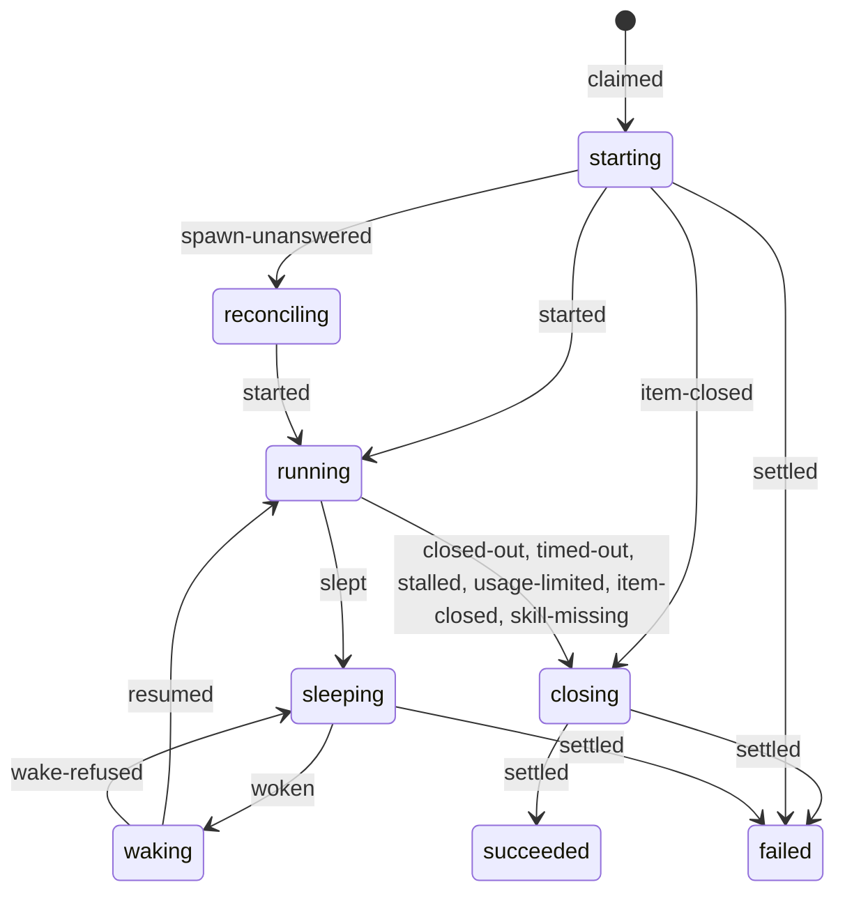

# Attempt lifecycle

boxxy runs each phase of an item as an attempt: one try at the phase, in one agent session. A job,
such as a merge, is an attempt with no session, and
[job attempts](../../design/boxxy/review-and-merge.md#job-attempts) covers it. The runner starts an
attempt when it claims the item, and settles it as succeeded or failed. On each tick the runner
reads the session of every live attempt through the atc worker, as `running`, `suspended`, `ended`
or `absent`, and one pure table maps the reading and the attempt's state to one action.

An attempt ends on a close-out, on a bound of [the reconcile table](#the-reconcile-table), or when
its session is lost. It never ends because a turn ended. boxxy stops the session before it settles
the attempt, so the attempt holds its seats until its session has stopped. The one exception is
[the give-up rule](#closing-the-stop-and-the-give-up-rule).

[The overview](../overview.md#terms) defines the terms this doc uses, such as runner, tick, claim,
seat, settle, fact and atc. [The pipeline](./pipeline.md) covers phases, steps, edges, limits and
holds, [agent sessions](./sessions.md) the kept session, cleanup and the atc worker, and
[the close-outs design](../../design/boxxy/close-outs.md) the phase kinds.

## The states

The table of moves in the attempt machine of `@boxxy/dispatch` holds every move, with the rows and
facts each one writes; the diagram shows the common ones. An attempt moves to `reconciling` when the
worker gives no answer to the spawn call. The spawn may still have landed, so the runner reads the
session by its spawn name. `wake-refused` comes when atc refuses a wake for capacity: the attempt
sleeps again and keeps its wake request ([capacity](./sessions.md#capacity-and-the-usage-limit)). A
closing attempt settles by its close-out when it has one, or else with the failure of the event that
moved it to `closing`. Each failure has its event's name, except that `usage-limited` gives
`usage-limit`.

An attempt takes its seats at the claim, releases them at the sleep, takes them again at the wake
before the session resumes, and releases them at the settle; `closing` keeps them. From the claim to
the settle it also holds the lease on its item and phase, a store row that lets one attempt at a
time run that phase, so a second attempt never starts on it.

Every write to an attempt, its session rows or its seats goes through one builder in
`modules/dispatch/src/attempts/`, which runs the XState machine as a pure function, and a repo test
fails when other code in `modules/dispatch` writes to them.

Two callers can change one attempt at once, such as the runner and a close-out call. The store
therefore refuses a change when the stored row differs from the row its builder read: the state,
every column that the machine's guards read, and the generations of the lease and of the seats. The
seat generation goes up at each wake. Two moves that leave the state the same can still conflict on
a guard column. The refused caller reads again on the next tick.

The runner adds a check of its own, because it decides each action from the row it read before the
session reading. It writes the move inside the store's write lock, which runs one change at a time,
and writes nothing when the row there differs from the earlier row on a guard column. An action that
calls the worker first (a respawn, a resume or a stop) also reads the row again before the call.
That narrows the race, but the worker call runs outside the lock, so the race stays open. A move
that records the worker's answer, such as `started` or `resumed`, skips the runner's check, and the
machine refuses it when the answer no longer fits the attempt's state.

## The reconcile table

The runner takes the action in this table for each reading:

| Reading   | starting, reconciling | running                  | sleeping                 | waking                   | closing |
| --------- | --------------------- | ------------------------ | ------------------------ | ------------------------ | ------- |
| running   | move to running       | check bounds             | request the wake         | move to running          | stop    |
| suspended | sleep                 | sleep                    | nothing                  | resume                   | settle  |
| ended     | settle                | settle                   | nothing                  | resume                   | settle  |
| absent    | send the spawn again  | settle as `session-lost` | settle as `session-lost` | settle as `session-lost` | settle  |

A time limit or a pending request changes some cells:

- an absent session on a starting or reconciling attempt settles as `spawn-lost` after
  `timeouts.spawnLostMinutes` (`timeouts` in `@boxxy/dispatch` holds the time limits that the rules
  file does not set), and a waking one as `resume-lost` after `timeouts.resumeLostMinutes`;
- a running session on a sleeping attempt can wake it over its limits
  ([sleep and wake](#sleep-and-wake));
- a closing attempt follows [the give-up rule](#closing-the-stop-and-the-give-up-rule);
- an `ended` reading on a running attempt that boxxy asked to sleep records the sleep.

A running attempt whose session runs stays as it is until it passes a bound. The pipeline step sets
`timeoutMinutes`, and the `sleep` block of the [rules file](../overview.md#terms) sets the four
`after…Minutes` settings; only `afterSilentMinutes` has a default. Each bound applies in one
[design mode](./pipeline.md#design-mode), `agent` or `attended`, or in both. boxxy checks the bounds
in this order and acts on the first one that is past:

| Mode     | Bound                                                                                                                                                                | Past the bound                                                   |
| -------- | -------------------------------------------------------------------------------------------------------------------------------------------------------------------- | ---------------------------------------------------------------- |
| both     | the reading carries a reset time for the account's usage limit, which atc never reports ([usage limit](./sessions.md#capacity-and-the-usage-limit))                  | boxxy stops the session and settles the attempt as `usage-limit` |
| agent    | the pipeline step's `timeoutMinutes`, counted from the start or the latest wake                                                                                      | boxxy stops the session and settles the attempt as `timed-out`   |
| attended | the session waits for the owner for `afterIdleMinutes`: it asks for input, its turn ended, it shows no activity since a wake, or no activity for `afterQuietMinutes` | sleep                                                            |
| agent    | the session shows no activity for `afterSilentMinutes`, counted from its last activity, its start or its latest wake, whichever is latest                            | boxxy stops the session and settles the attempt as `stalled`     |
| attended | the owner has not attached for `afterUnattendedMinutes`, while the agent stays active                                                                                | sleep, even when active                                          |

In agent mode, an attempt that the agent does not close out ends only at a bound of this table. An
agent ends its turn to wait for CI, a subagent or a scheduled wakeup, so a turn end is no bound.
boxxy never asks to put an agent-mode session to sleep, because a sleep stops the agent's scheduled
wakeup and no owner is there to wake the attempt. This holds when the session asks for input too:
Claude Code sends its idle notice after each turn end, and atc reads that notice as a request for
input. So a silent agent-mode session ends only at `afterSilentMinutes`.

atc counts only the agent's hook events as activity, such as the end of a turn, and never a tool
call. A turn the agent starts for a scheduled wakeup or a finished background task therefore shows
its activity when it ends. A scheduled wakeup can wait longer than the default of
`afterSilentMinutes`, so the example prompts in `modules/rules/example/prompts/` tell the agent to
wake more often than that. One case has no bound, on purpose: an attended session that the owner
attaches to again inside every `afterUnattendedMinutes`.

These rules explain the other cells:

- atc's state `done` means that the turn ended and the session waits for a prompt. It reads as
  running, never as an end, in either mode.
- An `ended` reading on a sleeping attempt does nothing, because a session on a local machine reads
  as ended once boxxy suspends it. A session that truly ended while asleep fails at the wake as
  `resume-lost`.
- In either mode, the session's host, the machine it runs on (a local machine or an imp), can sleep
  on its own. The reading then shows `suspended`, and boxxy records the sleep and requests the wake
  at once.
- A close-out that lands between the sleep request and the suspend moves the attempt to `closing`.
- boxxy puts no attempt to sleep before atc reports an agent session ID for it, because atc cannot
  revive a session that stopped before atc captured the ID.

## Sleep and wake

boxxy puts a session to sleep only in attended mode, and only on a bound in the table above. The
sleep has three steps, and the seats go last:

1. boxxy records on the attempt, in one change, that it asked for a sleep. This record is the mark,
   and boxxy writes it before any worker call.
2. boxxy asks the worker to suspend the session. The worker refuses when the session shows activity
   since boxxy judged it idle, except at the unattended bound.
3. boxxy records the sleep and releases the seats. A refusal clears the mark.

A crash, or an unknown answer from the worker, can stop the sleep between two steps, and the next
reading finishes it: a running reading clears the mark, and a suspended or ended reading records the
sleep.

Every wake starts as a wake request, from one of these sources:

- the owner runs `boxxy item wake <item>`;
- a reading shows the session running while the attempt sleeps, because the owner revived it in atc;
- a reading shows the session suspended when boxxy never asked for a sleep, because the host slept
  on its own.

Each claim takes requested wakes before any new work. The claim takes the attempt's seats, and only
then does boxxy resume the session. A session that the owner revived runs at that point, and boxxy
never stops it. If no seat comes free for it within `timeouts.seatlessSeconds`, the attempt wakes
over its limits: each limit that counts the attempt holds more running attempts than its maximum,
and boxxy claims no new work under that limit until its count is back at or under the maximum.

## Close-outs and their limits

One procedure, `attempt.closeOut`, takes the close-out of every phase. It gives the answer of the
first case in this table that matches:

| Case                                                                                                                              | Answer                        | The attempt        |
| --------------------------------------------------------------------------------------------------------------------------------- | ----------------------------- | ------------------ |
| the calling session has no attempt, or its current attempt holds another caller                                                   | refused, `no-attempt`         | none               |
| the call is for an attempt other than the current one, or for one that has ended                                                  | refused, `not-current`        | unchanged          |
| the same body again                                                                                                               | recorded, as a repeat         | unchanged          |
| a different body after a valid close-out                                                                                          | refused, `already-closed-out` | unchanged          |
| an invalid close-out                                                                                                              | rejected, with every problem  | stays open         |
| a valid close-out whose stored body, which the phase kind builds from what the agent sent, is over `closeOutLimits.closeOutBytes` | rejected, `too-large`         | stays open         |
| any other close-out of a live attempt                                                                                             | recorded                      | moves to `closing` |

A session can carry several attempts in turn, as a [kept session](./sessions.md#the-kept-session)
does. Its current attempt is the latest one bound to it, whose row records the
[proven caller](../interfaces/api-and-auth.md#the-proven-caller) that may close it out. The session
reads that attempt's ID with `attempt.current`.

`closeOutLimits.closeOutBytes` sits below the
[outbox's limit](../interfaces/facts-and-pepys.md#the-outbox) on one fact, so an accepted close-out
always reaches pepys. It also bounds a design close-out's design text, which has no limit of its
own.

## Closing, the stop and the give-up rule

boxxy moves an attempt to `closing` when it has decided that the attempt is over and the session may
still run. The runner then stops the session, and the attempt settles when the session reads as
suspended, ended or absent. While the agent is inside a turn, boxxy waits up to
`timeouts.stopGraceSeconds` after the move before it sends the stop, so the agent can tell the owner
that the close-out went in. A close of the item gets no such grace.

`item.close` ends the item's live attempts in the store change that closes it. A sleeping attempt
settles at once as failed, with the failure `item-closed`, and boxxy does not wake it. Any other
live attempt moves to `closing`, including one whose spawn is still in flight. It sends no second
spawn, and when its session appears, boxxy stops it and settles. When none appears within
`timeouts.spawnLostMinutes` of the claim, the attempt settles as a stray, a settled attempt whose
session may still run. The runner, then cleanup, looks for the session by its spawn name on each
tick and stops it when it appears.

atc refuses a stop while something else keeps the session's host awake. An attempt whose session
still runs `timeouts.closingGiveUpMinutes` after the move to `closing` therefore settles anyway, and
releases its seats and its lease. It settles by its close-out, or with the failure that moved it to
`closing`, as after a stop. boxxy marks it as a stray, lists it in `runner.status`, and sends the
stop on each tick for `timeouts.strayHours`. [Cleanup](./sessions.md#cleanup) then takes over.

## Settle

Settle runs in one store change. It writes the state, the failure, the outcome, the end time, the
seat release, the lease release, the rows and facts of the effects, and the `settled` fact. The
phase kind returns every effect of the outcome, such as a new item, a relation or the close of the
item. Settle builds one plan of rows and facts for each effect, in order, and counts the relations
and the close that earlier plans write. Settle skips, with a reason, a relation named twice, a
second close, and a second new item with the same title in one close-out. Without the skips, the
second insert breaks a unique key, the store refuses the whole settle, and the attempt stays
`closing` on every tick.

An item can hold for the owner after the settle. Settle then withholds each effect that changes the
item: the close, a relation, and a new kind, field, acceptance or body. It still files new items,
records each [friction](../../design/boxxy/close-outs.md#friction) proposal, and adds a `blocks`
relation from another item to this one: a blocked design or build records its wait that way, so the
item still waits after the owner retries it. The `settled` fact lists each withheld effect with its
reason, and settle writes the hold's [notice](./notices.md) row in the same lock.

Settle never throws on stored data. The phase kind loaded now can differ from the one that accepted
the close-out, so the settle rule of the phase kind runs inside a catch. When it throws, or returns
an outcome that its kind does not list, the attempt settles as failed with `closeout-unsettleable`
and the fixed outcome `unsettleable`, which the pipeline's edges never match. The item then holds,
and `boxxy item retry <item> --phase <phase>` moves it on.

The runner sets each failure in the table below. An attempt also fails with `closeout-missing` when
it settles with no close-out and none of those failures, with `closeout-unsettleable`, or with the
outcome `blocked` or `abandoned` of a
[design or build close-out](../../design/boxxy/close-outs.md#the-v1-phase-kinds).

| Failure         | Cause                                                                                                                                                                | Counts against the step's [`maxAttempts`](./pipeline.md#rules-of-the-engine) |
| --------------- | -------------------------------------------------------------------------------------------------------------------------------------------------------------------- | ---------------------------------------------------------------------------- |
| `spawn-refused` | the worker refused the spawn for a cause other than capacity                                                                                                         | yes                                                                          |
| `no-capacity`   | the worker target has no free machine                                                                                                                                | no                                                                           |
| `spawn-lost`    | no session appeared `timeouts.spawnLostMinutes` after the claim                                                                                                      | yes                                                                          |
| `session-lost`  | the session is absent                                                                                                                                                | yes                                                                          |
| `resume-lost`   | the session did not run `timeouts.resumeLostMinutes` after the wake                                                                                                  | yes                                                                          |
| `timed-out`     | an agent-mode attempt passed its step's `timeoutMinutes`, or a job's read kept failing past it ([job attempts](../../design/boxxy/review-and-merge.md#job-attempts)) | yes                                                                          |
| `stalled`       | an agent-mode session showed no activity for `afterSilentMinutes`                                                                                                    | yes                                                                          |
| `skill-missing` | a skill that the phase's recipe lists was missing after boxxy fetched the skills                                                                                     | yes                                                                          |
| `item-closed`   | the owner closed the item                                                                                                                                            | yes, on a closed item                                                        |
| `usage-limit`   | the reading carried a reset time for the account's usage limit                                                                                                       | no                                                                           |
