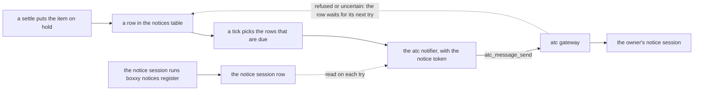

# Notice delivery

The owner learns that an item went on hold from a notice: a message that the server sends through
[atc](https://github.com/zgeoff/atc), the tool that runs agent sessions, to one session, the owner's
notice session. A notice starts as a row in the store, and the runner tries the row until atc takes
it, with no cap on tries, so a notice waits out a notice session that is stopped or asleep and an
owner's machine that is off. Each try carries an idempotency key that comes from the row, so a
repeat after a lost answer reaches the owner once. The notice session registers itself with boxxy,
so a new notice session needs no deploy and no restart of the server.

[The pipeline](./pipeline.md#notices) says which holds write a notice, and why notices have a table
of their own. [Attempt lifecycle](./attempts.md#settle) covers the settle that writes the row.
[API and auth](../interfaces/api-and-auth.md#the-doors) covers the doors through which the owner
calls the notice procedures. [The review-and-merge design](../../design/boxxy/review-and-merge.md)
covers the hold reasons.

## The path of a notice

The settle that leaves an item on hold writes one row in the `notices` table, in the same lock as
the settle. The runner's tick, every `tickMs` (in `@boxxy/server`'s `start-server.ts`), reads the
unsent rows whose next try time has passed, oldest first, up to 200 rows, and hands each one to the
`Notifier` port. `sendNotices`, in `@boxxy/dispatch`, builds the row's key, calls the port, and
updates the row once per try. A notice that is refused or uncertain changes no attempt and no item:
the hold already shows in `boxxy item list`, and the notice only tells the owner about it.

The server picks the notifier at start. With `BOXXY_ATC_NOTICE_TOKEN` set, it builds the atc
notifier, with an atc client of its own that carries that token and no other. With no notice token,
it uses a notifier that answers `sent` to every try, so every row is marked sent and no notice is
delivered. The server's other atc calls, which start and stop worker sessions, use the worker token,
`BOXXY_ATC_TOKEN`. The two tokens stay apart because the notice session runs on the owner's machine,
and the deployment grants that machine only to a token without the `spawn` and `kill` scopes.

## The registered notice session

atc addresses a session only by its gateway ID, `<daemon>.<incarnation>.<id>`, and the gateway
answers `no_such_session` to any other value. atc resolves no names, so a rename of the session
keeps its ID, and a new session has a new one. The store therefore holds the ID in one row of the
`notice_session` table, and the notice session writes that row itself, with
`boxxy notices register <gateway-id>` or the owner tool `notices_register`. `boxxy notices show`
prints it.

- Only the owner's path calls the two procedures: the owner listener, and `/mcp` on the public door,
  where `notices.register` needs the `write` scope and `notices.show` the `read` scope.
- `notices.register` checks the shape of the ID and nothing else, because the notice token has no
  scope that reads a session. An ID that names no session shows as `no_such_session` in
  `runner.status` after the next try.
- `notices.register` replaces the row and writes no fact. A check on the table keeps it to one row.
- The notifier reads the row on each try. A notice that waits therefore goes to a newly registered
  session on its next try, at most `noticeLimits.longestWaitMs` after the registration, and the
  server never restarts for it.
- With a notice token and no row, the notifier calls atc for nothing, and the try is `refused` with
  the reason `no-notice-session`. A read of the row that fails is `refused` with the reason
  `notice-session-unread`. Either row waits like any other refused row.

The server refuses to start in three cases, and each message names the variable or the key, and
never a variable's value:

- `BOXXY_ATC_NOTICE_TOKEN` is set and empty;
- the environment holds `BOXXY_ATC_NOTICE_SESSION`: the message says to register the session
  instead;
- the configuration file's `atc` section holds `noticeSession`, which its strict schema refuses.

The last two refusals exist because the store owns the notice session. A session ID in the
deployment would need a deploy for each new session.

## The notices row and the port

The `Notifier` port has one method, which takes the notice and the row's current key and answers one
of three outcomes:

| Outcome     | Meaning                       |
| ----------- | ----------------------------- |
| `sent`      | atc took the message          |
| `refused`   | atc ran nothing               |
| `uncertain` | atc may have sent the message |

The atc adapter maps `no_such_session`, `session_dead`, `unsupported`, `daemon_unavailable` and
`bad_args` to `refused`, and every other error to `uncertain`, including `outcome_unknown` and
`idempotency_conflict`. It keeps only the error's code, never its message, because a message may
carry text that must not reach the log. A notifier that throws counts as `uncertain`. The adapter
keeps no state between calls: it reads the session row and sends the key it gets.

Each row carries a key sequence, a count of uncertain tries under the current key, a count of all
tries, and its next try time. The row's key is `boxxy-notice:<row id>:<key sequence>`. Each try
updates the row by these rules:

1. On `sent`, the row is marked sent.
2. On `refused` while the uncertain count is 0, the key sequence goes up by 1. The gateway answers
   any later call under a refused key without sending, so the next try needs a new key.
3. On `uncertain`, or on `refused` after an uncertain try, the uncertain count goes up by 1 and the
   next try repeats the key. When the first send reached the atc daemon, the daemon returns that
   send's result, the try comes back `sent`, and the owner gets one message. When the first send
   never reached the daemon, the gateway answers `outcome_unknown` to every repeat, so after the
   third uncertain try the key sequence goes up by 1 and the uncertain count goes back to 0. A rare
   second copy costs the owner less than a notice that never arrives.
4. On every try, the try count goes up by 1, and the next try comes `noticeLimits.firstWaitMs` after
   the first try, doubling after each later one up to `noticeLimits.longestWaitMs`.

The store indexes the unsent rows by their next try time, so a tick reads only the rows that are
due.

## Unsent notices in `runner.status`

The owner procedure `runner.status` shows the notices that wait: the count of unsent rows, the time
of the oldest one, and `lastError`, the reason of the most recent try that was not `sent`.
`lastError` is `no-notice-session` while a notice token is set and no notice session is registered,
and `session_dead` while the registered session is stopped. The server keeps `lastError` in memory
and shows it only while a row is unsent, so a restart clears it until the next failed try.

## Constraints

- The server never gives up on a notice. A row stays unsent until atc takes it, with at most 15
  minutes between tries. A cap on tries would lose every notice sent while the owner's machine
  sleeps.
- The server never wakes the notice session. A wake needs the `spawn` scope on the owner's machine,
  which the notice token lacks, and atc cannot wake a machine that is off. atc answers
  `session_dead` while the session is stopped or asleep, and `daemon_unavailable` while the owner's
  machine is off; both are `refused`, and the row waits.
- A notice tried while no session is registered waits the same way, so it reaches a session that
  registers later.
- A registration changes no key. A row whose last try at the old session was `uncertain` repeats its
  key at the new session. When atc answers the repeat with the first send's result, the row is
  marked sent and the notice stays with the old session, like any notice sent before the
  registration. When atc answers the repeat as `uncertain`, the row gets a new key after its third
  uncertain try, and the notice goes to the new session.
- A notice session that starts a side session as a sub-session on another target loses every notice:
  atc lets a token reach a session only when that session and each of its sub-sessions run on a
  target that the grant names, so atc answers `no_such_session` and every notice waits. The owner's
  agent in the notice session therefore starts its side sessions as top-level sessions.
- A server restart changes no key and loses no notice, because the store holds each row's key
  sequence, counts and next try time, and the registered session. The environment holds the notice
  token.
- The owner gets each notice once, with two exceptions:
  - When a first send reached the session and every repeat of its key still comes back `uncertain`,
    the change of key after 3 tries sends the notice a second time.
  - The atc daemon forgets a key some time after its call completed. When the server stops after atc
    took a send but before the row was marked sent, and stays down until atc has forgotten the key,
    the notice goes a second time.

## What the deployment provides

A deployment supplies the notice token, an atc service token that holds the `message` scope alone,
and a grant: an entry in the atc daemon's config that lets that token reach the notice session on
the target, the place where atc runs sessions, that the session runs on.
