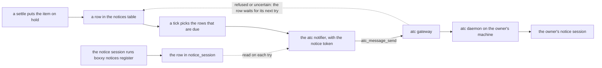

# Notice delivery

When a settle puts an item on hold, the boxxy server tells the owner with a notice: a message that
it sends through [atc](https://github.com/zgeoff/atc), the session manager, to one agent session
that the owner picks, the notice session. [The overview](../overview.md#terms) defines the terms
this doc uses, such as owner, item, hold, settle, runner and tick.

The settle only writes the notice as a row in the boxxy store, the server's SQLite database. The
runner tries that row on each tick until atc takes it, and never gives up, so a notice still arrives
after the notice session was stopped or asleep, or after the owner's machine was off. Each try
carries an idempotency key built from the row, which lets atc tell a repeat of a send from a new
send. A repeat after a lost answer therefore reaches the owner once, except in the two cases that
[the constraints](#constraints) list. The notice session registers itself with the server, so a new
notice session needs no deploy and no server restart.

[The pipeline](./pipeline.md#notices) covers which holds write a notice, and why notices have a
table of their own. [Attempt lifecycle](./attempts.md#settle) covers the settle that writes the row.
[API and auth](../interfaces/api-and-auth.md#the-doors) covers the listeners through which the owner
calls the notice procedures. [The review-and-merge design](../../design/boxxy/review-and-merge.md)
covers the hold reasons.

## The path of a notice

The settle that leaves an item on hold writes one row in the `notices` table in the settle's own
store transaction, so the store holds both the hold and its notice, or neither. On each tick, the
runner reads the unsent rows whose next try is due and hands each one to the notifier, the part of
the server that sends a notice. `@boxxy/dispatch` owns that loop and the
[retry rules](#the-notices-row-and-the-port). A notice that fails never changes an attempt or an
item, because the store already records the hold and `boxxy item list` shows it.

The server calls atc through two parts of atc. An atc daemon runs the sessions on one target, a
place where atc runs sessions, such as the owner's machine or an imp. The atc gateway sits in front
of several daemons and sends each call to the daemon it names.

The server picks the notifier at start. With `BOXXY_ATC_NOTICE_TOKEN` set, it builds the atc
notifier, which calls the gateway with an atc client of its own that carries only that token.
Without it, the server uses a notifier that answers `sent` to every try, so the server marks every
row sent and delivers no notice.

For notices, the deployment supplies:

- the notice token: an atc service token with only the `message` scope;
- a grant: an entry in the `principals` config of the atc daemon that runs the notice session, which
  lets the notice token reach the sessions on the owner's machine.

The server starts and stops worker sessions with its own atc token, `BOXXY_ATC_TOKEN`, which holds
the `spawn` and `kill` scopes ([the atc worker](./sessions.md#the-atc-worker)). The notice session
runs on the owner's machine, and the grant for that machine names only the notice token, so a token
that can start or stop sessions never reaches the owner's machine.

## The registered notice session

atc addresses a session only by its gateway ID, `<daemon>.<incarnation>.<id>`: the daemon's name in
the gateway's registry, the incarnation of that daemon, and the session's ID on that daemon. A
replaced daemon gets a new incarnation, so the IDs of its old sessions stop working. The gateway
answers `no_such_session` to any other value, a session's name included. A rename keeps the ID, and
a new session gets a new ID.

The ID therefore changes with each new notice session, so the store holds it, in the one row of the
`notice_session` table. The notice session writes that row itself, with
`boxxy notices register <gateway-id>` or the MCP tool `notices_register`, and `boxxy notices show`
prints it.

- Only the owner can call `notices.register` and `notices.show`: on the owner listener, or at `/mcp`
  on the public listener, where `notices.register` needs the `write` scope and `notices.show` the
  `read` scope.
- `notices.register` checks only the shape of the ID, because the notice token has no scope that
  reads a session. The server learns that an ID names no session at the next try, and
  `runner.status` then shows `no_such_session`.
- `notices.register` replaces the row and never writes a [fact](../overview.md#terms), because the
  fact catalog has no fact for the notice session. A `CHECK` constraint on the table keeps it to one
  row.
- The atc notifier reads the registered session on each try. A notice that waits therefore goes to a
  newly registered session on its next try, at most `noticeLimits.longestWaitMs` after the
  registration, with no server restart. `noticeLimits` is a constant in `@boxxy/dispatch`, so a
  change to it takes a release.
- With a notice token set and no session registered, the atc notifier never calls atc, and the try
  is `refused` with the reason `no-notice-session`. When the read of the registered session fails,
  the try is `refused` with the reason `notice-session-unread`. In both cases the notice waits like
  any other refused notice.

The server refuses to start when:

- `BOXXY_ATC_NOTICE_TOKEN` is set and empty;
- the environment holds `BOXXY_ATC_NOTICE_SESSION`, whatever its value, and the server's error asks
  the owner to register the session instead;
- the configuration file's `atc` section holds `noticeSession`, which its strict schema refuses.

In each error, the server names the variable or the key, and never a variable's value. The last two
refusals exist because the store owns the notice session. A session ID in the deployment would need
a deploy for each new session.

## The notices row and the port

The `Notifier` port has one method, which takes the notice and the row's current key and answers one
of three outcomes:

| Outcome     | Meaning                       |
| ----------- | ----------------------------- |
| `sent`      | atc took the message          |
| `refused`   | atc ran nothing               |
| `uncertain` | atc may have sent the message |

The atc notifier, in `@boxxy/notifier-atc`, answers `refused` to the atc error codes that mean atc
ran nothing: `no_such_session`, `session_dead`, `unsupported`, `daemon_unavailable` and `bad_args`.
It answers `uncertain` to every other error, `outcome_unknown` and `idempotency_conflict` included.
It keeps only the error's code, because an error message may carry text that must not reach the log.
A notifier that throws counts as `uncertain`. The atc notifier keeps no state between calls.

Each notices row holds its retry state: a key sequence, a count of uncertain tries under the current
key, a count of all tries, and the time of the next try. The row's key is
`boxxy-notice:<row id>:<key sequence>`. After each try, the server updates the row by these rules:

1. On `sent`, the server marks the row sent.
2. On `refused` while the uncertain count is 0, the key sequence goes up by 1. The gateway answers
   any later call under a refused key without sending, so the next try needs a new key.
3. On `uncertain`, or on `refused` after an uncertain try, the uncertain count goes up by 1 and the
   next try repeats the key. The server cannot tell whether the first send reached the atc daemon,
   so it repeats the key and lets atc answer:
   - When the daemon took the first send, it returns that send's result, the try comes back `sent`,
     and the owner gets one message.
   - When the first send never reached the daemon, the gateway answers `outcome_unknown` to every
     repeat, so no repeat succeeds.

   After `noticeLimits.uncertainTriesPerKey` uncertain tries under one key, the key sequence goes up
   by 1 and the uncertain count goes back to 0, whichever case holds. A second copy costs the owner
   less than a notice that never arrives.

4. On every try, the try count goes up by 1. The next try comes `noticeLimits.firstWaitMs` after the
   first try, and the wait doubles after each later try, up to `noticeLimits.longestWaitMs`. The
   wait follows the count of all tries, so a new key keeps the current wait.

The store indexes the unsent rows by their next try time, so a tick reads only the rows that are
due.

## Unsent notices in `runner.status`

The owner procedure `runner.status` shows the notices that wait: the count of unsent rows, the time
of the oldest one, and `lastError`, the reason of the most recent try that was not `sent`.
`lastError` is `no-notice-session` while a notice token is set and no notice session is registered,
and `session_dead` while the registered session is stopped. The server keeps `lastError` in memory
and shows it only while a row is unsent, so a restart clears it until the next failed try.

## Constraints

- The server never gives up on a notice. A row stays unsent until atc takes it, with at most
  `noticeLimits.longestWaitMs` between tries. A cap on tries would lose every notice sent while the
  owner's machine sleeps.
- The server never wakes the notice session. A wake needs the `spawn` scope on the owner's machine,
  which the notice token lacks, and atc cannot wake a machine that is off. atc answers
  `session_dead` while the session is stopped or asleep, and `daemon_unavailable` while the owner's
  machine is off. Both are `refused`, and the row waits.
- A notice tried while no session is registered waits the same way, so it reaches a session that
  registers later.
- A registration never changes a key. A row whose last try at the old session was `uncertain`
  repeats its key at the new session. When atc answers the repeat with the first send's result, the
  server marks the row sent and the notice stays with the old session, like any notice sent before
  the registration. When atc answers the repeat as `uncertain`, the row gets a new key once it
  reaches `noticeLimits.uncertainTriesPerKey` uncertain tries, and the notice goes to the new
  session.
- The owner's agent in the notice session starts each side session, a session it starts for other
  work, as a top-level session. atc lets a token reach a session only when that session and each of
  its sub-sessions run on a target that the grant covers. A sub-session on another target takes the
  notice session out of the notice token's reach, so atc answers `no_such_session` and every notice
  waits while that sub-session stays in the notice session's tree.
- A server restart never changes a key or loses a notice, because the store holds each row's key
  sequence, counts and next try time, and the registered session. The environment holds the notice
  token.
- The owner gets each notice once, with two exceptions:
  - A first send reaches the session, and every repeat of its key still comes back `uncertain`, as
    when the daemon could not record the first send as complete and holds its key as
    `outcome_unknown`. The change of key under rule 3 then sends the notice a second time.
  - The atc daemon keeps a completed key for a fixed retention, which its handshake reports
    ([atc idempotency](https://github.com/zgeoff/atc/blob/main/docs/architecture/protocol/idempotency.md)).
    When the server stops after atc took a send but before the server marked the row sent, and stays
    down past that retention, the repeat after the restart sends the notice a second time.
