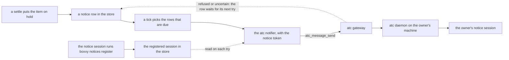

# Notice delivery

When an item goes on hold, boxxy tells the owner with a notice: an atc message to one agent session
the owner picked, the notice session. The settle that puts the item on hold writes the notice into
the boxxy store, and the runner tries to send it on every tick until atc takes it. A runner that
stays paused with work ready sends the owner a second kind of notice
([the paused-runner notice](#the-paused-runner-notice)) and a third when a wait skips a step that
leaves a tagged line unproven ([the notify notice](#the-notify-notice)). It never gives up, so a
notice written while the owner's machine is off waits in the store and arrives once atc can reach
the notice session again. Each try carries an idempotency key, so a retry after a lost answer still
reaches the owner once, apart from the two cases in
[what the owner can rely on](#what-the-owner-can-rely-on). Read this doc before you change how holds
reach the owner, or when notices stop arriving.

[The pipeline](./pipeline.md#when-an-item-needs-the-owner) covers which outcomes hold an item.
[Attempts](./attempts.md#settle) covers the settle that writes the notice.
[API and auth](../interfaces/api-and-auth.md#the-listeners) covers where the owner calls the notice
procedures. The [overview](../overview.md#terms) defines the shared terms.

## The path of a notice

The settle writes the notice row in the same store transaction as the hold, so the store holds both
the hold and its notice, or neither. On each tick the runner hands every due, unsent row to the
notifier. A failed notice never changes an attempt or an item, because the store already records the
hold and `boxxy item list` shows it.

The notifier reaches the session through atc's gateway, which passes each call to the daemon it
names. A daemon runs the sessions on one machine, such as the owner's machine or an imp.

## The paused-runner notice

A runner that has stayed paused for the `pausedNoticeHours` timeout while at least one item is ready
to claim sends the owner one notice. It names how long the runner has been paused, who paused it,
the reason, and how many items wait. The notice exists because a paused runner starts nothing and
shows nothing, so ready work can sit for a night with no sign of why
([pausing the runner](./pipeline.md#pausing-the-runner)).

The tick checks for it before it sends notices, and writes it as a notice row of the kind
`runner-paused`, with the detail fixed at that moment. The runner's row records when the notice was
queued, in the same change, so a later tick queues no second one. A resume clears the mark, and the
next pause starts a new count. A notice that atc has not taken follows the same retries as a hold
notice, and a resume after it is queued does not recall it.

The timeout is a constant beside the other timeouts in the dispatch module, not a config option. A
pause stored before the runner recorded its start time has no length, so it gets no notice.

## The notify notice

A step skipped by a [wait](./ship-watch.md#the-shipped-wait) that has no later check to prove a
tagged acceptance line sends a third kind of notice, `notify`. It names the item, the phase and the
skip reason, and the message tells the owner that boxxy ended that step with no session. The claim
writes the row in the same change as the skipped attempt, with the phase in the row, and the notice
follows the same retries, key and session as a hold notice.

## Turning notices on

The deployment sets `BOXXY_ATC_NOTICE_TOKEN` to an atc service token that holds only the `message`
scope, and the notifier calls the gateway with a client of its own that carries only that token. The
deployment also adds that token to the `principals` config of the atc daemon on the owner's machine.
Without the variable, the server uses a notifier that answers `sent` to every try, so it marks every
notice sent and delivers none.

The server starts and stops worker sessions with a separate token that holds the `spawn` and `kill`
scopes ([the atc worker](./sessions.md#the-atc-worker)). Only the notice token is granted on the
owner's machine, so a token that can start or stop sessions never reaches it.

The deployment never names the notice session, because a session ID in the deployment would need a
deploy for each new session. The server refuses to start while `BOXXY_ATC_NOTICE_SESSION` is set,
whatever its value, and prints `boxxy notices register <gateway-id>` as the step to take instead. It
also refuses to start when `BOXXY_ATC_NOTICE_TOKEN` is set but empty. In each error the server names
the variable, never its value.

## The registered notice session

atc addresses a session only by its gateway ID, `<daemon>.<incarnation>.<id>`, and answers
`no_such_session` to anything else, a session's name included. A rename keeps the ID, but a new
session, or a replaced daemon, gives a new one. The ID therefore changes with each new notice
session, so the notice session registers itself: it runs `boxxy notices register <gateway-id>`, or
calls the MCP tool `notices_register`, and the store keeps the one registered ID.
`boxxy notices show` prints it.

- **Only the owner registers.** The owner listener accepts both procedures, and the public
  listener's `/mcp` accepts them with the `write` scope for register and `read` for show.
- **Registration checks only the ID's shape,** because the notice token can't read a session. A
  wrong ID shows up at the next try, as `no_such_session` in `runner.status`.
- **Registration writes no fact,** so pepys keeps no record of it, and `boxxy notices show` is the
  only place it shows.
- **A waiting notice follows the new registration.** The notifier reads the registered session on
  every try, so the next try goes to the new session with no server restart.
- **With no session registered, or the store unreadable,** the notifier never calls atc and answers
  `refused` with `no-notice-session` or `notice-session-unread`. The notice waits like any other
  refused one.

## Retries and the idempotency key

Each notice row holds its retry state: a key sequence, a count of uncertain tries under the current
key, a count of all tries, and the time of the next try. A try sends the key
`boxxy-notice:<row id>:<key sequence>`, so bumping the sequence makes a new key. The notifier
answers each try with one of these outcomes:

| Outcome     | Meaning                         | atc answers                                                                                    |
| ----------- | ------------------------------- | ---------------------------------------------------------------------------------------------- |
| `sent`      | atc took the message            | success                                                                                        |
| `refused`   | atc did not send it             | `no_such_session`, `session_dead`, `unsupported`, `daemon_unavailable` or `bad_args`           |
| `uncertain` | atc may or may not have sent it | anything else, `outcome_unknown` and `idempotency_conflict` included, or a notifier that threw |

The notifier keeps only atc's error code, because an error message may carry text that must not
reach the log. After each try the server updates the row:

1. **`sent`** marks the row sent.
2. **`refused` with no uncertain try under this key** bumps the key, because the gateway answers any
   later call under a refused key without sending.
3. **`uncertain`, or `refused` after an uncertain try,** repeats the same key next time. The server
   can't tell whether the first send arrived, so it lets atc answer: when atc delivered and recorded
   it, the repeat comes back `sent` with that send's result, and the owner gets one message.
4. **After a run of uncertain tries under one key,** the key is bumped anyway. Only a key whose
   every repeat stays uncertain gets here: either the first send never reached the daemon, and the
   new key delivers the notice once, or the daemon delivered it but couldn't record it, and the new
   key delivers it a second time. The server can't tell these apart, and a second copy costs the
   owner less than a notice that never arrives.

The wait between tries doubles from a short first wait up to a cap. It follows the count of all
tries, so a new key keeps the current wait. The retry rules and their limits live in the dispatch
module, so changing them takes a release; the atc notifier in `@boxxy/notifier-atc` keeps no state
between tries.

## Unsent notices in `runner.status`

`runner.status` counts every kind of notice. It shows the count of unsent notices, the time of the
oldest, and `lastError`, the reason of the latest try that wasn't `sent`. `lastError` reads
`no-notice-session` while no session is registered, and `session_dead` while the registered session
is stopped. The server keeps `lastError` in memory and shows it only while a notice is unsent, so a
restart clears it until the next failed try.

## What the owner can rely on

- **A notice is never lost.** It stays unsent until atc takes it, and the wait between tries never
  passes the cap. A cap on tries would lose every notice written while the owner's machine sleeps. A
  server restart loses nothing either, because the store holds each row's retry state and the
  registered session.
- **boxxy never wakes the notice session.** A wake needs the `spawn` scope on the owner's machine,
  which the notice token lacks, and atc can't wake a machine that is off. atc answers `session_dead`
  while the session is stopped or asleep, and `daemon_unavailable` while the machine is off; both
  are `refused`, and the notice waits.
- **A registration never changes a key.** A notice whose last try at the old session was uncertain
  repeats its key at the new session. If atc answers with the first send's result, the notice stays
  with the old session, like any notice sent before the registration; if it stays uncertain, the key
  is eventually bumped and the notice goes to the new session.
- **A side session under the notice session blocks every notice.** atc lets a token reach a session
  only when it and all its sub-sessions run on machines the grant covers, so it answers
  `no_such_session` while a sub-session runs elsewhere. boxxy can't stop the owner's agent from
  starting such a sub-session, so the owner's agent must start each side session as a top-level
  session.
- **The owner gets each notice once, with two exceptions.** The daemon delivered a send but couldn't
  record it, so a new key sends it again (rule 4 above). Or the server stopped after atc took a send
  but before it marked the row sent, and stayed down past the daemon's retention of completed keys
  ([atc idempotency](https://github.com/zgeoff/atc/blob/main/docs/architecture/protocol/idempotency.md)),
  so the repeat after the restart sends it again.
