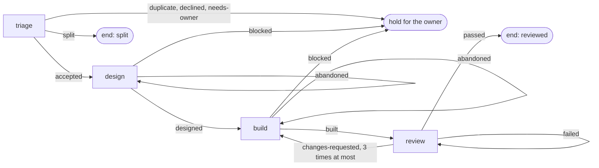

# The work pipeline

The pipeline is the route an item takes from filing to done: triage, design, build, review, and for
some repos verify and merge. The owner writes it as data in the rules file: the phases in order,
where each outcome of a phase sends the item, and how many tries each step gets. boxxy never stores
where an item is. It works that out from the item's settled attempts each time it reads the item, so
a rules change moves every waiting item without a migration. When an outcome needs the owner, the
item holds and the owner gets a notice. Read this doc before you change the rules file, a phase kind
or a launch prompt.

[Attempts](./attempts.md) covers one try at one phase. [Agent sessions](./sessions.md) covers the
session an attempt runs in, and capacity. [Notices](./notices.md) covers how a hold reaches the
owner. The [review, verify and merge design](../../design/boxxy/review-and-merge.md) owns the steps
after a build. The [overview](../overview.md#terms) defines the shared terms.

## Phases and edges

The diagram is the example rules file in `modules/rules/example/`. Each step of a pipeline gives a
phase, the attempts it allows in a row (`maxAttempts`), a time limit (`timeoutMinutes`), and an edge
for every outcome. The phase kind, the server code behind a phase, lists the outcomes, parses the
close-out and says what runs the attempt: an agent session, or a merge job that the runner drives
itself.

An edge is one of these:

- `next` moves the item to the following step, or ends the pipeline after the last one.
- `again` runs the same phase again, and counts against the step's `maxAttempts`.
- `{ to, max, resume }` sends the item to the step of phase `to` and adds one to the item's round,
  the count of its trips back through the pipeline. An edge back to an earlier step, or to its own
  step, needs `max`: the number of times it may run before the item holds with `rounds used up`, so
  every loop ends. `resume: true` wakes that step's [kept session](./sessions.md#the-kept-session),
  so the builder carries on with its context.
- `{ end }` ends the pipeline with a reason.
- `{ hold }` holds the item for the owner with a reason.

## Step gates and skips

A step may gate its attempt. The claim checks the gates before it starts the step, and the first
gate that says skip settles the step as skipped, with no session, pool, seat or lease.

| Step field                          | The step is skipped when                                                         | Reason recorded            |
| ----------------------------------- | -------------------------------------------------------------------------------- | -------------------------- |
| `criteria: { tagged: t }`           | no acceptance line of the item carries the tag `t`                               | `no-criteria-tagged:<tag>` |
| `skipWhen: [{ checkPassed: name }]` | the latest run of the check `name` at the head of the item's pull request passed | `check-passed:<name>`      |

The claim checks `criteria` first, then `skipWhen`, and any one true condition of `skipWhen` skips.
A step with `criteria` runs on the matching lines alone: the phase input and the launch prompt's
`acceptance` list only the lines with the tag. The tags an acceptance line may carry are the rules
file's `criterionTags`. `item file`, `item edit` and a triage or design close-out that sets
acceptance refuse a tag the list lacks, and a tag stays on its line in the item's state, its facts
and `item show`.

A step with a gate has a `skip` edge: `next`, `{ end }` or `{ hold }`, never `again` or `{ to }`. A
skipped attempt follows that edge, counts toward no `maxAttempts` and no `max`, and a tag added
after the step skipped doesn't bring it back: `boxxy item retry <item> --phase <phase>` does. A
claim that finds the runner paused, or an item whose repo is missing from `spawn.repos`, records no
skip. With no GitHub forge configured a `checkPassed` condition never skips, and a forge error reads
as not passed.

The loader refuses a gate with no `skip` edge, a condition it doesn't know, a `criteria.tagged` tag
that `criterionTags` doesn't list, and a `skip` hold that uses an engine hold reason.

The loader refuses a step that leaves out an outcome of its phase kind, or adds one the kind lacks,
so every outcome has an edge. It also refuses a step with no time limit, and a phase kind this
server can't run: a merge step needs a server with a `github` section in its config.

## How boxxy decides where an item stands

boxxy replays the item's settled attempts, and each `boxxy item retry` the owner ran, in time order,
through the rules loaded now. Each attempt contributes its stored outcome and round. The result is
the item's position: a phase, an end or a hold.

- **The round belongs to the item.** It starts at 1 and rises with each `{ to }` edge, each
  `boxxy item retry --phase`, and each retry that lifts a `rounds used up` hold. A review of
  reworked code has the build's round, and the reports count any attempt above round 1 as rework.
- **The engine adds three outcomes.** `lost` is the outcome of an attempt that failed without an
  outcome of its phase, such as one with no valid close-out. `lost` acts as `again`. One exception:
  the engine skips a `no-capacity` or `usage-limit` failure, because that work never ran.
  `unsettleable` marks a close-out the phase code could not settle; it has no edge, so the item
  holds. `skipped` marks a step a [gate](#step-gates-and-skips) skipped, and takes the step's `skip`
  edge.
- **The engine adds three holds:** `attempts used up`, `rounds used up` and `outcome not in rules`.
  When a newer phase kind drops an outcome, an item whose stored outcome lost its edge holds with
  `outcome not in rules`. It never falls through to `next`, so no item skips a phase unchecked. The
  loader refuses a rules-file hold with one of these reasons, so a report can tell an engine hold
  from a rules hold.
- **`boxxy item retry <item>` lifts a hold** and restarts both counts: the attempts in a row, and
  the runs of each `{ to }` edge. `--phase <phase>` also moves the item to that phase, and is the
  only way back to build after a passed review.

A rules change never touches a live attempt: the attempt settles by the phase kind loaded when it
settles. An item between attempts stands wherever the new rules put it. It can move to another
phase, leave a hold because a `maxAttempts` or `max` went up, or take a hold because one went down.
That last case sends no notice, because boxxy writes notices only at settle. Run
`boxxy rules dry-run <file>` before a rules change merges: it prints each open item's position now
and under the new rules, and writes nothing.

## When an item needs the owner

A hold stops the item until the owner acts, and the settle that leaves an item on hold writes a
notice ([notices](./notices.md)). An agent asks the owner a question the same way: it closes out
`blocked` with the question as its reason, or `needs-owner` at triage. The owner reads the question
with `boxxy item show`, answers with `boxxy item note`, and runs `boxxy item retry`.

The next attempt gets the question in `{{ stopped }}` and the answer in `{{ notes }}`, and sees
nothing else of the last attempt's work. The example prompts therefore tell a blocked agent to put
its progress in the reason too.

A close-out can also ask for changes, such as filing new items, adding relations or closing the
item. When its edge is a hold, settle files the new items but withholds every change to the item
itself, so the owner decides first. One change goes through: a `blocks` relation from another item
to this one, so a blocked design or build still waits on that item after the retry.

## Limits and pools

An item's design runs in `agent` mode by default. In `attended` mode the owner works with the agent
in its session, and the agent closes out when the owner is done. The owner sets `designMode` when
filing or editing the item, or a triage close-out sets it. An attended design takes its seats even
when the owner is away, so it sleeps and gives them back after `sleep.afterUnattendedMinutes` with
no owner attached.

A limit caps how many attempts run at once. It has a name, a maximum and a filter on the phase and
the item's fields. The claim starts an attempt only when every limit that counts it has a free seat,
and a sleeping attempt gives its seats back. The example caps all attempts with `workers`, and
attended designs with `owner-design`. A limit is only an upper bound: the atc target can have fewer
free machines, and atc then refuses the session
([capacity](./sessions.md#capacity-and-the-usage-limit)).

A pool decides which ready item the claim takes next: it takes the items its filter matches, in its
order, and the owner's levers, defer and expedite, change that order. A pool sets no count, so the
loader refuses a pool unless some limit counts every attempt it can start.

## Pausing the runner

`boxxy runner pause` stops the claim, so no ready item starts or wakes, and `boxxy runner resume`
lets it run again. Live attempts go on, and a restart keeps the pause. Each switch writes a fact in
the same change as the row, `boxxy.runner.paused` or `boxxy.runner.resumed`, with the runner as its
entity, the owner as its actor, and any `--reason` of a pause. The server logs one line for each
switch, and `boxxy status` shows the pause: since when, by whom, and the reason. A repeat pause or
resume changes nothing and writes no fact, so the first pause keeps its time and reason. The owner
gets a [notice](./notices.md#the-paused-runner-notice) when a long pause leaves work ready.

## Recipes and skills

The rules file's `kinds` section gives each item kind, such as `core.issue`, a pipeline and a recipe
per phase. A recipe sets the agent, the model, the launch prompt template and the skills. Each
kind's recipe map is keyed by phase name, and its key `design/attended` gives the recipe for an
attended design.

- **Skills are pinned.** The rules file pins one commit of one skills repository, and each recipe
  lists the skills its phase needs. The
  [session-start hook](../interfaces/cli-and-hooks.md#installing-skills) fetches them into the
  session's workspace, and a skill it can't install fails the attempt as `skill-missing`.
- **Each attempt records a recipe hash** over its recipe, its templates, the rules version and the
  skills pin, so the reports keep attempts of a changed recipe apart.
- **`session: builder` on a recipe** runs its phase in the build's
  [kept session](./sessions.md#the-kept-session) instead of a fresh one, such as a verify that
  grades the build where it was built.
- **A build recipe has no check command.** The agent follows the repo's own agent instructions.
- **A credentialed agent runs only where the server config scopes it.** The loader checks each
  recipe against `spawn.agents`, for every repo in `spawn.repos`
  ([who holds a credential](./sessions.md#who-holds-a-credential)). It refuses a recipe that names a
  listed agent outside its phases or repos (`agent-outside-scope`), a recipe for a
  `requireScopedAgent` phase whose agent isn't listed for it (`phase-without-scoped-agent`), a
  `session: builder` recipe that runs a listed agent, or that wakes the session of a build that runs
  a listed agent (`scoped-agent-builder-session`), and a `resume: true` edge into a phase a listed
  agent runs, or in a pipeline whose build runs a listed agent (`scoped-agent-session-resumed`). The
  loader checks each kind with its own pipeline and recipes. The review phase sets
  `requireScopedAgent`, so every review runs on the review agent.

## The launch prompt

A session reads its whole task from its launch prompt. The claim renders it from the recipe's
[Liquid](https://liquidjs.com/) template, filling these placeholders:

| Placeholder           | Value                                                                                                         |
| --------------------- | ------------------------------------------------------------------------------------------------------------- |
| `title`, `repo`       | the item's title and repo                                                                                     |
| `outcome`, `body`     | the outcome the owner wants, and the body, as written                                                         |
| `acceptance`          | one `- <id>: <text>` line per criterion; only the lines with the step's `criteria.tagged` tag when it has one |
| `design`              | the latest design's text, then `Location: <location>` when it has one; a build only                           |
| `conclusion`          | the latest design's conclusion, such as the result of an investigation; a build only                          |
| `findings`            | what sent the build back, from a [review](#the-review) or a verify; a build only                              |
| `stopped`             | the question or reason where the latest attempt of this phase stopped; empty after any other close-out        |
| `notes`               | one `- <YYYY-MM-DD>: <text>` line per note, oldest first                                                      |
| `security`            | `true` when the item has the security mark, else empty                                                        |
| `ticket`              | the whole item, `# <title>` then each non-empty section under its own heading; leaves out `security`          |
| `attempt_id`, `input` | the attempt's ID, and its input as JSON                                                                       |

Every placeholder but `ticket` gives its content only, with no heading. A template author needs four
rules:

- **An empty section is the empty string,** which `` reads as false. Put each section's
  heading inside its `if`, and open the tag with `{%-` so an empty section leaves no blank line.
- **A value reaches the agent as written.** Liquid never parses a value again, so `{{ }}` inside an
  item's text stays text.
- **A template the loader accepts always renders.** The loader refuses as `bad-prompt` a template
  that could throw at claim, such as one that binds a name in a branch that might not run.
- **A `for` loop over a placeholder runs once**, with the whole value, or never for an empty one.

A recipe may name a second template in `reworkPrompt`, which the claim renders when an earlier
attempt of the same phase succeeded, such as a build that a review sent back. When the item has a
kept session, the claim wakes it with this prompt, so the agent gets just the new findings.
Otherwise a fresh session starts with it, so the rework template must carry the whole task, for
example with `{{ ticket }}`.

## The review

The [review gate design](../../design/boxxy/review-and-merge.md#the-review-gate) owns the review. A
review session runs one command that the review gate, boxxy's adapter for the noslop review tool,
builds, and sends the tool's raw result as its close-out. The server checks that the result covers
the pull request's head commit, then posts it to the pull request. A failed call, or a result for
another commit, settles `failed`.

The next build's `findings` gives the commit the review read, the open findings counted by severity,
and the gate's text on how to answer them, never the findings' text
([decision 0009](../../decisions/0009-close-outs-hold-what-only-the-agent-knows.md)). After a failed
verify, `findings` gives the commit the verify ran at and the features that failed.

## What an item records

boxxy is the only record of the work. Each fact carries the full text it changes, so pepys can
rebuild every item from the facts alone ([facts and pepys](../interfaces/facts-and-pepys.md)), and
no fact links to an outside tracker.

- **The body** is markdown for the agent: context, scope, permissions and notes. boxxy never parses
  it, and an edit or a triage close-out replaces it whole.
- **Labels** are free short strings, and an edit replaces the whole list.
- **Notes** are append-only, and every later launch prompt carries them.
- **The security mark** flags work on a security weakness. The owner sets it when filing or editing,
  and a close-out can set it on an item it files. Only a template reads it, through
  `{{ security }}`.
- **Relation types are rules data**, such as `blocks`, `duplicate-of` and `relates-to`.
  `boxxy item close <item> --of <other>` closes an item as a duplicate and adds the `duplicate-of`
  relation in one change.

## Derived item state

An item's state is derived on every read, from its position, attempts, acceptance list, pull
requests and relations. The first row that matches wins:

| State      | When                                                                                                                       |
| ---------- | -------------------------------------------------------------------------------------------------------------------------- |
| `archived` | the item is closed                                                                                                         |
| `held`     | the owner filed it held, and hasn't released it                                                                            |
| `running`  | it has a live attempt, sleeping or closing ones included                                                                   |
| `waiting`  | its position is a hold, with the hold's reason                                                                             |
| `done`     | its position is an end, and a pull request linked to a succeeded build has merged                                          |
| `waiting`  | its position is an end and nothing merged: `pull request open`, `no pull request linked` or `pull request closed unmerged` |
| `idea`     | its phase needs an acceptance list and it has none                                                                         |
| `blocked`  | an item that `blocks` it is neither done nor archived                                                                      |
| `ready`    | anything else                                                                                                              |

A held item is the owner's draft: `boxxy item release` starts it at triage. Build, review, verify
and merge need an acceptance list. An `accepted` triage must leave one and a `designed` close-out
may replace it, and the claim never starts an `idea` item until the owner adds one or runs
`boxxy item retry --phase design`. The `blocked` state means another item is in the way; a `blocked`
outcome is different, and makes the item `waiting`.

At an end, the state reads whether the pull request merged, never a merge phase's outcome, so a
merge by hand and a merge by boxxy both make the item `done`. A
[pull request link](../interfaces/github.md#linking-a-pull-request) comes from the agent's hook or
the server's watch. An item on hold stays `waiting` even when its pull request merges. When the pull
request closed unmerged, the owner runs `boxxy item retry <item> --phase build` or closes the item.
