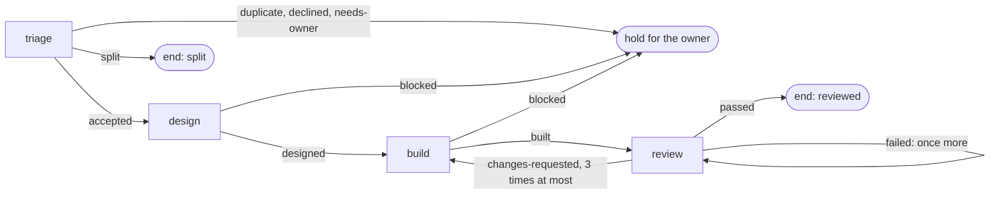

# The work pipeline

boxxy takes an item of work through a pipeline of phases, such as triage, design, build and review.
A phase can take several attempts. Most attempts run an agent session, and a merge runs as a job
that the runner drives. The pipeline is data in the rules file: the phases, the edge each outcome
takes, and the limits on attempts and rounds. boxxy stores no position for an item: it works out
where the item stands from the item's settled attempts each time it reads the item. When an outcome
needs the owner, the item holds, and the owner gets a notice.

[The overview](../overview.md#terms) defines the terms this doc uses, such as attempt, close-out,
settle, claim, limit, pool, lever, recipe and fact. [Attempt lifecycle](./attempts.md) covers one
attempt, from claim to settle. [Agent sessions](./sessions.md) covers the kept session and capacity.
[Notices](./notices.md) covers how a notice reaches the owner. The design doc
[Review, verify and merge](../../design/boxxy/review-and-merge.md) owns the steps after a build.

## The pipeline

The example rules file, `modules/rules/example/rules.yaml`, holds the common case, four phases:

Each step of a pipeline holds a phase, the attempts it allows in a row (`maxAttempts`), a time limit
(`timeoutMinutes`), and an edge for every outcome of its phase kind. A phase kind is the server's
code for the phase of that name: it lists the phase's outcomes, parses its close-out, and runs on
one worker, the atc session worker or the merge job worker.

An edge is one of five kinds:

- `next` moves the item to the step after this one, or ends the pipeline after the last step.
- `again` runs the same phase again, and counts against the step's `maxAttempts`.
- `{ to, max, resume }` sends the item to another phase and raises the item's round. A backward edge
  needs `max`, the times the edge may run before the item holds. On a backward edge, `resume: true`
  wakes the target's [kept session](./sessions.md#the-kept-session).
- `{ end }` ends the pipeline with a reason.
- `{ hold }` holds the item for the owner with a reason.

A close-out asks for changes, such as closing the item, setting its acceptance list, filing new
items or adding relations. When the outcome's edge is a hold, the settle withholds each change to an
existing item and lists it in the settle's fact. New items still file. A `blocks` relation from
another item still lands, so a blocked design or build waits on that item after the owner's retry.

### Rules of the engine

- **The position is a fold.** boxxy replays, in time order, the item's settled attempts and each
  `boxxy item retry` the owner ran, under the rules loaded now. A settled attempt stores its outcome
  and its round.
- **Every outcome has an edge.** A phase kind lists its outcomes, and the loader refuses a step that
  leaves one out or adds one the phase kind lacks.
- **Two outcomes come from the engine, and no phase kind lists them.** `lost`, an attempt with no
  valid close-out or a forced failure, acts as `again`. `unsettleable`, a close-out the phase code
  could not settle, has no edge, so it holds the item with `outcome not in rules`. Any other outcome
  with no edge under the rules loaded now takes the same hold, and never acts as `next`.
- **The round belongs to the item.** It starts at 1 and rises with each `{ to }` edge, each
  `item retry --phase`, and each retry out of `rounds used up`. The review of a reworked build has
  the build's round.
- **Three holds come from the engine.** `attempts used up` comes when a step runs out of
  `maxAttempts` in a row, `rounds used up` when a `{ to }` edge has run `max` times, and
  `outcome not in rules` as above. The loader refuses a `{ hold }` edge with one of these reasons,
  so a report can tell an engine hold from a rules hold.
- **`boxxy item retry <item>` lifts a hold.** It restarts both counts: the attempts in a row, and
  the runs of each `{ to }` edge. With `--phase <phase>` it also moves the item to that phase, which
  is the only way back to build after a passed review.
- **Two failures never count.** The engine skips an attempt that failed with `no-capacity` or
  `usage-limit`: it moves no item and counts against no limit of attempts, since the work never ran.

The loader also refuses a backward edge with no `max` (an edge back to its own step is backward), a
step with no time limit, and a phase kind on a worker this server lacks: a server builds the merge
job worker only when its config has a `github` section.

### A rules change

A rules change never touches a live attempt: the attempt settles by the phase kind loaded when it
settles. An item between attempts stands where the new rules put it, because boxxy derives the
position on every read. A changed edge therefore moves the item, a raised limit frees an item on
hold, and a lowered limit can hold one.

Run `boxxy rules dry-run <file>` before a rules change merges. It prints, for each open item, the
position it has and the position it would get, and writes nothing.

## Design mode

An item's design runs in `agent` mode by default. In `attended` mode the owner works with the agent
in the session, and the agent sends its close-out when the owner is done. The owner sets
`designMode` with `boxxy item file` or `boxxy item edit`, or a triage close-out sets it. An owner
who is away costs one session start for each attended item: the session asks its first question,
waits, goes to sleep and gives its seats back.

## Limits and pools

A limit caps the attempts that run at once. It has a name, a maximum, and a filter on the phase and
the item's fields that picks the attempts it counts. The claim starts an attempt only when every
limit that counts it has a free seat. A sleeping attempt holds no seat. The example has two limits:
`workers` counts every attempt, and `owner-design` counts attended designs. `workers` is an upper
bound only: the atc target that sessions run on (`spawn.target` in the server config) can have fewer
free machines, and atc then refuses the session
([capacity](./sessions.md#capacity-and-the-usage-limit)).

A pool picks which ready item the claim takes next: it takes the items that match its filter, in its
order, and the owner's levers, such as expedite and defer, change that order. A pool sets no count,
so the loader refuses a pool unless some limit counts every attempt the pool can start. The example
has one pool per phase, plus one for attended designs.

## Recipes and skills

Each item kind maps each phase to a recipe, and `design/attended` to the recipe of an attended
design. A recipe sets how the phase's session runs: the atc agent, the model and effort, the prompt
template, and the skills.

The review recipe runs on a review agent, an atc agent whose broker profile holds a read-only clone
token. List the review agents in the server's `spawn.reviewAgents`, and the loader keeps that token
to review sessions: it refuses a review agent on any other step, a review on any other agent, and a
review session that the item keeps or that wakes a kept session. With an empty list, the default,
the loader checks none of this.

- **Skills are pinned.** The rules file pins one commit of the skills repo, and each recipe lists
  the skills its phase needs. The recipe hash covers the list and the pin, so a change to either
  gives the recipe a new hash.
- **The session-start hook fetches the skills** at the pin into the session's workspace, then
  reports the session to the server with any skill it could not install. A missing skill fails the
  attempt as `skill-missing`. [Installing skills](../interfaces/cli-and-hooks.md#installing-skills)
  covers the fetch.
- **A build recipe has no check command.** The agent follows the repo's own agent instructions, so
  each repo keeps its own checks.

### The launch prompt

A session reads its whole task in its launch prompt, which the server renders at claim from the
recipe's [Liquid](https://liquidjs.com/) template with `@boxxy/prompt-template`. Each placeholder
holds its content only, with no heading. `ticket` is the exception: it holds the whole item, with a
heading on each section. A template author needs these rules:

- **Each value is plain text, and an empty section is the empty string**, which ``
  reads as false. Write each section's heading inside an `if` block, and open the tag with `{%-`, so
  an empty section leaves no bare heading and no blank line.
- **A value reaches the agent as written.** Liquid never parses a value again, so a value that holds
  `{{ }}` or `` stays text.
- **A template the loader accepts renders at claim with any values.** The loader refuses the rules
  as `bad-prompt` for a template that could throw at claim, such as one that binds a name in a
  branch that might not run.
- **A `for` loop over a placeholder yields the whole value once**, or never for an empty value.

| Placeholder           | Value                                                                                                                                                                      |
| --------------------- | -------------------------------------------------------------------------------------------------------------------------------------------------------------------------- |
| `title`, `repo`       | the item's title and repo                                                                                                                                                  |
| `outcome`             | the outcome the owner wants from the item, as filed                                                                                                                        |
| `body`                | the item's body as the owner wrote it                                                                                                                                      |
| `acceptance`          | one `- <id>: <text>` line for each criterion                                                                                                                               |
| `design`              | the design text, then `Location: <location>` when the design has one. Only a build gets it.                                                                                |
| `conclusion`          | the `conclusion` of the latest design, such as the result of an investigation. Only a build gets it.                                                                       |
| `findings`            | what sent the build back, from a review ([the review](#the-review)) or a verify. Only a build gets it.                                                                     |
| `stopped`             | where the latest attempt of the same phase stopped: the question of a `needs-owner` triage, or the reason of a `blocked` design or build. Empty after any other close-out. |
| `notes`               | one `- <YYYY-MM-DD>: <text>` line for each note, oldest first                                                                                                              |
| `security`            | `true` when the item has the [security mark](#the-ledger-labels-notes-and-relations), and empty otherwise                                                                  |
| `ticket`              | the whole item: `# <title>`, the outcome, the body, then each section that has content under its own heading. It leaves out `security`.                                    |
| `attempt_id`, `input` | the attempt's ID, and its input as JSON                                                                                                                                    |

A recipe may name a second template in `reworkPrompt`. The claim renders it in place of `prompt`
when the item has a succeeded attempt of the same phase, such as a build that a review sent back,
whatever the round. The rework template must carry the whole task, such as with `{{ ticket }}`,
because the claim spawns a fresh session with it when the kept session is gone. A rework on the
[kept session](./sessions.md#the-kept-session) sends the new attempt's prompt, so `findings` and
`design` carry that attempt's input.

## The ledger: labels, notes and relations

boxxy is the only record of the work. Each fact carries in full the text it changes: the title, the
outcome, the body, the acceptance list, the labels, each note and each relation. pepys can therefore
rebuild every item from the facts alone ([facts and pepys](../interfaces/facts-and-pepys.md)). A
fact never links to an outside tracker.

- **The body** is markdown up to `itemBodyMaxChars`: the context, scope, permissions and notes for
  the agent. boxxy never parses it. `item.edit` and a triage close-out's `set.body` replace the
  whole text. The server refuses a file or an edit whose fact would be too large to send to pepys,
  with `FACT_TOO_LARGE`.
- **Labels** are free short strings. `item.file` sets them, and `item.edit` replaces the whole list.
- **The security mark**, `fields.security: true`, marks an item whose work concerns a security
  weakness. The owner sets it with `item.file` or `item.edit`, and a close-out can set it on an item
  it files ([close-outs](../../design/boxxy/close-outs.md#openitems)). Only a template reads the
  mark, through the `security` placeholder.
- **Notes** are append-only. Every later launch prompt carries them in `{{ notes }}`.
- **Relations** have types that are rules data, such as `blocks`, `duplicate-of` and `relates-to`.
  `item.close --of <item>` closes an item as a duplicate and adds a `duplicate-of` relation in the
  same change. The close skips the relation when it exists and nobody removed it.

## Notices

The settle that leaves an item on hold writes a notice, which the runner sends to the owner. A hold
that a rules change makes sends no notice, because no settle runs.

An agent's question takes the same path. The agent closes out `blocked` with the question, or
`needs-owner` at triage, and the item holds. The owner reads the question with `boxxy item show`,
answers with `boxxy item note`, and runs `boxxy item retry`. The next attempt of the phase gets the
question in `{{ stopped }}` and the answer in `{{ notes }}`, so a design or a build that stops puts
the question and its progress in its reason.

## The review

[The review gate](../../design/boxxy/review-and-merge.md#the-review-gate) owns the review. A review
session runs the review tool's command that the review gate builds, and sends the tool's raw result.
The server checks the result against the pull request's head commit, and posts it. A failed call, or
a result for another commit, settles `failed`. The review takes a `workers` seat.

The next build's `findings` holds the commit the review read, the open findings counted by severity,
and the review gate's text on how to answer them, never the findings' text
([decision 0009](../../decisions/0009-close-outs-hold-what-only-the-agent-knows.md)). After a failed
verify, `findings` holds the commit the verify ran at and the failed features.

## Derived item state

boxxy derives an item's state on every read, from its position, attempts, acceptance list, pull
requests and relations. The first match wins:

| State      | When                                                                                                                                                           |
| ---------- | -------------------------------------------------------------------------------------------------------------------------------------------------------------- |
| `archived` | the item is closed                                                                                                                                             |
| `held`     | the owner filed the item held, and `boxxy item release` has not released it                                                                                    |
| `running`  | the item has a live attempt, a sleeping or closing one included                                                                                                |
| `waiting`  | the position is a hold, with the hold's reason                                                                                                                 |
| `done`     | the position is an end, and a pull request linked to a succeeded build attempt has merged                                                                      |
| `waiting`  | the position is an end, and no linked pull request has merged, with the reason `pull request open`, `no pull request linked` or `pull request closed unmerged` |
| `idea`     | the phase needs an acceptance list and the item has none                                                                                                       |
| `blocked`  | an item that `blocks` this one is neither done nor archived                                                                                                    |
| `ready`    | any other case                                                                                                                                                 |

A `held` item has not started, and `boxxy item release` starts it at triage. A `waiting` item
stopped at a hold, and `boxxy item retry` lifts the hold. The `blocked` state means another item
blocks this one, and the `blocked` outcome makes the item `waiting`.

Build, review, verify and merge need an acceptance list. An `accepted` triage must leave one, and a
`designed` close-out may replace it. The claim never starts an `idea` item until the owner adds a
list with `boxxy item edit`, or runs `boxxy item retry --phase design`.

Once the position is an end, the state reads the pull request's merge, never a merge phase's
outcome, so a merge by hand and one by boxxy both make the item `done`. An item on hold stays
`waiting` even when its pull request merges. Under the example, which has no
[merge step](../../design/boxxy/review-and-merge.md#the-merge-step), the item waits with
`pull request open` until someone merges it. When the pull request closed unmerged, the owner runs
`boxxy item retry <item> --phase build` or closes the item.
