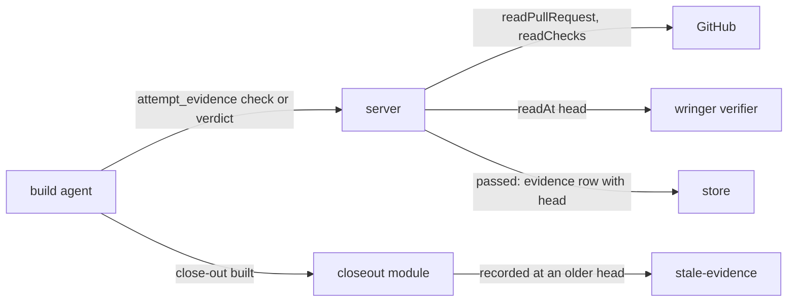

# Checked evidence

- **Status:** draft

A build agent records acceptance evidence as free text today. The server checks only that the cited evidence exists and belongs to the attempt. It never reads the CI run or the test cited in the text. Two evidence kinds change that: `check`, a CI check by name, and `verdict`, a `bun verify` feature by name. For either one the server reads the result from GitHub at the pull request's head, records it only when it passed, and refuses a `built` close-out whose checked evidence no longer matches the head.

The design extends [the verifier](./review-and-merge.md#the-verifier), the evidence that [attempts](../../architecture/work/attempts.md) record, and the build close-out in [the pipeline](../../architecture/work/pipeline.md).

## Shape



## Contracts

An agent records a check or a verdict by name. The server finds the head itself.

```ts
await attempt.evidence({ session, kind: 'check', ref: 'pr / checks' });
// → { kind: 'recorded', factId: 'f_01J…' }
//   or { kind: 'refused', reason: 'check-pending', check: 'pr / checks', head: '9c1e…' }

await attempt.evidence({ session, kind: 'verdict', ref: 'file-item' });
// → { kind: 'recorded', factId: 'f_01J…' }
//   or { kind: 'refused', reason: 'verdict-missing', feature: 'file-item', head: '9c1e…' }
```

The input stays one object. A check or verdict call that sends `observed` fails input validation.

```ts
// libs/contract
interface AttemptEvidenceInput {
  session: SessionRef;
  kind: 'test' | 'ci-run' | 'live-check' | 'check' | 'verdict';
  ref: string; // `check`: the check name, such as 'pr / checks'; `verdict`: the feature name, such as 'file-item'
  observed?: string; // free-text kinds only
}
```

Each answer below is added to the `attempt_evidence` output. See [Constraints](#constraints) for the answer each GitHub reading gets.

```ts
// libs/contract
type CheckedEvidenceAnswer =
  | { kind: 'retry' } // a forge read failed; the agent calls again, as with recordPullRequest
  | { kind: 'refused'; reason: 'no-forge' } // the server runs with no `github` config
  | { kind: 'refused'; reason: 'no-pull-request' | 'pull-request-closed' }
  | { kind: 'refused'; reason: 'check-pending' | 'check-failed' | 'check-missing'; check: string; head: CommitSha }
  | {
      kind: 'refused';
      reason: 'verify-pending' | 'verify-failed' | 'verdict-missing';
      feature: string;
      head: CommitSha;
      note?: string; // the verifier's note on an `incomplete` reading
    };
```

```ts
// libs/model
type EvidenceKind = 'pull_request' | 'commit' | 'test' | 'ci-run' | 'live-check' | 'check' | 'verdict';

interface EvidenceRow {
  // …existing fields
  head: CommitSha | null; // the head the server read; set for `check` and `verdict`, null for every other kind
}

interface PullRequestReading {
  // …existing fields
  head: CommitSha; // GitHub's `head.sha`; the commit list is paged, so its last entry can be older
}

interface CloseOutContext {
  // …existing fields
  head: CommitSha | null; // the open pull request's head, for a `built` build close-out; null when that pull request is closed or merged, and for every other phase and outcome
}

// a new build close-out problem; the agent records the cited check or verdict again at `head`
type StaleEvidence = {
  kind: 'stale-evidence';
  criterion: CriterionId;
  evidence: FactId;
  recordedAt: CommitSha;
  head: CommitSha | null; // null when the item's pull request is closed or merged
};

// added to CloseOutAnswer
type CloseOutRetry = { kind: 'retry' }; // the head read failed; nothing settled; the CLI exits as for an evidence retry
```

## Constraints

The server finds the pull request and its head this way:

- The pull request is the item's latest linked pull request, the one `findPullRequestLink` finds. After a send-back, the server reads the pull request that an earlier round opened.
- The server reads the pull request's state and head from the forge when the call arrives. For a closed or merged pull request, it returns `pull-request-closed`.
- The server builds the verifier next to the forge, and builds neither when the config has no `github` section.

The server maps each `check` reading, from `Forge.readChecks` at the head, to an answer:

- a check run in state `success`: recorded;
- a check run that is `pending`: `check-pending`;
- a check run in `failure` or `other`, such as cancelled or skipped: `check-failed`;
- no check run of that name, even when a commit status has that name: `check-missing`. An agent acts with a login that can post a commit status, so the server trusts only a check run, as the wringer verifier does for its gate.

The server maps each `verdict` reading, from the verifier and the `verify / gate` check run at the head, to an answer:

- the gate check run is pending or absent: `verify-pending`;
- the gate check run is `other`, such as cancelled: `verify-failed`;
- the reading is `incomplete`, from a failed gate or a report that doesn't parse: `verify-failed`, with the verifier's note;
- the reading is `verified` and lists the feature: recorded;
- the reading is `verified` without the feature, such as a gate that passed with no report: `verdict-missing`. The agent runs the feature's journey and `bun verify publish`, then calls again.

The verifier reads the feature list from the pull request's body, so a repo must run its verify gate again when someone edits the body, as boxxy does on `edited`. A gate that doesn't run again would vouch for an edited list.

The server records evidence by these rules:

- A repeat call with the same kind, ref and head returns the first fact ID and writes nothing. A call at a new head writes a new row.
- A refused or `retry` call writes nothing: no evidence row and no fact.
- A `check` call makes one pull request read and one checks read. A `verdict` call adds the verifier's read of the pull request's body. Agents record a few citations per build, well inside GitHub's rate limit.
- The `boxxy.evidence.recorded` fact carries `head` for `check` and `verdict`, and omits it for every other kind.

At close-out, the server checks the cited evidence against the head:

- The server parses the close-out first. It reads the head only for a valid `built` build close-out, outside the store lock, and skips the read for a resend of a recorded close-out.
- When the head read fails, the close-out returns `retry` and settles nothing. A `blocked` or `abandoned` close-out never waits on the forge.
- Each `check` or `verdict` citation in this close-out's `criteria` whose `head` differs from the current head gets one `stale-evidence` problem. So does each such citation when the pull request is closed or merged. Citations from an earlier round's close-out are never re-checked, and other evidence kinds never get the problem.

Ship the change in two PRs, in this order:

- The model and pepys change ships in its own PR first: the two kinds, `head` on the evidence fact, and the regenerated pepys boundary. The server change ships after that pepys release deploys, so pepys never refuses a fact the server sends.

## Decisions

- **The agent names the check, and the server reads it.** An agent can't record a pass that the server hasn't seen.
- **The server checks at build close-out.** The builder waits for CI before it closes out, and the server sends a stale or red result back to the session that can fix it.
- **The free-text kinds stay.** A repo with no CI check or verify setup for a line still records `test`, `ci-run` or `live-check`, and the server leaves them unchecked.
- **noslop gets no evidence kind.** noslop runs in the review phase, after the build closes out, so a build can't cite it. The review phase already checks noslop's result against the head.
- **Merge never re-reads checked evidence.** The required checks and the verify gate run at the merged head, so they cover a push after the close-out. To guard an acceptance line's check through merge, make that check required.

## Builder decides

- How the evidence table stores `head`, and the migration that adds it.
- The names of the server functions that resolve the head and read the result.
- The wording of each refusal message and of `stale-evidence` in the CLI.
- How the session guide and the example build prompt in this repo describe `check` and `verdict`.

## Out of scope

- A rule that requires checked evidence, such as "every feature line needs a `verdict`". A line can cite any kind.
- Checks on free-text evidence.
- A check after release, which stays in the live phase.
- The build prompt in the rules repo, which moves to `check` and `verdict` once this is built.
