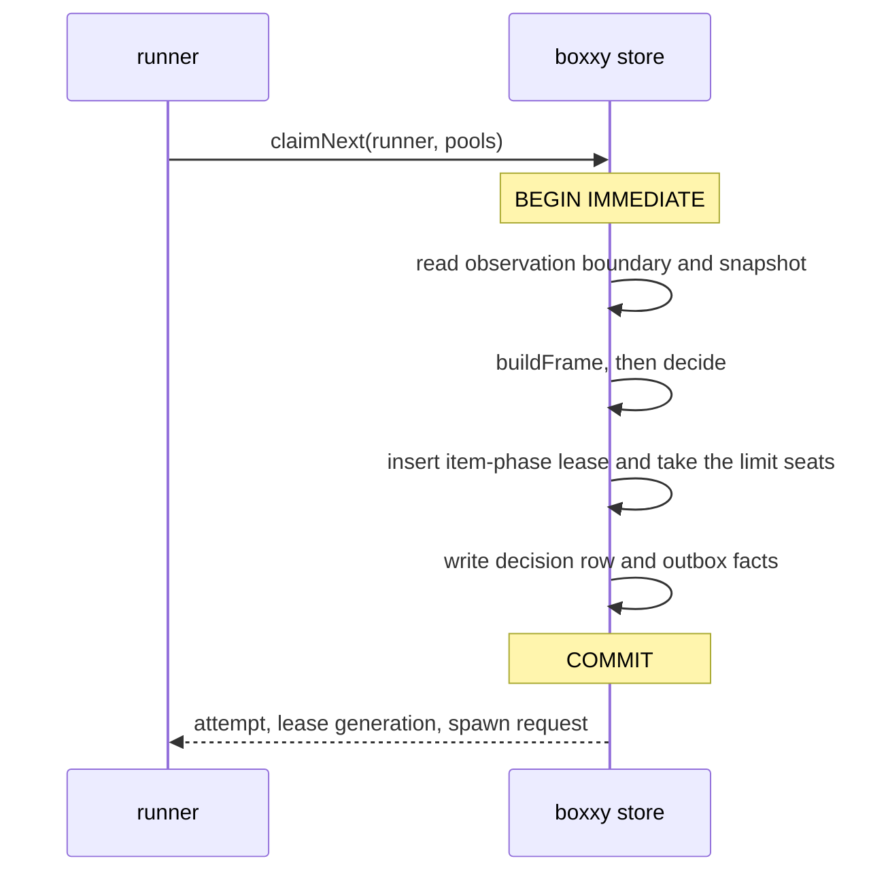

# Dispatch

A runner gets work by calling `claimNext`. The boxxy store runs the whole decision inside one
`BEGIN IMMEDIATE` transaction: it reads its own observation boundary, builds the frame, runs
`decide()`, and takes the item-phase lease and a seat in each limit that counts the attempt together. A pull that lands between
deciding and claiming can't be missed, and two runners can never take the same item phase or a
limit's last seat. The built claim holds the lock for 418 ms at p50 with 20,000 open items
([the built claim](#the-built-claim-measured)). At the measured claim rate that is about 1.5% of
each minute.

## claimNext

1. The runner calls `claimNext` through the command API.
2. The store opens `BEGIN IMMEDIATE`, which takes SQLite's single write lock.
3. The store reads its observation boundary and the snapshot: open items, links, the latest planning
   facts, leases, the seats held in each limit, and the wakes asked for.
4. `buildFrame()` and `decide()` run over that snapshot ([planning](./planning.md)).
5. The store takes the item-phase lease and a seat in each limit that counts the first pick, all
   in one change. A unique index on the live item-phase lease makes the lease take compare-and-set. The
   seat take is all or none: the store counts each limit's held seats under the write lock, and
   refuses the whole change when one limit is full or unknown. The store section of the
   [core types sketch](./sketches/v1/core/02-types.ts) gives the rules of the take.
6. The store writes the decision row (rules version, input snapshot hash, observation boundary), the
   exposure fact for any live experiment ([measurement](./measurement.md)), the exact spawn request,
   and the outbox facts. Then it commits.
7. The runner starts the attempt through its worker kind.

Shadow challengers for dispatch rules run `decide()` on the same snapshot after the commit, outside
the lock ([measurement](./measurement.md)).

## Leases and generations

- **Each claim holds the item-phase lease and its seats:** one seat in every limit whose filter the
  attempt matches ([v1](./v1.md#limits-and-pools)). A limit's seats are rows, so a seat count is
  atomic. Two runners can't each see the last free seat and claim different items.
- **Each lease has a generation number.** Every write made under a lease carries its generation, and
  the store refuses a write whose generation is not the live one. A runner that lost its lease, for
  example after a pause, can't overwrite the attempt that replaced it.
- **A runner renews its leases with a heartbeat** (from Beads, research). When the heartbeats stop, a
  reaper moves the attempt to `reconciling` (proposed). It doesn't release the item-phase lease, because a
  silent runner doesn't prove that the session stopped.
- **Guarded updates fail loudly.** A write that expects a holder or a state and finds another fails
  with the mismatch, rather than writing over it.

## The observation boundary

Each decision records its observation boundary: the boxxy store's version and the sequence offset it
had read in each pepys stream. `explain` and replay read facts up to those offsets, never by source
time. A CI fact can arrive after a dispatch with a source time before it, and pepys orders facts
only within one stream, so a replay by source time would see facts the dispatcher never saw.

The decision's snapshot hash covers the snapshot and the pools in capacity or usage-limit backoff.
The store never holds the backoff: it lives in the runner's memory alone, and `decide()` gives no pick in a pool
that it holds, so a replay needs it to give the same pick.

## The benchmark (measured)

This benchmark ran a stub `claimNext` on Bun 1.4.3 with `bun:sqlite` in WAL mode, on a WSL2 dev
machine. Each claim ran inside `BEGIN IMMEDIATE`:

1. Read the full snapshot: open items, links, planning facts, leases and slots.
2. Build the frame: the blocked gate, the defer gate with the expedite waiver, expedite propagation
   over `serves` and `blocks`, and inherited rank.
3. Decide: pools by kind order, then rank, then oldest.
4. Take both leases, write the decision row, and commit.

Each size ran 300 claims, with churn between claims: a random running item finishes, and a new rank
fact lands. Two runs agreed within a few milliseconds.

| Open items | Lock p50 (ms) | Lock p99 (ms) | `decide()` p50 / p99 (ms) |
| --- | --- | --- | --- |
| 1,000 | 0.5 | 4.0 | 0.1 / 2.3 |
| 5,000 | 3.6 | 6.8 | 0.9 / 4.2 |
| 20,000 | 14.4 | 23.5 | 5.9 / 10.9 |

- **The claim rate is low (measured).** The busiest 10 minutes of a busy day had 19 session starts,
  about 2 claims a minute. A claim runs only when a seat frees.
- **The lock has headroom (modelled from the measured numbers).** At 20,000 open items and 60 claims
  a minute, 30 times the measured peak, the lock is held about 1.4 seconds a minute, or 2%.
- **The snapshot read costs more than `decide()` (measured).** At 20,000 items, about 60% of lock
  time is reading rows. Proposed: keep the latest planning fact per item in its own table, so a
  claim doesn't read every fact, before the fact log grows.
- **Limits of the stub.** Its frame has 4 plug-ins, not a full concept registry, and it ran one
  runner, so there was no real contention. A registry of ten plug-ins may cost 2 to 3 times more
  `decide()` time (modelled), still well inside the budget.

## The built claim (measured)

`bun run bench` runs the claim benchmark, `adapters/store-sqlite/bench/claim-next.bench.ts`, through `rig bench`. The benchmark seeds 5,000 open items on the SQLite store through the test dispatch harness, each at its pipeline's first phase. It raises every limit to the item count, so each claim finds a free seat, and rig times 20 `claimNext` calls after 5 to warm up. The budget is the store rule's lock limit, a p99 under 50 ms at 5,000 open items ([slice 1](./slice-1.md#store-rules)). rig judges the median against it.

- **The built claim misses the budget (measured).** Three runs on Bun 1.4.3, on a WSL2 dev machine, gave medians of 103, 109 and 173 ms, so `rig bench` fails. CI does not run the benchmark until the claim gets cheaper, which is [not decided](./v1-open.md#not-decided).

The figures below came from 50 claims per size, with the claimed item closed and settled between claims so a seat is free. A lever puts an item at a later phase through `item.retry`. They ran on Bun 1.4.3, on a WSL2 dev machine:

| Open items | Levers | Lock p50 (ms) | Lock p99 (ms) |
| --- | --- | --- | --- |
| 20,000 | none | 418 | 930 |
| 20,000 | one per 20 items | 502 | 631 |
| 20,000 | one per item | 2,445 | 2,766 |

- **The stub's figures don't hold for the built claim (measured).** The stub read fewer rows and ran
  4 plug-ins.
- **Three steps take the time (measured, one item per lever).** At 20,000 items the snapshot read
  took about 280 ms, the snapshot hash about 280 ms, and `buildFrame` about 2,000 ms. `decide()`
  took 25 ms.
- **The expedite signal grows with the square of the item count.** It filters and sorts every
  lever once per item. With few levers the frame is cheap, and the snapshot read and the hash are
  most of the lock.
- **The lock still has headroom at the measured claim rate (modelled).** At 2 claims a minute and
  418 ms per claim, the lock is held under 1 second a minute. Whether to make the claim cheaper is
  [not decided](./v1-open.md#not-decided).

## Gates fail toward holding

`buildFrame()` records every plug-in that throws as a fault fact, then treats its output by kind:

| Plug-in kind | On a fault |
| --- | --- |
| gate | holds the item, with the fault as its reason |
| pool gate | holds the pool, with the fault as its reason |
| waiver | lifts nothing |
| admission | admits nothing |
| signal | gives no opinion; the pool sorts by its other keys |
| filter field | gives no value, so no pool that filters on the field takes the item |

A [propagation line](./planning.md#propagation) that throws is a fault too, and carries nothing
(proposed).

A gate that fails open would let blocked work run, so a failed gate holds. The cost is a stranded
item, which the [judgement pool](./planning.md#the-judgement-pool) picks up.

## The judgement pool

No matched rule never leaves work stuck. A ready item that no pool takes for a set time goes to the
one-slot judgement pool as a `plan.judge` phase, and a second strand goes to the owner.
[Planning](./planning.md#the-judgement-pool) owns the rule. The judgement pool is an ordinary pool
to `claimNext`, and an owner pull ranks ahead of a judgement phase's pull.

## Unknown outcomes

A crash, a stopped heartbeat, or an atc `outcome_unknown` leaves an attempt in `reconciling`. The
worker kind's `reconcile` settles it from the attempt's own facts and from atc's session list.

- Reconcile never treats a missing idempotency key as proof that a spawn never ran. atc deletes
  completed keys after 24 hours, so "key unknown" proves nothing.
- When reconcile finds no session, a retry sends the exact spawn request stored with the claim. atc
  checks the payload hash, and needs a working directory or workspace.
- An operational gap goes to reconcile, never to the owner as an ask.
- The item-phase lease stays held until reconcile settles the attempt, so no second attempt starts
  beside a session that may still be running (proposed).
