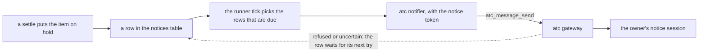

# Notices and the review tool in production

- **Status:** draft

The owner learns of a hold from a notice: an atc message that the deployed server sends to one atc session, the owner's notice session ([notices in v1](./v1.md#notices) says which holds write one). This design delivers each notice to that session even when the session sleeps or the owner's machine is off, and lets the owner rename the session with no change to boxxy. It also lists what the deployed system needs to run the review tool, noslop. The review-and-merge design owns the hold reasons and the text of each notice; this design owns their delivery.

## Shape



## Contracts

### The notice session in the configuration

atc addresses a session only by its gateway ID, `<daemon>.<incarnation>.<id>`. It resolves no names: the gateway answers `no_such_session` to any other value. The server's configuration therefore holds the ID, and the `notices` section takes the place of the `noticeSession` key.

```ts
// apps/server, the configuration file's `atc` section
const atcSection = z.strictObject({
  // …existing fields
  notices: z
    .strictObject({
      // the notice session's gateway ID, as `atc_sessions_list` prints it through the gateway
      session: z.string().regex(/^[^.]+\.[^.]+\..+$/u),
    })
    .optional(), // with none, the server sends no notice and marks each row sent
});
```

- The notifier calls atc with the token in `BOXXY_ATC_NOTICE_TOKEN`, and with no other token. Every other atc call of the server uses `BOXXY_ATC_TOKEN`.
- When `notices` is set and `BOXXY_ATC_NOTICE_TOKEN` is empty, the server refuses to start.

### The notices row and the port

```ts
// @boxxy/model
interface NoticeRow {
  // …existing fields: id, item, reason, at, tries, sentAt
  readonly keySeq: number; // the row's current key is `boxxy-notice:<id>:<keySeq>`
  readonly keyTries: number; // tries under the current key; 0 after each change of key
  readonly nextTryAt: Instant; // the tick sends the row once now >= nextTryAt; a new row holds its `at`
}

// @boxxy/model, the Notifier port
interface Notifier {
  tellHold: (notice: HoldNotice) => Promise<NoticeOutcome>;
}

interface HoldNotice {
  // …the notice's content, which the review-and-merge design owns
  readonly key: string; // the row's current key; `sendNotices` builds it, the adapter sends it unchanged
}

type NoticeOutcome =
  | { readonly kind: 'sent' }
  // atc refused and ran nothing; the gateway answers any later call under this key with
  // `outcome_unknown` and sends nothing, so the next try needs a new key
  | { readonly kind: 'refused'; readonly reason: string }
  // atc may have sent the message, so the next try repeats the key, and atc returns the first
  // send's result instead of sending again
  | { readonly kind: 'uncertain'; readonly reason: string };
```

- The atc adapter maps `no_such_session`, `session_dead`, `unsupported`, `daemon_unavailable` and `bad_args` to `refused`, and every other error to `uncertain`, `outcome_unknown` and `idempotency_conflict` among them. It keeps no state between calls.
- `sendNotices`, in `@boxxy/dispatch`, updates the row once per try:
  - `sent` sets `sentAt`.
  - `refused` adds 1 to `keySeq` and sets `keyTries` to 0.
  - `uncertain` adds 1 to `keyTries`. On the third uncertain try under one key, it adds 1 to `keySeq` and sets `keyTries` to 0.
  - Every try adds 1 to `tries`, then sets `nextTryAt` to `now + min(5 s × 2^(tries − 1), 15 min)`, so the first retry comes 5 seconds after the first try.
- A migration adds `key_seq` and `key_tries`, each `INTEGER NOT NULL DEFAULT 0`, and `next_try_at INTEGER NOT NULL DEFAULT 0`. It then sets `next_try_at = at` on each row, and replaces the index of unsent rows with one on `(next_try_at) WHERE sent_at IS NULL`.

### Unsent notices in `runner.status`

The owner procedure `runner.status` ([v1 API](./v1-api-and-auth.md)) shows the notices that wait:

```ts
notices: {
  unsent: 3,
  oldestUnsentAt: '2026-11-12T09:14:05.000Z', // null when every row is sent
  lastError: 'session_dead', // the reason of the most recent try that was not `sent`, or null
}
```

## Constraints

- The server never gives up on a notice. A row stays unsent until atc takes it, with at most 15 minutes between tries.
- The server never wakes the notice session. While the session sleeps or the owner's machine is off, the notice waits, and `boxxy item list` still shows the hold.
- A server restart changes no key, because each key comes from its row.
- The owner gets each notice once, with two exceptions:
  - A send that stays uncertain for 3 tries moves to a new key. When the first of those sends reached the session, the owner gets the notice twice. The gateway keeps an uncertain key forever and never sends under it, so without a new key the notice never arrives.
  - The atc daemon forgets a key 24 hours after its call completed. When the server stops after atc took a send and before the row was marked sent, and stays down for longer than that, the owner gets the notice twice.
- A failed or refused notice changes no attempt and no item.

## What the deployment provides

- A notice token that holds the `message` scope alone. The worker token holds `spawn` and `kill`, and must never reach the owner's machine.
- A grant that puts the notice session within the notice token's reach. atc counts a session as within reach only when every session in its tree runs on a target that the grant names. The notice session therefore starts its side sessions as top-level sessions; a sub-session of it on another target makes atc answer `no_such_session`, and every notice waits.
- The notice session's gateway ID in the server's configuration. When the owner replaces the session, the owner sets the new ID in the deployment's configuration, and the rows that wait go to the new session on their next try.

## The review tool in production

The review-and-merge design owns the `ReviewGate` port and its noslop adapter. The deployed system needs these:

- The worker image holds the noslop CLI at a pinned version. The review session runs `noslop review --pr <number> --json --adapter claude`, because Codex, noslop's default, has no sign-in inside a worker machine. The session signs in to Claude through the broker, and noslop reads its GitHub token from `GH_TOKEN` or `GITHUB_TOKEN`.
- The server posts the session's result as the noslop GitHub App, with `@noslop/cli/post`, which checks the result against the pull request's head and the base branch's config before it posts. The App's keys reach the server pod alone, as `BOXXY_NOSLOP_APP_ID` and `BOXXY_NOSLOP_APP_PRIVATE_KEY`, and never reach a worker session.
- The owner installs the App on every repo that the server spawns workers for.

## Decisions

- **The configuration holds the notice session's gateway ID.** atc resolves no names, and a rename keeps the ID, so a rename needs no change to boxxy.
- **A notice waits with no cap on tries.** A cap of 5 tries at one tick each, about 25 seconds, loses every notice sent while the owner's machine sleeps.
- **An uncertain send gives up its key after 3 tries.** A rare duplicate costs the owner less than a notice that never arrives.
- **The notice token is separate from the worker token.** The notice session runs on the owner's machine, and the server's worker calls need `spawn` and `kill`.
- **The server does not wake the notice session.** A wake needs `spawn` on the owner's machine, and atc cannot wake a machine that is off.

## Acceptance

- **A forced hold reaches the notice session.** On the deployed system, a throwaway item whose task tells the worker to close out `blocked` with a question goes on hold ([notices in v1](./v1.md#notices)). Within one tick, the notice session's conversation shows an `<atc-message kind="connector">` that names the item, and `atc_message_get` on that message's ID shows `delivered` or `answered`. A hold that a rules change makes proves nothing, because it writes no notice.
- **A sleeping notice session loses no notice.** With the notice session stopped, a forced hold leaves `runner.status` at `unsent: 1` with `lastError: 'session_dead'`. After the owner starts the session again, the notice arrives once, within 15 minutes.
- **A rename loses no notice.** With the notice session stopped, a forced hold leaves one row unsent. The owner renames the session and starts it again, with no change to the server's configuration, and the notice arrives once at the same session ID.
- **A boxxy review round shows a noslop check on the pull request.** In the scratch repo of [the live proof](./v1-work-list.md#22-the-live-proof), a review round leaves a `noslop` check run, posted by the App, at the pull request's head.
- `sendNotices` tests: a refused try changes the key and keeps the row unsent; an uncertain try keeps the key; the third uncertain try changes it; a row before its `nextTryAt` is not tried; a row with 50 tries is still tried.
- Notifier tests: each atc code maps to its outcome, and the adapter sends the key it gets.

## Builder decides

- The internal names, and how the server logs a try.
- Whether one tick stops after the first `refused` outcome, since every row goes to one session.
- The test layout.

## Out of scope

- Which atc target the notice session runs on, and the grant that reaches it. The deployment owns both.
- Asks to the owner. An ask that sends a notice uses the same rows and the same session.
