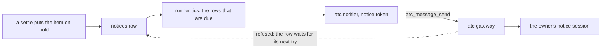

# Owner notices in production

- **Status:** draft

The deployed server tells the owner about a hold through one atc session, the owner's notice session. Today a notice that atc refuses uses its 5 tries in about 25 seconds and is never sent again, so a notice session that sleeps loses the notice. This design keeps every notice until atc takes it, gives the server its own narrow credential for the notice session, and lists what the deployed server needs to run the review gate's noslop adapter.

## Shape



## Contracts

### The notice session in the configuration

atc addresses a session by its gateway ID, `<daemon>.<incarnation>.<id>`, and never by its name: the gateway answers `no_such_session` to any other value. The configuration therefore holds the ID.

```ts
// apps/server's configuration file, section `atc`
const atcSection = z.strictObject({
  // …existing fields, without `noticeSession`
  notices: z
    .strictObject({
      // the notice session's gateway ID, as `atc_sessions_list` prints it under the gateway
      session: z.string().regex(/^[^.]+\.[^.]+\..+$/u),
    })
    .optional(), // with none, the null notifier marks every notice sent
});
```

- The `notices` section replaces `noticeSession`. The strict schema rejects the old key, so the server refuses to start with a configuration that still holds it.
- The notifier calls atc with the notice token from `BOXXY_ATC_NOTICE_TOKEN`, and with no other token. The server's worker calls keep `BOXXY_ATC_TOKEN`.
- When `notices` is set and `BOXXY_ATC_NOTICE_TOKEN` is empty, the server refuses to start.

### The notices row and the port

```ts
// @boxxy/model
interface NoticeRow {
  // …existing fields: id, item, reason, at, sentAt
  readonly tries: number; // every try counts; the count never stops the row being sent
  readonly keySeq: number; // goes up by 1 after each try that atc refused and ran nothing
  readonly nextTryAt: Instant; // the tick sends the row only once now >= nextTryAt; a new row holds its `at`
}

// @boxxy/model, the Notifier port
interface Notifier {
  tellHold: (notice: HoldNotice) => Promise<NoticeOutcome>;
}

interface HoldNotice {
  readonly item: ItemId;
  readonly reason: HoldReason;
  readonly at: Instant;
  readonly key: string; // `boxxy-notice:<row id>:<keySeq>`; the core builds it from the row
}

type NoticeOutcome =
  | { readonly kind: 'sent' }
  // atc refused and ran nothing, so the next try takes a fresh key
  | { readonly kind: 'refused'; readonly reason: string }
  // atc may have run the send, such as on `outcome_unknown` or a lost connection, so the next try keeps the key
  | { readonly kind: 'failed'; readonly reason: string };
```

- The adapter maps the atc codes `no_such_session`, `session_dead`, `unsupported`, `daemon_unavailable`, `bad_args` and `idempotency_conflict` to `refused`, and every other error to `failed`. It keeps no state between calls.
- `sendNotices` writes one row update per try: `tries + 1`, `keySeq + 1` on `refused`, and `nextTryAt = now + min(5 s × 2^tries, 15 min)`.
- A migration adds `key_seq INTEGER NOT NULL DEFAULT 0` and `next_try_at INTEGER NOT NULL`, sets `next_try_at = at` on each existing row, and changes the unsent index to `(next_try_at) WHERE sent_at IS NULL`.

### `runner.status`

```ts
notices: {
  unsent: 3,
  oldestUnsentAt: '2026-11-12T09:14:05.000Z', // null when nothing is unsent
  lastRefusal: 'session_dead', // the reason of the last try of the newest unsent row that was tried, or null
}
```

## Constraints

- The server never gives up on a notice. A row stays unsent until atc takes it, and waits at most 15 minutes between tries.
- The owner gets each notice at most once. A try that atc may have run keeps the row's key, and the gateway answers a repeat of that key with the first send's result.
- A server restart changes no key, because the key comes from the row.
- The server never wakes the notice session. While the session sleeps or the owner's machine is off, the notice waits, and its hold stays visible in `boxxy item list`.
- A failed or refused notice changes no attempt and no item.
- The notice token holds only the `message` scope.
- The notice session spawns its side sessions as top-level sessions. atc counts a session as within a principal's reach only when every session in its tree is, so a sub-session on another target puts the notice session out of reach, and every notice then waits on `no_such_session`.

## Decisions

- **The configuration holds the session's gateway ID.** atc resolves no names. A rename keeps the ID, so renaming the notice session needs no change to boxxy.
- **A new notice session is a configuration change.** When the owner replaces the session, the next deploy sets the new ID. The rows that wait in the meantime go to the new session on their next try.
- **A notice waits with no cap on tries.** Any cap loses a notice whenever the owner's machine sleeps for longer than the tries last.
- **The notice credential is separate from the worker credential.** The notice session runs on the owner's machine. The worker token holds `spawn` and `kill`, and must never reach that machine.
- **The server does not wake the notice session.** A wake needs `spawn` on the owner's machine, and atc cannot wake a machine that is off.
- **No bake-off.** The port change adds one field and one outcome, which one adapter and one core function read, so it is cheap to change later.

## The review gate in production

The `ReviewGate` design owns the port and the noslop adapter. The deployed system needs these:

- The worker image holds the noslop CLI at a pinned version, and the review session runs `noslop review --pr <number> --json --adapter claude`. The session signs in to Claude and to GitHub through the broker. Codex has no brokered sign-in, so the session never uses noslop's default Codex adapter.
- The server posts the session's result as the noslop GitHub App with `@noslop/cli/post`, which checks the result against the pull request's head and the base branch's config before it posts. The App's keys reach the server pod alone, as `BOXXY_NOSLOP_APP_ID` and `BOXXY_NOSLOP_APP_PRIVATE_KEY`, and never reach a worker session.
- The App is installed on every repo that the server spawns workers for.

## Acceptance

- **A forced hold reaches the notice session.** On the deployed system, an item whose task tells the worker to close out `blocked` goes on hold, and within one tick the notice session's conversation shows an `<atc-message kind="connector">` that names the item. `atc_message_get` on the message ID shows `delivered` or `answered`. A hold from a rules change proves nothing, because it writes no notice.
- **A sleeping notice session loses no notice.** With the notice session stopped, a forced hold leaves `runner.status` at `unsent: 1` with `lastRefusal: 'session_dead'`. After the owner starts the session again, the notice arrives once, within 15 minutes.
- **A boxxy review round shows a noslop check on the pull request.** On the scratch repo, a review round leaves a `noslop` check run, posted by the App, at the pull request's head.
- `sendNotices` tests: a refused try raises `keySeq` and keeps the row unsent; a failed try keeps `keySeq`; a row before its `nextTryAt` is not tried; a row with 50 tries is still tried.
- Notifier tests: each atc code maps to its outcome, and the adapter sends the key it is given.

## Builder decides

- The internal names, and the wording of the notice text.
- Whether one tick stops after the first `refused` outcome, since every row goes to one session.
- The test layout.

## Out of scope

- The asks and grants design. An ask that tells the owner uses this outbox and this session.
- Where the owner's notice session runs, and its atc targets and grants. The deployment owns them.
