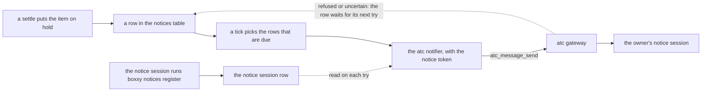

# Notice delivery in production

- **Status:** draft

The owner learns of a hold from a notice: a message that the deployed server sends through [atc](https://github.com/zgeoff/atc), the tool that runs agent sessions, to one session, the owner's notice session. This design gets each notice to that session even while the session or the owner's machine sleeps. The notice session registers itself with boxxy, so a new notice session needs no deploy, and a rename of the session changes nothing. The [review-and-merge design](./review-and-merge.md) owns the hold reasons and the text of each notice. [Notices in v1](./v1.md#notices) says which holds write a notice.

Terms this doc uses:

- **settle:** the store change that ends an attempt. When it leaves the item on hold, it writes one row in the `notices` table.
- **tick:** one pass of the server's runner loop, every 5 seconds. Each tick sends the notices that are due.
- **target:** a place where atc runs sessions, such as the owner's machine or a worker machine.
- **grant:** an entry in an atc daemon's config that lets one caller, such as the server's token, reach the sessions on the targets it names.

## The path of a notice



## Contracts

### The registered notice session

atc addresses a session only by its gateway ID, `<daemon>.<incarnation>.<id>`: the gateway answers `no_such_session` to any other value. The store holds that ID in one row, and the notice session writes the row itself, with `boxxy notices register <gateway-id>` or the owner tool `notices_register`. The environment holds the notice token, and neither the environment nor the configuration file holds a notice session.

```ts
// @boxxy/model, the one row of the `notice_session` table
interface NoticeSessionRow {
  readonly gatewayID: string; // as `atc_sessions_list` prints it through the gateway
  readonly setAt: Instant;
}

// @boxxy/contract; `setAt` is an ISO 8601 time on the wire
'notices.register': { input: { gatewayID: string }; output: { session: NoticeSession } };
'notices.show': { input: {}; output: { session: NoticeSession | null } }; // null: none is registered

// apps/server, the environment it reads at start
const noticeEnv = z.strictObject({
  // with none, the server sends no notice and marks each row sent
  BOXXY_ATC_NOTICE_TOKEN: z.string().min(1).optional(),
});
```

- Only the owner's path calls the two procedures, as [the access table](./v1-api-and-auth.md#the-doors) says: the owner listener, and `/mcp` on the public door, where `notices.register` needs the `write` scope and `notices.show` the `read` scope. The worker token gets `FORBIDDEN`.
- `notices.register` checks the shape of the ID and nothing else, because the notice token has no scope that reads a session. An ID that names no session shows as `no_such_session` in `runner.status`.
- `notices.register` replaces the row and writes no fact. A check on the table keeps it to one row.
- The notifier reads the row on each try. A notice that waits therefore goes to a newly registered session on its next try, and the server never restarts for it.
- With a notice token and no row, the notifier calls atc for nothing, and the try is `refused` with the reason `no-notice-session`. The notice row waits like any other refused row. A read of the row that fails is `refused` too, with the reason `notice-session-unread`.
- The notifier calls atc with the notice token, from `BOXXY_ATC_NOTICE_TOKEN`, and with no other token. The server's other atc calls, which start and stop worker sessions, use the worker token, from `BOXXY_ATC_TOKEN`.
- The server refuses to start while `BOXXY_ATC_NOTICE_TOKEN` is set and empty.
- The server refuses to start while the environment holds `BOXXY_ATC_NOTICE_SESSION`, or its configuration file holds `noticeSession`. The message names the variable or the key, and never its value.

### The notices row and the port

```ts
// @boxxy/model
interface NoticeRow {
  // …existing fields: id, item, reason, at, tries, sentAt
  readonly keySeq: number; // the row's current key is `boxxy-notice:<id>:<keySeq>`
  readonly keyTries: number; // uncertain tries under the current key; 0 after each change of key
  readonly nextTryAt: Instant; // a tick sends the row once now >= nextTryAt; a new row holds its `at`
}

// @boxxy/model, the Notifier port
interface Notifier {
  tellHold: (notice: HoldNotice) => Promise<NoticeOutcome>;
}

interface HoldNotice {
  // …the notice's content, which the review-and-merge design owns
  readonly key: string; // the row's current key; the adapter sends it unchanged
}

type NoticeOutcome =
  | { readonly kind: 'sent' }
  | { readonly kind: 'refused'; readonly reason: string } // atc ran nothing
  | { readonly kind: 'uncertain'; readonly reason: string }; // atc may have sent the message
```

The atc adapter maps `no_such_session`, `session_dead`, `unsupported`, `daemon_unavailable` and `bad_args` to `refused`. It maps every other error to `uncertain`, including `outcome_unknown` and `idempotency_conflict`. The adapter keeps no state between calls.

`sendNotices`, in `@boxxy/dispatch`, builds each row's key, calls the port, and updates the row once per try:

1. On `sent`, `sendNotices` sets `sentAt`.
2. On `refused` while `keyTries` is 0, `sendNotices` adds 1 to `keySeq`. The gateway answers any later call under a refused key without sending, so the next try needs a new key.
3. On `uncertain`, or on `refused` while `keyTries` is above 0, `sendNotices` adds 1 to `keyTries`. The next try repeats the key. When the first send reached the atc daemon, the daemon returns that send's result, the try comes back `sent`, and the owner gets one message. When the first send never reached the daemon, the gateway answers `outcome_unknown` to every repeat, so after the third uncertain try `sendNotices` adds 1 to `keySeq` and sets `keyTries` to 0.
4. On every try, `sendNotices` adds 1 to `tries`, then sets `nextTryAt` to `now + min(5 s × 2^(tries − 1), 15 min)`, so the first retry comes 5 seconds after the first try.

The store's read `listNoticesToSend(maxTries, limit)` becomes `listNoticesDue(now, limit)`: the unsent rows whose `nextTryAt` has passed, oldest `nextTryAt` first. `noticeLimits.maxTries` and the `stuck` count of `NoticeReport` go. A migration adds `key_seq` and `key_tries`, each `INTEGER NOT NULL DEFAULT 0`, and `next_try_at INTEGER NOT NULL DEFAULT 0`. It then sets `next_try_at = at` on each row, and replaces the index of unsent rows with one on `(next_try_at) WHERE sent_at IS NULL`.

### Unsent notices in `runner.status`

The owner procedure `runner.status` ([the v1 API](./v1-api-and-auth.md)) shows the notices that wait:

```ts
notices: {
  unsent: 3,
  oldestUnsentAt: '2026-11-12T09:14:05.000Z', // null when every row is sent
  lastError: 'session_dead', // the reason of the most recent try that was not `sent`, or null
}
```

`lastError` is `no-notice-session` while a notice token is set and no notice session is registered.

## Constraints

- The server never gives up on a notice. A row stays unsent until atc takes it, with at most 15 minutes between tries.
- The server never wakes the notice session. While the notice waits, `boxxy item list` still shows the hold. atc answers `session_dead` while the session is stopped or asleep, and `daemon_unavailable` while the owner's machine is off.
- A notice tried while no session is registered waits the same way, so it reaches a session that registers later, at most 15 minutes after the registration.
- A registration changes no key. A row whose last try at the old session was `uncertain` repeats its key at the new session. When atc answers the repeat with the first send's result, the row is marked sent and the notice stays with the old session, like any notice sent before the registration. When atc answers the repeat as `uncertain`, the row gets a new key after its third uncertain try, and the notice goes to the new session.
- A server restart changes no key, because each key comes from its row.
- The owner gets each notice once, with two exceptions:
  - When a first send reached the session and every repeat of its key still comes back `uncertain`, the change of key after 3 tries sends the notice a second time.
  - The atc daemon forgets a key 24 hours after its call completed. When the server stops after atc took a send but before `sendNotices` marked the row sent, and stays down for more than 24 hours, the notice goes a second time.
- A notice that is `refused` or `uncertain` changes no attempt and no item.

## What the deployment provides

- The notice token, an atc service token that holds the `message` scope alone. The worker token holds `spawn` and `kill`, so the deployment never grants it the owner's machine.
- A grant on the owner's machine that lets the notice token reach the notice session on that machine's `local` target. atc lets a token reach a session only when that session and each of its sub-sessions run on a target that the grant names. The owner's agent in the notice session therefore starts its side sessions as top-level sessions. A sub-session on another target makes atc answer `no_such_session`, and every notice then waits.
- Nothing for the notice session's ID: the deployment's Secret holds the notice token alone. The owner's agent in a new notice session runs `boxxy notices register` with its own gateway ID, and the rows that wait go to that session on their next try.

## Decisions

- **The store holds the notice session's gateway ID, and the session registers it.** atc resolves no names, and a rename keeps the ID. A new session has a new ID, and an ID in the deployment would need a deploy for each new session.
- **Registration checks the shape of the ID only.** A read of the session needs a scope that the notice token lacks, and a wrong ID shows in `runner.status` on the first notice.
- **The notice session runs on the owner machine's `local` target.** The grant names that target alone.
- **A notice waits with no cap on tries.** A cap of 5 tries, one per tick, loses every notice sent while the owner's machine sleeps for more than 25 seconds.
- **An uncertain key gives way to a new key after 3 tries.** A rare second copy costs the owner less than a notice that never arrives.
- **The notice token is separate from the worker token.** The notice session runs on the owner's machine, and only a token without `spawn` and `kill` reaches it.
- **The server never wakes the notice session.** A wake needs `spawn` on the owner's machine, and atc cannot wake a machine that is off.

## Acceptance

- **A forced hold reaches the notice session.** On the deployed system, a throwaway item whose task tells the worker to end its attempt as `blocked`, with a question, goes on hold. Within 2 ticks, the notice session's conversation shows an `<atc-message kind="connector">` that names the item, and `atc_message_get` on that message's ID shows `delivered` or `answered`. A hold from a rules change proves nothing, because no settle writes its notice.
- **A stopped notice session loses no notice.** With the notice session stopped, a forced hold leaves `runner.status` at `unsent: 1` with `lastError: 'session_dead'`. After the owner starts the session again, the notice arrives once, within 15 minutes.
- **A rename loses no notice.** With the notice session stopped, a forced hold leaves one row unsent. The owner renames the session and starts it again, with no new registration, and the notice arrives once, at the same session ID.
- **A new session registers with no deploy.** With the registered session stopped, a forced hold leaves one row unsent. A new session runs `boxxy notices register` with its own gateway ID, and `boxxy notices show` prints that ID. The notice arrives once at the new session within 15 minutes, with no change to the deployment and no restart of the server.
- `sendNotices` tests: a refused try changes the key; an uncertain try keeps it; the third uncertain try changes it; a refused try after an uncertain one keeps the key; a row before its `nextTryAt` is not tried; a row with 50 tries is still tried.
- Notifier tests: each atc code maps to its outcome, the adapter sends the key it gets, and it reads the session on each call.
- Registration tests: the worker token is refused on both procedures; an ID of the wrong shape is refused; with a notice token and no registered session, a row stays unsent and `runner.status` shows `no-notice-session`; a row that waits reaches a session that registers later; the server refuses to start while `BOXXY_ATC_NOTICE_SESSION` is set, and prints no value.

## Builder decides

- The internal names, and how the server logs a try.
- Whether a tick stops after the first `refused` outcome, since every row goes to one session.
- The test layout.

## The review tool in production

[The review gate](./review-and-merge.md#the-review-gate) runs noslop in a review session on a worker machine, and the server posts the result as the noslop GitHub App. The deployment needs these:

- The noslop CLI in the worker image, at a pinned version. Codex, noslop's default model CLI, has no sign-in on a worker machine, so the review session runs noslop with `--adapter claude`.
- The read-only clone token in the review session, as `GH_TOKEN`, which noslop reads to fetch the pull request. It is the token the atc daemon clones with, with `Contents: read` and `Pull requests: read`. atc withholds the daemon's variables from sessions, so the review recipe names a review agent, an atc agent whose broker profile holds the token, and the server lists it in `spawn.reviewAgents`. Build and design sessions never get it: [the review gate](./review-and-merge.md#the-review-gate) holds the load rules that keep it to review sessions.
- The App's keys in the server pod alone, and never in a worker session.
- The App, installed on every repo that the server starts workers for.
- The check: in the scratch repo of [the live proof](./v1-work-list.md#22-the-live-proof), a boxxy review round leaves a `noslop` check run, posted by the App, at the pull request's head.

## Out of scope

- Asks, the requests that a worker makes to the owner for a decision. When an ask sends a notice, it uses the same rows and the same session.
