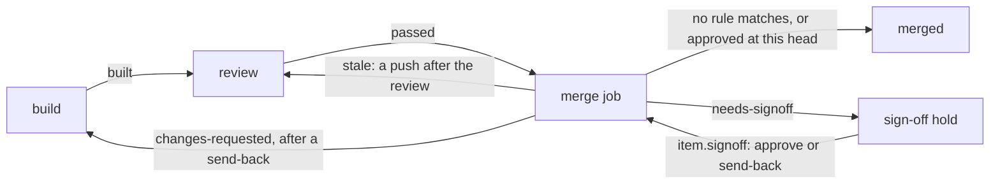

# Owner sign-off at merge

- **Status:** draft

The owner signs off a chosen kind of change, such as an edit to a skill, before boxxy merges it. The [rules file](../../architecture/work/pipeline.md) names the changes. When such a pull request is otherwise ready to merge, the merge step puts the item on a hold until the owner approves the pull request's head commit, or sends it back to the build agent with findings.

Read the [pipeline](../../architecture/work/pipeline.md) for the terms this design uses: items, attempts, steps and their edges, holds, rounds, and levers, the owner actions recorded on an item, such as `item.retry`. The head is the pull request's latest commit.

## Shape



## Contracts

The owner's agent lists the items that wait for a sign-off, then answers one item at the head it read. The API procedure `item.signoff` is the MCP tool `item_signoff` and the CLI command `boxxy item signoff`. `signoff.list` is `signoff_list` and `boxxy signoff list`.

```ts
const waiting = await boxxy.signoff.list({});
// → { items: [{ item: '01a1…', title: 'tighten the testing skill',
//      pullRequest: { repo: 'acme/skills', number: 40 }, head: '3f9c…',
//      rules: ['skills'], paths: ['testing/SKILL.md'], truncated: false, since: 1795174860467 }] }

await boxxy.item.signoff({ item: '01a1…', head: '3f9c…', verdict: 'approve' });
// → { lever: 812 }
await boxxy.item.signoff({ item: '01a1…', head: '3f9c…', verdict: 'send-back', findings: 'The new rule …' });
// → { lever: 813 }
//   or the error NOT_FOUND, ITEM_HELD, NOT_AWAITING_SIGNOFF, STALE_HEAD { head } or FINDINGS_REQUIRED
```

A caller needs the owner's read access for `signoff.list`, and the owner's write access for `item.signoff`, as for `item.retry` ([API and auth](../../architecture/interfaces/api-and-auth.md)).

The rules file names the changes under `merge`, and maps the two sign-off outcomes on each merge step:

```yaml
merge:
  method: squash
  signoff:                        # with no `signoff`, no merge waits for the owner
    - name: skills                # shown to the owner as the reason the item waits
      paths:                      # globs over the paths the pull request changes, from the repo root
        - "**/SKILL.md"
        - "**/skills/*/references/**"
      repos: [acme/skills]        # optional; with none, the rule matches in every repo

pipelines:
  build:
    - phase: merge
      on:
        # …the merge step's other edges
        needs-signoff: { hold: <hold name> }          # a { hold } edge; its hold is the sign-off hold
        changes-requested: { to: build, max: 3, resume: true }  # a { to } edge, with its own max
```

```ts
// @boxxy/model, the rules types
interface MergeRules {
  // …existing fields
  readonly signoff: readonly SignoffRule[]; // empty when the rules file sets none
}

interface SignoffRule {
  readonly name: string;
  readonly paths: readonly string[]; // globs; the loader refuses an empty list
  readonly repos: readonly RepoName[] | null; // null matches every repo
}

// @boxxy/model, the phase kinds: an outcome that a step maps only under a condition on the rules
interface PhaseKind {
  // …existing fields
  // the merge kind lists `needs-signoff` and `changes-requested`, each with
  // `requiredWhen: (rules) => rules.merge?.signoff.length > 0`
  readonly conditionalOutcomes: readonly { readonly outcome: string; readonly requiredWhen: (rules: Rules) => boolean }[];
}

// @boxxy/model, the merge types
interface MergeObservation {
  // …existing fields
  readonly changedPaths: ChangedPaths;
  readonly signoff: SignoffVerdict | null; // see "The order of the merge rule"
}

type ChangedPaths =
  | { readonly kind: 'read'; readonly head: CommitSha; readonly paths: readonly string[] }
  | { readonly kind: 'truncated'; readonly head: CommitSha; readonly paths: readonly string[] }
  | { readonly kind: 'not-read' }; // no rule covers the repo, or the pull request isn't open

interface SignoffVerdict {
  readonly head: CommitSha; // the head the owner read
  readonly verdict: 'approve' | 'send-back';
  readonly findings: string | null; // set exactly when `send-back`
  readonly lever: number;
}

type MergeOutcome = /* …existing outcomes */ 'needs-signoff' | 'changes-requested';

// the record a merge attempt leaves when it finishes
interface MergeCloseOut {
  // …existing fields
  // set on every outcome once a rule matched or the list was cut short, so `item get` shows why
  readonly signoff: {
    readonly rules: readonly string[]; // the rules that matched; empty when only `truncated`
    readonly paths: readonly string[]; // the changed paths that matched, at most 50
    readonly truncated: boolean;
  } | null;
  readonly sentBack: { readonly head: CommitSha; readonly findings: string } | null; // `changes-requested` only
}

// @boxxy/model, what sent a build back, read by the build's launch prompt: the members for
// review and verify, and one for the owner
type SentBack =
  | ReviewSentBack
  | VerifySentBack
  | { readonly from: 'owner'; readonly head: CommitSha; readonly findings: string };
```

A sign-off lever is a lever row of kind `signoff.approve` or `signoff.send-back`, with the owner's findings in its `reason` column, at most 8000 characters, and the head in a `head` column that only sign-off levers set. The `boxxy.lever.recorded` fact that boxxy sends to pepys ([facts and pepys](../../architecture/interfaces/facts-and-pepys.md)) carries `head` as an optional field.

## Constraints

### Which changes need a sign-off

- A rule matches when any changed path matches any of its globs, and its `repos` is null or lists the pull request's repo.
- A glob matches dot folders, such as `.agents/skills/`, and matches case-sensitively.
- A renamed file counts at its old path and its new path. A deleted file counts at its path.
- The merge job reads the changed paths from the base branch to the head. After it reads the paths, it reads the head again. When the head moved, it reads the paths and the head again.
- When the forge lists fewer files than the pull request's own count of changed files, the list is `truncated`, and the merge rule treats it as a match.
- When the forge can't list the changed paths, the merge job waits and reads again. The merge job never merges a change whose paths it couldn't read.
- When no rule covers the pull request's repo, the merge job reads no changed paths.

### The order of the merge rule

Each attempt of the merge step runs as a job. On each read, the job passes what it read from the forge to the merge rule, a pure function in `@boxxy/train`, which decides the attempt's outcome. The rule's checks run in this order, and the first that decides ends the attempt:

1. The pull request merged or closed: `merged` or `closed`.
2. A send-back verdict at the current head: `changes-requested`.
3. The review doesn't cover the current head: `stale`, back to review.
4. A conflict or a red check: `repair`.
5. A pending check or an unknown mergeable state: the job waits.
6. The forge refused the merge: `refused`.
7. A sign-off rule matched, or the list is `truncated`, and no approval at the current head: `needs-signoff`.
8. The job merges at the current head.

- A verdict counts only when its head equals the head the job read.
- An approval counts until the head moves.
- A send-back counts for one merge attempt. Once a merge attempt finishes on it, later attempts ignore it, so one send-back sends the item back once.
- After a push, check 3 sends the item back to review, so the owner never sees a head that no review covers.

### The owner's answer

- The sign-off hold is the hold that the merge step's `needs-signoff` edge names. An item waits for a sign-off when it stands at that hold and its latest merge attempt finished `needs-signoff`.
- `item.signoff` refuses `ITEM_HELD` while an `item.held` lever is in force on the item, as `item.retry` does. It refuses `NOT_AWAITING_SIGNOFF` unless the item waits for a sign-off with no attempt running. It refuses `STALE_HEAD` when the head differs from the head of that `needs-signoff` attempt, and `FINDINGS_REQUIRED` for a send-back with no findings.
- `item.signoff` refuses findings over 8000 characters as a bad input, like any other bad argument.
- One `item.signoff` call writes one lever, and the lever moves the item from the sign-off hold to the merge step. The owner makes no second call.
- A sign-off lever moves an item only from the sign-off hold. The claim, `item get` and the rules dry run all replay an item's position from its history, and each one applies sign-off levers by this rule.
- A sign-off lever keeps the item's round, and the counts that each `{ to }` edge's `max` caps. When a cap runs out, the item holds `rounds used up`, as at any `{ to }` edge.
- `item.retry` at the sign-off hold works as at any hold: it starts a new round and sends the item to the merge step, which asks the owner again.
- When a `changes-requested` merge attempt is the latest attempt that sent the build back, boxxy puts the owner's text whole, with the head the owner read, in the next build's findings.
- `signoff.list` lists each item that waits for a sign-off, oldest first by when it reached the hold, with the head, rules and paths of its `needs-signoff` attempt.

### The rules file and the fact

- When the rules file sets `merge.signoff`, the loader refuses a merge step that leaves out `needs-signoff` or `changes-requested`. It refuses `needs-signoff` unless it is a `{ hold }` edge, and `changes-requested` unless it is a `{ to }` edge.
- When the rules file sets no `merge.signoff`, the loader refuses those two edges.
- When new rules drop `merge.signoff`, an item at the sign-off hold replays into the `outcome not in rules` hold, and `item.retry` moves it on. The next merge merges it with no sign-off.
- boxxy writes `head` on a lever fact only to a pepys whose boundary reads the field. When pepys refuses an unknown field, the pepys release that reads `head` ships first.

## Decisions

- **The sign-off is part of the merge step.** Only the merge rule knows that a change is otherwise ready to merge, so a separate step would have to repeat its reads.
- **The merge attempt finishes and holds while the owner decides.** A merge attempt that waited would count against the rules file's `jobs` limit for as long as the owner took, and run into the merge step's time limit. The engine sends the hold notice it sends for every hold.
- **The owner's findings reach the builder whole.** A review's findings reach the next build as counts, never as text ([the review](../../architecture/work/pipeline.md#the-review)). The owner's text lives nowhere else, so the prompt carries it.
- **The rules file names the changes that need a sign-off.** boxxy's code names no repo, path or person.
- **The owner's write access is enough to sign off.** The owner's own agent calls `item.signoff` for the owner, so the tool has no scope of its own.

## Builder decides

- The glob matcher, and its pin in the root catalog and the layout doc.
- The forge read that gives rename sources and the pull request's file count.
- How the merge job reads the item's levers.
- The names of internal functions, and the wording of each error message.
- The `owner-signoff` verify feature: its journey and the seed command that puts an item at the sign-off hold.
- The test layout.

## Out of scope

- A sign-off on anything but a pull request at merge, such as a design or a deploy. The [gate phase in the core model](./core-model.md#gates-and-sign-offs) designs a sign-off at any point in a pipeline. The sign-off verdict holds what that gate's answer holds, the subject, the verdict and the findings, so the gate can take it over.
- How the owner hears that an item waits. The owner's agent reads `signoff.list`.
- A sign-off that covers the base branch. When the base moves after an approval, the forge merges the approved head onto the new base, unless the repo's ruleset requires branches to be up to date.
