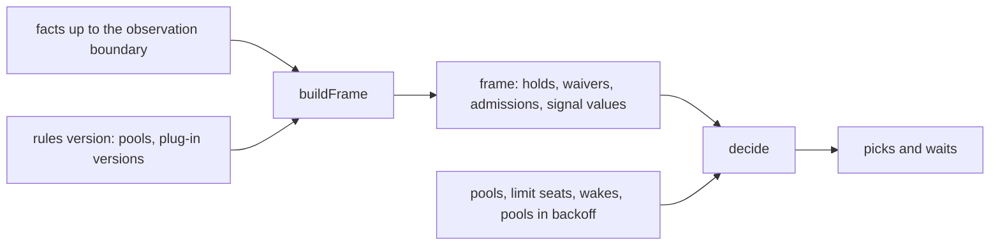

# Planning

Planning decides which ready item starts next, and which sleeping attempt wakes. Every planning idea, such as rank,
defer or expedite, is a concept: a module that registers plug-ins
([decision 0004](../../decisions/0004-planning-concepts-are-plug-ins.md)). `buildFrame()` runs the
plug-ins over the facts and builds one frame. `decide()` reads the frame and the pools and returns
picks, and never names a concept. A new sort key, such as cheapest measured work first, is one file
and one plug-in reference in the rules.

## Concepts

A concept is one module. It registers its item kinds, link types, fact kinds, commands and levers,
the pool filter fields it defines in `filterFields`, and the plug-ins that act on ordering:

| Plug-in kind | What it does | Example |
| --- | --- | --- |
| signal | gives a sort key that a pool can name | rank, age |
| gate | holds an item off the frontier, with a reason | defer, blocked |
| pool gate | holds a whole pool, with a reason | pacing ([capacity](./capacity.md#the-pacing-gate)) |
| waiver | lifts one gate's hold for one item | expedite lifts defer |
| admission | widens which pools may take an item | `--any-pool` |
| view | a pure function over the frame | explain, forecast, roadmap |

A signal, a gate or a pool gate can declare a schema for its parameters. The rules name a plug-in
by a plug-in reference: a bare name, or a one-key map from the name to its parameters, such as
`{ kind-order: { order: [chore, bug] } }`. The loader checks the parameters against the schema. A pool filter field, such
as `repo`, gives the value that a pool's `takes` matches.

The concepts boxxy builds first are the ones whose shapes differ most: a pool, defer as a gate with
expedite as its waiver, and expedite propagation over links. They test the plug-in interface before
many plug-ins depend on it. boxxy has no fixed list of concepts: it builds a concept when a need
arrives, and later concepts are additions to the same registry.

### Propagation

`buildFrame()` runs each propagation line in the rules over every open item, ready or not. A line
names a signal, a link type and a direction, such as rank down `serves` or expedite back over
`blocks`. `buildFrame()` carries the signal's value across those links, and the signal's `combine` keeps one value where two meet. A
propagation line is rules data, so the registry has no propagation kind.

## buildFrame and decide



- `buildFrame()` runs each propagation line, and each signal that a line carries, over every open
  item. It runs each gate, pool gate, waiver, admission and other signal over the ready items. It
  records each output and each fault in the frame.
- `decide()` takes the ready items that no gate holds, offers them to each pool by its filter and
  `order`, and returns a pick for each item and wake that gets its seats ([limits](#limits-and-the-decision)).
- Both are pure. Time, the seat counts, the pools in backoff and every live reading come in as facts or arguments.
- A plug-in that throws is a fault, and a failed gate holds
  ([dispatch](./dispatch.md#gates-fail-toward-holding)).
- `claimNext` runs both inside the store's write transaction ([dispatch](./dispatch.md)).

## Pools

A pool is a filter, a sort and an empty policy. A pool's name carries no meaning: any ordering is
configuration. Named limits cap the running attempts, and a pool has no slot count of its own
([v1](./v1.md#limits-and-pools)).

```yaml
pools:
  - name: maintenance
    takes: { phase: build, kind: [chore, improvement, bug] }
    order: [kind: [chore, improvement, bug], oldest]
  - name: nixie
    takes: { phase: build, project: nixie }
    when_empty: idle
```

- An item that fits two pools goes to the first match in declared order. `explain` shows this, and
  the loader should warn about overlapping filters at load time (proposed).
- Signal values must be cached by signal name and parameters, so two pools can use one signal with
  different parameters.
- A limit's seats are rows in the store, and a claim takes all of an attempt's seats or none ([dispatch](./dispatch.md)).

### Limits and the decision

A pick takes one seat in each limit whose `counts` filter matches the pick's field values, and `decide` gives a pick only when each of those limits has a free seat. The store's snapshot gives each limit's `max` and the seats held now, and `decide` counts down the seats of its own picks, so one decision never starts more than a limit allows. A limit can hold more seats than its `max` after a wake over the cap ([lifecycle](./v1-lifecycle.md)), and it then gives no pick until the count is under `max` again.

`decide` returns its picks in this order:

1. The wakes: each sleeping attempt whose wake was asked for, oldest request first. A wake matches the limits against the field values its attempt stored at the claim.
2. The starts, pool by pool in declared order, and inside a pool by the pool's `order`. Each ready item that no gate holds belongs to the first pool whose filter takes it.

`decide` gives no pick in a pool that is in backoff, for a start or for the wake of an attempt in that pool. The runner holds the backoff in memory and passes the pools in backoff to `decide` as an argument, because the store never sees them. Each item and wake that gets no pick gets a wait with its reason: `limit-full` with the first full limit, `backoff` with the pool, or `no-pool` when no pool takes the item. An item that a gate holds gets no wait, because the frame holds the reason.

The filter field `designMode` of the pool concept gives `agent` for an item that sets no design mode, so each design item matches one of the two design pools of [v1](./v1.md#limits-and-pools).

### The judgement pool

A ready item that no pool or admission takes for a set time is stranded. boxxy gives it a
`plan.judge` phase in a judgement pool with one slot. The judgement close-out must end the strand
with an override (pin, admit or lift) or a defer. A second strand on the same item goes to the owner.
The judgement pool also takes other cases that no rule covers, such as an attempt that passed its
cost cap ([capacity](./capacity.md)).

## Ordering levers

These concepts give the owner and agents a lever on order. Each lever is a fact with its actor and
time ([rules](./rules.md#levers-as-facts)).

- **Expedite** beats every sort key.
  - It takes items, an ordered list, or a goal or project (all its open items, in the order given).
  - It reaches through blockers: an expedited blocked item pulls its blockers forward first.
  - It takes the next free slot in any pool whose filter matches, or with `--any-pool` the next free
    build slot anywhere. It never stops running work.
  - It lifts defer, quiet hours and budget holds on the pulled work and its blockers. A gate declared
    unliftable, such as `blocked` or `attended`, still holds.
  - It carries a reason and an optional expiry. Only a caller on the owner's path can expedite
    ([API and auth](./v1-api-and-auth.md#the-two-paths)). An owner pull
    ranks ahead of a judgement phase's pull.
- **Defer** hides an item from the frontier. `defer --until <time>` wakes it at that time. `defer`
  with no time keeps it out until `undefer`.
- **Rank** is sparse. The owner ranks a few goals or items, and nothing gets a default rank. Items
  inherit rank through `serves` and `blocks` links. An unranked item sorts by the pool's other keys.
- **Deadline** is a rare optional field. Pools read it as urgency once it gets close.

boxxy refuses cycles, estimates and a default priority.

## Projects, areas and goals

- **A project** (`core.project`) is a body of work with an outcome: a goal, repos, an optional target
  date and acceptance. Items link `serves` to it, and its progress is derived.
- **An area** is a standing bucket, such as maintenance of one repo, not a project. It is a field
  derived from repo and kind, or set at triage. Pools filter on it.
- **A goal** (`core.goal`) has an optional target date. Projects and items link `serves` to goals. A
  roadmap is the goal tree over time. A goal that drifts from its date can open an ask.

Whether goal and project are one kind or two is open.

## Explain

`explain` answers questions such as "why was the nixie slot idle on Tuesday at 14:00". It rebuilds
the frame at that time from facts up to the recorded observation boundary
([dispatch](./dispatch.md#the-observation-boundary)), reruns `decide()` with the recorded rules
version, and returns each candidate with the reason it was not picked. Reasons cost nothing until
someone asks.

When the rebuilt input's hash doesn't match the recorded snapshot hash, or a pinned plug-in version
is missing, `explain` marks the explanation suspect. [Replay CI](./rules.md#replay-ci) uses the same
mechanism to show what a new rules version would have done.

## Forecast (proposed)

A forecast gives the date goal G lands as a range from measured work, never from estimates. It
is a view over replay, not a second scheduler, so it can never disagree with dispatch about order.

1. **Like-work cohorts.** Each open item gets a cohort key: kind, repo and size band. The size band
   comes from the triage close-out's typed `size`, or from lines changed at merge for done items.
   Each cohort holds the last 30 days of done items with their cycle time (claim to merge, all
   attempts) and slot time (the sum of attempt durations).
2. **Simulate `decide()` forward.** A Monte Carlo of 500 runs. Each run copies the current frame and
   steps simulated time. Free slots ask the real `decide()`, with the same rules version and
   plug-ins, for picks. Each pick draws a slot time from its cohort, then finishes and unblocks its
   dependants. New items arrive at each cohort's measured rate. A run ends when every item serving G
   is done. The answer is the p50 and p90 of the end dates.
3. **What moves the date.** The view reruns the forecast with one change at a time: one more slot in
   each pool, an expedite of G, each open blocker removed, each competing goal deferred. It returns
   the shifts, largest first.
4. **Confidence.** The range is the confidence. A cohort with fewer than 10 done items borrows the
   next wider cohort (drop size, then repo), and the forecast shows the borrowing. An item with no
   cohort makes the forecast "not enough data".

Open issues:

- **Scope grows while work runs.** Items filed later against G, such as follow-ups and findings,
  aren't in today's tree. Either model them from each cohort's measured follow-up rate, or label the
  forecast "for the current scope" and track scope growth beside it.
- **Cost.** 500 runs of `decide()` over weeks of simulated time is millions of calls. Cache the frame
  between steps and recompute only changed items. Measure before promising a live view.
- **Lag.** Reruns and review loops sit inside cycle time, so a recipe that cuts rework moves
  forecasts only after 30 days of new data. Either weight recent items more, or show the recipe mix.
- **The owner isn't simulated.** Future expedites, holds and decisions aren't in the model, so the
  forecast means "if nothing changes".
