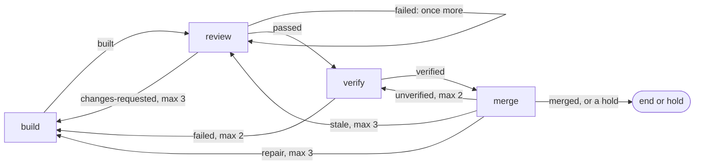

# Review, verify and merge

After a build, boxxy reviews the pull request, has an agent grade the work on the real app, and merges the pull request through GitHub when every required check is green at its head. An agent comes back only for work that needs one: findings to answer, a conflict, a red check or a failed feature. The item holds for the owner in six cases:

- a loop has used all its send-backs;
- a review or a verify failed twice in a row;
- the verify agent asks a question;
- the pull request closed with no merge;
- a required check stayed pending past the merge's time limit;
- GitHub refused the merge of a clean, green head.

## Terms

This doc uses the terms of the [core model](./core-model.md) and [v1](./v1.md): item, phase, attempt, recipe, close-out, settle, edge, hold and round. These terms are its own, or have one meaning here:

- **Send-back:** a backward edge, such as `changes-requested: { to: build, max: 3 }`. Its `max` is the number of send-backs the edge allows. The next use of that edge holds the item with `rounds used up`. Each edge counts its own uses since the item's latest `boxxy item retry`.
- **Review number:** 1 plus the item's `changes-requested` reviews since its latest retry. It differs from the item's round, which rises on every send-back.
- **Worker:** what runs an attempt, named by the phase kind. `atc.session` runs an agent session on an agent host, a machine that atc starts. A job worker runs inside the boxxy server and starts no session. The rules limit named `workers` counts agent sessions only.
- **The runner:** the server's loop that claims attempts and, on each tick, reads every live attempt ([attempt lifecycle](./v1-lifecycle.md)).
- **The core:** the packages under `modules/` and `libs/`, which do no I/O ([layout](./layout.md)).
- **pepys:** the fact store that boxxy writes its facts to, and its queries ([facts and pepys](./v1-facts-and-pepys.md)).

The review tool is noslop, and the verify tool is wringer. Only their adapters name them.

## The sketches

The sketches in [`sketches/next/review-and-merge/`](./sketches/next/review-and-merge/) hold the contracts. Where this doc and a sketch differ, the sketch stands.

- [`01-usage.ts`](./sketches/next/review-and-merge/01-usage.ts): the lines of the rules file, the phase kinds, how the server builds the adapters, the noslop and wringer adapters, and what the owner sees.
- [`02-types.ts`](./sketches/next/review-and-merge/02-types.ts): the two ports, the job worker, the merge types, the close-outs and the three fact types.
- [`03-flow.ts`](./sketches/next/review-and-merge/03-flow.ts): the job attempt on each tick, the review close-out, the review cause, the merge rule, the merge action, the kept session and the caps.

## Decisions

- **Review, verify and merge are pipeline phases.** A send-back is a backward edge, so the pipeline engine counts the send-backs, holds the item and sends the hold's notice to the owner. The [rules dry run](./rules.md) covers the three steps.
- **The review runs in an agent session on an agent host.** The agent host's image pins noslop, and the boxxy server's pod is too small to run reviews. A server restart also leaves a running review alone. The session runs one command and sends its output as the close-out. The agent judges nothing.
- **Only the server posts the review.** The server checks the result against the pull request's head, posts it as the noslop App, and reads the open findings. The App's keys stay in the server's pod.
- **The merge runs on a job worker.** The runner reads a merge attempt on each tick, as it reads every live attempt. A webhook never starts a merge.
- **An agent never decides a merge.** `decideMerge` in `modules/train` is pure, and the runner calls it on each read of a merge attempt.
- **boxxy reads required checks from its rules and the branch.** It takes the union of `merge.checks` in the rules file and the base branch's required status checks. The loader refuses an empty `merge.checks`, so the union is never empty, even on a branch that requires no check.
- **boxxy's own repo requires no check on GitHub.** Its `main` keeps direct pushes open, so a broken boxxy never blocks its own fix. Its rules file lists `pr / checks` and `verify / gate` in `merge.checks`, and the merge step waits for both.
- **boxxy decides "reviewed at this head" from its own review close-out.** boxxy never reads noslop's GitHub check, because that check passes at a head that no review has read.
- **The owner picks who grades, with a recipe field.** The verify phase always runs as its own agent attempt. A verify recipe with `session: builder` wakes the build's kept session, so the builder grades its own work. `session: fresh` starts a new session.

## The review gate

`ReviewGate` has two methods ([`02-types.ts`](./sketches/next/review-and-merge/02-types.ts)), and the port holds no tool name:

- `buildCommand(round)` is pure. The review phase kind puts its command line in the session's input.
- `accept(round, result)` runs in the server. It checks and posts the tool's result, and returns a `GateReading`: the head it covers, its open findings by severity, and its token cost.

A review goes like this:

1. The core picks the review number and its cause with `buildRoundCause` ([`03-flow.ts`](./sketches/next/review-and-merge/03-flow.ts), section C). The cause is `first` for the first review, `rework` after a `changes-requested` review, or `recheck` after a repair, a `stale` send-back, a failed verify or a failed review.
2. A session on an agent host runs the command in its clone of the repo, and sends the tool's raw result with `boxxy attempt close-out`. noslop fetches the pull request's base and head into that clone itself.
3. The server's `attempt.closeOut` procedure runs `closeOutCall` from `modules/dispatch`. It refuses a call from another session, hashes the raw result, and answers a repeat of a stored result as a repeat. Otherwise it passes the result to `accept`, before it takes the store's lock, because `accept` posts to GitHub.
4. The procedure stores the `ReviewCloseOut` that holds the reading, through the phase kind's parser, as for any close-out. The attempt settles `passed`, `changes-requested` or `failed`.

Rules of the review:

- **A review needs a pull request.** When the item has none, the review's input holds no command, and the server rejects its close-out. The server reads the noslop App's keys from `NOSLOP_GITHUB_APP_ID`, `NOSLOP_GITHUB_APP_PRIVATE_KEY` and `NOSLOP_GITHUB_APP_INSTALLATION_ID`, and refuses to start when only some are set. Without the keys or a `github` section, it rejects every review close-out.
- **Each reading carries its head.** When the result is for another head than the pull request's current head, or it read no part of that head, the reading is `not-covered`, and the review settles `failed`.
- **A failed review runs once more.** A failed call, an unreadable result or a `not-covered` reading settles `failed`. The edge `again` runs the review as a `recheck` with the same review number. A second failed review in a row holds the item with `attempts used up`.
- **Four reviews, then a hold.** The edge is `changes-requested: { to: build, max: 3, resume: true }`, so the fourth `changes-requested` holds the item with `rounds used up`.
- **The first review is full, and every later review runs `--fixes-only`.** A later review checks the builder's answers to the open findings and raises no new finding. When no `fixed` answer got a verdict, such as when the builder answered every finding `not-a-defect` or a repair added no answer, that run read nothing at the head. The command then runs a plain review of what changed since the last review, so the review covers the head.
- **boxxy counts the change that a later review skips.** Each review after the first records `unrelatedLines` in its close-out: the changed lines between the earlier review's head and this head, in files that had no open finding at the earlier review. The server reads the changed files from GitHub's compare, and the pure `countUnrelatedLines` counts them. pepys reads the field, so it shows how much unrelated change reaches a `--fixes-only` review.
- **The review session gets the read-only clone token.** It is the token that the atc daemon clones with, with `Contents: read` and `Pull requests: read`, and noslop reads it as `GH_TOKEN`. atc withholds the daemon's variables from sessions, so the review recipe reaches the token through a broker profile. The recipe names a review agent: an atc agent whose broker profile holds the token, so its sessions hold a placeholder in `GH_TOKEN` and the broker adds the token on the way out. Build and design sessions never get it, because the server lists its review agents in `spawn.reviewAgents`, and with any listed, the rules load only when:
  - no recipe of a step other than review names a review agent (`review-agent-outside-review`);
  - every review recipe names one (`review-without-review-agent`), and none has `session: builder` (`review-builder-session`), because a review with no kept build session starts fresh on the review agent, and the item keeps that session for the next build;
  - no edge with `resume: true` goes to the review step (`review-session-resumed`), because an item keeps one session, and a later resume of the build would wake a kept review session.
- **boxxy trusts the review session as it trusts any session.** Only the review attempt's own session can close it out. noslop's check before a post matches the result's head and config to the pull request, and never checks that the review's calls ran.
- **The builder answers findings in the review tool.** The rework build's input carries the open counts and `answerHint`, a text from the adapter with where the findings are and how to answer them. The core never reads a finding's text.

Section 4 of [`01-usage.ts`](./sketches/next/review-and-merge/01-usage.ts) maps noslop's commands and output to the port.

## The verifier

The `verify` phase runs an agent session that drives the real app with the repo's verify CLI and records a verdict for each changed feature. Its input is the pull request and its head. wringer picks the features in scope from the paths the pull request changed. The agent closes out with one of four outcomes:

| Outcome | Edge |
| --- | --- |
| `verified` | on to merge |
| `failed`, with the failing features | back to build, `max: 2`, and the rework build's input carries the features; the third `failed` holds the item with `rounds used up` |
| `blocked`, with a question | hold, and the question reaches the owner |
| `abandoned` | runs once more; a second `abandoned` in a row holds the item with `attempts used up` |

The verdict reaches the merge in three steps, and only the last one decides the merge:

1. The verify agent runs the journeys, writes wringer's report into the pull request body, and then closes out `verified`, which moves the item on to merge.
2. The CI check `verify / gate` reads that report and fails a change whose features lack a fresh verdict. The gate computes wringer's fingerprint of the change, which needs a checkout, and the server has none.
3. The merge job calls `Verifier.readAt(pullRequest, head)`. The wringer adapter builds the `VerifyReading` from the latest `verify / gate` run at the head and the report in the body. A head with no gate run that passed or failed reads `not-covered`, never `verified`; a cancelled or skipped run gave no verdict. `decideMerge` reads only this reading, so a `verified` close-out with no green gate never merges.

[wringer journeys](./wringer-journeys.md) owns what the grading agent does, the report, and the `verify / gate` workflow. The workflow runs on `pull_request` with the types `opened`, `synchronize`, `reopened` and `edited`, because the report lives in the body.
- **pepys compares the two graders by recipe.** The owner gives one item kind the `session: builder` recipe and another the `session: fresh` recipe. When the build's kept session is gone, a `session: builder` attempt runs on a fresh session, and its `started` fact carries `resumeFallback: true`, so a comparison can leave it out. When the fresh start's reply is lost, the runner's reconcile writes `reconciled` in place of `started`, and that fact carries the same flag.

## The merge step

The merge phase runs on the job worker `merge.forge`. On each read, at most once every 30 seconds per attempt, the job reads:

- the pull request's state, head and mergeable state;
- the latest run of each check at the head, and the base branch's required checks;
- the verify reading at the head;
- the item's latest settled review.

`decideMerge`, in section D of [`03-flow.ts`](./sketches/next/review-and-merge/03-flow.ts), then finishes the attempt, waits, or asks GitHub to merge. It checks these rows from the top, and the first match wins:

| What the job reads | Result | Then |
| --- | --- | --- |
| merged, by boxxy or anyone | `merged` | the item ends |
| closed with no merge | `closed` | hold |
| the latest review did not pass at this head | `stale` | back to review, `max: 3` |
| a conflict with the base | `repair` | back to build, `max: 3` |
| a required check failed at this head | `repair` | back to build, `max: 3` |
| a check pending, skipped or missing, within the time limit | wait | read again |
| a check pending, skipped or missing, past the time limit | `stalled` | hold |
| every check green and the verify reading not `verified` | `unverified` | back to verify, `max: 2` |
| GitHub refused a merge of this clean, green head | `refused` | hold |
| a merge request sent at this head, past the time limit | `stalled` | hold |
| a merge request sent at this head less than 5 minutes ago | wait | read again |
| every check green and the verify reading `verified` | merge request | read again |

- **The time limit is 240 minutes per merge attempt, from its claim.** A send-back ends the attempt, so the next merge attempt starts its own 240 minutes. The send-back caps bound the total.
- **Only `success` is green.** A check counts as green only when its latest run at the head concluded `success`. A skipped, neutral or cancelled run never counts.

### Races and repeats

- **boxxy merges only the head it read.** The merge call passes `sha: head`, and GitHub refuses it when the head moved. The next read sees the new head, and the item goes back to review.
- **The runner marks the request before the call.** In one store change, under the attempt's lease, the runner sets `actedAt` and `actedHead` and writes `boxxy.merge.requested`. Then it calls GitHub. When the store refuses the change, because another runner holds the lease, the runner sends no call.
- **A lost answer is safe.** When the call gets no answer, the next read sees the merge, or waits 5 minutes and sends the call again at the same head. A second call never merges twice, because GitHub merges only at `sha`.
- **boxxy writes one merge fact per merge.** The settle of a `merged` attempt moves the pull request row to merged and writes `boxxy.pull_request.merged`. The [pull request watch](./v1-lifecycle.md#the-pull-request-watch) may have done both first. The row's state lets only the first writer through.
- **A webhook never changes boxxy state.** A replayed webhook reaches pepys only.
- **A merge by hand ends the item.** The merge job reads `merged` and settles. When the item held before the merge, `boxxy item retry <item> --phase merge` runs the merge job, which reads the merge.

The GitHub adapter needs `Contents: write` and `Pull requests: write` to merge, `Checks: read` and `Commit statuses: read` for the checks, and `Metadata: read` for the branch's rules.

### The merge train

`decideMerge` takes a `MergeUnit`, a list of pull requests with their heads. `MergeAnswer` holds `queued`, GitHub's answer when a merge queue takes a pull request, which the direct merge call never gives. A rule over units of several pull requests can therefore take the place of `decideMerge` with the same outcomes, and the rules file's merge step and its edges stay as they are. The [merge train](./merge-train.md) describes that rule.

## Job attempts

A merge attempt uses the attempt states `starting`, `running`, `closing`, `succeeded` and `failed`, and the one module that writes attempt state. Section A of [`03-flow.ts`](./sketches/next/review-and-merge/03-flow.ts) holds the changes of state.

- **The runner routes each attempt by its worker.** The claim stores the phase kind's worker on the attempt row. On each tick the runner looks the name up in the server's `WorkerRegistry`: a session worker's attempt goes through the reconcile table, and a job's attempt goes through `runJobReading` in `modules/dispatch/src/jobs/`. The claim of a job attempt starts nothing.
- **A job reads, then moves.** Its first read moves it from `starting` to running and writes `boxxy.attempt.job_started`. A read that throws moves nothing. A `wait` sets `readAt` and `waitReason`, an `act` sets `actedAt`, `actedHead` and `readAt`, and the job reads again only `jobReadSeconds` (30) after `readAt`. The drive gets `actRetryMinutes` (5) in its context, for the wait before it sends an unanswered action again.
- **A finished job settles in the same tick.** The drive's close-out goes through the phase kind's parser. When the parser refuses it, the attempt settles `closeout-unsettleable`, and the runner logs the problems.
- **A merge holds a `jobs` seat.** The `workers` limit, at 7, counts the phases that run agent sessions, review included. The `jobs` limit, at 20, counts merges, so a merge that waits on CI never holds a session's seat.
- **The runner writes the merge close-out.** Its actor is `boxxy:runner:<runner_id>`, and it goes through the phase kind's parser and the `closed_out` fact, as an agent's close-out does.
- **The loader checks each worker name.** The server passes the loader the names of the workers it built, and the loader refuses a phase kind that names any other worker.

## Facts and pepys

The fact catalog of 30 types holds three for these steps: `boxxy.attempt.job_started`, `boxxy.merge.requested` and `boxxy.merge.answered` ([`02-types.ts`](./sketches/next/review-and-merge/02-types.ts), the last section). The item is the entity of each one. Everything else that pepys reads about these steps reaches it in `boxxy.attempt.closed_out`:

- each review's head, open counts, token cost and `unrelatedLines`;
- each verify close-out, with its grader;
- each merge close-out, with the verify reading.

pepys's stage-time query reads the review outcomes `passed` and `changes-requested`. For an item with a merge phase, the query starts the merge step when the runner claims the item's first merge attempt after its latest passed review. For an item with no merge phase, the merge step starts at the end of the latest passed review. A review's close-out carries tokens per model, and pepys prices them as it prices telemetry.

## What the owner sees

Section 5 of [`01-usage.ts`](./sketches/next/review-and-merge/01-usage.ts) shows both views. `boxxy item get` shows the latest review at each head with its open counts, the verify reading and its grader, the merge attempt's wait reason, and the send-backs each loop has used. `boxxy runner status` lists each live merge with its wait reason and age. A hold reaches the owner's notice session through the [notice port](./v1.md#notices).

## Acceptance

| Behaviour | Evidence |
| --- | --- |
| An item whose required checks are green at its head merges with no person. | An e2e journey in `system-tests/e2e/` with a fake forge: the merge job calls `mergeAtHead` at the head it read, and the store holds `boxxy.merge.requested`, `boxxy.merge.answered` and one `boxxy.pull_request.merged`. |
| A red check sends the item to a repair build, and a fourth repair holds it with a notice. | The same journey with a red check, and a `decideMerge` test row for each row of the merge table. |
| Each loop holds after its last send-back, with a notice. | An `advance` test over the rules lines in section 1 of `01-usage.ts`, one row per backward edge. |
| A refused merge of a clean, green head holds the item, and a request with no answer is sent again. | `decideMerge` test rows with `acted` set: `not-mergeable` gives `refused`, no answer after 5 minutes gives a new request, and past the time limit gives `stalled`. |
| Each review after the first records the changed lines outside the files that had findings. | `countUnrelatedLines` test rows, a close-out procedure test with a fake forge compare, and a pepys query test that reads `unrelatedLines`. |
| Only a review session gets the read-only clone token. | A recipe test: the review recipe names the token's path, and the build and design recipes name none. |
| A review never passes a head that it did not read. | Review adapter tests: the later-review command runs a plain review after a `--fixes-only` run that judged no fix; `accept` reads such a run as `not-covered` and posts nothing; and a result for an old head reads `not-covered`. |
| A server restart during a review never holds the item or starts a second review. | A system test that stops the server after `accept` posts and before the close-out is stored: the session's second close-out settles the same attempt. A second test repeats a stored close-out, and `accept` does not run. |
| A passed review needs noslop's check to pass. | A review adapter test: `check` answers `failure` with no open finding, and the reading is blocked `unreadable`. |
| A review close-out from any other session is refused. | The close-out procedure's caller test, as for every attempt. |
| The core holds no tool name. | `turbo boundaries` and the import-zones lint: no file in `modules/` or `libs/` imports a review or verify adapter. |

## Left to the implementer

- The folder names of the two adapters, inside the layout's rule of one package per outside system.
- The shell form of the review command, and the name of the file it writes.
- The wording of `answerHint`, the wait reasons and the `runner.status` lines.
- How the GitHub adapter reads required checks: from the branch's rules, from branch protection, or both.

## Open questions

- **Whether a second post of one result is safe.** When the server crashes after `accept` posts and before the close-out is stored, the session sends the close-out again, and `accept` posts again. noslop's docs do not say whether a repeat post adds comments. The owner checks it in the first live run on a real repo. The verdict stays right either way, because it comes from the open findings.
- **The GitHub permissions.** The owner checks in the first live run that the permissions in [Races and repeats](#races-and-repeats) are enough to merge and to read rules, checks and statuses.
