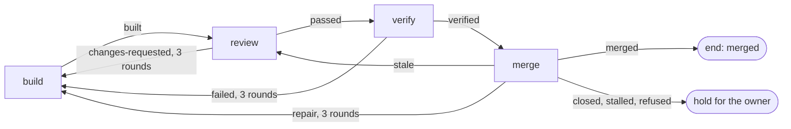

# Review, verify and merge

After a build, boxxy runs three more steps and lands the pull request with no person in the loop. A review gate checks the head through a port, an agent grades the work on the real app, and a merge rule in the core merges through GitHub when every required check is green at the head. An agent comes back only when the rule cannot go on: findings to answer, a conflict, a red check or a failed feature. Each loop has a cap of 3 rounds, and then the item holds for the owner. This design replaces the review session of [v1](./v1.md#the-review) and v1's rule that boxxy never merges.

## The sketches

The sketches in [`sketches/next/review-and-merge/`](./sketches/next/review-and-merge/) hold the contracts. Where this doc and a sketch differ, the sketch stands.

| File | Holds |
| --- | --- |
| [`01-usage.ts`](./sketches/next/review-and-merge/01-usage.ts) | the rules lines, the phase kinds, the server's wiring, the map from each tool to its port, what the owner sees |
| [`02-types.ts`](./sketches/next/review-and-merge/02-types.ts) | the two ports, the job worker, the merge types, the close-outs, the new facts |
| [`03-flow.ts`](./sketches/next/review-and-merge/03-flow.ts) | a job attempt on each tick, the review job, the round cause, the merge rule, the merge action, the kept session, the caps |

## Decisions

- **Review, verify and merge are pipeline phases.** The engine gives them rounds, caps, holds, notices and the rules dry run with no new code, because a send-back is a backward edge that `findPosition` already folds.
- **Review and merge run on a job worker.** `JobWorker` is a second worker shape beside the session-shaped `WorkerKind`. A job runs no agent session and holds no host, so it never sleeps, wakes or keeps a session.
- **The runner tick drives the merge.** A merge attempt is a live attempt, and the readings loop reads it like any other. No webhook and no forge watch starts a merge.
- **No agent decides a merge.** `decideMerge` in `modules/train` is pure, and the runner calls it on each read of a merge job.
- **boxxy reads required checks from its rules and the branch.** It takes the union of `merge.checks` in the rules file and the base branch's required status checks. The loader refuses an empty `merge.checks`, because a branch can require nothing.
- **The review gate's own record decides "reviewed at this head".** boxxy never reads the review tool's GitHub check, because that check passes at a head no review read.
- **Who grades is a recipe field.** The verify phase always runs as its own agent attempt. `session: builder` wakes the builder's kept session, and `session: fresh` starts a new one. Each arm then has its own attempts, cost and time in pepys.
- **The review cap counts rounds.** Round 3 is the last: a third review that asks for changes holds the item.

## The review gate

`ReviewGate` has two methods, `start` and `read`, and no tool name appears in it ([`02-types.ts`](./sketches/next/review-and-merge/02-types.ts)). The review job calls them: it reads the pull request's head from the forge, starts a round on that head, and reads the round on each tick until it finishes. The runner records the reading as the review close-out, and the attempt settles `passed`, `changes-requested` or `failed`.

- **Each reading carries its head.** The parser refuses a reading for a head other than the one the job read at its start. When a run read no part of the head, the adapter answers `not-covered`, and the attempt settles `failed`.
- **The core picks the round and its cause.** `buildRoundCause` in [`03-flow.ts`](./sketches/next/review-and-merge/03-flow.ts), section C, gives `first`, `rework` or `recheck`. The adapter maps the cause to its own calls.
- **A rework round raises no new finding.** It checks the builder's answers to the open findings. A recheck round, after a repair, a moved head or a failed verify, reviews what changed.
- **Three rounds, then a hold.** The edge `changes-requested: { to: build, max: 2, resume: true }` sends the item back twice, and the third `changes-requested` holds it with `rounds used up`.
- **A failed round runs again.** A failed call, an unreadable result or a `not-covered` reading settles `failed`, and the edge `again` runs the round once more at the same round number. A second failure holds the item with `attempts used up`.
- **A round is idempotent by its attempt ID.** A second `start` with the same key starts nothing. When the process dies with no result, `read` answers `absent`, the attempt settles `job-lost`, and the next attempt runs the round again.
- **The builder answers findings in the tool.** The rework build's input carries the open counts and the adapter's `answerHint`: a text that tells the builder where the findings are and how to answer them. The core never reads a finding's text.

Section 4 of [`01-usage.ts`](./sketches/next/review-and-merge/01-usage.ts) maps noslop's commands and output to the port. The server runs noslop as a detached child process, one per round, so the server's image holds noslop, the noslop App's keys and a model login. Another adapter, such as a Codex review or a review agent in an atc session, implements the same two methods.

## The verifier

The `verify` phase runs an agent session that drives the real app with the repo's verify CLI and records a verdict for each changed feature. Its input is the pull request and its head, with no acceptance text: the verify tool takes the features in scope from the paths the pull request changed. The agent closes out `verified`, `failed` with the failing features, `blocked` with a question, or `abandoned`.

`Verifier` has one method, `readAt(pullRequest, head)`, which the merge job calls. The server has no checkout, so it never computes the verify tool's fingerprint. CI's gate check computes it, and the wringer adapter reads that check's latest run at the head, with the report in the pull request body. A head with no finished gate run reads `not-covered`, never `verified`.

- **The gate check reruns when the body changes.** The repo's verify workflow runs on `pull_request` with the type `edited` beside the default types, because the report lives in the body.
- **The grader arm is a recipe.** The rules file can give two item kinds the two verify recipes, and pepys compares them by recipe hash. A builder-arm attempt whose kept session was gone runs on a fresh session, and its `started` fact carries `resumeFallback: true`, so a comparison can leave it out.

## The merge step

The merge phase runs on the job worker `merge.forge`. On each read, at most once every 30 seconds per attempt, the job observes the pull request: its state, its head, its mergeable state, the latest run of each check at the head, the base branch's required checks, the verify reading at the head, and the item's latest settled review. `decideMerge`, in section D of [`03-flow.ts`](./sketches/next/review-and-merge/03-flow.ts), then finishes the attempt with an outcome, waits, or asks for the merge.

| Observation | Outcome | Edge |
| --- | --- | --- |
| merged, by boxxy or anyone | `merged` | end |
| closed with no merge | `closed` | hold |
| the latest review did not pass at this head | `stale` | back to review, 3 rounds |
| a conflict with the base | `repair` | back to build, 3 rounds |
| a required check failed at this head | `repair` | back to build, 3 rounds |
| a check pending, skipped or missing past the step's 240 minutes | `stalled` | hold |
| every check green and the verify reading not `verified` | `unverified` | back to verify, 3 rounds |
| GitHub refuses the merge of a clean, green head | `refused` | hold |

A check counts as green only when its latest run at the head concluded `success`. A skipped, neutral or cancelled run never counts.

### Races and repeats

- **boxxy merges only the head it read.** The merge call passes `sha: head`, and GitHub refuses it when the head moved. The next read then sees the new head, and the item goes back to review.
- **The request is marked before the call.** The move `acted` writes `actedAt`, `actedHead` and `boxxy.merge.requested` under the attempt's lease, before the forge call. A refused move sends nothing.
- **A lost answer is safe.** When the call gets no answer, the next read sees the merge, or waits 5 minutes and sends the call again at the same head. A second call never merges twice, because GitHub merges only at `sha`.
- **One merge fact per merge.** The settle of a `merged` attempt moves the pull request row to merged and writes `boxxy.pull_request.merged`, unless the pull request watch already did. The row's state guards both writers.
- **boxxy reads no webhook to merge.** A replayed webhook reaches pepys only, and changes no boxxy state.
- **A merge by hand ends the item.** The merge job reads `merged` and settles. When the item held before the merge, `boxxy item retry <item> --phase merge` runs the merge job, which reads the merge.

The GitHub adapter needs more than its pull request reads: `Contents: write` and `Pull requests: write` to merge, `Checks: read` and `Commit statuses: read` for the checks, and `Metadata: read` for the branch's rules.

### Room for the merge train

The [merge train](./merge-train.md) replaces `decideMerge` with a strategy over a `MergeUnit` of several pull requests, in `modules/train`. It keeps the merge phase's outcomes, so no pipeline changes. GitHub's `merge-async` call with a merge queue answers `queued`, which `MergeAnswer` already holds.

## Job attempts

A job attempt uses the attempt machine and its one writer, with the states `starting`, `reconciling`, `running`, `closing`, `succeeded` and `failed`. Section A of [`03-flow.ts`](./sketches/next/review-and-merge/03-flow.ts) holds the moves.

- **A job holds a `jobs` seat.** The limit `workers` counts the phases that run agent sessions, and the limit `jobs`, at 20, counts review and merge. A merge that waits on CI therefore never holds a session's seat.
- **The step's time limit applies.** A review past it settles `lost`. A merge past it finishes `stalled`.
- **The runner writes a job's close-out.** Its actor is `boxxy:runner:<runner_id>`, and it goes through the phase kind's parser and the `closed_out` fact, as an agent's close-out does.
- **The loader checks each worker name.** The server passes the names of its workers, and the loader refuses a phase kind whose worker it lacks.

## Facts and pepys

Three fact types join the catalog, which then holds 30 ([`02-types.ts`](./sketches/next/review-and-merge/02-types.ts), the last section): `boxxy.attempt.job_started`, `boxxy.merge.requested` and `boxxy.merge.answered`. Each one names the item as its entity. A round's head, open counts and token cost, the verify close-out with its grader, and the merge close-out with the verify reading reach pepys in `boxxy.attempt.closed_out`.

- **The review keeps its outcome names.** `passed` and `changes-requested` stay, so the stage-time query reads the same names.
- **The merge step starts at the merge attempt.** The stage-time query starts the merge step at the claim of the item's first merge attempt after its latest passed review. For an item with no merge phase, it starts at the end of the latest passed review, as in v1.
- **A review round costs tokens, not money.** The close-out carries the tokens per model, and pepys prices them as it prices telemetry.

## What the owner sees

Section 5 of [`01-usage.ts`](./sketches/next/review-and-merge/01-usage.ts) shows both views. `boxxy item get` shows the latest review at each head with its open counts, the verify reading and its grader, the merge attempt's wait reason, and how many rounds each loop has used. `boxxy runner status` lists each live job with its wait reason and age. A hold reaches the owner's notice session through the [notice port](./v1.md#notices), as every hold does.

## Builder decides

- The folder names of the two adapters, inside the layout's rule of one package per outside system.
- The layout of the review adapter's state folder, and how it finds a live process.
- The wording of `answerHint`, the wait reasons and the `runner.status` lines.
- How the GitHub adapter reads required checks: from the branch's rules, from branch protection, or both.

## Open questions

- **Whether a rework round may miss new code.** A rework round checks the builder's answers and raises no new finding, so a fix commit's other changes get no review until a recheck. The owner decides whether to keep this cost. Until then, rework rounds raise no new finding.
- **The GitHub permissions.** The live proof checks that the permissions above are enough to merge and to read rules, checks and statuses.
