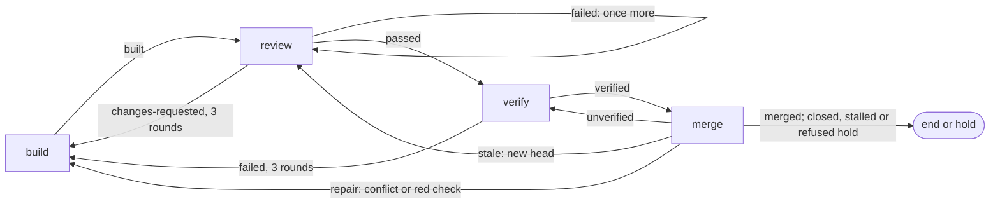

# Review, verify and merge

After a build, boxxy reviews the pull request, has an agent grade the work on the real app, and merges the pull request through GitHub when every required check is green at its head. No person takes part unless a loop runs out of rounds. An agent comes back only for work that needs one: findings to answer, a conflict, a red check or a failed feature. Each loop sends the item back at most a fixed number of times, and then the item holds for the owner.

This doc uses the terms of the [core model](./core-model.md) and [v1](./v1.md): item, phase, attempt, recipe, close-out, settle, edge and hold. A round is one pass of a loop, such as one review of one head. The review tool is noslop, and the verify tool is wringer. Only their adapters name them.

## The sketches

The sketches in [`sketches/next/review-and-merge/`](./sketches/next/review-and-merge/) hold the contracts. Where this doc and a sketch differ, the sketch stands.

- [`01-usage.ts`](./sketches/next/review-and-merge/01-usage.ts): the rules lines, the phase kinds, the server's wiring, the noslop and wringer adapters, and what the owner sees.
- [`02-types.ts`](./sketches/next/review-and-merge/02-types.ts): the two ports, the job worker, the merge types, the close-outs and the new facts.
- [`03-flow.ts`](./sketches/next/review-and-merge/03-flow.ts): the job attempt on each tick, the review close-out, the round cause, the merge rule, the merge action, the kept session and the caps.

## Decisions

- **Review, verify and merge are pipeline phases.** A send-back is a backward edge, so the pipeline engine counts rounds, holds the item and sends the notice, and the rules dry run covers the new steps.
- **The review runs in an agent session on a worker machine.** The worker machine's image pins noslop, a server restart leaves a running round alone, and the boxxy server's pod is too small to run reviews. The session runs one command and sends its output as the close-out. The agent judges nothing.
- **Only the server posts the review.** It checks the result against the pull request's head, posts it as the noslop App, and reads the open findings. The App's keys stay in the server's pod.
- **The merge runs on a job worker.** `JobWorker` runs a phase with no agent session and no host. The tick's readings loop reads a merge attempt as it reads every live attempt, so no webhook starts a merge.
- **No agent decides a merge.** `decideMerge` in `modules/train` is pure, and the runner calls it on each read of a merge attempt.
- **boxxy reads required checks from its rules and the branch.** It takes the union of `merge.checks` in the rules file and the base branch's required status checks. The loader refuses an empty `merge.checks`, because a branch can require nothing.
- **boxxy's own review close-out decides "reviewed at this head".** boxxy never reads noslop's GitHub check, because that check passes at a head that no review has read.
- **A recipe field picks who grades.** The verify phase always runs as its own agent attempt. `session: builder` wakes the builder's kept session, and `session: fresh` starts a new one, so pepys can compare the two by recipe.

## The review gate

`ReviewGate` has two methods, and no tool name appears in it ([`02-types.ts`](./sketches/next/review-and-merge/02-types.ts)):

- `buildCommand(round)` is pure. The review phase kind puts its command line in the session's input.
- `accept(round, result)` runs in the server when the session closes out. It returns a `GateReading` with the head it covers, its open findings by severity and its token cost.

A round goes like this:

1. The core picks the round number and its cause with `buildRoundCause` ([`03-flow.ts`](./sketches/next/review-and-merge/03-flow.ts), section C): `first`, `rework` after a `changes-requested` review, or `recheck` after anything else.
2. A session on a worker machine runs the command in the pull request's checkout and sends the tool's raw result with `boxxy attempt close-out`.
3. The `attempt.closeOut` procedure passes the result to `accept`, outside the lock, and the phase kind's parser reads the reading. The attempt settles `passed`, `changes-requested` or `failed`.

Rules of the round:

- **Each reading carries its head.** When the result is for another head than the pull request's current head, or it read no part of that head, the reading is `not-covered`, and the round settles `failed`.
- **A failed round runs once more.** A failed call, an unreadable result or a `not-covered` reading settles `failed`. The edge `again` runs the round as a `recheck` at the same round number, and a second failure holds the item with `attempts used up`.
- **Three rounds, then a hold.** The edge `changes-requested: { to: build, max: 2, resume: true }` sends the item back twice. The third `changes-requested` holds it with `rounds used up`.
- **A rework round raises no new finding.** It checks the builder's answers to the open findings. A `recheck` reviews what changed since the last review.
- **The builder answers findings in the tool.** The rework build's input carries the open counts and `answerHint`, a text that tells the builder where the findings are and how to answer them. The core never reads a finding's text.

Section 4 of [`01-usage.ts`](./sketches/next/review-and-merge/01-usage.ts) maps noslop's commands and output to the port.

## The verifier

The `verify` phase runs an agent session that drives the real app with the repo's verify CLI and records a verdict for each changed feature. Its input is the pull request and its head. The verify tool picks the features in scope from the paths the pull request changed. The agent closes out `verified`, `failed` with the failing features, `blocked` with a question, or `abandoned`.

`Verifier` has one method, `readAt(pullRequest, head)`, and the merge job calls it. The CI check `verify / gate` works out wringer's fingerprint of the change, which needs a checkout, so the server never computes it. The wringer adapter reads the latest run of that check at the head, and the report that the agent writes into the pull request body. A head with no finished gate run reads `not-covered`, never `verified`. The wringer journeys design owns the CI job and how a verdict reaches the body.

- **The gate check runs again when the body changes.** The verify workflow runs on `pull_request` with the types `opened`, `synchronize`, `reopened` and `edited`, because the report lives in the body.
- **The owner picks the grader per item kind.** The rules file can give two item kinds the two verify recipes, one each, and pepys compares them by recipe hash. When the builder's kept session is gone, the builder-arm attempt runs on a fresh session, and its `started` fact carries `resumeFallback: true`, so a comparison can leave it out.

## The merge step

The merge phase runs on the job worker `merge.forge`. On each read, at most once every 30 seconds per attempt, the job reads the pull request's state, head and mergeable state, the latest run of each check at the head, the base branch's required checks, the verify reading at the head, and the item's latest settled review. `decideMerge`, in section D of [`03-flow.ts`](./sketches/next/review-and-merge/03-flow.ts), then finishes the attempt, waits, or asks GitHub to merge.

`decideMerge` checks these rows from the top, and the first match wins:

| What the job reads | Result | Then |
| --- | --- | --- |
| merged, by boxxy or anyone | `merged` | the item ends |
| closed with no merge | `closed` | hold |
| the latest review did not pass at this head | `stale` | back to review |
| a conflict with the base | `repair` | back to build |
| a required check failed at this head | `repair` | back to build |
| a check pending, skipped or missing, within the step's 240 minutes | wait | read again |
| the same, past the step's 240 minutes | `stalled` | hold |
| every check green and the verify reading not `verified` | `unverified` | back to verify |
| GitHub refused a merge of this clean, green head | `refused` | hold |
| a merge request sent at this head, past the step's 240 minutes | `stalled` | hold |
| a merge request sent at this head less than 5 minutes ago | wait | read again |
| every check green and the verify reading `verified` | merge request | read again |

Each backward edge has its own count from the item's latest retry: `repair` and `stale` hold the item on their fourth use, and `unverified` on its third. A check counts as green only when its latest run at the head concluded `success`. A skipped, neutral or cancelled run never counts.

### Races and repeats

- **boxxy merges only the head it read.** The merge call passes `sha: head`, and GitHub refuses it when the head moved. The next read sees the new head, and the item goes back to review.
- **The runner marks the request before the call.** The move `acted` writes `actedAt`, `actedHead` and `boxxy.merge.requested` under the attempt's lease, before the forge call. When the store refuses the move, because another runner holds the lease, the runner sends no call.
- **A lost answer is safe.** When the call gets no answer, the next read sees the merge, or waits 5 minutes and sends the call again at the same head. A second call never merges twice, because GitHub merges only at `sha`.
- **One merge fact per merge.** The settle of a `merged` attempt moves the pull request row to merged and writes `boxxy.pull_request.merged`, unless the pull request watch did first. The row's state guards both writers.
- **boxxy merges on no webhook.** A replayed webhook reaches pepys only, and changes no boxxy state.
- **A merge by hand ends the item.** The merge job reads `merged` and settles. When the item held before the merge, `boxxy item retry <item> --phase merge` runs the merge job, which reads the merge.

The GitHub adapter needs `Contents: write` and `Pull requests: write` to merge, `Checks: read` and `Commit statuses: read` for the checks, and `Metadata: read` for the branch's rules.

### The merge train

`decideMerge` takes a `MergeUnit`, a list of pull requests with their heads, and `MergeAnswer` holds `queued`, GitHub's answer when a merge queue takes a pull request. The [merge train](./merge-train.md) replaces `decideMerge` with a rule over units of several pull requests and keeps its outcomes, so no pipeline changes.

## Job attempts

A merge attempt uses the attempt machine and its one writer, with the states `starting`, `running`, `closing`, `succeeded` and `failed`. Section A of [`03-flow.ts`](./sketches/next/review-and-merge/03-flow.ts) holds the moves.

- **A merge holds a `jobs` seat.** The limit `workers`, at 7, counts the phases that run agent sessions, review included. The limit `jobs`, at 20, counts merges, so a merge that waits on CI never holds a session's seat.
- **The step's time limit applies.** A merge past it finishes `stalled`.
- **The runner writes the merge close-out.** Its actor is `boxxy:runner:<runner_id>`, and it goes through the phase kind's parser and the `closed_out` fact, as an agent's close-out does.
- **The loader checks each worker name.** The server passes the names of its workers, and the loader refuses a phase kind whose worker it lacks.

## Facts and pepys

Three fact types join the catalog, which then holds 30 ([`02-types.ts`](./sketches/next/review-and-merge/02-types.ts), the last section): `boxxy.attempt.job_started`, `boxxy.merge.requested` and `boxxy.merge.answered`. The item is the entity of each one. `boxxy.attempt.closed_out` carries the rest to pepys:

- each review round's head, open counts and token cost;
- each verify close-out, with its grader;
- each merge close-out, with the verify reading.

The stage-time query reads the review outcomes `passed` and `changes-requested`. It starts the merge step at the claim of the item's first merge attempt after its latest passed review. For an item with no merge phase, the merge step starts at the end of the latest passed review. A review round's close-out carries tokens per model, and pepys prices them as it prices telemetry.

## What the owner sees

Section 5 of [`01-usage.ts`](./sketches/next/review-and-merge/01-usage.ts) shows both views. `boxxy item get` shows the latest review at each head with its open counts, the verify reading and its grader, the merge attempt's wait reason, and the rounds each loop has used. `boxxy runner status` lists each live merge with its wait reason and age. A hold reaches the owner's notice session through the [notice port](./v1.md#notices).

## Acceptance

| Behaviour | Evidence |
| --- | --- |
| An item whose required checks are green at its head merges with no person. | An e2e journey in `system-tests/e2e/` with a fake forge: the merge job calls `mergeAtHead` at the head it read, and the store holds `boxxy.merge.requested`, `boxxy.merge.answered` and one `boxxy.pull_request.merged`. |
| A red check sends the item to a repair build, and a fourth repair holds it with a notice. | The same journey with a red check, and a `decideMerge` test row for each row of the merge table. |
| Each loop holds after its last round with a notice. | An `advance` test over the rules lines in section 1 of `01-usage.ts`, one row per backward edge. |
| A refused merge of a clean, green head holds the item, and a request with no answer is sent again. | `decideMerge` test rows with `acted` set: `not-mergeable` gives `refused`, no answer after 5 minutes gives a new request, and past the time limit gives `stalled`. |
| A review round never passes a head it did not read. | Review adapter tests: a fixes-only result with an empty `fixChecks` reads `not-covered` and posts nothing; a result for an old head reads `not-covered`. |
| The core names no tool. | `turbo boundaries` and the import-zones lint: no file in `modules/` or `libs/` imports a review or verify adapter. |

## Left to the implementer

- The folder names of the two adapters, inside the layout's rule of one package per outside system.
- The shell form of the review command, and the name of the file it writes.
- The wording of `answerHint`, the wait reasons and the `runner.status` lines.
- How the GitHub adapter reads required checks: from the branch's rules, from branch protection, or both.

## Open questions

- **Whether a rework round may miss new code.** A rework round checks the builder's answers and raises no new finding, so a fix commit's other changes get no review before the next recheck. The owner decides whether to accept this. The design runs rework rounds as fixes-only.
- **Whether a second post of one result is safe.** When the server crashes after `accept` posts and before the close-out change, the session sends the close-out again, and `accept` posts again. noslop's docs do not say whether a repeat post adds comments. The first live run on a real repo checks it. The verdict stays right either way, because it comes from the open findings.
- **The GitHub permissions.** The first live run checks that the permissions in [Races and repeats](#races-and-repeats) are enough to merge and to read rules, checks and statuses.
