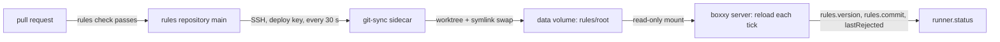

# Rules from the rules repository

- **Status:** draft

The deployed server loads its rules from a private git repository, the rules repository, in place of the copy baked into its image. A merged pull request reaches the live rules within 2 minutes, with no image build and no deploy. A git-sync sidecar in the server's pod fetches `main` into the pod's volume, and the server loads the new commit on its next tick, as [rules](./rules.md#policy-in-git) says it loads any checkout.

## Shape



## Contracts

### The server's rules section

The cloud repo's Pulumi program writes this section into the server's configuration file, with new values for both existing keys.

```json
{
  "rules": {
    "folder": "/rules/root/current",
    "ref": "git-sync"
  }
}
```

- `folder` is git-sync's link, under the sync root that git-sync makes below the mount.
- `ref` is the branch git-sync's root repository moves with `git reset --soft` after each fetch. git-sync keeps no remote-tracking branch, so the default `origin/main` never resolves, and every read fails with `git could not read the rules ref origin/main`.

### The pod

The server's StatefulSet gains one native sidecar: an init container with `restartPolicy: Always`. It is written in the cloud repo's Pulumi style, which `buildBoxxySpec` follows.

```ts
// cloud repo, buildBoxxySpec: the sidecar, the pod's one entry in `initContainers`
const rulesSync: input.core.v1.Container = {
  name: 'rules-sync',
  image: 'registry.k8s.io/git-sync/git-sync:v4.8.0@sha256:a20644562fba94773e594885cb001aadb5a3172175f13ac1215e5b2033c9200e',
  restartPolicy: 'Always', // a native sidecar: it starts before the server and restarts on its own
  args: [
    '--repo=$(RULES_REPO_URL)', // ssh://git@ssh.github.com:443/<owner>/<rules repository>.git
    '--ref=main',
    '--root=/git/root', // git-sync makes this folder, so git-sync owns it
    '--link=current',
    '--period=30s',
    '--depth=1',
    '--max-failures=-1', // retry forever; the old checkout stays published
    '--stale-worktree-timeout=10m', // a server read that spans a swap still finds the old worktree
    '--http-bind=:2020',
    '--http-metrics',
    '--ssh-key-file=/etc/git-secret/ssh',
    '--ssh-known-hosts-file=/etc/git-secret/known_hosts',
  ],
  env: [{ name: 'RULES_REPO_URL', valueFrom: { secretKeyRef: { name: rulesSecret, key: 'url' } } }],
  startupProbe: { exec: { command: ['test', '-d', '/git/root/current'] }, periodSeconds: 2, failureThreshold: 150 },
  volumeMounts: [
    { name: 'data', subPath: 'rules', mountPath: '/git' },
    { name: 'rules-key', mountPath: '/etc/git-secret', readOnly: true },
    { name: 'rules-sync-tmp', mountPath: '/tmp' }, // HOME: git-sync writes its global git config here
  ],
  securityContext: {
    runAsUser: 65_533, // the image's own user: ssh exits with "No user exists for uid" for any uid with no passwd entry
    runAsGroup: 65_533,
    allowPrivilegeEscalation: false,
    readOnlyRootFilesystem: true,
    capabilities: { drop: ['ALL'] },
  },
  resources: { requests: { cpu: '10m', memory: '16Mi' }, limits: { memory: '64Mi' } },
};

// the server container gains one mount and one setting; …existing fields
const serverChanges = {
  volumeMounts: [{ name: 'data', subPath: 'rules', mountPath: '/rules', readOnly: true }],
  env: [
    // git refuses a repository that another uid owns; the sidecar's files belong to 65533
    { name: 'GIT_CONFIG_COUNT', value: '1' },
    { name: 'GIT_CONFIG_KEY_0', value: 'safe.directory' },
    { name: 'GIT_CONFIG_VALUE_0', value: '*' },
  ],
};

// pod volumes; …existing volumes
const volumes = [
  { name: 'rules-key', secret: { secretName: rulesSecret, defaultMode: 0o440, items: [{ key: 'ssh', path: 'ssh' }, { key: 'known_hosts', path: 'known_hosts' }] } },
  { name: 'rules-sync-tmp', emptyDir: { medium: 'Memory', sizeLimit: '4Mi' } },
];
```

The Secret holds three keys: `ssh`, the deploy key's private half; `known_hosts`, GitHub's host keys for `[ssh.github.com]:443`, from GitHub's published meta; `url`, the rules repository's SSH URL. The repository's name is private, so the URL comes from a secret stack config value, as `boxxySpawnRepos` does.

### The server image

The image's base carries `git`, since `readRulesCheckout` runs `git` for a checkout. The distroless `cc-debian12` base has none: `exec: "/usr/bin/git": stat /usr/bin/git: no such file`. `cgr.dev/chainguard/git`, pinned by digest, runs the compiled `boxxy-linux-x64` binary as uid 65532 on a read-only root, and carries git 2.56.1.

```dockerfile
# cloud repo, images/boxxy/Dockerfile; …existing lines, minus the COPY of rules/
ARG BASE_IMAGE # a glibc base with git, pinned by digest
FROM ${BASE_IMAGE}
USER 65532
```

### The rules repository's check

The rules repository's CI loads each pull request with the server's own reader and loader, from `@boxxy/server` on npm, pinned to one exact version in `.github/rules-check/package.json` and its `bun.lock`.

```ts
// .github/rules-check/check-rules.ts, run as: bun check-rules.ts <checkout>
import { loadServerRules, readRulesCheckout } from '@boxxy/server';

const read = await readRulesCheckout({ folder: process.argv[2], ref: 'HEAD' });
// → { kind: 'rejected', reason: 'the rules commit holds rules.yaml, which is not a plain file' }

if (read.kind === 'rejected') {
  console.error(read.reason);
  process.exit(1);
}

const loaded = loadServerRules(read.checkout);
// → { kind: 'rejected', rejections: [{ file: 'rules.yaml', path: 'pipelines.standard[0].maxAttempts', reason: { kind: 'invalid', … } }] }

if (loaded.kind === 'rejected') {
  console.error(JSON.stringify(loaded.rejections, null, 2));
  process.exit(1);
}

console.log(`loads: ${loaded.rules.version}`);
```

```yaml
# .github/workflows/rules-check.yml
name: rules check
on:
  pull_request:
  push:
    branches: [main]
permissions:
  contents: read
jobs:
  rules-check:
    runs-on: ubuntu-latest
    timeout-minutes: 5
    steps:
      - uses: actions/checkout@<sha> # pinned by commit
      - uses: oven-sh/setup-bun@<sha>
        with:
          bun-version-file: .github/rules-check/.bun-version
      - run: bun install --frozen-lockfile
        working-directory: .github/rules-check
      - run: bun check-rules.ts "$GITHUB_WORKSPACE"
        working-directory: .github/rules-check
```

The repository's `.gitignore` lists `node_modules/`, so the install leaves `git status --porcelain` empty, and the reader's uncommitted-changes check passes.

### The ruleset

One ruleset on the default branch, with no bypass actor:

```json
{
  "name": "main",
  "target": "branch",
  "enforcement": "active",
  "conditions": { "ref_name": { "include": ["~DEFAULT_BRANCH"], "exclude": [] } },
  "bypass_actors": [],
  "rules": [
    { "type": "deletion" },
    { "type": "non_fast_forward" },
    { "type": "pull_request", "parameters": { "required_approving_review_count": 0, "dismiss_stale_reviews_on_push": true, "require_last_push_approval": false, "required_review_thread_resolution": true, "require_code_owner_review": false } },
    { "type": "required_status_checks", "parameters": { "strict_required_status_checks_policy": true, "required_status_checks": [{ "context": "rules-check" }] } }
  ]
}
```

### The rules file's header

Once the image holds no rules, `rules.yaml` opens with this comment:

```yaml
# The boxxy server's live rules. A pull request merged to main reaches the server within 2
# minutes: a sidecar in the server's pod fetches main every 30 seconds, and the server loads
# the new commit on its next tick. The rules check loads each pull request with the server's
# own loader, so a file it refuses never merges. When the server still refuses a commit, the
# rules in force stay, and `boxxy runner status` shows the refused commit and each reason.
# They start as the v1 example rules of @boxxy/rules: four phases, two limits, five pools and
# the sleep times. Each recipe runs atc's `boxxy` agent, which loads the boxxy hook plug-in.
```

## Constraints

- The server container never mounts the deploy key. Only the sidecar mounts the `rules-key` volume.
- The server mounts the rules folder read-only.
- The sidecar writes below `rules/` on the volume through the pod's `fsGroup`, 65532, which Kubernetes adds to the groups of every container in the pod.
- The deploy key is a read-only deploy key on the rules repository alone.
- The sync root lives on the server's `data` volume under `rules/`, so a pod restart while GitHub is unreachable starts on the last synced commit. The backup job copies only `*.db`, so the checkout stays out of the backups.
- The server container starts only after the sidecar's startup probe finds the `current` link. On a fresh volume with GitHub unreachable, the pod waits 5 minutes, then the kubelet restarts the sidecar.
- A merged commit reaches `runner.status` within 30 s of fetch period plus one 5 s tick, plus the fetch time.
- When a fetch fails or GitHub is unreachable, git-sync logs `error syncing repo, will retry`, keeps the `current` link, and retries every 30 s. The server goes on loading the same commit, so `runner.status` shows the old `rules.commit` and an unchanged `lastRejected`.
- When the server's read of the checkout fails, the server logs `the rules checkout could not be read; the rules stay`, and `runner.status` changes nothing. A read that spans git-sync's link swap fails this way once, and the next tick reads the new commit.
- When the loader refuses a commit, the rules in force stay, and `runner.status` shows `lastRejected: { commit, rejections }` with the refused commit. The next commit that loads clears it.
- A read that throws inside the tick, such as when `git cat-file` finds an object that git-sync pruned, is logged as `the runner tick failed`, and the next tick tries again.
- Prometheus scrapes the sidecar's `/metrics` on port 2020. An alert fires when `git_sync_count_total` with `status="success"` or `status="noop"` has not grown for 15 minutes, and when the series is missing, as every rule in the cloud repo's [observability](https://github.com/zgeoff/cloud/blob/main/docs/architecture/workloads/observability.md) design does.
- The pin of `@boxxy/server` in the rules check equals the pin in the cloud repo's `package.json`. A rules check older or newer than the live server can pass a file that the live server refuses, and the live server's refusal keeps the rules in force.
- Every commit to `main` gives a new rules version, since the version hashes the commit. A change to the README or to the check's lock file is a new version with the same rules.

## Decisions

- **A git-sync sidecar fetches the rules.** The server never holds a credential and never fetches, as [rules](./rules.md#policy-in-git) designs it. git-sync swaps the checkout with one symlink rename, so the server never reads a half-written tree. Its idle memory measured 6.4 MiB, and the checkout of the current rules takes 308 KiB.
- **The credential is a read-only deploy key, used over SSH on port 443.** GitHub scopes a deploy key to one repository and enforces read-only access, and the key needs no token refresh. The pod already reaches GitHub on port 443.
- **The sync root lives on the existing `data` volume.** A restart keeps the last synced rules when GitHub is down. A StatefulSet's volume claim templates are immutable, so a volume of its own would mean replacing the StatefulSet.
- **`ref` is `git-sync`.** It is the only ref in git-sync's layout that names the fetched `main`. The ancestor check adds no trust here: the ruleset and the sidecar's `--ref=main` keep unmerged commits out.
- **The rules check runs `@boxxy/server` from npm.** The server package already exports `readRulesCheckout` and `loadServerRules`, so the check runs the code the pod runs, and boxxy needs no new command.
- **The server image's base carries git.** The server reads a checkout only through `git`. Reading git objects in TypeScript would duplicate the reader's checks in a second implementation.

## Builder decides

- The Secret's and the stack config value's names.
- The alert's name, its labels and its runbook entry.
- How the cloud repo's image test builds a git-sync layout for its checkout case.
- The rules check's Bun version.

## Out of scope

- Replay CI on the rules repository ([replay CI](./rules.md#replay-ci)). The rules check loads the file; it does not replay facts.
- A `runner.status` field that shows the time of the last fetch. The server cannot see git-sync's result, so the alert is the signal for a stale checkout.

## Open questions

- **Does `runner.status` need a fetch-age field?** The owner settles it. Until then, the alert in the cloud repo is the only signal that the checkout has stopped moving.

## Slices

### 1. A boxxy release with the checkout reader

- **Outcome:** an `@boxxy/server` release holds the three reader commits: the ref check, the read from the checked commit, and `--no-replace-objects`. No release holds them yet.
- **Follows:** [how boxxy ships](./release.md).
- **Needs:** the owner merges the open release pull request.
- **Check:** `git tag --contains` on each of the three commits prints the release's `@boxxy/server` tag.

### 2. The rules repository's check and ruleset

- **Outcome:** the rules repository holds the check, its workflow and `.gitignore`, and the ruleset is active.
- **Follows:** [the rules repository's check](#the-rules-repositorys-check), [the ruleset](#the-ruleset).
- **Needs:** slice 1, for the pinned `@boxxy/server` version.
- **Check:** a pull request that sets `maxAttempts: two` fails `rules-check` and cannot merge; a pull request that adds a prompt comment passes and merges; `git push --force` to `main` is refused.

### 3. The image carries git

- **Outcome:** the cloud repo's boxxy image builds on a base with git, as uid 65532, and pins the `@boxxy/server` release of slice 1.
- **Follows:** [the server image](#the-server-image).
- **Needs:** slice 1.
- **Check:** the cloud repo's image test gains a case that mounts a git-sync layout read-only, owned by uid 65533, at `/rules`, with `ref: git-sync` and the `safe.directory` variables, and the server answers `/healthz`. The existing cases still pass.

### 4. The sidecar

- **Outcome:** the server's pod runs the sidecar, mounts the synced folder read-only, and loads its rules from the rules repository; the deploy key is on the rules repository; the alert exists.
- **Follows:** [the pod](#the-pod), [the server's rules section](#the-servers-rules-section), [constraints](#constraints).
- **Needs:** slices 2 and 3; the owner adds the deploy key to the rules repository and its private half to the deploy's secrets.
- **Check:** the cloud repo's spec tests show the key mounted only in the sidecar and `/rules` read-only in the server. After the deploy, `runner.status` shows `rules.commit` equal to the rules repository's `main`.

### 5. Retire the image's rules

- **Outcome:** the cloud repo loses `deploy/boxxy/rules/`, the image's `COPY` of it, the copy in `scripts/write-boxxy-image-context.sh`, the workflow's `deploy/boxxy/rules/**` path, and the image test's case for `/rules` in the image. Its boxxy architecture doc's "The rules" section says the rules come from the rules repository through the sidecar, and the rules file in the rules repository opens with [the new header](#the-rules-files-header).
- **Follows:** [the rules file's header](#the-rules-files-header).
- **Needs:** slice 4, live.
- **Check:** `git grep -n 'deploy/boxxy/rules'` in the cloud repo prints nothing, and the image test passes.

### 6. The live check

- **Outcome:** a rules change goes live with no deploy, and a refused commit leaves the rules in force.
- **Needs:** slice 5.
- **Check:**
  1. Read `boxxy runner status`, and note `rules.version` and `rules.commit`.
  2. Merge a pull request that adds a comment line to one prompt. Expect within 2 minutes: a new `rules.commit` equal to the merge commit, a new `rules.version`, `lastRejected: null`, and no new image tag in the deploy's stack config.
  3. The owner sets the ruleset's enforcement to `disabled`, merges a pull request that sets `maxAttempts: two`, and sets the enforcement back to `active`. Expect within 2 minutes: `rules.version` and `rules.commit` unchanged from step 2, and `lastRejected.commit` equal to the merge commit.
  4. Revert the commit in a pull request. Expect `lastRejected: null` and a new `rules.version`.
