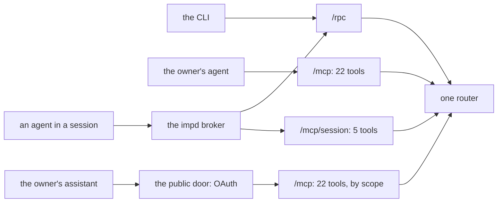

# API and auth in v1

One contract holds every v1 procedure, and the server serves it through four doors: an RPC route for the CLI, an MCP endpoint for the owner's agent on the owner's private network, a second MCP endpoint for the same agent on a public door behind OAuth, and a third MCP endpoint for an agent inside a session. A table beside the contract says who each procedure is for. A worker session reaches the server through a broker that adds a bearer token, and that token may call only the session and hook procedures. Every session and hook call also needs a proven caller, and the server refuses the call when it cannot prove one. [`01-api.ts`](./sketches/v1/edge/01-api.ts) holds the contract, the access table and the auth rules.

## The doors

The contract lives in the package `@boxxy/contract`, and the server builds one router from it on oRPC v2. Section A of [`01-api.ts`](./sketches/v1/edge/01-api.ts) shows the server, the CLI client and an MCP call. [The CLI and the hooks](./v1-cli.md) covers the CLI. The server opens up to three listeners, each on an address that the configuration file sets:

- The owner listener sits on the owner's private network. It serves `/rpc`, `/mcp` and `/healthz`. Its only gate is the network.
- The worker listener is the broker's target. It serves `/rpc` and `/mcp/session`, and answers 401 on any path, unknown ones included, to a request without the worker token.
- The public door serves `/mcp`, the OAuth routes and the sign-in pages, and nothing else. It is off when the configuration has no `publicDoor` section. [The public door](#the-public-door) covers it.

The owner and worker listeners refuse a body over 256 KiB with 413, on every path, `/healthz` included. The public door refuses a body over 256 KiB too. The server counts the bytes as it reads the body, so a streamed body with no length header gets the same limit.

The owner and worker listeners refuse with 403 a request that a browser page sent: one with an `Origin` header, or a `Sec-Fetch-Site` header other than `none`. No caller of those listeners is a page. The owner listener takes no token, so without this check a page on any site could send it a write: a browser sends a `text/plain` POST with no CORS preflight, and a site whose name resolves to the listener's address passes for the same origin. The public door is the one door a browser reaches, for the sign-in pages, and it holds its own checks.

Section B holds the rules of the contract. Four of them shape every procedure:

- A procedure is `<group>.<verb>`, and its MCP tool is `<group>_<verb>`. The tool name is set on the procedure, so a renamed router key never renames a tool.
- A contract schema has no transform. An ID is a plain string on the wire, and the handler brands it.
- An answer that a caller acts on in its normal flow is a member of the output union. A call that names a thing that does not exist throws a typed error.
- The server accepts the previous version of the CLI, because the CLI is in the agent image and an image update can lag a server deploy. A release removes and renames nothing that the previous CLI sends or reads.

## The procedures

Section C of [`01-api.ts`](./sketches/v1/edge/01-api.ts) holds the input, the output and the errors of each procedure, and section D holds the access table. The table below gives who may call each one. "Owner" is a call on the owner's path. "Session" and "hook" are calls through the broker, with the worker token and a proven caller.

| Procedure | Caller | MCP tool | What it does |
| --- | --- | --- | --- |
| `item.file` | owner | owner | files an item; refuses a repo that the server's `spawn.repos` does not name; with `held`, files it [held](./planning.md#held-items) |
| `item.edit` | owner | owner | replaces the given fields of an item |
| `item.close` | owner | owner | closes an item and ends its live attempt; with `of`, as a duplicate |
| `item.retry` | owner | owner | lifts a hold and resets the attempt counts; with `phase`, sets the position |
| `item.wake` | owner | owner | asks boxxy to wake the item's sleeping session |
| `item.release` | owner | owner | releases a held item; refuses an item that is not held |
| `item.note` | owner | owner | appends a note |
| `item.get` | owner | owner | returns one item with its position, notes, attempts, pull requests and revisions |
| `item.list` | owner | owner | lists items, with filters for state (`held` among them), repo, phase, text and label |
| `relation.add` | owner | owner | adds a relation between two items |
| `relation.remove` | owner | owner | removes a relation |
| `plan.defer` | owner | owner | holds an item back from dispatch |
| `plan.undefer` | owner | owner | ends a deferral |
| `plan.expedite` | owner | owner | puts items at the front of their pools |
| `plan.unexpedite` | owner | owner | ends an expedite |
| `runner.status` | owner | owner | returns the limits, the live attempts, the strays, unsent notices and the outbox state |
| `report.cost` | owner | owner | returns what one item cost, from pepys |
| `report.stageTimes` | owner | owner | returns the time of one item in each of seven steps, from pepys |
| `attempt.current` | session | session | returns the attempt of the calling session, with the schema of its close-out |
| `attempt.evidence` | session | session | records one piece of evidence |
| `attempt.closeOut` | session | session | sends the close-out |
| `attempt.listItems` | session | session | lists the items of the session's repo, held items left out, with filters for state, phase, text and label |
| `attempt.getItem` | session | session | returns one item of the session's repo with its notes, relations and pull requests |
| `attempt.bindSession` | hook | none | binds the agent session; reports missing skills |
| `attempt.recordPullRequest` | hook | none | links a pull request to the attempt |
| `runner.pause` | owner | owner | pauses the runner |
| `runner.resume` | owner | owner | resumes the runner |
| `notices.register` | owner | owner | sets the [notice session](./owner-notices.md#the-registered-notice-session) by its atc gateway ID |
| `notices.show` | owner | owner | returns the notice session and when it was set |
| `outbox.retry` | owner | none | clears the park mark of every parked outbox row |
| `rules.dryRun` | owner | none | shows where each open item would stand under a rules file |
| `auth.enroll` | owner | none | mints a one-time link that enrolls a passkey for the public door |
| `auth.addClient` | owner | none | adds a client that may ask for a grant |
| `auth.listClients` | owner | none | lists the clients |
| `auth.removeClient` | owner | none | removes a client and revokes its grants |
| `auth.listGrants` | owner | none | lists the grants |
| `auth.revokeGrant` | owner | none | revokes one grant |

- **22 owner tools.** The owner's agent files and steers work for the owner, so it gets every command on an item, every read, the runner pause and resume, and the two procedures of the notice session. Only the owner's path files a held item, releases one or lists the held items, and a test checks that their access rows say so.
- **5 session tools, on their own endpoint.** A session's tool list holds no command on another item. It reads the other items of its repo, so triage can find a duplicate or an overlap, and [the session's reads](#the-sessions-reads-of-other-items) sets what it sees. A session reports found work in its close-out, where settle dedupes it.
- **10 procedures with no tool.** A hook program calls two of them. The outbox retry acts on the whole outbox and writes no fact that shows who did it, so it stays with a person at the CLI. The rules dry run takes a whole file. Six manage the public door's sign-in, as [the public door](#the-public-door) says.
- **A test keeps the access table in step with the contract.** It fails when a procedure has no entry, when an entry names no procedure, or when a tool has no name.

`attempt.current` tells the agent which of the four close-outs its attempt takes: the phase, the JSON Schema of the body, and the outcome names. It also returns the skills to fetch and the item's notes.

## The paths

Section E of [`01-api.ts`](./sketches/v1/edge/01-api.ts) holds the owner and worker paths, the scope of the worker token and the rule of the proven caller.

| Path | Who | How the server knows |
| --- | --- | --- |
| the owner's path | the owner, the CLI and the owner's agent | the request arrives on the owner listener, with no token |
| the public door | the owner's assistant, from anywhere | the request carries an OAuth access token that the owner approved, and the door serves only `/mcp` |
| the worker path | a session and its hooks | the request arrives through the impd broker, which adds the worker bearer token, on either listener |

A worker session runs in an imp, which reaches the public internet only. The session calls a made-up host, and the broker sends the request to the boxxy server and adds the bearer token. The session never holds the token. It gets the address as `BOXXY_URL` from an atc auth profile.

## The public door

[0018](../../decisions/0018-public-owner-mcp.md) records why the owner's MCP endpoint has a public door. The door runs the OAuth server of [`@boxxy/auth-oauth`](../../../adapters/auth-oauth/README.md), a copy of the one in atc, and serves the owner's 20 tools. It never serves `/rpc` or `/healthz`, and the six `auth` procedures are not tools, so no token reaches them.

The configuration's `publicDoor` section holds the `port`, the `publicURL`, `trustForwardedFrom`, and optionally the `hostname` (loopback by default) and the `authFile`. A door that listens beyond loopback needs an `https` public URL. The `publicURL` is the OAuth issuer, and `<publicURL>/mcp` is the one resource that every token is bound to.

- **Clients.** A client is a public client that the owner adds with `boxxy auth clients add`, with PKCE S256 and no client secret. The door has no dynamic client registration.
- **Authorization.** Each authorization needs a fresh passkey sign-in, then a consent page that lists the scopes the client asked for. Only `read` starts ticked. The owner enrolls a passkey with `boxxy auth enroll`, which prints a one-time link.
- **Tokens.** An access token is opaque, lasts 3600 seconds and is stored hashed. Refresh tokens rotate, and a reused one revokes the client's grants. A code lasts 600 seconds and an owner session 1800 seconds. The signing secret is drawn at each start, so a restart ends the sign-ins in progress. A token's audience must equal `<publicURL>/mcp`.
- **Scopes.** `read` is for a tool that changes nothing: `runner_status`, `item_get`, `item_list`, `report_cost` and `report_stage_times`. `write` is for every tool that changes state, the runner pause and resume among them. The access table holds each tool's scope, and the door registers only a tool that has one. A token without the scope that a tool needs gets 403 with `insufficient_scope`. A request with no valid token gets 401.
- **Request checks.** The door answers 403 to a request whose `Host` is not the public host or the local address, and to a form post or an MCP request whose `Origin` is another one. It writes each sign-in outcome and each refused token to stderr as a JSON line. `trustForwardedFrom` lists the socket peers whose `CF-Connecting-IP` header those lines label `trusted`.
- **State.** The OAuth state lives in an auth database file beside the store, which only its owner can read. `boxxy auth clients` and `boxxy auth grants` manage it through the owner listener.

## The scope of the worker token

The security rule at the top of section E of [`01-api.ts`](./sketches/v1/edge/01-api.ts) sets the scope. A request with the worker bearer token may call only the procedures whose caller is `session` or `hook`. Every owner procedure answers `FORBIDDEN`. A wrong token gets 401 on every procedure.

One root middleware does this from the access table, for the RPC route and both MCP endpoints, and no handler repeats the check. A session therefore cannot close an item, retry one or pause the runner, although the broker carries any path.

The same middleware logs each call that fails with an internal error, which oRPC answers with `INTERNAL_SERVER_ERROR` and status 500. The warning names the procedure, the `item` and `attempt` IDs of the input when it has them, and the error with its chain of causes. It holds no other part of the input, so it never logs a close-out body or a token. A typed error, such as `NOT_FOUND` or `PEPYS_UNAVAILABLE`, logs nothing.

A session reads other items through its own two procedures, `attempt.listItems` and `attempt.getItem`, and never through `item.list` or `item.get`, so the rule above holds with no exception.

A session on a local worker target reaches the server on the owner's path and can call every owner procedure. v1 accepts that, because v1 workers run on the cloud target. Such a session can call no session or hook procedure, because it has no proven caller.

## The session's reads of other items

A session sees the items of one repo: the repo of the item that its current attempt works on. The server finds that attempt from the proven caller, as `attempt.current` does, and never takes the repo from the request. A duplicate or an overlap of an item is work in the same repo, so one repo is enough for triage. An item of another repo stays out of sight, because the session's work, such as a public pull request, could carry that item's text into its own repo.

- **Held items.** A held item is the owner's draft, so a session never sees one: `attempt.listItems` leaves it out and takes no `held` state, and `attempt.getItem` answers `NOT_FOUND`.
- **Refusals.** `attempt.getItem` answers `NOT_FOUND` for an item of another repo, a held item and a missing item alike, so the answer never shows that an item exists. A caller whose session has no attempt gets `refused: no-attempt`, and a request with no proven caller gets 401.
- **What an answer holds.** A listed item has the fields of an `item.list` row. `attempt.getItem` returns the item with its body, its notes, its relations and its pull requests. Both leave out the item's kept session, and `attempt.getItem` leaves out the attempts, the evidence and the revisions, because a kept session and an attempt row hold another session's caller and atc session. `attempt.getItem` also leaves out each relation whose other item the session cannot see, so a relation never shows a held item or an item of another repo.
- **No writes.** Both procedures write nothing, and a session still has no edit, note, retry, hold or release. A test sends each owner command with a proven session's call and checks that the answer is `FORBIDDEN` and that the item is unchanged.

## The proven caller

Every session and hook procedure needs a proven caller, the hook that binds a session included. The bearer token proves only that a call came through the broker. The proof says who sent it.

1. The root middleware asks the `CallerProof` port to prove the request. The port answers with a caller identity, which is an issuer and a subject, or with nothing. With nothing, the server answers 401.
2. The server finds the session in its own store: the atc session whose latest attempt row holds that caller. The runner records the caller on the attempt row from the worker's answer. When the store holds no such session, the answer is `no-attempt`. When two sessions match, the answer is `FORBIDDEN`.
3. The handler gives the core the attempt ID from the request, and the session and the caller from steps 1 and 2. The core accepts the call only when the named attempt is the latest one that the session carries and that attempt's own row holds the proven caller.

No branch skips a step, and a check that the server cannot make is a refusal. The server never takes the session from the request: a session that could name a session could name another one. The core compares two caller identities for equality and knows nothing more about them.

The port has three adapters:

| Adapter | Use |
| --- | --- |
| the imp identity verifier | v1. It reads the `Imp-Identity` header, a short-lived token that the broker signs, and gives the token's issuer and subject. It imports the verifier from `@impz/client/identity`, which impz builds |
| a fake | tests set who the next request is from |
| none | the server uses it when its configuration has no `trustedIssuers` section, which names the trust document folders and the audience, so every session and hook call is refused |

Section F of [`01-api.ts`](./sketches/v1/edge/01-api.ts) says what the server checks on the token. The broker removes any such header that a guest sends and adds its own.

The package `@boxxy/caller-proof-imp` holds the verifier adapter, `impIdentityCallerProof({ issuers, audience, clock })`. It reads the `imp-identity` header and gives the token's issuer, and the machine ID as the subject: the same ID that atc reports for the session's host, which the runner stores as the caller. The imp's name is never the subject.

The adapter reads no file: the server reads every regular file in the folders of `trustedIssuers.folders`, in name order, parses each as JSON, and passes the list with `trustedIssuers.audience`. The server follows a symlink to its target and skips sub-folders and names that start with `..`, so a Kubernetes ConfigMap volume, which shows each key as a symlink into a hidden `..data` folder, loads each document once.

These refuse the start: a missing folder, a symlink that points nowhere, a file that is not JSON, and folders that together hold no document. A bad document, or two documents for one issuer, makes the adapter throw, so the server does not start either. With an empty audience, the adapter proves no request. Only this adapter and the atc worker adapter name the imp or its token, apart from the one place in the server that builds the adapter; every other package sees an issuer and a subject.

The adapter does not call the library's session check, `checkSessionImp`. That check compares the issuer and the machine ID of the caller with the host of a session. The server already makes the same comparison in step 2, when it finds the session by the caller, and the core makes it again on the attempt's own caller in step 3. A third check would add nothing, and a second definition of "the same machine" could drift from the store's.

The proven caller depends on two things outside this repo: an impz broker that signs each call with the identity token, and a broker rule that signs calls to the boxxy host. atc reports the VM host of a session from release 7.13.0. Until both are in place, the server refuses every session and hook call. [Open for the builder](./v1-open.md#needs-work-outside-this-repo) lists them.

A test walks every procedure three ways: with the worker token against every owner procedure, with a missing or wrong proof against every session and hook procedure, and with one session's proof and another session's attempt ID. Each case must leave every row as it was. Section D of [`01-api.ts`](./sketches/v1/edge/01-api.ts) lists the cases.
