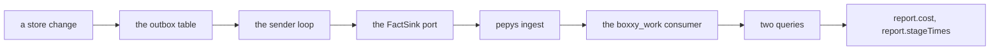

# Facts and pepys in v1

Every store change writes its facts to an outbox table in the same transaction. A sender loop sends the unsent rows to pepys in order, and a repeat changes nothing there, because each row keeps one event ID. In pepys, the package `@boxxy/pepys` builds three tables and three link types from the facts, and answers two queries: what an item cost to land, and how long it spent in each step. boxxy reads those two queries for two reports and reads nothing else from pepys, so every decision of boxxy is the same when pepys is down, behind or absent.

## The path of a fact

## The outbox

Section B of [`02-outbox.ts`](./sketches/v1/edge/02-outbox.ts) holds the table and the write rule.

- **One write path.** The store's apply function is the only code that inserts an outbox row. It writes every row and every fact of a change in one transaction, or none ([decision 0013](../../decisions/0013-one-write-path-per-fact.md)). A state in the store therefore has its fact in the outbox.
- **The row's sequence number is the store version**, and its fact ID is a UUID version 7 that the caller made. Every send of the row carries that ID as the event ID.
- **No store change is refused for its size.** The API bounds every string and list, the close-out parser caps its lists and rejects a close-out over 120,000 bytes, and the sender parks a row that is still over the limit of one fact.
- **Nothing is dropped or capped.** Sent rows stay, because the sequence number is the store version and close-outs cite fact IDs.

## The sender

Section D of [`02-outbox.ts`](./sketches/v1/edge/02-outbox.ts) holds the loop and the table of answers. The sender runs as its own loop, apart from the runner tick, because a send can wait 10 seconds and a tick must not.

A batch is the longest run of unsent rows, in order, that holds 100 facts or fewer and fits the byte budget of one batch. One batch is in flight at a time.

| Answer from pepys | What the sender does |
| --- | --- |
| stored | marks the batch sent and sends the next one at once |
| 502, 503 or 504, a timeout, no connection | keeps the batch, waits with a backoff from 1 second to 5 minutes, and sends the same rows again; never gives up |
| the batch is refused with 400, 413 or 422, and it holds more than one row | splits the batch in halves and sends each, to find the bad row |
| the batch is refused with 400, 413 or 422, and it holds one row | parks the row with the reason, and goes on |
| any other refusal, such as a wrong secret, a missing route, or a 500 | parks nothing, reports `blocked`, and tries again every 5 minutes |

Ingest answers 500 when a source throws, when it has no blob store, or when its log refuses an append. No split of the batch fixes those, so the sink reports a 500 as a refusal of the sink.

After 25 rows parked in a row with none stored between, the sender stops parking and reports `blocked`: that pattern means the boxxy server and the deployed `@boxxy/pepys` differ in version. `boxxy outbox retry` clears every park mark.

The `FactSink` port has three forms (section C): the pepys adapter, which uses the kit's batch sender and holds no HTTP code of its own; a fake for tests; and no sink at all. With no sink, no loop runs and the rows stay unsent, so the whole history goes out when the owner adds pepys later. One contract suite runs against the fake and the pepys adapter.

`runner.status` shows the outbox state: the count of unsent and parked rows, the age of the oldest unsent row, the last error and the next try (section E). Nothing pushes an alert in v1.

## The fact catalog

[`04-facts.ts`](./sketches/v1/core/04-facts.ts) holds the 27 fact types on the stream `facts.boxxy.work`, each with its payload and its writer.

| Group | Types |
| --- | --- |
| items | `boxxy.item.filed`, `.noted`, `.edited`, `.closed` |
| relations and levers | `boxxy.relation.added`, `.removed`, `boxxy.lever.recorded` |
| the claim | `boxxy.attempt.claimed`, `boxxy.decision.recorded` |
| the session | `boxxy.attempt.started`, `.spawn_unanswered`, `.reconciled`, `.session_bound` |
| sleep and wake | `boxxy.attempt.slept`, `.wake_requested`, `.woken`, `.resumed` |
| the end | `boxxy.attempt.closed_out`, `.timed_out`, `.turn_ended`, `.settled`, `boxxy.proposal.recorded` |
| evidence and pull requests | `boxxy.evidence.recorded`, `boxxy.pull_request.linked`, `.merged`, `.closed`, `boxxy.commit.linked` |

- **Every fact names an item as its entity**, and a fact about an attempt carries the attempt in its payload. One scope in pepys then holds every fact of one item, so the consumer rebuilds an item from one read, in any arrival order. A relation fact names its source item.
- **The fact ID on the wire** is `event:boxxy:<event>`, where the event is the outbox row's fact ID.
- **A runner pause or resume writes no fact**, because it names no item.
- **Three settle causes have no fact of their own.** `stalled`, `skill-missing` and a capacity refusal show on the `settled` fact.
- **The schemas are declared once**, in `@boxxy/model`. The store checks each fact against them. The wire schema in `@boxxy/pepys` is the model's schema plus the store version, which the sink adds.
- **The caller.** The `started`, `reconciled` and `resumed` facts carry the proven caller of the attempt's session. pepys counts a telemetry row for an attempt only when the row's proven origin is that caller.
- **Pull requests.** boxxy stores GitHub's own ID of each pull request and sends it as a decimal string, because pepys builds its entity ID from it. The hook reads the forge before it writes. When the forge does not answer, the hook writes nothing, and the pull request watch links the pull request within 5 minutes ([the watch](./v1-lifecycle.md#the-pull-request-watch)).
- **A merge.** boxxy records its own sighting of a merge, because the item's derived state reads it and boxxy must dispatch while pepys is down. pepys takes the merge time from the GitHub tables.

Section C of [`04-facts.ts`](./sketches/v1/core/04-facts.ts) lists what the build changes in the slice 1 catalog.

## The `boxxy_work` package

[`01-package.ts`](./sketches/v1/pepys-package/01-package.ts) holds the package `@boxxy/pepys`, at `packages/pepys`. It is one pepys plug-in: the source with its fact family, the consumer `boxxy_work`, three link types and two queries. The pepys deployment in the cloud repo imports the plug-in, and the boxxy server imports the source, the sink and the reader by subpath, which load no GitHub or telemetry plug-in code.

The consumer runs in scope mode, with one scope per item. From an item's facts it writes:

| Table | One row per | From |
| --- | --- | --- |
| `boxxy_item` | item | the filed, edited and closed facts |
| `boxxy_attempt` | claimed attempt | the claim, session, sleep, close-out and settle facts |
| `boxxy_attempt_session` | pair of attempt and telemetry session | the session facts |

| Link | From | To |
| --- | --- | --- |
| `ran_in` | an attempt | the telemetry session, by the atc session ID, or by the agent session ID as the fallback |
| `produced` | an attempt | the GitHub pull request, by GitHub's own ID |
| `attempt_of` | an attempt | its item |

- The consumer reads 13 of the 27 fact types and passes over the others.
- An attempt with no claimed fact in the scope yields no row and no link. The fact marks the scope dirty when it arrives, and the next run writes them.
- The consumer's module does no date arithmetic. It copies each fact's time, and stores sleep as a list of stretches that the query adds up.
- The entry file of the consumer compiles with scriptc, so it imports generated glue only. The package commits the glue, and a check in CI fails when the glue is stale.
- `@pepys/kit` and zod are peer dependencies, so that the deployment holds one copy of each. The package imports no kysely: each query runs on the kit's query database.

[`lookups.md`](./sketches/v1/pepys-package/lookups.md) records the lookups behind the two join keys.

## The two queries

[`02-queries.ts`](./sketches/v1/pepys-package/02-queries.ts) holds both queries and their output schemas, which are declared once in `@boxxy/model`. Each query takes one item.

The deployment builds the plug-in with `buildBoxxyPlugin`, and passes it the GitHub and telemetry consumers that the queries read, with the GitHub plug-in's delivery module as `delivery`: its consumers, `selectPullRequestDelivery` as `select` and `parsePullRequestDeliveries` as `parse`. `@boxxy/pepys` types the module by its shape, so it has no run-time dependency on the GitHub plug-in and imports no kysely. The stage-time query finds the item's pull requests itself, through the `produced` links of its attempts, and calls `select` only when it finds at least one. The type takes the module as the plug-in exports it, so no deployment writes a delivery read of its own. `createRealPepys` in `@boxxy/pepys/test-utils` passes the module this way. The package's types name the columns that each query reads, so a consumer with fewer columns fails the type check.

### `boxxy_cost_to_land`

The query returns one line per phase, rework flag, product, model and cost basis, with requests, four token counts and the cost, and totals.

- **Landed** means that a pull request which an attempt of the item produced has merged in the GitHub table. The time is the earliest such merge. An item that has not landed returns its cost so far.
- **Every attempt counts**, whatever its state or outcome, also one after the merge. One exception: an attempt that failed with `no-capacity` ran no session and gets no line.
- **Rework** is an attempt whose round is above 1.
- **Each telemetry row counts for one attempt.** The row's session and its proven origin must match the attempt's session and caller. When one session carried several attempts, each attempt owns the stretch from the time it was bound to the session until the next attempt was bound. A kept session is such a case.
- **An unknown cost is null, never 0.** A product that reports cost per turn gets its own lines.

Each query reads plain rows of its tables with one statement per table, and a builder in TypeScript does the stretches, the caller match and the sums. The statements need no window function, no `julianday` and no common table expression from the store. An input that names no boxxy item answers as an item with no rows.

### `boxxy_stage_time`

The query returns seven steps: triage, design, build, review, merge, release and deploy. It also returns the rework count and minutes, the wait for review, and the time the item's attempts slept. A step that has not happened has null minutes.

- The four phases come from the item's attempts. A phase's minutes are the sum over its settled attempts of the time from claim to end, less the attempt's sleep.
- Merge, release and deploy come from the GitHub plug-in's delivery module, reached through the `produced` link. boxxy starts none of them.
- Merge starts at the latest end of a review that passed. A review that settled `unsettleable` starts no merge step, because boxxy could not read whether it passed, so such an item has null merge minutes after its pull request merged. Release starts at the merge, and deploy at the release. An item with two pull requests takes the earliest time of each step.
- An attempt that failed with `no-capacity` is in no measure. Every other attempt counts, a `usage-limit` one too.
- The rework count is the number of reviews that asked for changes. The highest round less one is a different number.
- The wait for review of a build that was built runs from its end to the claim of the first review claimed after that end. The claim times give the order, because an attempt's number counts within its own phase.
- An open sleep counts 0 minutes, because the query reads no clock.
- The query names three outcome names of the phase kinds. A phase kind that renames one must change the query.

[`04-test.ts`](./sketches/v1/pepys-package/04-test.ts) holds the tests of the consumer and both queries on the kit's test store.

## What boxxy reads from pepys

[`03-readers.ts`](./sketches/v1/pepys-package/03-readers.ts) holds the `PepysReader` port, its pepys adapter and its fake. The port has two methods, one for each query.

- `report.cost` and `report.stageTimes` return the query's output, whole, plus `behind`: the count of that item's facts still in the outbox.
- An item that pepys holds no fact of yet gives an empty value. With pepys down, both reports answer a typed error, and `item.get` still shows each attempt's times.
- The adapter never throws and never retries. An answer that its schema refuses reads as unavailable.
- A lint rule keeps `@boxxy/pepys` out of the model, planning, dispatch, close-out and rules packages.

Section F of [`02-outbox.ts`](./sketches/v1/edge/02-outbox.ts) lists what boxxy never reads from pepys: no decision, no claim, no position, no merge state, and no check that a fact arrived.
