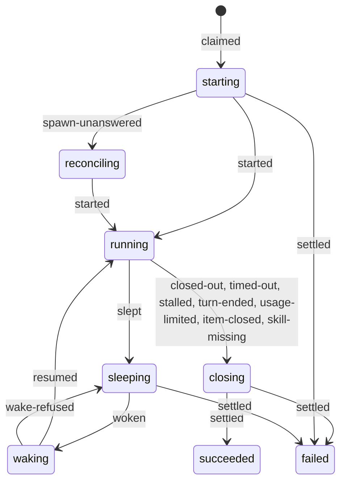

# Attempt lifecycle in v1

An attempt has eight states, and one module builds every write to it. On each tick the runner reads the session of every live attempt, and one pure table maps the reading and the attempt's state to one action. A reading of a running session never ends an attempt: an attempt ends when its session is suspended, ended or absent. boxxy stops a session before it settles the attempt, so a seat stays held until the session has stopped. [`03-flow.ts`](./sketches/v1/core/03-flow.ts) holds every table this doc names, and [`02-types.ts`](./sketches/v1/core/02-types.ts) holds the types.

## The states

The diagram shows the common moves. Section A of [`03-flow.ts`](./sketches/v1/core/03-flow.ts) holds the full table: each event, the states it is allowed from, the state it leads to, and the rows and facts it writes.

- **One writer.** The attempt-change builder in `modules/dispatch/src/attempts/` builds every write to the attempts table, to the attempt sessions table, and every seat write. A caller passes an event and applies the change it gets back. A test fails when another file writes to the attempts table.
- **The table is an XState machine**, `xstate` pinned exactly at `6.0.0-beta.2`. The builder calls the pure `transition` function and creates no actor. The row stores the state value and the context, never a snapshot. Section A lists the rules of the machine.
- **Races.** Each change of a live attempt names the lease generation and the hold generation it was built under. It expects the state and every other column that the machine's guards read, as the builder read them, so two moves that keep the state also race. Of two callers that race, the store applies one change and refuses the other. The caller drops a refused change and reads again on the next tick.
- **Seats.** An attempt takes its seats at the claim, releases them at the sleep, takes them again at the wake before the session resumes, and releases them at the settle. An attempt in `closing` keeps what it held.
- **The lease.** The attempt holds its item-phase lease from the claim to the settle, through every sleep, so no second attempt starts on the item.

## The reconcile table

Section B of [`03-flow.ts`](./sketches/v1/core/03-flow.ts) holds the table. The runner reads one session per live attempt on each tick, and the table gives one action.

| Reading | starting, reconciling | running | sleeping | waking | closing |
| --- | --- | --- | --- | --- | --- |
| running | move to running | see the bounds after this table | request the wake; 10 seconds later, wake over the cap | move to running | stop, or settle by the give-up rule |
| suspended | sleep | sleep | nothing | resume | settle |
| ended | settle | settle, or sleep when boxxy asked for the stop | nothing | resume | settle |
| absent | send the spawn again | settle as `session-lost` | settle as `session-lost` | settle as `session-lost` | settle |

A running attempt whose session runs stays as it is only inside a bound that the rules set. boxxy checks the bounds in the order of this table and acts on the first one that is past:

| Mode | Bound | Past the bound |
| --- | --- | --- |
| both | the session reports that the account hit its usage limit | boxxy stops the session and settles the attempt as `usage-limit` |
| agent | the step's time limit, counted from the start or the latest wake | boxxy stops the session and settles the attempt as `timed-out` |
| agent | the turn ended with no close-out | boxxy stops the session and settles the attempt as `closeout-missing` |
| both | the session waits for the owner for `afterIdleMinutes` (30): it asks for input, or an attended turn ended | sleep |
| attended | the session shows no activity at all for `afterQuietMinutes` (60) | sleep |
| agent | 30 minutes with no activity | boxxy stops the session and settles the attempt as `stalled` |
| attended | the owner has not attached for `afterUnattendedMinutes` (240), while the agent stays active | sleep, with no idle check |

An agent-mode session that asks for input and then shows no activity meets two bounds at once: the idle sleep and the stall both fall due 30 minutes after its last activity. The sleep wins, because with the stall first an agent-mode session could never sleep idle. A session with no agent session ID cannot sleep, so the stall rule stops it.

One case has no bound, on purpose: an attended session that the owner attaches to again inside every 240 minutes.

Four rules decide the hard cells:

- atc's state `done` means that the turn ended and the session waits for a prompt. It reads as running, never as an end.
- An `ended` reading on a sleeping attempt does nothing, because a local session that boxxy put to sleep reads as ended. A session that truly ended while asleep fails at the wake as `resume-lost`.
- A close-out beats a sleep in progress. A close-out that lands between the sleep request and the stop moves the attempt to `closing`.
- boxxy puts no attempt to sleep before atc reports an agent session ID for it, because atc cannot revive a session that stopped before atc captured the ID.

The time limits that the rules file does not hold are in `timeouts`, in `modules/dispatch/src/timeouts.ts`: 10 minutes for a lost spawn, a lost resume and a session that does not stop, 60 seconds of grace before a stop, 10 seconds before a revived session wakes over the cap, 30 minutes for a stall, 60 seconds of capacity backoff, 24 hours at most of usage-limit backoff, and 24 hours for a stray session, a kept session and a failed attempt's session.

## Sleep and wake

Section C of [`03-flow.ts`](./sketches/v1/core/03-flow.ts) holds the rules.

boxxy learns that a session waits for the owner from the reading alone: the session asks for input, an attended turn ended, a woken session shows no activity, or an attended session went quiet. The sleep has three steps, and the seats go last:

1. boxxy marks the attempt, in one change, before any worker call.
2. boxxy asks the worker to suspend the session. The adapter refuses when the session shows newer activity.
3. boxxy records the sleep and releases the seats. A refusal clears the mark.

A crash, or an unknown answer from the worker, can stop the sleep between two steps. The next reading finishes it:

- **After step 1.** The attempt keeps the mark and its seats. A running reading clears the mark, and the next tick checks the bounds again. A suspended or ended reading records the sleep.
- **After step 2.** The session reads as suspended or ended, and boxxy records the sleep and releases the seats.

The wake is one mechanism. Every source ends in a wake request, and nothing else wakes an attempt:

- the owner runs `boxxy item wake <item>`;
- a reading shows the session running while the attempt sleeps, because the owner revived it in atc;
- a reading shows that the host slept with no request.

`decide` puts a wake before any new work. The claim takes the seats, and only then does boxxy resume the session. One case leaves that order: the owner revived the session and no seat came free in 10 seconds, two ticks of the runner. The attempt then wakes over the cap, the limit counts the seat, and boxxy starts no new work under that limit until the count is at or under the maximum. boxxy stops no session that the owner revived.

## Close-outs and their limits

Section D of [`03-flow.ts`](./sketches/v1/core/03-flow.ts) holds the table of cases. One procedure, `attempt.closeOut`, takes the close-out of every phase. The phase comes from the attempt row, and that phase kind's parser reports every problem at once.

| Case | Answer |
| --- | --- |
| the call is not for the current attempt of the calling session | refused, `not-current`; checked first |
| the first valid close-out of a live attempt | recorded; the attempt moves to `closing` |
| an invalid close-out | rejected, with every problem; the attempt stays open |
| a valid close-out over 120,000 bytes as stored | rejected, `too-large`; the attempt stays open |
| the same body again | recorded, as a repeat; nothing is written |
| another body after a valid close-out | refused, `already-closed-out` |
| a session boxxy never started, or one with no proven caller | refused, `no-attempt` |

- **The first valid close-out is final.** A later call cannot replace it.
- **A call reaches the attempt it names, and only when that attempt is the current one of the calling session.** The current attempt is the latest attempt that the session carries, and its own row must hold the proven caller. The session reads its attempt ID with `attempt.current`. [API and auth](./v1-api-and-auth.md#the-proven-caller) has the rule in full.
- **The size limit is on the close-out as stored**, so an accepted close-out always fits one outbox item. `closeOutLimits` in [`02-types.ts`](./sketches/v1/core/02-types.ts) holds the numbers and the reason for each.

## Closing, the stop and the give-up rule

Section D of [`03-flow.ts`](./sketches/v1/core/03-flow.ts) holds the stop, the give-up rule and the table of what `item.close` does to each attempt state. boxxy moves an attempt to `closing` when it has decided that the attempt is over and the session still runs. The runner then stops the session, and the attempt settles when the session reads as suspended, ended or absent.

- **Grace.** boxxy sends no stop while the agent is inside a turn, until 60 seconds after the move to `closing`, so the agent can tell the owner that the close-out went in. A close caused by `item.close` gets no grace.
- **The give-up rule.** An attempt whose session still runs 10 minutes after the move to `closing` settles anyway, by its cause, and releases its seats and its lease. boxxy marks it as a stray, keeps sending the stop for 24 hours, and lists it in `runner.status`. A stop can fail for that long on a host that another owner keeps awake.
- **An item closed while its spawn is in flight.** The attempt stays in `closing` and sends no second spawn. When the session appears, boxxy stops it and settles. When none appears in 10 minutes, the attempt settles as a stray, and the runner looks for the session by its spawn name for 24 hours.

`item.close` ends the item's live attempts in the same store change as the close. A sleeping attempt settles at once as failed, with the reason `item-closed` and no wake. Any other live attempt moves to `closing`.

## Settle

Section D of [`03-flow.ts`](./sketches/v1/core/03-flow.ts) holds the settle function, step by step. Settle runs in one store change. It writes the state, the failure, the outcome, the end time, the seat release, the lease release, the rows and facts of the effects, and the `settled` fact. It stores no position.

The phase kind returns every effect of the outcome, and settle builds one plan of rows and facts for each. When the item holds after the settle, settle withholds each effect that changes the item: the close, a relation, and a new kind, field or acceptance. It still files new items and records friction proposals. The `settled` fact lists each withheld effect with its reason, and settle writes the hold's notice row in the same lock, after the settle change.

Settle never throws on stored data. The phase kind loaded now can differ from the one that accepted the close-out, so the settle rule of the phase kind runs inside a catch. When it throws, or returns an outcome that its kind does not list, the attempt settles as failed with `closeout-unsettleable` and the fixed outcome `unsettleable`. A name that the phase code returned goes to its own field, so that no rules file can give it an edge. The item then holds, and `boxxy item retry <item> --phase <phase>` moves it on.

An attempt fails with one of ten forced failures, or with `closeout-missing` or `closeout-unsettleable`. A design or build close-out that is `blocked` or `abandoned` also fails the attempt, with that outcome as the failure ([close-outs](./close-outs.md#the-v1-phase-kinds)).

| Failure | Cause | Counts against `maxAttempts` |
| --- | --- | --- |
| `spawn-refused` | the worker refused the spawn for a cause other than capacity | yes |
| `no-capacity` | the worker target has no free machine | no |
| `spawn-lost` | no session appeared 10 minutes after the claim | yes |
| `session-lost` | the session is absent | yes |
| `resume-lost` | the session did not run 10 minutes after the wake | yes |
| `timed-out` | an agent-mode attempt passed its step's time limit | yes |
| `stalled` | an agent-mode session showed no activity for 30 minutes | yes |
| `skill-missing` | a skill the recipe lists was not there after the fetch | yes |
| `item-closed` | the owner closed the item | the item is archived |
| `usage-limit` | the session hit the account's usage limit | no |

## The kept session

Section H of [`03-flow.ts`](./sketches/v1/core/03-flow.ts) holds the table. One rules line turns it on: the `changes-requested` edge carries `resume: true`.

1. A build attempt settles `built`. boxxy stops its session and keeps it, and records the kept session on the item.
2. The review runs in its own session.
3. When the review asks for changes, the claim of the next build attempt wakes the kept session and sends the review's findings as a message. The new attempt binds to the same atc session.
4. When the wake fails or the session is gone, boxxy spawns a fresh session, and the `started` fact says so. Either way the item's kept session is cleared when the new attempt starts. A wake refused for capacity settles the attempt as `no-capacity`, and a wake with no answer goes to the reconcile table; both keep the kept session.

A kept session holds no seat while it sleeps. It is state of the item, outside the attempt machine: the first attempt has succeeded, and the second starts with the plain claim and start events. One atc session then carries two attempts, so the session ID alone does not say which attempt a call is for. The resumed session reads `attempt.current` again and gets the new attempt's ID. boxxy forgets a kept session when the item is done or closed, and 24 hours after it was kept, unless a live attempt runs on it.

## Cleanup

Section H of [`03-flow.ts`](./sketches/v1/core/03-flow.ts) holds the cleanup rule. The runner tick removes the session of a settled attempt that is not kept:

| Attempt | What boxxy does |
| --- | --- |
| succeeded | forgets the stopped session at once; on an imp target the machine is destroyed |
| failed | keeps the stopped session for 24 hours, for diagnosis, then forgets it |

boxxy tries a failed forget again on the next tick, and never forgets a stray session before it has stopped. The attempt row records the forget, through the attempt move `session-forgotten`. No fact does, because no fact type for cleanup exists.

## Capacity and the usage limit

Section F of [`03-flow.ts`](./sketches/v1/core/03-flow.ts) holds the tables for a start and for a wake.

- **A spawn refused for capacity** settles the attempt as failed with `no-capacity`. The item stays ready, and the pool backs off for 60 seconds.
- **A wake refused for capacity** is no failure. The attempt sleeps again and keeps its wake request, and the pool backs off for 60 seconds.
- **The backoff holds back start picks and wake picks.** Without the hold on wake picks, the claim loop of one tick picks the refused wake again and never reaches the readings. The mark lives in the runner's memory, per pool. A restart forgets it, and the next claim finds out again.
- **The claim loop has two more guards.** No item is claimed twice in one tick, and an error in the loop ends the loop and not the tick.
- **The usage limit.** boxxy learns of the limit from the reading: the worker reports the time at which the account's limit resets. A running attempt with that reading moves to `closing` and settles as failed with `usage-limit`. Its pool backs off until the reset time, for 24 hours at most. When atc gives no reset time, the worker adapter reports the time it saw the limit, and a reset time that is not in the future holds the pool for the whole 24 hours. The reading decides, because the runner reads every live session on every tick. A session at the limit sends no close-out, and telemetry reaches boxxy only through pepys. What atc reports for such a session is [not checked](./v1-open.md#the-lifecycle).
- **Trusted folder.** The atc worker adapter checks, before each spawn, that the agent trusts the worker folder. It refuses the spawn otherwise, because a session in an untrusted folder waits at a dialog and runs no turn.
