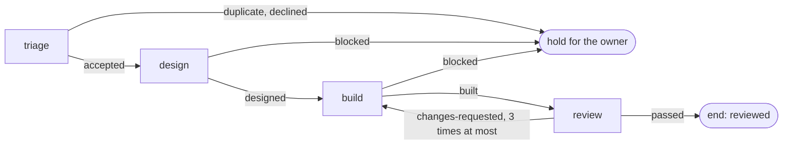

# boxxy v1

v1 takes an item of work through four phases: triage, design, build and review. Each phase runs as one attempt in a worker session, and a review that asks for changes sends the item back to build. boxxy records every change as a fact, sends the facts to pepys, and reports what each item cost and how long it spent in each step. Build v1 from this doc, the four docs it links, and the sketches in [`sketches/v1/`](./sketches/v1/). v1 builds on the [slice 1](./slice-1.md) code, and where a v1 doc and the slice 1 doc differ, the v1 doc stands. [Decision 0017](../../decisions/0017-v1-scope.md) records the scope.

## The v1 docs

| Doc | Holds |
| --- | --- |
| this doc | the pipeline and its rules, design mode, limits, recipes, the ledger, notices, the review |
| [Attempt lifecycle](./v1-lifecycle.md) | the attempt states, the reconcile table, sleep and wake, close-outs, settle, the kept session, cleanup, capacity |
| [API and auth](./v1-api-and-auth.md) | the 32 procedures and who may call each, the doors, the public door, the worker token, the proven caller |
| [Facts and pepys](./v1-facts-and-pepys.md) | the outbox, the 27 fact types, the `boxxy_work` package, the two queries and the two reports |
| [Open for the builder](./v1-open.md) | everything the sketches mark as not checked, assumed, not decided or not designed |
| [Work list](./v1-work-list.md) | the build as numbered slices, in dependency order |
| [Folder layout](./layout-folders.md) | the folders inside each package that v1 adds or grows |

## The sketches, and which one stands

The sketches are TypeScript files that show shapes, tables and call sites. They are not compiled, and no check in the repo reads them. Build to them. Where a v1 doc and a v1 sketch differ, the sketch stands, and you fix the doc. Change a sketch in the same commit as the code when the code needs another shape or rule.

| Folder | Files | Owns |
| --- | --- | --- |
| [`core/`](./sketches/v1/core/) | `01-usage.ts`, `02-types.ts`, `03-flow.ts`, `04-facts.ts` | the engine, the attempt lifecycle, the fact types, their payloads and the entity rule |
| [`edge/`](./sketches/v1/edge/) | `01-api.ts`, `02-outbox.ts` | the procedure names, the access table, auth, the outbox sender, the reader port |
| [`pepys-package/`](./sketches/v1/pepys-package/) | `01-package.ts` to `04-test.ts`, `lookups.md` | the columns of the pepys tables, the link types, the two queries |

Where two sketches differ, the folder that owns the subject stands. One case is known: section D of [`04-facts.ts`](./sketches/v1/core/04-facts.ts) lists table columns. The columns in [`01-package.ts`](./sketches/v1/pepys-package/01-package.ts) stand.

A sketch names the file that holds each part. Where that path and the [folder layout](./layout-folders.md) differ, the folder layout stands.

## The pipeline

A pipeline is a list of steps in the rules file. Each step names a phase, and maps every outcome of that phase to an edge. Part 1 of [`01-usage.ts`](./sketches/v1/core/01-usage.ts) holds the v1 rules file, and section E of [`03-flow.ts`](./sketches/v1/core/03-flow.ts) holds the engine.

| Phase | Outcomes and their edges | Attempts in a row | Time limit |
| --- | --- | --- | --- |
| triage | `accepted`: next. `duplicate`, `declined`: hold | 2 | 20 minutes |
| design | `designed`: next. `blocked`: hold. `abandoned`: again | 2 | 90 minutes |
| build | `built`: next. `blocked`: hold. `abandoned`: again | 2 | 180 minutes |
| review | `passed`: end. `changes-requested`: back to build, 3 times at most, on the kept session | 2 | 45 minutes |

An edge is one of five kinds:

- `next` moves the item to the step after this one.
- `again` runs the same phase again, and counts against the step's `maxAttempts`.
- `{ to, max, resume }` sends the item back to an earlier phase and raises the item's round. A backward edge needs `max`. `resume: true` keeps the session of the target phase for the rework ([the kept session](./v1-lifecycle.md#the-kept-session)).
- `{ end }` ends the pipeline with a reason.
- `{ hold }` holds the item for the owner with a reason. boxxy then withholds every effect of the close-out that changes an item: the close, the relations, and the kind, design mode and acceptance that triage sets. Friction still records.

### Rules of the engine

- **boxxy stores no position.** The engine folds over the item's settled attempts and its retry levers with the rules loaded now, on every read. A settled attempt stores its outcome and its round.
- **Every outcome has an edge.** A phase kind lists its outcome names once. The loader refuses a step that leaves one out or names one the phase kind lacks, and the type of the phase kind's settle answer comes from the same list.
- **Two outcomes belong to the engine.** `lost` means the attempt ended with no valid close-out or with a forced failure, and it acts as `again`. `unsettleable` means the phase code could not settle a stored close-out. A phase kind may list neither.
- **A stored outcome with no edge holds the item**, with the reason `outcome not in rules`. It never reads as `next`.
- **The round belongs to the item.** It starts at 1 and rises each time a backward edge or `item retry --phase` sends the item back. The review of a reworked build has the build's round.
- **Three holds come from the engine:** `attempts used up`, `rounds used up` and `outcome not in rules`. The loader refuses a `{ hold }` edge that names one of them, so a report can tell an engine hold from a rules hold. `boxxy item retry <item>` lifts a hold and resets both counts. With `--phase` it also sets the position, which is the only way back to build after a passed review.
- **Two failures never count.** An attempt that failed with `no-capacity` or `usage-limit` moves no item and counts against no limit of attempts.

The loader refuses a rules file for each reason in `LoadRejectionReason` in [`02-types.ts`](./sketches/v1/core/02-types.ts). The reasons that v1 adds cover an unmapped or unknown outcome, a backward edge with no `max`, a step with no time limit, sleep times out of order, a phase kind that lists an engine outcome, a recipe with skills and no pin, `resume` on a forward edge, and a hold edge that names an engine hold. An edge back to its own step is a backward edge. The server passes the loader the phase kinds, as it passes the concepts, and [the rules version](./rules.md#the-rules-version) covers each phase kind. [`modules/rules/example/`](../../../modules/rules/example/) holds the v1 rules file of part 1 with its prompts, and a test loads it.

### A rules change

A rules change never touches a live attempt: the attempt settles by the phase kind loaded when it settles. An item between attempts stands where the new rules put it, so a changed edge moves it, a raised limit frees a held item, and a lowered limit can hold one. The table at the end of section E of [`03-flow.ts`](./sketches/v1/core/03-flow.ts) lists each case.

Run `boxxy rules dry-run <file>` before a rules change merges. It loads the file and prints, for each open item, the position the item has and the position it would get. It writes nothing.

## Design mode

Section F of [`03-flow.ts`](./sketches/v1/core/03-flow.ts) holds the rule for an attended session. An item's design runs in one of two modes, `agent` or `attended`. The person who files the item or its triage attempt sets `designMode`, and an item that sets none runs in agent mode. In attended mode the owner works with the agent in the session, and the agent sends its close-out when the owner is done.

boxxy starts an attended design session by one rule: `decide` picked the item, and both limits have a free seat. No lever and no "owner is ready" signal exists. An owner who is away costs one session start for each attended item: the session asks its first question, waits, sleeps and frees both seats.

## Limits and pools

The rules file caps running attempts with named limits, which part 1 of [`01-usage.ts`](./sketches/v1/core/01-usage.ts) lists. v1 has two:

| Limit | Maximum | Counts |
| --- | --- | --- |
| `workers` | 7 | every attempt |
| `owner-design` | 1 | attended design attempts |

`workers` is an upper bound. The worker target can have fewer free machines, and it then refuses the spawn ([capacity](./v1-lifecycle.md#capacity-and-the-usage-limit)). A sleeping attempt holds no seat. Two cases can put an eighth session on seven machines until a seat comes free: a session that does not stop, and an owner who revives a session when no seat is free.

A pool is a filter and a sort, with no count. v1 has five pools: triage, design with the owner, design, review and build. The loader refuses a pool whose attempts no limit is sure to count.

## Recipes and skills

Every v1 recipe runs Claude, with the model `claude-opus-5-5` at medium effort. The rules file holds one recipe for each phase, and one more for attended design. Part 1 of [`01-usage.ts`](./sketches/v1/core/01-usage.ts) holds the recipes, and `Recipe` and `SkillsPin` in [`02-types.ts`](./sketches/v1/core/02-types.ts) hold their shape.

- **Skills are pinned.** The rules file pins one full commit of the skills repo, and each recipe lists the skills its phase needs. The recipe hash covers the list and the pin. The `claimed` fact carries the pin.
- **The session-start hook fetches the skills** at the pin into the session's workspace, then binds the session. A listed skill that is missing after the fetch fails the attempt as `skill-missing`. [The CLI and the hooks](./v1-cli.md#installing-skills) says how the fetch runs and what counts as missing.
- **The CLI and the hook plug-in are in the agent image.** No recipe and no spawn request names a plug-in folder.
- **A build recipe names no check command.** Its text says to follow the repo's own agent instructions.
- **The triage recipe accepts no criterion that only a release or a live run can prove.** boxxy cannot check this in code.

### The launch prompt

A session reads its whole task in its launch prompt. The prompt is the recipe's template with each `{{name}}` replaced by the value below, in one pass. A value that holds `{{name}}` stays as written, and the text of the template outside the placeholders reaches the agent word for word. A section that has no content renders as nothing, so a template can put each placeholder on a line of its own.

| Placeholder | Value |
| --- | --- |
| `{{title}}` | the item's title |
| `{{outcome}}` | the item's outcome |
| `{{body}}` | the item's [body](./core-model.md#items) as the owner wrote it |
| `{{acceptance}}` | `## Acceptance`, then one `- <id>: <text>` line for each criterion |
| `{{design}}` | `## Design`, then the design text, then `Location: <location>` when the design has one. Only a build and a review get a design. |
| `{{findings}}` | `## Findings to fix`, then each finding of the latest review that asked for changes: `### <title>`, `<path>:<line>` when it has a place, and its body |
| `{{notes}}` | `## Notes from the owner`, then one `- <YYYY-MM-DD>: <text>` line for each note, oldest first |
| `{{ticket}}` | `# <title>`, the outcome, the body, then the acceptance, design, findings and notes sections, each only when it has content, with a blank line between parts |
| `{{repo}}` | the item's repo |
| `{{attempt_id}}` | the attempt's ID |
| `{{input}}` | the attempt's input, as JSON |

`boxxy attempt current` stays for the attempt ID and the JSON Schema of the close-out body. A rework round on the [kept session](./v1-lifecycle.md#the-kept-session) sends the prompt of the new attempt, so `{{findings}}` and `{{design}}` carry that round's input. The example prompts in [`modules/rules/example/prompts/`](../../../modules/rules/example/prompts/) lead with one line of the job and `{{ticket}}`. The build and review prompts add `{{input}}`, so the agent gets the pull request.

## The ledger: labels, notes and relations

boxxy is the only ledger of the work, which the header of [`04-facts.ts`](./sketches/v1/core/04-facts.ts) states as a rule. Every text of an item is in a fact, in full: the title, the outcome, the body, the acceptance list, the labels, each note and each relation. pepys can therefore rebuild every item from the fact stream. No fact links to an outside tracker.

- **The body** is markdown of 40,000 characters or fewer, empty by default: the context, scope, permissions and notes for the agent, by convention under `## Context`, `## Scope`, `## Permissions` and `## Notes for the agent`. boxxy does not parse it. `item.file` sets it, `item.edit` replaces the whole text, `item.get` shows it and `item.list` leaves it out. `boxxy.item.filed` carries it, and `boxxy.item.edited` carries it when it changes. The owner door refuses a file or an edit whose fact would pass the outbox's limit of one fact, as `FACT_TOO_LARGE`, so no fact is parked later.
- **Labels** are free short strings. `item.file` sets them, and `item.edit` replaces the whole list.
- **Notes** are append-only. `item.note` adds one, `item.get` shows them, `item.list` searches them, and the launch prompt of the next attempt carries them in `{{notes}}`.
- **Relations** have three types, which are rules data: `blocks`, `duplicate-of` and `relates-to`. `item.close` with `--of` closes an item as a duplicate and adds the relation in the same change, unless the relation is live already.

## Notices

boxxy tells the owner when an item goes on hold, through the `Notifier` port (section "the notice port" of [`02-types.ts`](./sketches/v1/core/02-types.ts)). The port has one method. Three adapters implement it: one sends an atc message to one named session, one is a fake for tests, and one does nothing.

1. The change that settles an attempt writes one row in the `notices` table when the item's position after it is a hold.
2. The runner tick sends each unsent row after the readings, and tries a refused or uncertain one again once its `nextTryAt` has passed. The row waits 5 seconds after its first try, doubling up to 15 minutes, and has no cap on tries. `runner.status` lists the unsent rows. [Notice delivery in production](./owner-notices.md) owns the keys, the retry rules and the outcomes.

A notice that is not sent changes no attempt and no item. Notices use their own table, because the fact outbox sends in order and a notice must not hold facts back. A hold that a rules change makes gets no notice, because no settle writes the row.

An agent's question takes the same path. The agent closes out `blocked` with the question, the item holds, the owner gets the notice, answers with `boxxy item note` and runs `boxxy item retry`.

## The review

[Review, verify and merge](./review-and-merge.md) replaces this section: the review session runs the command that the `ReviewGate` port gives, and the server checks, posts and reads its result through the port. In v1, `ReviewCloseOut` in [`02-types.ts`](./sketches/v1/core/02-types.ts) holds the review close-out. A review attempt is an agent session, like every other attempt. The session runs `noslop review --json --report json` and sends the review close-out itself: `passed`, or `changes-requested` with the findings as text. The next build attempt gets those findings as its input.

- The review takes a `workers` seat. No separate limit for reviews exists.
- The close-out keeps a summary of noslop's result, and the whole result only when it is 32,768 bytes or smaller.
- The findings are text in the close-out. [Decision 0009](../../decisions/0009-close-outs-hold-what-only-the-agent-knows.md) says that review findings come from the review tool's facts. v1 departs from it for the review phase.
- A triage close-out must leave the item with an acceptance list, so no item reaches build without one.

## Derived item state

Section G of [`03-flow.ts`](./sketches/v1/core/03-flow.ts) holds the table. An item is `done` when its position is an end and a pull request linked to a succeeded build attempt has merged. In v1, boxxy never merges: the tools that merge a repo's work today keep doing so. [Review, verify and merge](./review-and-merge.md#the-merge-step) adds a merge phase that merges when every required check is green at the head. An item whose pull request closed unmerged after a passed review waits, and the owner sends it back with `boxxy item retry <item> --phase build` or closes it.

## Open for the builder

[Open for the builder](./v1-open.md) lists every point that the sketches mark as not checked, assumed, not decided or not designed. Read it before you start a slice of the [work list](./v1-work-list.md).
