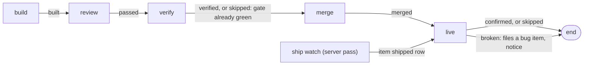

# Verify and live phases

- **Status:** agreed
- **Decision records:** [0019](../../decisions/0019-credential-scope-in-server-config.md)

boxxy gains the generic parts that let a rules file run a single-purpose agent after a merge, started once the merged commit ships: step gates that skip a step, wait kinds such as `shipped`, a ship watch that reads GitHub, per-repo policy, criterion tags, a `live` phase kind, and agents whose credentials the server config scopes. Only the `live` phase kind, the `notify: true` edge and the per-repo recipes are still to build. boxxy's code fixes no pipeline: the rules file composes these parts, and no module or lib names a phase, a tag or an environment.

The example rules file in [Contracts](#the-rules-file) composes them into the owner's pipeline, `triage → design → build → review → verify → merge → live`. In it the builder writes the journeys, a fresh verify agent alone grades them, and a live agent checks on prod only the acceptance lines tagged `prod`. Another rules file can use any of the parts, in any order, or none.

This doc uses the terms of the [core model](./core-model.md), [the pipeline](../../architecture/work/pipeline.md), [attempts](../../architecture/work/attempts.md), [agent sessions](../../architecture/work/sessions.md) and [review, verify and merge](./review-and-merge.md#terms). [Verify journeys](../../architecture/repo/verify-journeys.md) defines journeys, feature files, the path map and the `verify / gate` check, and [facts and pepys](../../architecture/interfaces/facts-and-pepys.md) covers pepys, the fact store that holds boxxy's reports.

## Shape

The example pipeline:



The diagram leaves out the send-backs of review, verify and merge, which [review, verify and merge](./review-and-merge.md) owns and this design keeps.

## Contracts

### The rules file

The rules file gains a `repos` section, a list of criterion tags and four step fields. The file below is the example: its steps, their order, the tag `prod`, the pools and the recipes are the owner's choices, and each one is data. Only the field names and the wait kind `shipped` come from boxxy.

```yaml
criterionTags: [prod] # the only tags an item's acceptance line may carry

repos:
  example/app: # shipped when the deploy tag holds the merge commit
    ships: { deploy-tag: { tag: deployed/prod } }
    recipes: { live: live-app-v1 } # replaces the kind's recipe for this phase, in this repo only
  example/lib: # shipped once a release holds the merge commit
    ships: { release: {} }
  example/service: # a release, then a deploy repo's bump of that release reaches its deploy tag
    ships: { release: {}, then: { repo: example/deploy, tag: deployed/prod/service } }
  example/notes:
    ships: none
  # a repo with no entry reads as `ships: none`

pipelines:
  build:
    - { phase: build, ... }
    - { phase: review, ..., on: { passed: next, ... } }
    - phase: verify
      skipWhen: [{ checkPassed: verify / gate }] # the gate already passes at the head: no feature to grade
      skip: next
      on: { verified: next, failed: { to: build, max: 2, resume: true }, blocked: { hold: blocked }, abandoned: again }
    - { phase: merge, ..., on: { merged: next, ... } }
    - phase: live
      criteria: { tagged: prod } # the session gets only these lines; with none, the step skips
      waits: [shipped] # claimable only once the ship watch records the merge commit shipped
      skip: { end: merged }
      maxAttempts: 2
      timeoutMinutes: 60
      on:
        confirmed: { end: live }
        broken: { end: live-broken, notify: true } # the close-out files a bug item
        blocked: { hold: blocked } # a line needs a write the agent lacks, or another question
        abandoned: again

kinds:
  bug:
    pipeline: build
    recipes: { build: build-bug-v1, review: review-run, verify: verify-v1, merge: merge-v1, live: live-v1 }

pools: # in claim order: an item in flight finishes before a new one starts
  - { name: merge, takes: { phase: merge } } # holds a `jobs` seat, never a `workers` one
  - { name: live, takes: { phase: live } }
  - { name: verify, takes: { phase: verify } }
  - { name: review, takes: { phase: review } }
  - { name: build, takes: { phase: build } }
  - { name: design, takes: { phase: design, designMode: agent } }
  - { name: triage, takes: { phase: triage } }

recipes:
  live-v1: { agent: boxxy, prompt: prompts/live-v1.md, ... } # no prod credentials: public endpoints only
  live-app-v1: { agent: app-live, prompt: prompts/live-v1.md, ... } # the agent whose broker profile holds example/app's prod credentials
```

A step's recipe resolves in this order, and the first match wins: the repo's `<phase>/attended`, the repo's `<phase>`, the kind's `<phase>/attended`, the kind's `<phase>`. `<phase>/attended` counts only for a design in attended mode.

### The server config

Built: [who holds a credential](../../architecture/work/sessions.md#who-holds-a-credential) describes `spawn.agents` and `spawn.phases.<phase>.requireScopedAgent`. The rules repository's CI check loads each rules pull request as the server does, so it gets a copy of `spawn.agents` and of the repo names in `spawn.repos`.

### Criteria tags

The tags are built: see [step gates and skips](../../architecture/work/pipeline.md#step-gates-and-skips). The triage and design prompts still need a line that says when to tag a line `prod`: when only the deployed system can prove it.

### Step gates, waits and the ship watch

Built: [step gates and skips](../../architecture/work/pipeline.md#step-gates-and-skips) covers the gates, the `waits` gate and the skip edge, and the [ship watch](../../architecture/work/ship-watch.md) covers `repos`, the `shipped` wait and the watch. `RepoPolicy` holds `ships` only; the `repos.<repo>.recipes` map in [the rules file](#the-rules-file) is not built.

### The live phase

```ts
// @boxxy/closeout: the live phase kind's input and close-out
interface LiveInput {
  pullRequest: PullRequestRef;
  commit: CommitSha;
  shipped: ItemShipped;
  criteria: readonly Criterion[]; // only the lines the step's `criteria.tagged` matches
}

type LiveCloseOut =
  | { outcome: 'confirmed'; lines: readonly LineResult[] }
  | { outcome: 'broken'; lines: readonly LineResult[]; bug: LiveBug }
  | { outcome: 'blocked'; reason: string } // the question for the owner
  | { outcome: 'abandoned'; reason: string };

// filed through the openItems effect, with a `relates-to` link to the checked item
interface LiveBug extends OpenItem {
  kind: 'bug'; // the parser refuses another kind
  acceptance: readonly { text: string; tags: readonly string[] }[]; // the failing lines, tags kept; OpenItem gains this field
}

interface LineResult {
  criterionId: CriterionId;
  passed: boolean;
  evidence: string; // stays in the item: never posted to the pull request
}
```

### Spawn

Built: the stored spawn request carries the item's `repo` and the attempt's `phase`, as [who holds a credential](../../architecture/work/sessions.md#who-holds-a-credential) describes.

## Constraints

### Who holds a credential

Built: [who holds a credential](../../architecture/work/sessions.md#who-holds-a-credential) and [the pipeline's recipes](../../architecture/work/pipeline.md#recipes-and-skills) describe the loader refusals, the worker check and the refusal of `spawn.reviewAgents`. A repo's own recipe for a phase, in `repos.<repo>.recipes`, is not built: when it is, the loader resolves it per repo in place of the kind's recipe, and checks it against the same scope.

### Gates and skips

Built, except the `notify: true` edge: see [step gates and skips](../../architecture/work/pipeline.md#step-gates-and-skips), [skipped attempts](../../architecture/work/attempts.md#skipped-attempts) and [the ship watch](../../architecture/work/ship-watch.md). The skip notice of the `shipped` wait is the `notify` notice kind, which a `notify: true` edge reuses ([notices](../../architecture/work/notices.md#the-notify-notice)).

### Verify, in the example rules

The example's build and verify prompts hold the first three rules. The last two hold for any rules file that skips its verify step on the gate.

- The build phase writes or changes the journey, the feature file and the path map for each feature it adds or changes, and runs `bun verify lint`. It records no verdict and publishes no report.
- Only the verify phase records verdicts and runs `bun verify publish`.
- The build and rework launch prompts say that `verify / gate` stays red until the verify phase runs, and that the builder leaves it.
- The verify step skips when the latest `verify / gate` check run at the head passed. The gate passes only when every changed feature has a fresh verdict, so a skip never merges an ungraded change.
- The wringer verifier reads a passed gate with no report as `verified` with no features: [what the merge step reads](../../architecture/repo/verify-journeys.md#what-the-merge-step-reads).

### The live phase kind

- The example live prompt runs `bun verify doctor --target prod`, then checks each line it got against the repo's prod target, read-only.
- When a line needs a write that the repo's QA guards don't allow ([what a repo gives its live agent](#what-a-repo-gives-its-live-agent)), the agent closes out `blocked` with the write it needs.
- A `broken` close-out files its bug through the existing `openItems` effect, with the failing lines and their tags, so the bug's own live step, when its pipeline has one, checks them again.
- `notify: true` on an edge writes a notice at settle without a hold.
- Live evidence goes into the item and the close-out, never into a pull request: the repos are public, and prod data is not.

### What a repo gives its live agent

- A prod target in its verify registry, with `access: 'read-only'` and `evidence: 'local'`.
- Any QA kit that writes to prod confines each write to a QA area and refuses outside it, as a guard in the repo's own scripts.
- Its prod credentials in its own vault, read by the broker profile of its scoped agent.

## Decisions

- **The example rules keep the shared `workers` limit of 7 agent sessions.** Verify and live add no limit of their own, and the example's pool order runs later phases first. Until the claim reads the worker target's free compute, the `workers` limit stands in for it.
- **The ship watch reads GitHub through the forge adapter, never pepys.** boxxy reads pepys only for reports, and that reader never retries. pepys also records no deploy for a repo that deploys its own code with no bump pull request.
- **Each repo's ship rule is data.** A deploy tag, a release, or a release then a deploy repo's tag cover the repos with no new workflow in any of them.
- **A failed live check ends the item and files a bug.** The item's pull request has already merged, so a fix needs a new pull request, and a new item keeps each item's cost and land time true in pepys.
- **The credential grant lives in the server config, and the agent choice in the rules file.** [0019](../../decisions/0019-credential-scope-in-server-config.md)

## Builder decides

- The names of the rejection kinds beyond those named here, and their messages.
- The live prompt's wording, and the triage and design prompt lines that set the `prod` tag.

## Out of scope

- Claims that follow the worker target's free compute. A separate work item builds that, with limits as optional lane caps.
- A per-item credential. Each scoped agent covers one repo and its listed phases.
- pepys reading `boxxy.item.shipped`. Its stage times keep reading GitHub's own release and deploy times.

## Open questions

- **How long an item waits to ship.** The owner settles it. Until then the wait has no limit.
