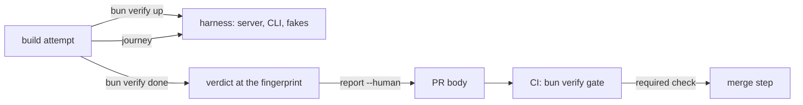

# wringer journeys on boxxy

- **Status:** draft

boxxy gets a verify CLI on [wringer](https://github.com/zgeoff/wringer), run as `bun verify`, with
three features to start: file an item, claim and settle an attempt, and report cost. The agent that
builds a change runs each changed feature's journey against boxxy on its own machine, records a
verdict, and puts the report in the pull request. A required CI check, the verify gate, fails a pull
request that changes a feature's files with no verdict for that code.

The sketches are in [`sketches/next/wringer-journeys/`](./sketches/next/wringer-journeys/): the
registry, the map and the three journeys in `01-usage.ts`, the harness contract in `02-types.ts`,
and the order of its steps in `03-flow.ts`. Where this doc and a sketch differ, the sketch stands.

## Shape



## The harness

`bun verify up` launches one Bun process, `scripts/verify/harness/main.ts`, which builds the parts
that the end-to-end system test builds, in the same way:

- the real server's two listeners on `createTestServer`, with the SQLite store in wringer's run
  folder, the example rules, and a skills repo in the run folder that the rules pin;
- the fake clock, worker, forge, caller proof and notifier of `createTestServer`;
- pepys under test, from `startPepysUnderTest`: the real ingest and query API in process.

The process serves two localhost listeners and prints one ready line: `boxxy`, the server's two
listeners behind the broker routing, and `control`, the routes for the steps that only the harness
can take. `HarnessReadyLine` and `ControlRoutes` in `02-types.ts` hold both.

- **Every owner and session step runs the real CLI as a process,** `bun apps/cli/src/main.ts`, with
  `BOXXY_URL` set to the `boxxy` listener. The broker routing sends a session or hook call to the
  worker listener with the worker token, and any other call to the owner listener, as a deployment's
  broker does. The harness sets the caller that the fake proof returns before each session's calls.
- **Time moves only when a step moves it.** No tick, watch or outbox send runs on a timer. A control
  route advances the clock, then runs one tick, one watch pass or one outbox drain. A journey reads
  the same numbers on every run.
- **Each `up` starts from nothing.** The store and the skills repo live in the run folder, and the
  fakes and pepys under test live in the process. `bun verify down` ends both.
- **Each journey files its own item.** The harness keeps the item that the last `file-item` or
  `land-item` filed, and a journey line names it as `@current`. Each opened pull request takes the
  next number. The three journeys run in any order on one run.
- **The harness reaches no network outside localhost.** It needs no atc, GitHub or deployed pepys,
  and no token, so it runs on the owner's machine and on a Linux CI runner after `bun install`.

The broker routing is the one part the harness adds to the system tests' parts. It moves out of
`createTestCLI` into its own export, `makeBrokerSend` in `@boxxy/system-tests/test-utils`, and
`createTestCLI` calls it, so the test and the harness route alike.

## The three journeys

Section D of `01-usage.ts` holds each journey as the `verify` skill's feature map holds it. Every
end state is a read command of the registry that runs the CLI and fails with `check-failed` when a
value differs from the one in the journey line, so a pass needs no judgement from the grader.

| Feature | The journey runs | It observes | A pass means |
| --- | --- | --- | --- |
| `file-item` | `item file` through the CLI | `item show` gives the item with its title | the owner's path from the CLI through the server to the store files and shows an item |
| `claim-settle` | `file-item`, then `run-session --close-out accepted`: one tick claims, the session-start hook binds, `attempt close-out` sends the triage body, the turn ends, two ticks settle | `item show` gives a triage attempt `succeeded` with the outcome `accepted` | `decide`, the claim, the start on the fake worker, the hook's bind, the close-out parse and the settle work together through the CLI and the server |
| `report-cost` | `land-item`: four sessions to a passed review, a pull request linked by the post-tool-use hook, the merge seen by the watch and sent to pepys as a signed webhook, two model requests, and an outbox drain | `cost` gives 2 requests and 3 USD; `times` gives a build of 30 minutes and a merge of 20 | the facts reach pepys through the outbox and the sink, and both reports come back from pepys through the server and the CLI |

A journey proves boxxy's own code. It never runs the worker, forge, caller-proof or notifier adapter,
because the fakes stand in for them. Each adapter's own tests cover it, and the worker and forge
contract suites run against both the adapter and its fake.

## The path-to-feature map

Section C of `01-usage.ts` holds the globs. wringer's gate fails a pull request on two causes: a
changed feature with no verdict at the current fingerprint, and a changed path that no feature maps
and no ignore glob matches. So every tracked path is in a feature or ignored.

| Paths | Features |
| --- | --- |
| `apps/cli/**`, `apps/server/**`, `libs/**`, `adapters/store-sqlite/**`, `modules/rules/**`, `modules/dispatch/**`, `modules/closeout/**`, `scripts/verify/**`, `system-tests/src/test-utils/**` | all three |
| `modules/planning/**` | `claim-settle`, `report-cost` |
| `packages/pepys/**` | `report-cost` |

The ignore list has four groups, each with its reason in the sketch:

1. Prose, tests and benches: `docs/**`, each `README.md`, `CHANGELOG.md` and `LICENSE`,
   `AGENTS.md`, `CLAUDE.md`, `**/*.test.ts`, `**/bench/**` and `system-tests/e2e/**`.
2. Build, lint and repo wiring that Bun never reads when it runs the source: the TypeScript, turbo,
   lint, format, commit and hook configs, `.claude/**`, `.github/**`, and the repo scripts outside
   `scripts/verify/`.
3. The files the repo's bots change: `**/package.json`, `bun.lock`, `.bun-version` and the two
   release-please files.
4. The four adapters to outside systems that no local journey reaches: `worker-atc`,
   `caller-proof-imp`, `notifier-atc` and `forge-github`.

The map keeps these rules:

- A package is in a feature when the feature's journey runs code in it. The harness runs the fakes
  in a package's `src/test-utils/`, so the whole package folder maps, its fakes included.
- `scripts/verify/**` maps to all three features. A change to the harness or a read command changes
  what a journey proves, so it needs fresh verdicts.
- An ignore glob never matches a source file that a journey runs. `**/*.md` stays off the list,
  because the rules' prompts are markdown that the server sends to each session.
- The package manifests are the one exception: a journey reads them, and the list ignores them so
  the bots' pull requests pass. A manifest change that alters behaviour, such as a new `exports`
  entry, comes with a source change in the same package, which maps.
- A new package fails the gate as unmapped until its pull request adds it to a feature or to the
  ignore list.
- A pull request from Renovate, release-please or repo-sync changes only ignored paths, so the gate
  passes with no verdict and no agent.

## The CI check

The gate runs in a workflow of its own, `.github/workflows/verify.yml`, with one job. `pr.yml` is
synced from zgeoff/tools and has no `edited` trigger. The shared `bun-checks.yml` runs gitleaks and
every static check of the repo beside the scripts it is given, so a body edit would rerun them all,
and their failures would turn the gate red. The job pins each action to the commit that
`bun-checks.yml` pins.

```yaml
name: Verify

on:
  pull_request:
    # `edited`: the gate reads the report from the body, which the grader writes after a push
    types: [opened, synchronize, reopened, edited]

concurrency:
  group: ${{ github.workflow }}-${{ github.ref }}
  cancel-in-progress: true

permissions:
  contents: read

jobs:
  verify-gate:
    runs-on: ubuntu-latest
    timeout-minutes: 5
    steps:
      - uses: actions/checkout@<sha> # v7.0.1
        with:
          fetch-depth: 0 # the fingerprint diffs against the merge base
          filter: blob:none
          persist-credentials: false
      - uses: oven-sh/setup-bun@<sha> # v2.2.0
        with:
          bun-version-file: .bun-version
      - run: bun install --frozen-lockfile
      - run: bun run --silent verify:lint
      - run: bun run --silent ci:verify-gate
```

- **Required check:** `verify-gate`, beside `pr / checks`. The job has no `if:` and no path filter,
  so it reports on every pull request. The slice that adds it is done only when the ruleset of
  `main` requires both checks.
- **What it runs:** `bun verify lint`, which fails on a glob that matches no file and on a journey
  line that would fail before it ran, then `ci:verify-gate`. That script writes the body from the
  event to a file, runs `bun verify gate --base origin/<base branch> --body-file <file>`, and prints
  one `::error::` annotation for each failing feature and each unmapped path (section D of
  `03-flow.ts`). Neither step starts boxxy.
- **Which commit:** the job checks out GitHub's merge ref, so the gate fingerprints the change as it
  would land on the base's tip. The fingerprint is a patch id with 3 lines of context, so it matches
  the grader's local verdict unless the base changed lines within 3 lines of the pull request's
  hunks. In that case the verdict reads stale, and the change is graded again.
- **Timeout:** 5 minutes, the floor for a job with no tests. The job installs and runs two commands
  of a few seconds each.

## Who grades, and the verdict flow

The build attempt grades its own work. The build recipe tells the agent to follow the repo's own
instructions, so boxxy's `AGENTS.md` carries the step and boxxy's core changes nothing:

1. Before it opens or updates its pull request, the build agent loads the `verify` skill and runs
   `bun verify report`. Each feature with `changed: true` needs a verdict.
2. It runs `bun verify up` and `bun verify doctor`, then each changed feature's journey and
   `bun verify done`.
3. It records one evidence per verdict with `boxxy attempt evidence --kind live-check`, the feature
   as the ref and the fingerprint as the observed value, and cites it in its close-out's criteria.
4. It runs `bun verify report --human`, and puts the output last in the pull request body's
   Verification section with `gh pr edit --body-file`, in place of an older report.
5. The `edited` event reruns the gate, which passes when every changed feature has a verdict at the
   fingerprint of the code.

- **A rework round grades again.** A review that asks for changes sends the item back to build, the
  kept session changes the code, and every verdict goes stale. The rework attempt runs steps 1 to 5
  again before its close-out.
- **A review attempt never changes the code,** so a passed review leaves the verdicts fresh.
- **A red gate after a passed review** comes from a base change near the hunks or a body edit. The
  merge step reads the red check and sends the item back, by the rule of the merge step's design.
- **The gate trusts the report it reads.** It recomputes the fingerprint and the changed features,
  but it cannot tell that a journey ran: a report block written by hand passes. The evidence files
  stay on the grader's machine, because the registry sets no upload hook.

A separate grader, a verify attempt after the review that loads only the `verify` skill, is the
challenger to this flow. It needs no change on this repo: the same CI check reads the same body. The
rules add it as a step, and the measurement of the two belongs to the `Verifier` port's design.

## What this design expects from the `Verifier` port

The port and the merge step that reads it are designed apart. This design needs one read from the
port, and the wringer adapter gets it from the required check that this doc wires:

```ts
// the core; the wringer adapter reads the check run `verify-gate` at the head through the forge
interface Verifier {
  readGate(pullRequest: PullRequestRef, head: CommitSha): Promise<VerifyGate>;
}

type VerifyGate =
  | { readonly kind: 'passed' }

  // the check failed; one line per failing feature or unmapped path, from the check run's
  // annotations, for the attempt that the merge step sends the item back to
  | { readonly kind: 'failed'; readonly failing: readonly string[] }

  // no finished check at this head yet
  | { readonly kind: 'pending' };
```

- The adapter reads the failing features from the annotations of the `verify-gate` check run, which
  the forge returns with no checkout.
- The grader needs nothing from the port: the build recipe and `AGENTS.md` start it.

## Constraints

- All three journeys pass on a machine with no network beyond localhost, after `bun install`. The
  check runs them in a network namespace with only the loopback interface up, such as one made by
  `unshare --map-root-user --net`.
- `runBoxxy` sets `BOXXY_SKILLS_URL` on every CLI call, because the session-start hook fetches from
  GitHub when the variable is unset.
- Each journey finishes in 60 seconds or less, the timeout of `land-item`.
- The harness process prints its ready line only after both listeners answer, and exits with code 1
  and the cause on stderr when a part fails to start.
- A control route answers 409 for a step whose state is wrong, and the registry turns the answer into
  `check-failed`. A route never retries.
- Only `scripts/verify/` imports `@wringer/*`, and the import-zones pins hold that edge.
- `.wringer/` is in `.gitignore`.
- The `verify` and `wringer` skills are the repo's own: `bunx @wringer/gunshi skill install` writes
  the `wringer` skill, and the repo writes the `verify` skill. The skills sync never delivers either.

## Decisions

- **The harness composes `createTestServer` in a launched process, with the fake clock.** The real
  `startServer` ticks every 5 seconds and watches every 5 minutes, so a journey on it waits on
  timers and reads different minutes on each run.
- **Each owner and session step runs the CLI as a process.** It proves the CLI's entry, its HTTP
  client and its stdin, which an in-process `runCLI` skips.
- **The map is by package, with three groups of features.** Every journey runs most of the server,
  so a split by file would mostly repeat the same globs and break on each new file.
- **The adapters no journey reaches are ignored, never mapped.** A mapped adapter would demand a
  verdict from a journey that never runs it.
- **The bots' files are ignored.** A dependency bump and a release merge on green CI. The system
  tests drive the same flow in CI on every pull request.
- **The gate runs in a job of its own, on the merge ref.** The shared checks workflow would run every
  static check again on each body edit, and a failure of one would read as a missing verdict.
- **The build attempt grades.** It changed the code and has the journeys at hand, and the challenger
  needs no change on this repo.

## Builder decides

- The names and layout of the files in `scripts/verify/` beyond the entry and the registry.
- The canned close-out bodies behind each preset, and the title and acceptance text `file-item`
  sends.
- The wording of each `check-failed` message.
- Whether the harness serves both listeners on one port with path prefixes.

## Out of scope

- A journey that runs a real adapter against its stand-in, such as the atc worker against the fake
  atc server. Each adapter's contract suite covers it.
- A read-only target on a deployed boxxy. The post-deploy checks are a later boxxy trigger.
- Uploading the evidence files. The registry's upload hook stays unset.
- The `Verifier` port, the merge step and the verify phase kind.

## Open questions

- **Which wringer release carries `.ignore(...)`?** The wringer release settles it. Until it
  ships, the verify CLI is not built.
