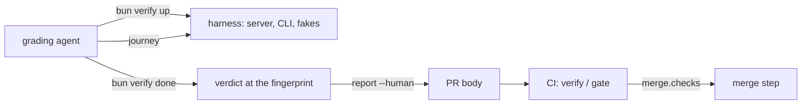

# wringer journeys on boxxy

- **Status:** draft

boxxy has a verify CLI on [wringer](https://github.com/zgeoff/wringer) 0.2.0, run as `bun verify`, with three features: file an item, claim and settle an attempt, and report cost. An agent grades a pull request on its own machine: it runs the journey of each feature that the pull request changes, against a local boxxy, and puts the report in the pull request's body. A CI check, `verify / gate`, fails a pull request that changes a feature's files with no fresh verdict for that feature, and boxxy's merge step waits for it through `merge.checks` in the rules file.

wringer's terms, as this doc uses them:

- The **registry** is the TypeScript object, built with wringer's `createWringer()`, that lists what `bun verify` can do: the target it launches, the actions that change state, the read commands, the doctor check and the features.
- A **journey** is the list of `bun verify` lines that exercise one feature, each a call of an action or a read command. The last line is a read, with the value it expects as an argument.
- A **verdict** is what `bun verify done` records when a journey passes: the feature and the fingerprint of the code it ran on. wringer keeps the verdicts, and the evidence files of each run, in `.wringer/` on the grader's machine.
- The **fingerprint** is a patch id of the branch's change against the merge base with `main`. Any edit to a feature's paths changes it, and the feature's verdict goes stale.
- The **report** is the block that `bun verify report --human` prints: each feature, whether the change touches its paths, and its verdict. The gate reads it from the pull request's body.

boxxy's own terms come from these docs:

- an item, its attempts and their phases: the [core model](./core-model.md);
- the runner's tick, one pass that claims, reads and settles attempts: the [attempt lifecycle](./v1-lifecycle.md);
- a close-out, the structured result a session sends at the end of its attempt: [close-outs](./close-outs.md);
- the outbox, the store's queue of facts for pepys, and pepys, the service that stores the facts and serves the cost and time reports: [facts and pepys](./v1-facts-and-pepys.md).

The sketches are in [`sketches/next/wringer-journeys/`](./sketches/next/wringer-journeys/): the registry, the map and the three journeys in `01-usage.ts`, the harness contract in `02-types.ts`, and the order of its steps in `03-flow.ts`. Where this doc and a sketch differ, the sketch stands.

## Shape



## The harness

The verify CLI, its registry, its map and the harness live in `system-tests/src/test-utils/verify/`, a test helper folder of `@boxxy/system-tests`. `chex test-layout` lets only a test or a test helper import a package's `test-utils` entry, and the harness imports four of them. The root `verify` script runs the CLI from there.

`bun verify up` launches one Bun process, `verify/harness/main.ts` in that folder, the harness. It builds the same parts as the end-to-end system test `journey-item-to-merge`, in the same way:

- the real server, composed by `createTestServer` with the SQLite store, the example rules, and a skills repo: a local git repo of skills that the rules pin and that the session-start hook reads;
- the fake clock, worker, forge, caller proof and notifier that `createTestServer` passes in, where a deployment passes the atc, GitHub and imp adapters;
- pepys under test, from `startPepysUnderTest`: the real ingest and query API, in the same process.

The store and the skills repo live in wringer's run folder, which wringer makes new for each `up`. `bun verify down` stops the process, so the next `up` starts from an empty store.

The real server has two listeners: the owner listener for owner calls, and the worker listener for session and hook calls, which a worker token guards. A deployment puts a broker in front of them, which sends each call to the right listener and adds the token. The harness serves two listeners of its own on localhost, and prints one ready line with both URLs:

- `boxxy`: the broker routing, in front of the server's two listeners;
- `control`: the routes for the steps that only the harness can take, such as moving the clock.

`HarnessReadyLine` and `ControlRoutes` in `02-types.ts` hold both. The system test routes calls this way inside `createTestCLI`. The routing moves to a new function, `makeBrokerSend`, exported from `@boxxy/system-tests/test-utils`, and both `createTestCLI` and the harness call it.

- **Every owner and session step runs the real CLI as a process,** `bun apps/cli/src/main.ts`, with `BOXXY_URL` set to the `boxxy` listener. `runBoxxy`, the registry's helper for this, parses the CLI's JSON output with a schema. Before each session's calls, the harness sets the caller that the fake caller proof returns. The caller proof is the identity the server reads from a call, which a deployment gets from imp.
- **Time moves only when a step moves it.** No tick, pull request watch or outbox send runs on a timer. A control route advances the fake clock, then runs one tick, one watch pass or one outbox drain. A journey reads the same numbers on every run.
- **Each journey files its own item.** The harness keeps the item that the last `file-item` or `land-item` action filed, and a journey line refers to it as `@current`. Each pull request that the fake forge opens takes the next number. The three journeys run in any order after one `up`. When a journey sets the current item, the harness closes the item before it, so no tick claims work for an old item. The minutes that a control route takes count from the day the current item was set.
- **The doctor check calls `GET /control/health`.** The route sends a status call through the broker routing and asks pepys under test for a stage time. A doctor check runs no process, so it cannot run the CLI.
- **The harness reaches no network outside localhost.** It needs no atc, GitHub or deployed pepys, and no token.

## The three journeys

Section D of `01-usage.ts` holds each journey as the `verify` skill's feature map holds it. Each journey ends in a read command, which runs the CLI and fails with `check-failed` when a value differs from the one in the journey line. The grader judges nothing.

The journeys call these actions of the registry:

- `file-item` files an item through the CLI.
- `run-session` runs one attempt of the current item: a tick claims it, the session-start hook binds the session, the session sends the canned close-out of the chosen preset, the turn ends, and two ticks settle the attempt.
- `land-item` files an item and runs it to a merge: sessions for triage, design, build and review, a pull request that the post-tool-use hook links, the merge that the watch sees, one model request in the build and one in the review, and an outbox drain to pepys.

| Feature | The journey runs | It reads |
| --- | --- | --- |
| `file-item` | `file-item` | `item show`: the item and its title |
| `claim-settle` | `file-item`, then `run-session` with the close-out `accepted` | `item show`: a triage attempt `succeeded` with the outcome `accepted` |
| `report-cost` | `land-item` | `cost`: 2 requests and 3 USD; `times`: a build of 30 minutes and a merge of 20 |

A pass proves this much:

- `file-item`: the owner's path through the CLI and the server to the store files an item and shows it.
- `claim-settle`: dispatch's `decide`, the claim, the start on the fake worker, the hook's bind, the close-out parse and the settle work together.
- `report-cost`: the facts reach pepys through the outbox, and both reports come back from pepys through the server and the CLI.

A journey proves boxxy's own code. The fakes stand in for the worker, forge, caller-proof and notifier adapters, so a journey never runs them.

## The path-to-feature map

Section C of `01-usage.ts` holds the globs. wringer's gate fails a pull request on a changed feature with no verdict at the current fingerprint, or on a changed path that no feature maps and no ignore glob matches. So every tracked path is in a feature or ignored. The registry passes the ignore globs to `.ignore(...)`. wringer counts a path that an ignore glob matches as no change, in the changed paths and in the fingerprint, even when a feature's glob matches it too.

| Paths | Features |
| --- | --- |
| `apps/cli/**`, `apps/server/**`, `libs/**`, `adapters/store-sqlite/**`, `modules/{rules,dispatch,closeout}/**`, `system-tests/src/test-utils/**` | all three |
| `modules/planning/**` | `claim-settle`, `report-cost` |
| `packages/pepys/**` | `report-cost` |

The ignore list's groups, each with its reason in the sketch:

1. Prose, tests and benches: `docs/**`, each `README.md`, `CHANGELOG.md` and `LICENSE`, `AGENTS.md`, `CLAUDE.md`, `**/*.test.ts`, `**/bench/**` and `system-tests/e2e/**`.
2. Build, lint and repo wiring that Bun never reads when it runs the source: the TypeScript, turbo, lint, format, commit and hook configs, `.claude/**`, `.github/**`, and `scripts/**`.
3. The files that Renovate and release-please change: each `package.json`, `bun.lock`, `.bun-version`, `.release-please-manifest.json` and `release-please-config.json`.
4. Code that no journey runs: the adapters behind the fakes, the public door's `adapters/auth-oauth` among them, and the server's own start, config, timers and rules loader, which the harness replaces with `createTestServer`. The system test `start-server-atc-spawn`, each adapter's tests and contract suite, and the [live proof](./v1-work-list.md#22-the-live-proof) cover them.

The map keeps these rules:

- A package is in a feature when the feature's journey runs code in it. The harness runs the fakes in a package's `src/test-utils/`, so the whole package folder maps, its fakes included.
- A change to `system-tests/src/test-utils/**`, the verify CLI and the harness among it, needs fresh verdicts of all three features, because it changes what a journey proves.
- An ignore glob never matches a source file that a journey runs. `**/*.md` stays off the list, because the rules' prompts are markdown that the server sends to each session.
- The dependency files are the one exception. A patch or minor update merges on green CI with no verdict. A major bump of a third-party package, or a new Bun version, gets the owner's standing review for major bumps, and the system tests in CI run the same flow as the journeys.
- A new package fails the gate as unmapped until its pull request adds it to a feature or to the ignore list.

## The CI check

The gate runs as the check `verify / gate`, in a workflow of its own, `.github/workflows/verify.yml`:

```yaml
name: verify

on:
  pull_request:
    # `edited`: the grader writes the report into the body after the push
    types: [opened, synchronize, reopened, edited]

concurrency:
  group: ${{ github.workflow }}-${{ github.ref }}
  cancel-in-progress: true

permissions:
  contents: read

jobs:
  gate:
    name: verify / gate
    runs-on: ubuntu-latest
    timeout-minutes: 5
    steps:
      - uses: actions/checkout@<sha> # v7.0.1
        with:
          fetch-depth: 0 # the fingerprint reads the merge base
          filter: blob:none
          persist-credentials: false
      - uses: oven-sh/setup-bun@<sha> # v2.2.0
        with:
          bun-version-file: .bun-version
      - run: bun install --frozen-lockfile
      - run: bun run --silent verify:lint
      - run: bun run --silent ci:verify-gate
```

- The job has no `if:` and no path filter, so it reports on every pull request. boxxy's merge step waits for a check that never reports until its time limit, and then holds the item.
- The gate has a workflow of its own because `pr.yml`, which repo-sync copies from zgeoff/tools, has no `edited` trigger. The shared `bun-checks.yml` that `pr.yml` calls runs every static check, so a body edit there would rerun them all.
- The job pins each action to the commit that `bun-checks.yml` pins.
- `bun verify lint` fails on a glob that matches no file, and on a journey line that calls no command of the registry.
- `ci:verify-gate` writes the body from the event to a file, then runs `bun verify gate --base origin/main --body-file <file>`. It prints one `::error::` annotation for each failing feature and each unmapped path (section D of `03-flow.ts`). Neither step starts boxxy or runs a journey.
- The job checks out GitHub's merge ref, so the gate fingerprints the change as it would land on the tip of `main`. The patch id uses 3 lines of context. A change to `main` within 3 lines of the pull request's hunks makes the verdict read stale, and the change is graded again.
- The timeout is 5 minutes, the floor that the repo's CI rules set for a job with no tests.

## Who grades

The `verify` phase of boxxy's pipeline grades. It runs after the review and before the merge. The [review and merge design](./review-and-merge.md#the-verifier) owns the phase and its recipes, including the choice between the builder's [kept session](./v1-lifecycle.md#the-kept-session) and a fresh one. This doc owns what the grading agent does:

1. Load the `verify` skill and run `bun verify report`. Each feature with `changed: true` needs a verdict.
2. Run `bun verify up` and `bun verify doctor`, then each changed feature's journey and `bun verify done`.
3. Run `bun verify report --human`, and put the output last in the body's Verification section with `gh pr edit --body-file`, in place of an older report.
4. Close out `verified` when every changed feature has a verdict, or `failed` with the features whose journey failed.

The `edited` event reruns the gate. The grader never changes the code, so the head the review passed stays the head the merge reads.

- An agent that opens a pull request outside boxxy takes the same steps before it hands off. `AGENTS.md` holds them.
- A rework after a failed verify or a review sends the item back to build. The new head makes every verdict stale, and the `verify` phase grades again.
- The gate trusts the report. It recomputes the fingerprint and the changed features, but it cannot tell that a journey ran, so a report written by hand passes.

## What this design gives the `Verifier` port

The [review and merge design](./review-and-merge.md#the-verifier) owns the port, `Verifier.readAt(pullRequest, head)`, and its `VerifyReading`. The wringer adapter fills the reading through the forge, from the `verify / gate` run at the head and the report in the pull request's body:

- `verified` when the gate run succeeded, and `incomplete` when it failed;
- each feature and its status (`verified`, `stale`, `missing` or `unchanged`) from the report;
- `not-covered` when no gate run at the head has finished, or the body has no report.

An unmapped path fails the gate while every feature reads `verified`. The reading is then `incomplete`, and the run's annotation holds the path.

## Constraints

- All three journeys pass on a Linux machine with no network beyond localhost, after `bun install`. The slice that builds the harness proves it by running the journeys in a network namespace with only the loopback interface up, such as one made by `unshare --map-root-user --net`.
- `runBoxxy` sets `BOXXY_SKILLS_URL` on every CLI call, because the session-start hook fetches from GitHub when the variable is unset.
- Each journey finishes in 60 seconds or less. `land-item`, the longest step, has a timeout of 60 seconds.
- The harness prints its ready line only after both listeners answer. When a part fails to start, it exits with code 1 and the cause on stderr.
- A control route answers 409 for a step whose state is wrong, and the registry turns the answer into `check-failed`. A route never retries.
- Only `@boxxy/system-tests` imports `@wringer/*`, and the import-zones pins hold that edge.- `.wringer/` is in `.gitignore`, and the registry sets no upload hook, so the evidence files never leave the grader's machine.
- The repo owns the `verify` and `wringer` skills: `bunx @wringer/gunshi skill install` writes the `wringer` skill, and the repo writes the `verify` skill. The skills sync never delivers either.

## Decisions

- **The harness composes `createTestServer` in a launched process, with the fake clock.** The real `startServer` ticks every 5 seconds and watches every 5 minutes, so a journey on it waits on timers and reads different minutes on each run.
- **Each owner and session step runs the CLI as a process.** It proves the CLI's entry, its HTTP client and its stdin, which an in-process `runCLI` skips.
- **The map is by package.** Every journey runs most of the server, so a map by file would repeat the same globs and break on each new file.
- **Code that no journey runs is ignored, never mapped.** A mapped path would demand a verdict from a journey that never runs it.
- **The dependency files are ignored.** A mapped lock file would make every update bot's pull request wait for an agent's verdict, and a major bump gets a review.
- **The gate runs in a job of its own, on the merge ref.** The shared checks workflow would rerun every static check on each body edit.

## Builder decides

- The names and layout of the files in `system-tests/src/test-utils/verify/` beyond the entry and the registry.
- The canned close-out bodies behind each preset, and the title and acceptance text that `file-item` sends.
- The wording of each `check-failed` message.
- Whether the harness serves its two listeners on one port with path prefixes.

## Out of scope

- A journey that runs a real adapter against its stand-in, such as the atc worker against the fake atc server. Each adapter's contract suite covers it.
- A read-only target on a deployed boxxy.
- Uploading the evidence files.
- The `Verifier` port, the `verify` phase and the merge step.
